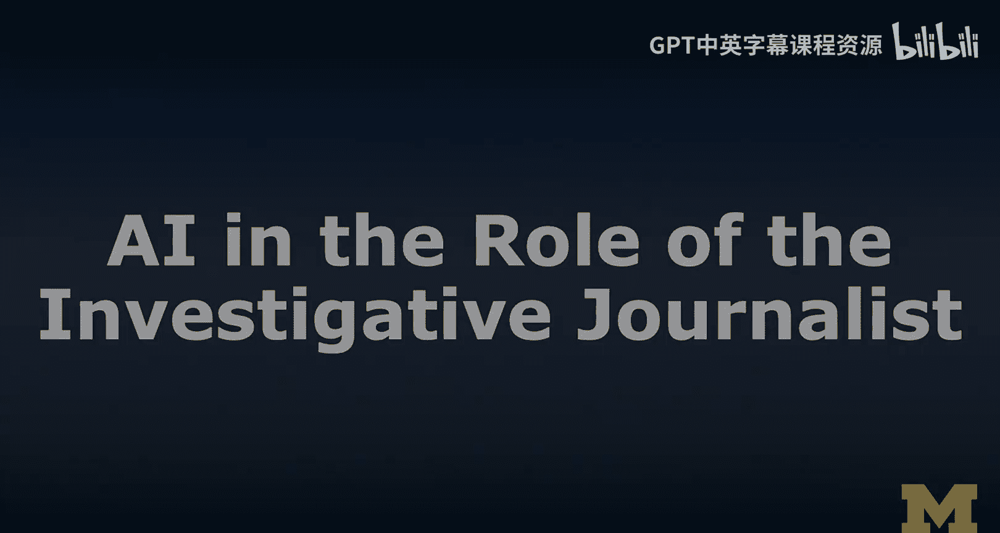
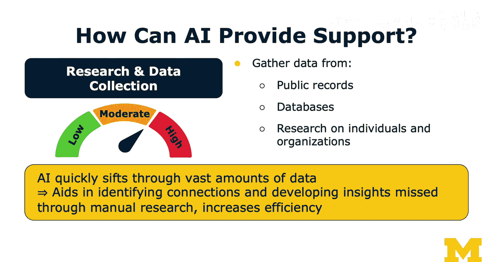
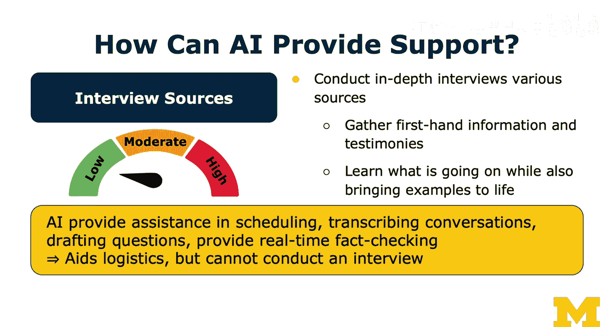
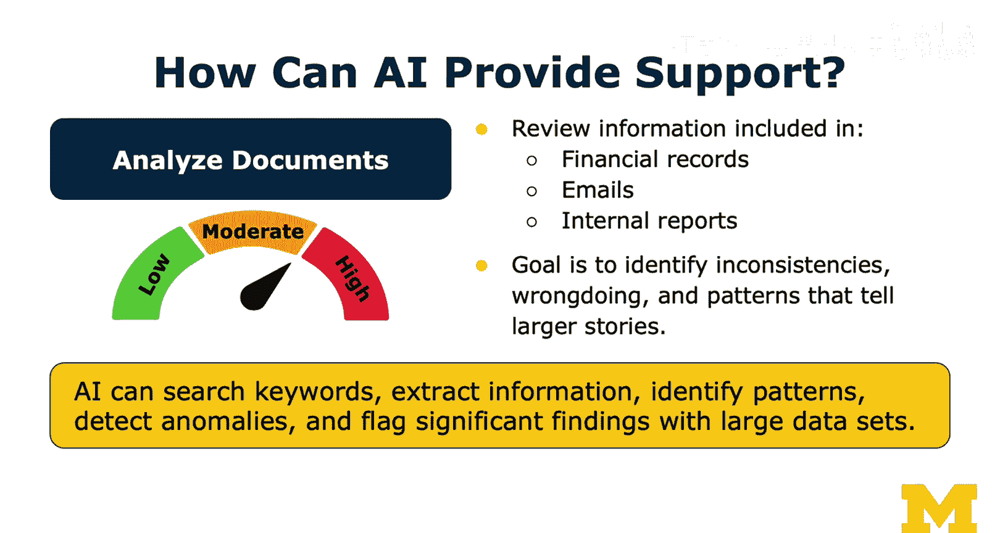
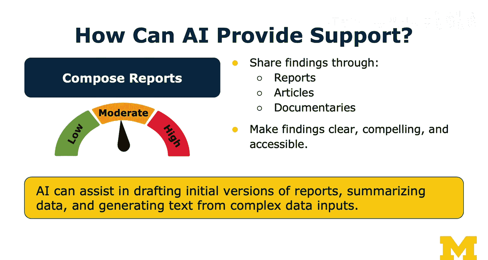
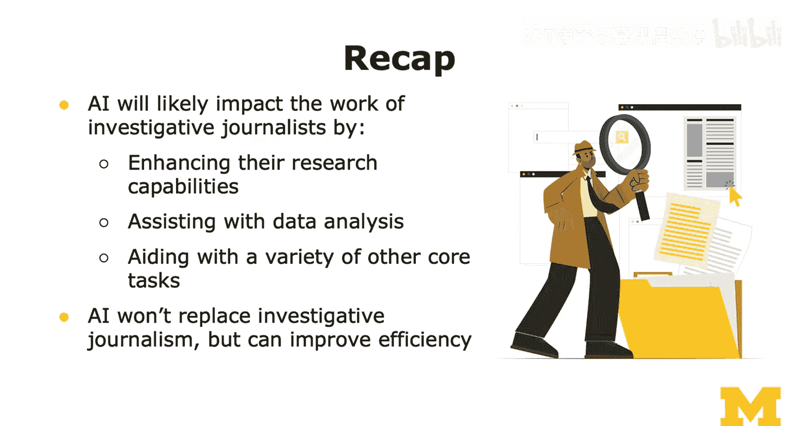

# 密歇根大学《应对颠覆：工作场所的生成式人工智能｜Navigating Disruption： Generative AI in the Workplace》 - P15：3_人工智能在调查记者角色中的应用.zh_en - GPT中英字幕课程资源 - BV159uyztEfn

One of the critical roles in the newsroom is filled by investigative journalists。

Investigative journalists are professionals who dig deep into stories to uncover facts that are often hidden from the public eye。

Their work is essential to checking political institutions to maintain a functioning democracy and bringing transparency and accountability to various sectors。

They uncover truths， and hold power accountable。Investigative journalists generally conduct a series of practices。

Ranging from research and data collection to interviewing sources。Analyzing documents。

 checking facts and producing their own reports on what they've discovered。

They spend a significant amount of time gathering data through public records， databases。

 and background research on individuals and organizations。

They conduct in depth interviews with various sources from whistleblowers to experts in order to gather first hand information and testimonies that will help them to learn about what's going on and to bring their examples to life。

They analyze documents such as financial records， emails。

 or internal reports to identify inconsistencies， to find evidence of wrongdoing or to gather patterns that might tell a larger story。

They meticulously fact check and verify information。From their sources。

To uphold the integrity of their reporting。And finally。

 investigative journalists compile those findings into reports， articles， and documentaries。

That present that information to the public in a clear， compelling and accessible way。

So how exposed are investigative journalists to AI when it comes to their research and data collection role。

 there's potentially moderate to high exposure in a variety of aspects。

 artificial intelligence can aid in research by quickly sifting through vast amounts of data and identifying information relevant to particular questions。

Natural language processing tools can help journalists find connections and develop insights that might be missed through manual research。

 or that may take considerably more time。

However， AI does not make the human role irrelevant here。

And this data collection still requires human oversight to ensure that the context and relevance of what's identified by AI fits the narrative that the investigative journalist is investigating and is hoping to tell。

So what we see here is a role shift where AI may change the role of an investigative journalist by reducing the work of finding the initial information and increasing the time devoted to evaluating its quality。

 What role can AI play in interviewing sources。

Here， the exposures to AI are somewhat lower。AI might be able to provide some background assistance such as scheduling or transcribing the conversations。

 drafting interview questions， or providing real time background information and fact checking。

But AI cannot directly conduct an interview， at least not very well。

The nuanced understanding and emotional intelligence required to conduct effective interviews remains inherently human。

At least at this point in time。So we can say that the exposure here is lower。

 and although AI will potentially augment the task。

 it will not in any substantive way replace the need for human labor or shift it。

How about analyzing documents here， AI might be quite effective。

So we can say there's probably moderate to high exposure to AI。

AI tools can search for keywords and extract relevant information to particular questions。

 speeding up the task of recognizing patterns， detecting anomalies。

 and flagging significant information within large dataset sets。

 whether those data sets are quantitative or qualitative。

Comprised of a large variety of text from sources like annual meeting records。

 machine learning algorithms can identify trends in the data。

 potentially shifting the human journalists role。

Again， like data collection and research in the initial stage。

 the role of AI will largely shift what an investigative journalist does。

Instead of analyzing the data in the first place， their role may consist more of interpreting what AI has identified。

 placing it in a broader context and verifying what's going on。In this case。

 it could make the task of identifying key developments and changes easier。

 Another place that investigative journalists invest a lot of effort is in checking information and verifying。

This is also an area that sees moderate exposure to AI。

AI may automate certain aspects of fact checking by cross referencing data against trusted databases and sources。

 or by identifying what data sources are helpful in the first place。But again。

 human judgment is crucial in distinguishing nefarious activities from coincidental correspondences。

 especially in complex or sensitive cases。Investigative journalists will be needed for these tasks。

 although the AI tools can meaningfully augment their work。Finally， in writing and reporting。

 AI can assist investigative journalists in drafting initial versions of reports and articles。

 summarizing data and generating text based on complex data inputs that would have been impossible for computers in the past here again。

 story telling， ethical considerations and crafting compelling narratives still requires some amount of human creativity and judgment。

While AI might help moderately with the initial drafting of the writing。

It's more likely to result in a mix of replacement， augmentation， and role shifting。

 with journalists continuing to play a significant role throughout the writing process。

When we look at a role like an investigative journalist。

 we should ask what kinds of impacts are AI tools going to have across the duties that an investigative journalist might have。

For many of these， AI is likely to have an influence。 It can augment。

 sometimes replace and frequently shift the work of an investigative journalist。

By enhancing their research capabilities， assisting with data analysis and aiding them with a variety of other core tasks。

But it's not going to be able to do all of it。It won't be able to conduct an interview and understand the nuances of true wrongdoing without relying heavily on human skills。

Nonetheless， investigative journalists may be encouraged to leverage artificial intelligence as a tool to enhance the efficiency and depth of their investigative journalism。

 What this means depends on whether collectively this enhances investigative journalist's ability to focus on the human aspects of their profession that AI can't replicate。

As well as how the job of investigative journalism may change with the integration of AI。

