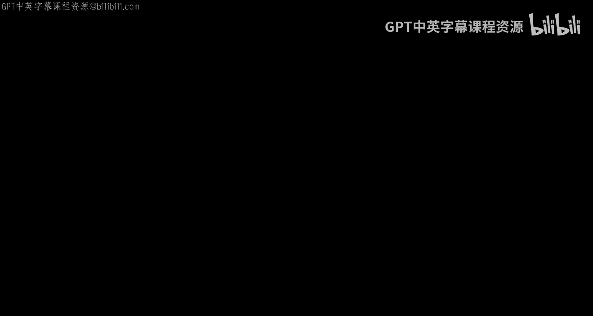
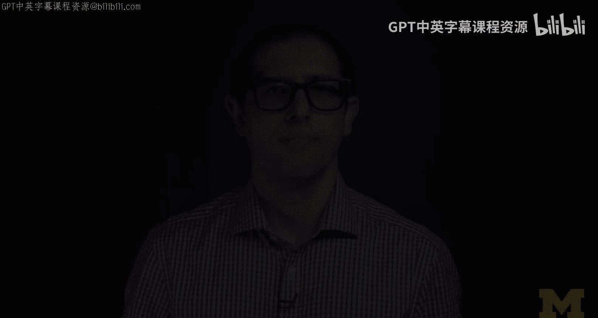
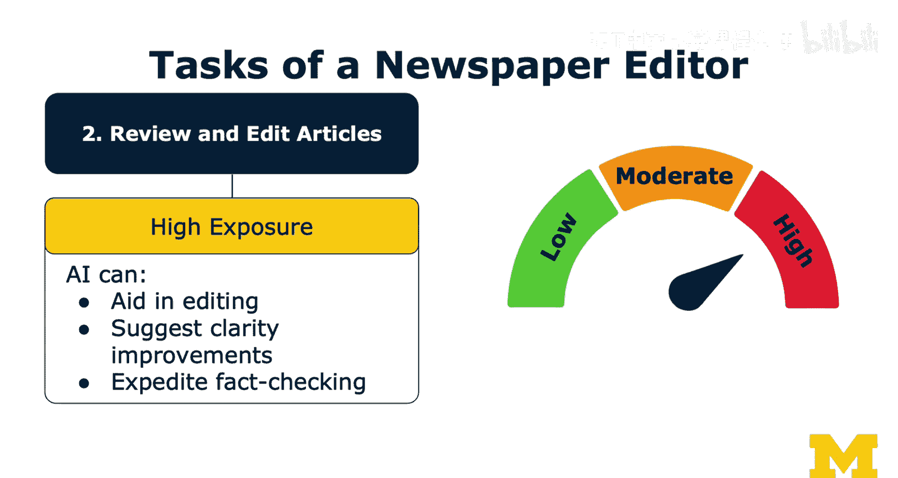
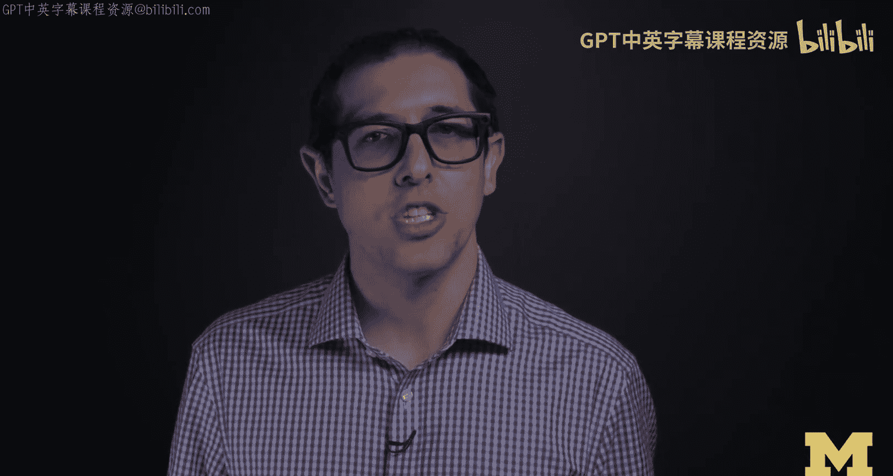
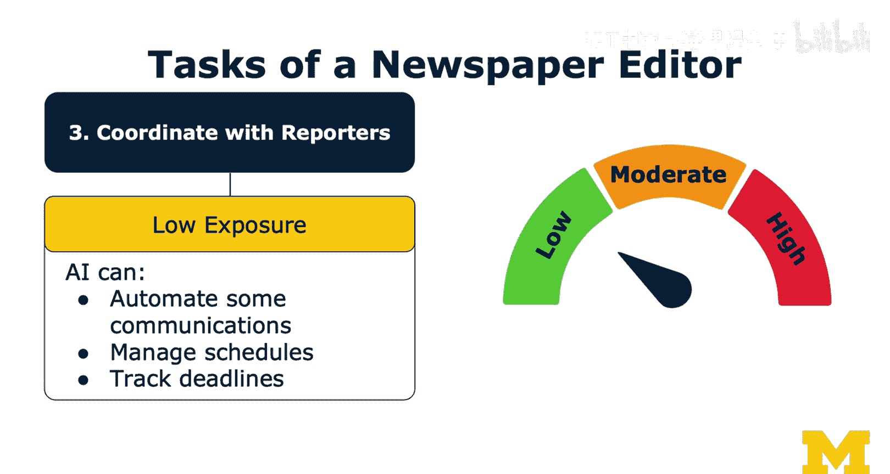
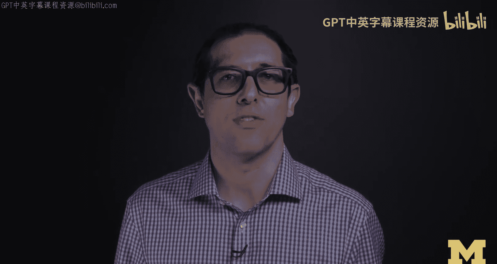
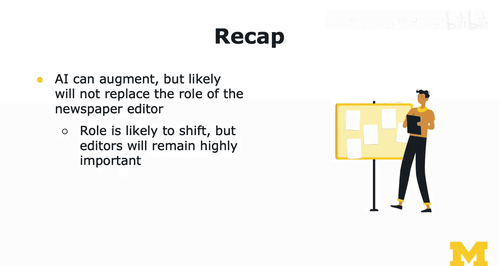
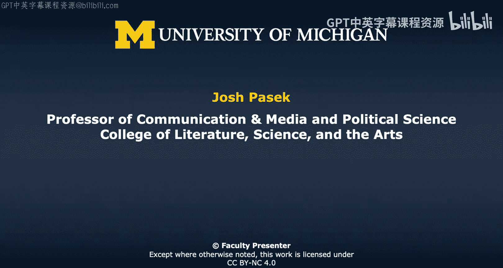

# 密歇根大学《应对颠覆：工作场所的生成式人工智能｜Navigating Disruption： Generative AI in the Workplace》 - P16：4_人工智能助力新闻编辑.zh_en - GPT中英字幕课程资源 - BV159uyztEfn

Let's take on another role， newspaper editors。Newspaper editors are the key gatekeepers of the news。

 They are responsible for ensuring that the content published is accurate， engaging and relevant。

Their role is vital in maintaining the quality and integrity of journalism。

 effectively carrying the news from the journalists who create it to the actual publication where it gets produced and disseminated。

So what are the tasks of a newspaper editor？Well， the first thing they need to do is content selection and planning。

Editors get together and decide which stories to cover and plan how that content will be laid out for the print and digital editions of newspapers。

They assess the newsworthiness of different events and ensure a balanced mix of content that covers various areas。

 such as local versus national news。Next， they review and edit the articles， assessing clarity。

 accuracy and coherence。This includes checking for grammatical errors and factual inaccuracies。

 as well as ensuring that the content matches the publication's style guide。

 Editors also conduct an additional series of fact checking。

 verifying the information presented in articles by cross referencing sources。

This is critical for maintaining the publication's credibility with the public。

Editors also coordinate with reporters。 They provide guidance on story development， offer feedback。

 and ensure that deadlines are met。As the pieces of a newspaper come together。

 they're responsible for the final approval and publication of that product。

This involves approving the content before it's published。

 as well as making last minute adjustments that may be necessary to accommodate late breaking events。

Finally， editors oversee the layout and design for the print and digital editions。

How exposed are these different roles to artificial intelligence？

Content selection and planning have lowed to moderate exposure to AI。

AI can assist editors by analyzing data sets like viewership data and suggesting what might resonate with the outlet's target audience。

Algorithms can also identify trending topics on social media， for instance。

 to determine what other kinds of content might be worth investigating or to predict what kinds of stories would perform well。

 But functionally， the question of what a newspaper revolves around。Covers timeliness and importance。

And that is a fundamentally human decision。One of the challenges with artificial intelligence is that AI is mostly trained with older data。

 not day to day developments。Therefore， although AI can provide useful information for brainstorming content。

It necessarily lacks the full context of the contemporary moment。

And therefore plays an augmenting role at best。Editorial judgment is needed to maintain a balanced and ethical approach to news。

 ensuring that important news is reported， not just what's trending。

And that is essentially a human responsibility。When it comes to reviewing and editing articles。

 there is potentially a high exposure to artificial intelligence。

Artificial intelligence tools can significantly aid in editing by automatically identifying and correcting grammar errors such as inconsistent tenses。

 spelling issues， and syntax errors。AI can also suggest improvements in clarity and coherence。

 potentially replacing much of the manual work editors previously did。

 so this is a high exposure domain。However， that doesn't mean human editors have no role at all。

Human editor's roles will be shifted， but their efforts may be increasingly focused on making more nuanced editorial decisions and maintaining the publication's voice and style。

What about fact checking？Well， as we discussed with investigative journalists。

 AI can have a sizable role in the fact checking exercise by cross referencing information against verified databases and assessing potential inaccuracies and the like。

There are some risks here， though。If journalists and editors rely on the same AI tools for fact checking。

Errors introduced or missed by those tools can lead to inaccuracies slipping through。

Human judgment remains critical in evaluating the information that comes in and verifying complex and ambiguous information to ensure that the final output is of high quality and newsworthy。

AI in this context is likely to augment， but not replace human labor。

The process of coordinating with reporters is a lower exposure task。

 AI may augment this role and conduct some automation of contacts， but functionally。

 managing schedules and tracking deadlines reflect only a small component of the editor reporter coordination。

The mentorship， feedback and nuanced guidance provided by editors to reporters are deeply human tasks。

 and AI may be able to assist with them， but is unlikely to fully replicate them。So here again。

 we see some augmentation， but it's limited。 Finally。

 editors have a role in the final approval and publication of the news。

Here the potential role of AI is low to moderate。AI can assist with final checks for consistency and completeness and can even help to optimize layout designs based on reader preferences。

But the final decision making， ethical considerations and determining the importance of content remain quintessentially human again。

 in the role of an editor， AI can augment but can't really replace what an editor does。

There's considerable potential for AI to enhance the efficiency of newspaper editors。

 particularly in editing and fact checking roles。However， many aspects of what newspaper editors do。

Making editorial judgments， mentoring and managing reporters， approving content。

 and recognizing and highlighting important news still require human skills and intuition。

And so again， we see a case where the role may shift with the integration of AI。

 but editors are still likely to remain highly important， even as AI integrates into the newsroom。

