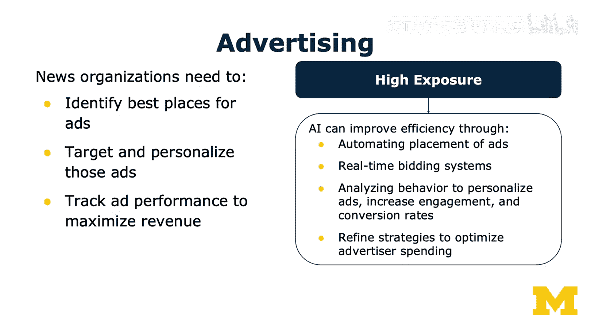
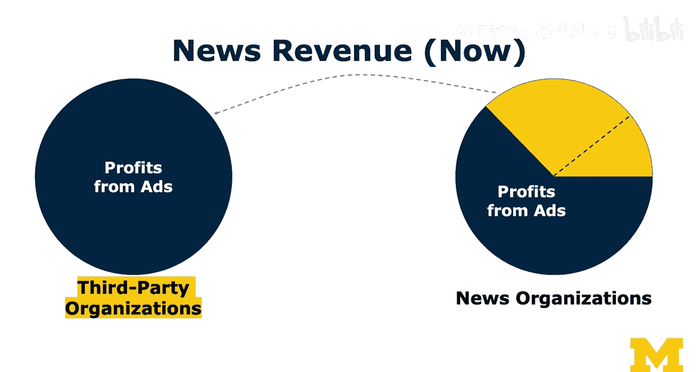
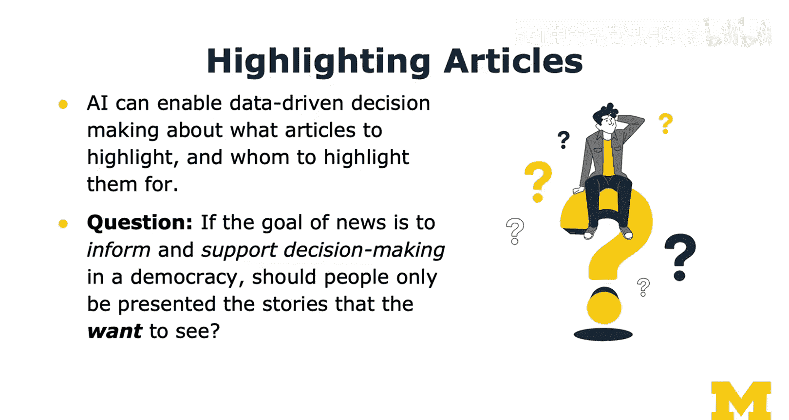

# 密歇根大学《应对颠覆：工作场所的生成式人工智能｜Navigating Disruption： Generative AI in the Workplace》 - P17：5_后台运作中的人工智能.zh_en - GPT中英字幕课程资源 - BV159uyztEfn

As we think about the role of AI in news， perhaps where AI is the most relevant to how news is generated and assessed is in the back end of news organizations。

Here， questions revolve around advertising， revenue and printing。

 all areas where AI is most likely to play a significantly increased role。

So what else happens in a newsroom beyond journalism and editing？To keep news organizations afloat。

 someone needs to manage and optimize advertising。News outlets need to identify the best places to place ads to maximize revenue。

Advertising teams need to target and personalize ads to reach specific audience segments and track ad performance to maximize revenue。

This is a high exposure area for AI。Artificial intelligence has enormous ability to make advertising more efficient through automated placements and real time bidding systems。

AI algorithms can analyze user behavior and preferences to personal ads。

 increasing engagement and conversion rates。AI driven analytics tools also provide much more detailed performance reports。

 helping to refine strategies and optimize advertiser spending。

While AI can handle a lot of this work， newspapers， at least to date。

 have not really gained the benefits of AI's ability in advertising。

This is largely because AI driven advertising processes are largely controlled by a few big tech companies that dominate the online advertising space。

Because these companies use data that newspapers do not have access to and employ sophisticated AI tools already。

The effect of this development is that newspapers have largely outsourced advertising。

 Adv placements used to be the primary driver of revenue for news organizations。

But the fact that this process has largely been handed over to third parties has been a major hit on newspaper profits in the contemporary era。

In large part， because of the drop in advertising returns。

 the revenue models for newspapers increasingly depends on subscriptions。

Asking individuals to subscribe to newspapers in recent years。

Even to access digital stories is necessary because the revenue model from advertising is not holding newspapers afloat in the way it used to。

Determining how to price and encourage subscriptions to news organizations has therefore become an increasingly important backend task。

And one that is also largely exposed to AI。While the days of calling phones to drum up subscriptions to newspapers were gone even before the AI era。

Artificial intelligence is changing this arena as well。

AI can assist newspapers in identifying effective pricing models and optimizing strategies that may be more efficient for news organizations。

 such as helping them determine when a paywall should or shouldn't be presented。But so far。

 the process of encouraging individuals to pay for news has only been partially effective and has not replaced the value that news organizations had even from paper subscriptions in prior eras。

Therefore， these marginal distinctions that AI help to optimize may not be enough to make up for the challenges of the contemporary newspaper revenue model。

There are also strategies that AI may encourage that can be a mixed bag for newspapers。 For instance。

 AI enables newspapers to engage in more data driven decision making about what articles to highlight and to whom。

But whether it's ideal for newspapers to principally highlight the stories the public most wants to read is a question。

If the goal of the news is to inform and support decision making in a democracy。

Then the news that people want to read may not be the news they need to encounter back in the 1960s。

 William Pay， the owner and chairman of CB S， told reporters that their job at CB S News was not to be the primary revenue stream for the company。

In a meeting， he told his news correspondence， I have Jack Benny to make me money。

Indicating that it was perhaps okay for news to be a loss leaner。

As journalist Jo provided a critical service for the country。In the contemporary era。

 this philosophy on the role of news appears dead。Instead。

 news needs to make money and data driven decision making enables news organizations to do that by following what people want instead of what is the most important。

This shift can end up yielding a very different type of news。

The role of AI in the back end for news organizations is thus much more of a mixed bag。

It's changed how news organizations think about making money and how they do their work。

And this change has been relatively fundamental。Yet it's not clear that this has led to increased efficiency in the journalism industry。

Instead， it may have transformed what journalism is and the role it plays in society。

