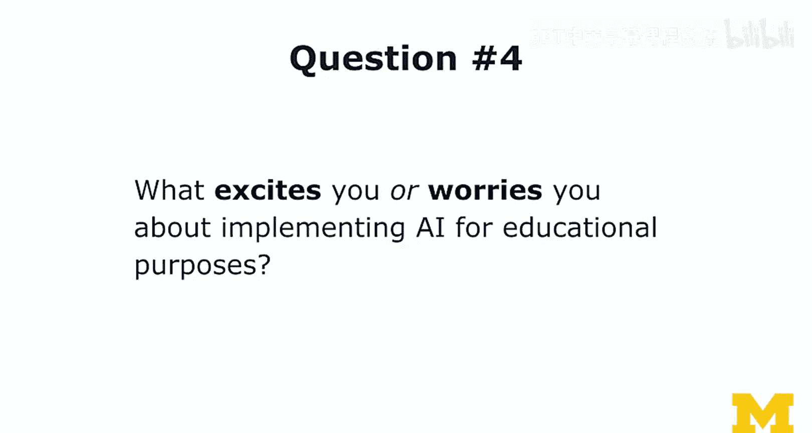
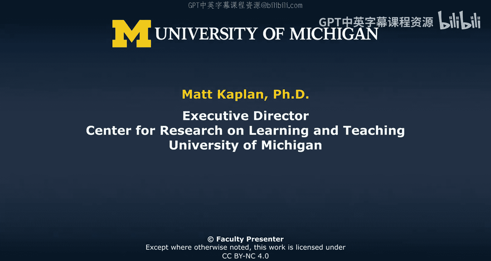

# 密歇根大学《应对颠覆：工作场所的生成式人工智能｜Navigating Disruption： Generative AI in the Workplace》 - P18：6_教育行业现状及相关职位.zh_en - GPT中英字幕课程资源 - BV159uyztEfn

Hi， my name is Matt Kaplan， and I'm the executive director of the Center for Research on Learning and Teaching。

 the University of Michigan's Teaching Excellence Center。

We were the first teaching center in the country founded in 1962。

 Our mission is to promote innovation， excellence and equity in teaching and learning。

 This is my 30th year at the university。😊，U of M is a very large enterprise。

 We have over 8000 faculty， including those who fit the traditional view of。

Professors doing research and teaching students in classrooms and labs。

 but also those in the Allied health professions who see patients in hospitals and teach students in the clinic。

In total， they teach over 30000 undergraduates and about 20000 graduate and professional students。

The university also employs over 20，000 staff members in roles as varied as departmental and administrative staff and academic advisors to folks in housing and dining who provide essential services for our students and staff who are responsible for the university's infrastructure。

And， of course。People who help with all aspects of the instructional process。

 like my colleagues at CRLT。The most obvious work of those involved in education is the time spent in classrooms with students that might be lecturing。

 leading discussions， providing one on one instruction in the arts or in the clinic。

But this is the tip of an iceberg that includes the intellectual work of planning for instruction。

From choosing the most relevant content and how to sequence it effectively to designing tests and assignments that assess student learning。

And their work also includes advising students informally in office hours and over email。

 as well as more formally as students navigate their path to degrees and seek advice and recommendations for life after the university。

 This is a group that has been keenly affected by the appearance and proliferation of generative AI。

I'm proud to say that I work with a dedicated group of professionals whose main role is to partner with these instructors across all 19 of the university schools and colleges on all aspects of teaching。

 from course design to teaching practice， with the goal of ensuring that all students。

 no matter their background can succeed。😊，Including ways to respond to the opportunities and challenges of generative AI。

I think there's a range of responses to generative AI in education， at least from where I sit。

 and it runs from embracing the promise of Gen AI tools like chat GPT to attempting to minimize their impact to not engaging at all。

 given other topics of concern， including faculty burnout。And these are not mutually exclusive views。

 I think for many instructors， this is still unfamiliar territory。

 and they are grappling with how and whether to adapt their teaching in light of Gen A I。

So typical questions include。 what kinds of policy statements do I need to include in my syllabus？

 How widely are my students using chat T P T to complete assignments。

 And what are the implications for how I assess their learning。

Do students have equal access to Gen A I tools， And how do I find the time to learn more and figure out my approach。

 given everything else on my plate。Others have been developing creative approaches to integrating this technology into their courses。

This ranges from using U of M tools to create on demand digital tutors that can be available 24/7 to answer student questions whenever they have them。

To using Gen A I to jumpstart student thinking and skill building。

The motivations driving that experimentation are also varied。

Running from an excitement about innovation to a commitment to use all the tools in your tool box to support student learning or the need to prepare students to be competitive in the work world that will increasingly include Gen A I。

 We also need to think about this from the student's point of view。

 being careful about assumptions on that front。 For example。

 a recent study I read reported on a survey of students that showed that they， too。

 have mixed views about Gen A I。😊，While they see it as a useful tool and feel it's important for them to develop skills using J A I for life after college。

 they also worry about misuse， such as plagiarism。And right now。

 the policies and practices vary from class to class， teacher to teacher。

 which can make it tricky for students to navigate their own approach to Gen AI in any given situation。

So along with a desire to develop Gen AI literacy， they really like clear guidelines and open discussion about this。

 particularly around the ethical use of GenAI， and this is something CRLT and other offices that are part of U of M's teaching with technology collaborativellab are trying to address through workshops for instructors on topics such as GenAI basics to integrating specific apps that can directly aid learning。

These are also great forums for sharing the creative work that colleagues are doing across the institution。

And we also offer one on one consultations for faculty who want to think about the specific applications of GenAI to their classrooms。

I think it's exciting to envision the ways Gen A I can contribute to student success and help students develop important skills for their futures。

 For example， Gen A I can accelerate learning， whether that's by being a partner to brainstorm initial ideas for an essay。

😊，Or helping non computer science PhD students in engineering develop coding skills much more quickly than they would otherwise。

It can also be a support for students。 For example， in responding to writing prompts。

 if you are not fluent in English or developing visuals when that is not a strong suit。

 and it can be a support for faculty as well。 For example。

 in helping to develop first drafts of grading rubrics or assignments。Perhaps more importantly。

 it has the potential to help students hone critical thinking skills。

 and those are going to be essential to future careers and to developing the skills of democratic citizenship。

Information literacy is becoming more and more important as sources of information proliferate。

 A look at the current political landscape makes clear the need for informed judgments about the veracity of widely distributed information。

By working with apps like chat GT and having to evaluate the quality and accuracy of responses it offers。

 students will strengthen their capacity to be critical consumers of information more broadly。

 And this can naturally lead to insights about ethical uses of data and information。

 a topic that crosses the disciplines。That said， there are also many challenges raised by GenAI。

The most frequent concerns I hear are about academic integrity， equity and intellectual property。 So。

 for example， around cheating， instructors wonder how they will know that students are doing their own work。

Detection software has been shown to yield an unfortunate a number of false positives。

 So that's really not a good answer。Probably means they will need to rethink assignments and also have explicit policies and conversations with students about expectations。

And even if students are not copying wholesale from JAI apps。

 instructors are grappling with how to evaluate assignments that incorporate JAI。In terms of equity。

 well U of M's GenAI apps have the potential to ensure equal access regardless of income。

Wealthier school districts will have the ability to offer preparation with Gen AI。

 not available in less well resourced areas。And we know that Gen AI is built on models that can easily replicate stereotypes and other negative representations that are part of the information universe on the web。

 Beyond that， apps like chat TPT are prone to hallucination that is just making up data。

We saw that in a well publicized case about a New York attorney sanctioned for using false cases generated by chat G P T in a legal brief without the proper evaluation skills that I mentioned before。

 Profals， as well as students， can easily learn or pass on incorrect information。

 which we know from research is then very difficult to correct。

 There are also questions about who will own the data that is entered into Gen AI apps。 For example。

 commercialmer programs can use the information entered as part of their algorithms to generate future content。

 That is a problem for student work， which is owned by students by law in this country。Finally。

 there is the challenge of staying current， since the proliferation and updating of Gen AI apps seems to be constant。

