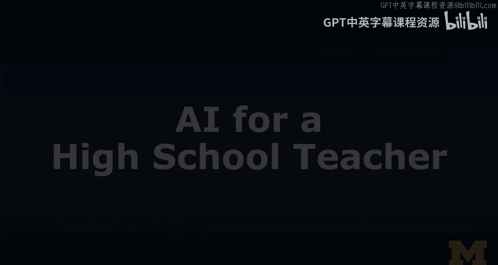
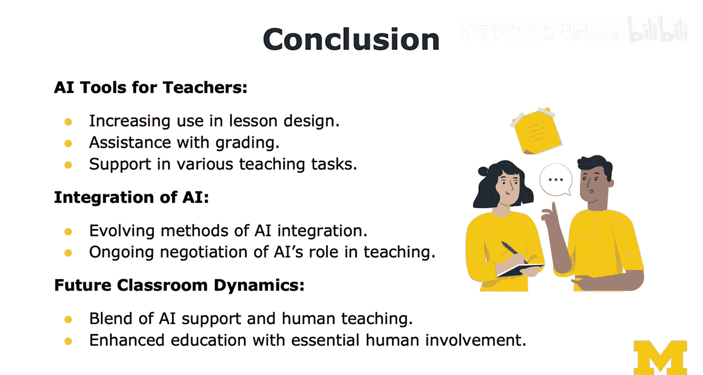
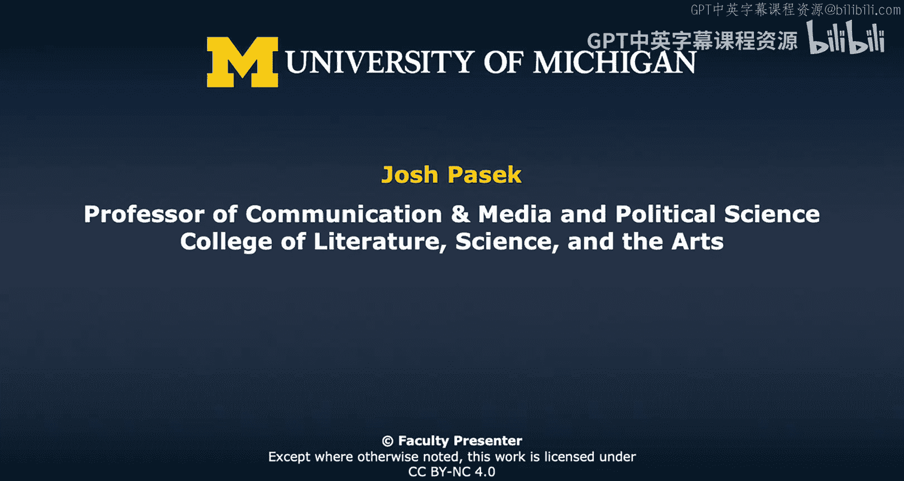

# 密歇根大学《应对颠覆：工作场所的生成式人工智能｜Navigating Disruption： Generative AI in the Workplace》 - P19：7_人工智能辅助高中教学.zh_en - GPT中英字幕课程资源 - BV159uyztEfn

One of the most central positions in any educational institution is that of teachers。

Teachers play a critical role in shaping students' minds。

 guiding them through various phases of their education。

 and often aiding in their personal development。Teachers， like professionals in many other roles。

 engage in a variety of tasks。 They're involved in lesson planning， developing curricula。

 scheduling lessons， designing educational materials that need to be engaging， delivering lessons。

 facilitating classroom discussions， and managing classroom behavior and dynamics。

Teachers also need to evaluate student performance。Through tests， assignments or projects。

And they need to provide feedback to help those students improve。

They also provide student support and mentoring， offering both academic guidance and emotional support to students。

 helping them to identify the direction of their future education and career choices further。

Teachers are expected to continuously improve upon and refine their teaching skills。

 Stay updated with educational trends and participate in professional development。Through teachers。

 training sessions and educational workshops。So how exposed are these different tasks to artificial intelligence？

Lessson planning is moderately exposed。Artificial intelligence has a number of capabilities that assist in creating lesson plans。

 both by providing access to resources that may be part of a particular instructional module or by generating tailored content based on learning objectives。

In each of these respects， AI serves to change the tasks of teachers so that teachers end up refining materials rather than producing them in the first place。

AI tools also have the ability to suggest engaging activities for classes。

 highlight resources that might enhance a lesson， or even design additional materials that may be used as part of a lesson。

Thinking through how those materials relate to the classroom and the individuals involved remains a teacher task。

But the ability to offload some of that work onto AI means that this area has moderate exposure。

 mainly in the role of augmentation。When it comes to teaching and classroom management。

 artificial intelligence isn't able to do quite as much。

AI can support teaching by offering virtual assistance， for example。

 by finding engaging materials for students， and helping both teachers and students find key pieces of information in a text。

However。For many classroom related tasks， such as dealing with the learning styles of individuals。

 the teacher's role remains critical and can't be handed to an artificial intelligence agent。However。

 for many classroom related tasks， such as dealing with the learning styles of individuals。

 the teacher's role remains critical and can't be handed to an artificial intelligence agent。

Classroom management in particular， requires a person who can engage not only intellectually。

 but also sometimes physically with the students。AI has a high potential to impact the evaluation of student performance。

Artificial intelligence can automate grading for not only multiple choice tests。

 but may also be able to provide feedback for other kinds of assessments。

AI powered tools can help students refine the spelling， grammar and structure of their work。

 and can check for plagiarism。There's an increasing potential for AI to contribute to the evaluation of student work。

And it already can provide a reasonable amount of initial feedback。 Of course。

 there are still pieces of grading that require the instructor to be directly involved。

 and it's important for instructors to review feedback from any AI tool。However。

 it is possible that artificial intelligence can supplement or even replace a large portion of these assessment related tasks。

When it comes to student support and mentoring， AI is less likely to play a sizable role。

While AI guided tutoring programs exist and will continue to improve。

The aspects of student support that make the greatest long term difference rely on the personal connection teachers build with their students and the empathy required for effective mentoring and emotional support。

 These are uniquely human qualities and really can't be replaced with an AI。😊。

When it comes to professional development， there's a moderate potential that artificial intelligence can supplement teacher labor。

AI can not only help guide teachers to the most effective and relevant professional development opportunities。

But it can also help evaluate which opportunities may be most beneficial or may be functionally redundant。

Additionally， the integration of AI into a teacher's repertoire can aid in generating materials for personalized learning that meet individual student needs。

 which is often more challenging in classes with many students or those marked by students who are at different conceptual levels for a topic。

AI has a considerable potential for workload reduction and identifying enhanced teaching resources in these arenas。

Which can augment teachers work in valuable ways。 While teaching might initially seem like a highly hands on and person centric task。

 There are a number of aspects of teaching that could be susceptible to the introduction of artificial intelligence。

 Teachers are likely to increasingly use these tools to aid them in designing lessons。

 grading and other aspects of their work。How AI is integrated into the classroom and how it's negotiated in the teaching profession remains to be seen。

The future will likely involve a blend of AI support and human teaching。

 enhancing the educational experience while maintaining essential human involvement in the classroom。

