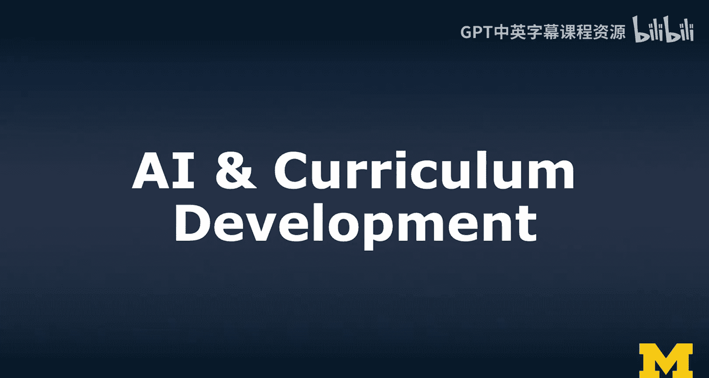
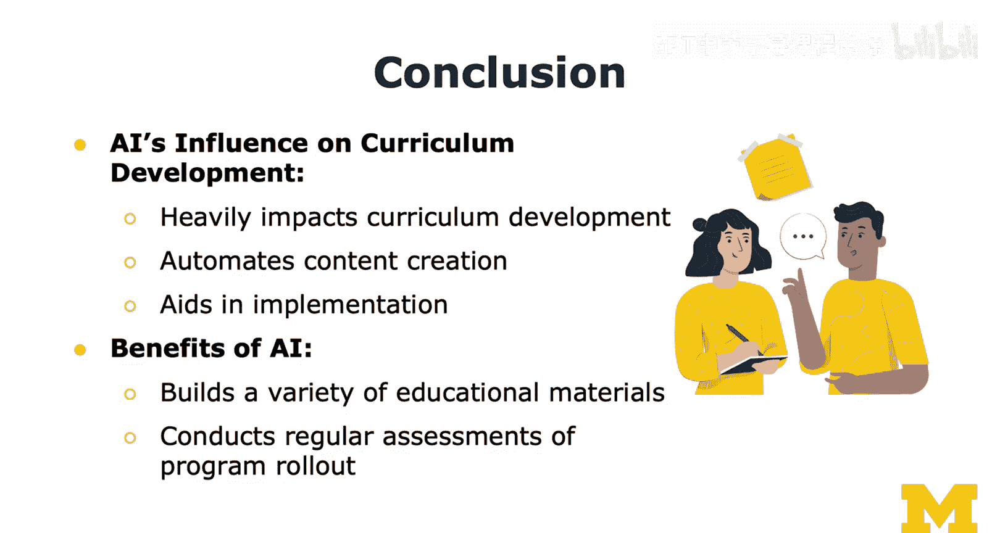
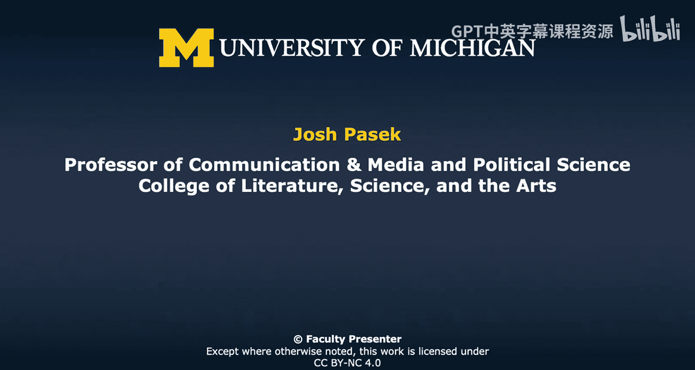

# 密歇根大学《应对颠覆：工作场所的生成式人工智能｜Navigating Disruption： Generative AI in the Workplace》 - P20：8_人工智能课程开发.zh_en - GPT中英字幕课程资源 - BV159uyztEfn

Across many educational areas， educators present pre structured curricula to students and ensure the materials they are using are appropriately designed for the learners entering the classroom。

Curriculum development is therefore a critical process。

 It involves designing tools and learning experiences to ensure that students are met at the right educational level for individuals working in curriculum development。

 the process typically starts with a needs assessment。

 identifying the educational needs of students and gaps in current curriculum that may exist。

In this process， there's a need to gather and analyze data to inform curriculum decisions after conducting the needs assessment。

  individualss in the curriculum development arena establish course objectives， outline a curriculum。

 then move towards specific lesson plans。As they do this， they incorporate educational standards。

Learning outcomes and specific assessments into the curriculum。

This stage involves creating new content and developing instructional materials such as textbooks。

 multimedia resources and assignments。Curriculum developers need to ensure that the content is engaging。

 accurate and aligned with educational goals。 Once the curriculum， design and content are developed。

 Cur developers then evaluate and revise them to ensure effectiveness in practice。

They gather feedback and performance data to improve the content and its delivery。

 making necessary adjustments。 After developing and refining the curriculum。

Develop support its initial implementation by training educators on using the new curriculum。

 They also monitor the rollout and address any issues that arise and make appropriate adjustments。

And even after a curriculum is developed， refined， and rolled out。

 curriculum developers continue in a role of implementation support。

Training educators on how to use the new curriculum。

And providing help in monitoring any further rollout and addressing any other issues that arise as curriculum use becomes widespread。

Assessing the needs for a particular curriculum often involves analyzing large data sets to identify what is currently being done。

 as well as what potential domains could be taught。

AI can provide considerable assistance with these tasks。

Artificial intelligence algorithms can process student performance data in existing curricula。

Consider summarize survey results and other metrics and even evaluate the textual content and current curricula to provide insights for curriculum planning。

In this respect， Needs assessment is a moderate to high exposure area for artificial intelligence。

Human interpretation is still necessary to ensure insights are relevant and actionable。

 but AI can significantly streamline data analysis， which shifts the role of curriculum developers。

 Curricul design is also moderately exposed to artificial intelligence。 AI can suggest topics。

 generate outlines and align materials with educational standards。

 AI tools can also help map out learning outcomes and competencies。However。

 creative decisions remain the domain of human curriculum designers。

 and we may not yet want to entrust the entire curriculum to AI tools。Therefore， while AI can assist。

 human input at this point remains crucial。 Artific intelligence can generate initial versions of instructional materials such as quizzes。

 interactive simulations， images。Slide decks， drafts of textbook content， and the like。

Natural language processing tools can also create customized learning materials tailored to different learning styles and levels。

In many respects， once the basic parameters of the course are developed。

 much of the content can be heavily automated， potentially replacing a significant portion of what curriculum developers do in this role。

 evaluatingval and revising curricula also falls into the moderate exposure category。

 Artific intelligence again， much like it evaluated existing curricula can analyze student performance data and feedback and assess the effectiveness of components of the curriculum。

Those AI models can also identify patterns and suggest areas for improvement， yet again。

 human educators are going to be needed to consider how these findings can best yield appropriate adjustments that respond to the data and are balanced across the curriculum。

And this reflects considerable augmentation and a shift of the curriculum developer's role。

In supporting curriculum implementation， artificial intelligence is likely to be less helpful while AI can provide training resources and support and monitor educators with implementation to varying degrees。

 the human element in training and ad ministerministering curricula cannot be fully replicated by AI。

So how then is artificial intelligence likely to influence curriculum development？Well。

 it's going to provide a series of data driven insights and help heavily in producing materials。

 as well as generate materials that are personalized and differentiated across different kinds of learners。

It will likely automate a number of time consuming tasks and allow the developers to focus more on how the curriculum is playing out in the classroom and less on some aspects of the design。

Therefore， curriculum development is liable to be fairly heavily influenced by the emergence of artificial intelligence。

 which can build many materials and aid in implementation with automated content creation and regular assessments of program rollout。

