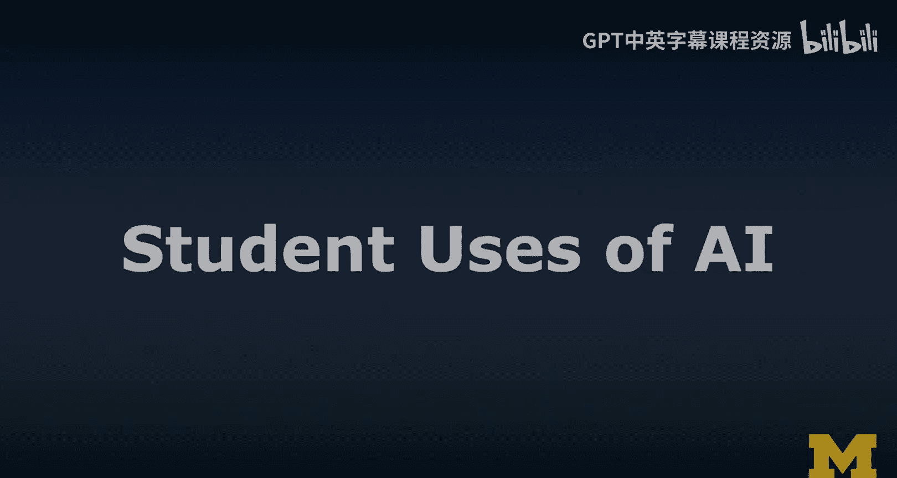
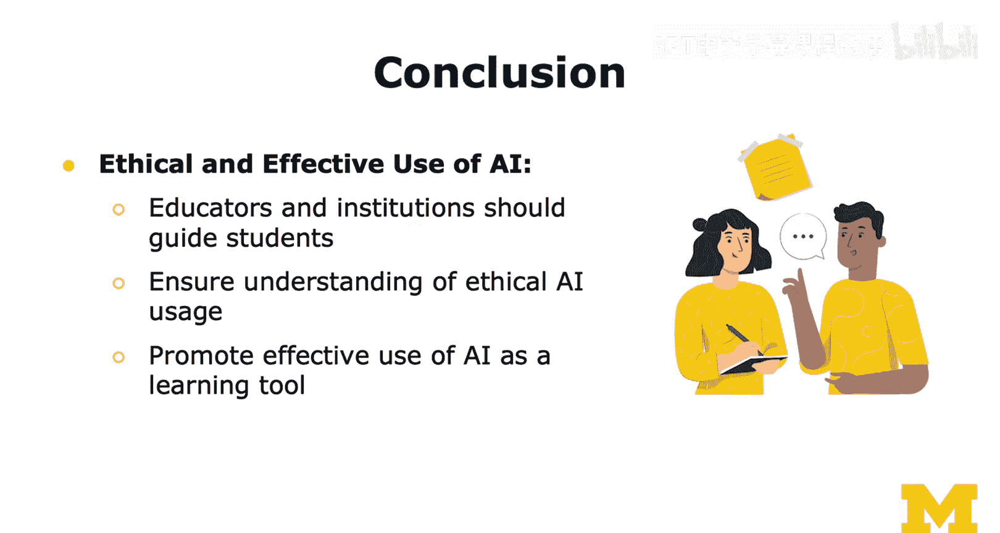
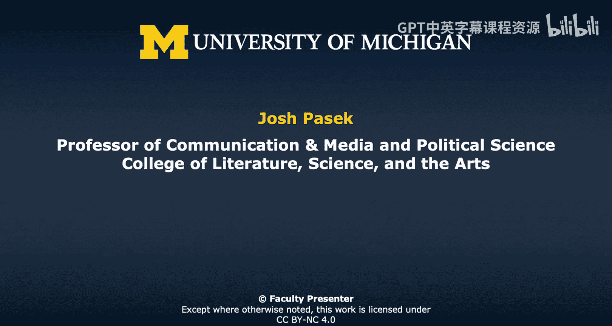

# 密歇根大学《应对颠覆：工作场所的生成式人工智能｜Navigating Disruption： Generative AI in the Workplace》 - P21：9_学生对人工智能的应用.zh_en - GPT中英字幕课程资源 - BV159uyztEfn

Another critical role in education is， of course， that of the student。

 As we explore the role of artificial intelligence in the workplace。

 it's important to recognize that the impact of AI may not only be among formal employees。

 but also among those they interact with。Understanding the role of students in the context of education can provide valuable insights into how AI might influence their learning experiences。

Students within an educational environment have a number of important roles。

 They are involved in learning and comprehension。 They attend classes。

 They need to understand the course material， and they need to engage with the educational content。

This often involves not only listening to presentations。

 but also utilizing additional study aids and resources to enhance their comprehension。

 Students complete homework assignments， which must be done on time and often require them to do external work to complete their assignments。

For example， a student writing a term paper。Will'll need to conduct additional research to complete the paper effectively。

 Students also need to study and prepare for examinations and other assessments。

 which involves reviewing course material。Memorizing information。

Practicing for certain types of assessments and working through the process of applying their knowledge and the techniques they've learned to various use cases。

Students also engage in collaboration in group projects where they work with peers on collective projects and assignments。

This requires them to communicate and collaborate effectively within a team setting。And further。

 there are various aspects of the student role that revolve around skill development and extracurricular activities。

Outside of the classroom itself， students need to understand how to engage with others。

 They participate non academic events at schools and develop skills through participating in these various environments and learning to balance the importance of their academic work with other interests and responsibilities。

The learning and comprehension aspect of students' role is highly exposed to artificial intelligence。

 both positively and negatively。Artificial intelligence powered platforms are able to provide personalized learning experiences。

The use of artificial intelligence can help students to adapt content to their individual learning styles and paces。

Artificialally intelligent tutors and chatbots can aid students by answering questions and explaining concepts in real time。

Even if students come up with questions in the middle of the night。

But it's also critical that students engage actively with the material。

And develop critical thinking skills。That avoid relying too heavily on artificial intelligence for their learning and comprehension。

When it comes to homework and assignments， students are again massively exposed to the impacts of AI。

Artificial intelligence can assist with generating ideas。

 conducting research and drafting portions of assignments， or in certain cases。

 drafting the entirety of assignments， which may not be valuable for learning。

 but is happening increasingly and has become a concern in many classrooms。

Even putting aside questions about whether this is cheating。

 it deprives students of key learning skills for how to craft arguments and gather information toolss like grammar checkers and citation generators can help students both improve the quality of their work。

 but also may replace the need for students to learn these tasks themselves。😡，Again。

 there's a considerable risk here。 inappropriate use。

 where students rely too heavily on AI to complete their assignments and fail to understand the material or how to do the processes without artificial intelligence can hinder learning and lead to academic dishonesty。

Artificial intelligence can also highly expose students as they're preparing for examinations。

AI can aid students by creating customized study plans， providing practice exams。

 and offering instant feedback on their responses to practice questions。But again。

 there are risks here。 over reliance on AI can lead to circumstances where individuals lack the intrinsic study strategies that allow them to effectively learn outside of an environment where artificial intelligence is either acceptable or available。

In collaboration and group work， students are only moderately exposed to AI。

AI can facilitate collaboration by managing schedules， sharing documents， tracking project progress。

 and brainstorming ideas collectively。While there's some potential for inappropriate use in collaboration in group work。

 the ability to facilitate interpersonal reactions is probably greater than its ability to take over collective efforts。

And when it comes to skill development and extracurricular activities。

 artificial intelligence is likely to play a smaller role。

While AI can recommend activities or aid in specific tasks。

 students are more likely to follow their own interests and are less likely to misuse artificial intelligence in ways that will fail to enhance their learning and skill set。

What do we make of the role of artificial intelligence in student life？ Well。

 there are clear values in personalized learning， assisting through otherwise tedious tasks of brainstorming and drafting。

And providing and helping to revise drafts of papers。

Yet there' is a consistent risk that that misuse and over reliance on AI could undermine the process of learning as a consequence。

So educators and institutions should ensure students understand how to use AI ethically and effectively as a tool to avoid compromising their own educational development。

 and this is going to be critical for fostering a healthy and effective learning environment。

