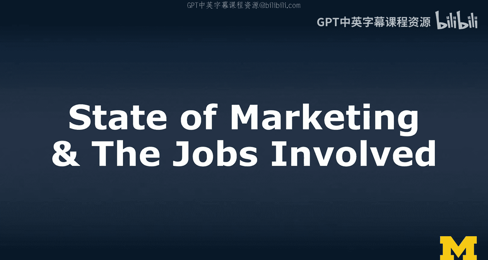
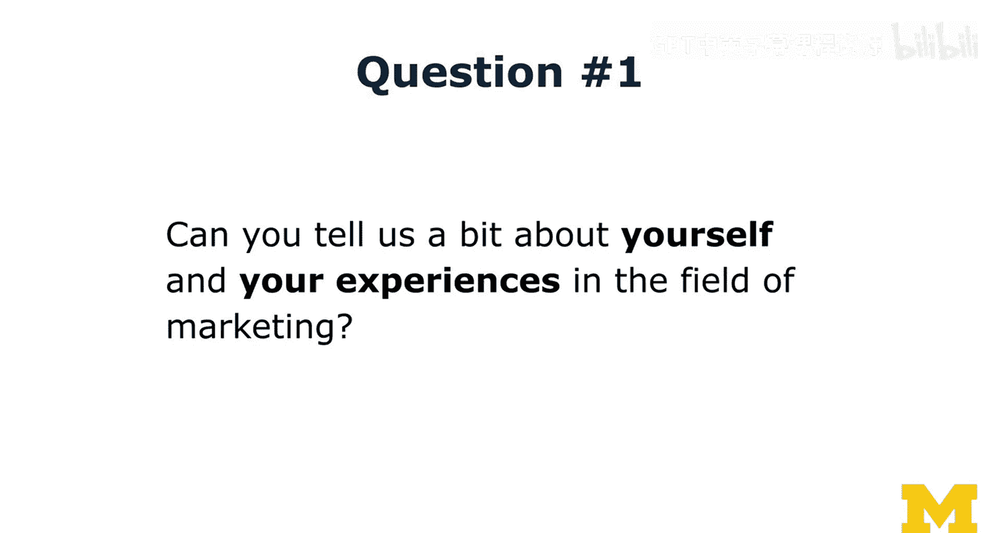
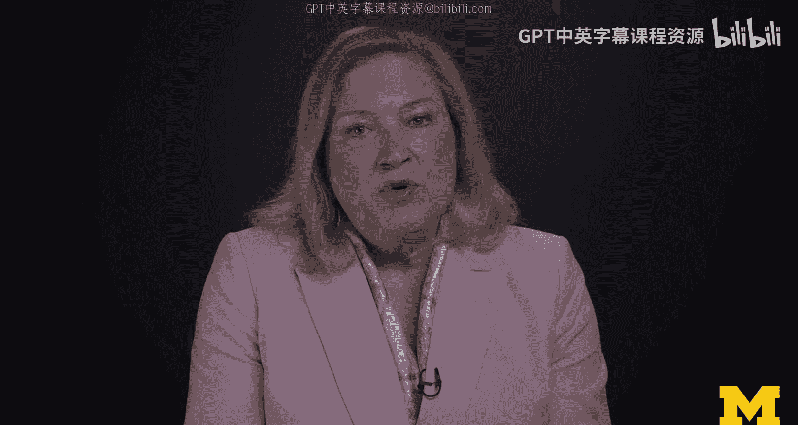
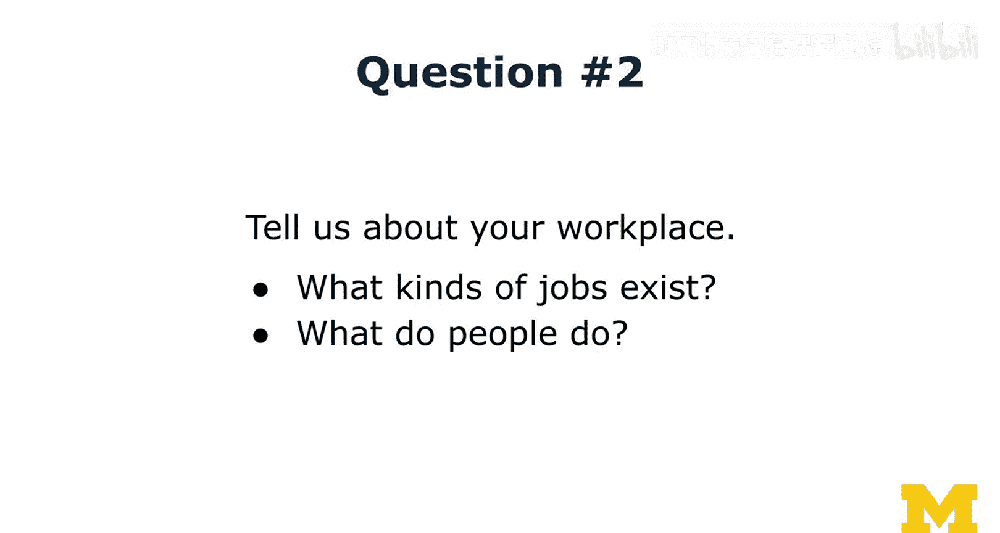
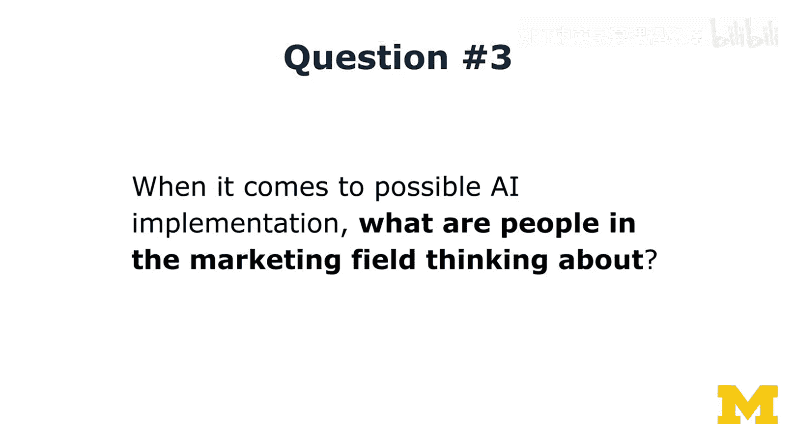
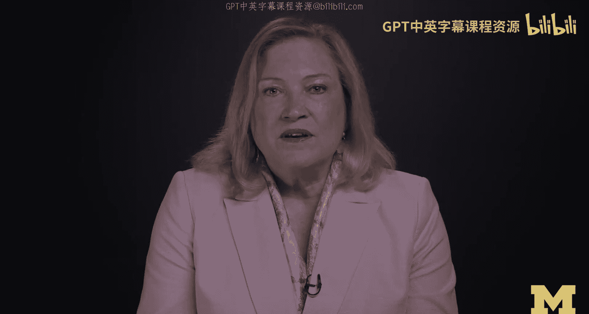
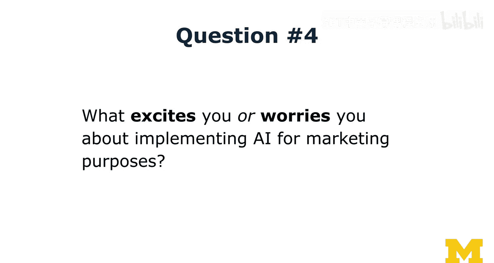
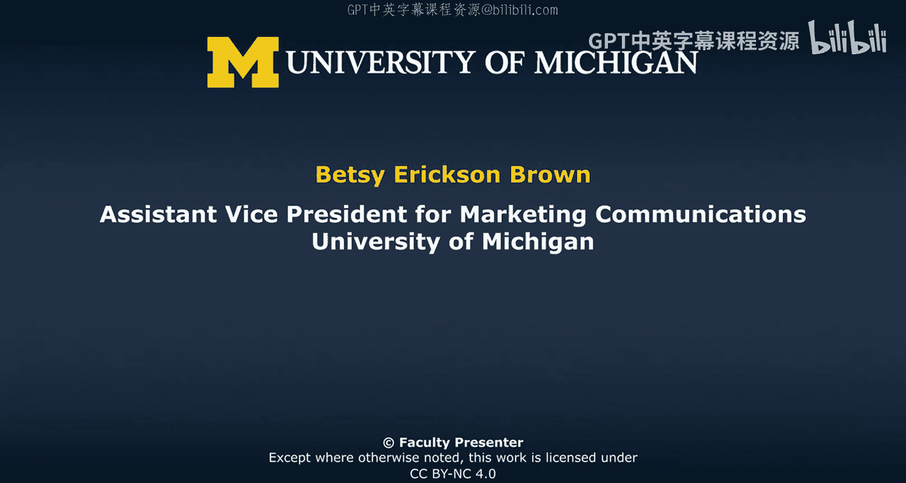

# 密歇根大学《应对颠覆：工作场所的生成式人工智能｜Navigating Disruption： Generative AI in the Workplace》 - P22：10_市场营销现状及相关职位.zh_en - GPT中英字幕课程资源 - BV159uyztEfn

I'm Betsy Erickson Brown， Asant Vice President for Market communicationations at the University of Michigan。

Marketing and public relations have been my career practice area for some 40 years。

 so I've seen a great deal of change。I've been in my current role for three years and before that spent 10 years as Director of Marketing and Communications in U of M's Office of Undergraduate Admissions。

I started my career at a global ad agency， which was a great way to see the scope of advertising and marketing roles。

As AVP， I oversee about 40 people who work in an agency model serving University of Michigan subbrands like our schools。

 colleges， student support units like Student Life。

 others like the Center for Positive organizations at the Business School and University Ini like the Go Blue Guarantee。

 which provides four years of free tuition to qualifiedualified state Re。

We also provide services to the U of M， Dearborn and Flint campuses。

In one word， we are storytellers。We bring the U of M brand to life using stories because humans connect with the emotion of a good story。

Our staff is content creators like photographers， videographers， writers。

 graphic designers and proofread。

We're also digital marketers who design and build websites， plan and buy digital advertising。

 and analyze user needs and behavior。We have project managers who plan project assignments and keep workflow smooth and strategists who understand audiences。

 define the behaviors we are looking to inspire and create plans for marketing campaigns。

As with any new technology， ask marketers about the potential of AI and you'll get a variety of responses。

At Michigan we have early adopters who are doing a lot of experimentation with generative AI。

 and many who use it regularly。Others， however， are curious， but more cautious。

I think we'll settle out at a place where JenI is another tool in our toolbox that benefits from human interaction。

 but it may not fully realize some of the early hype。

Michigan Engineering talks about using AI tools in honest ways that reduce burdens and amplify team strengths。

I just did a quick survey of marketing directors at Michigan and most are very interested in getting more training and learning about best practices with AI。

In my unit， we're considering how AI can simplify routine tasks and free up time for higher level thinking。

Our strategy team is looking at how AI can help us synthesize qualitative audience research findings without bias。

Our digital ad and creative teams are thinking about keyword selection and how AI might assist with writing the best ad copy or crafting compelling email subject lines。

We're also dabbling in AI for proofreading large volumess of copy。

Our video team is testing AI for creating transcripts of interviews and closed captions for live stream events。

As well as images for storyboards and animations。A few of our project managers are using AI to pull out key themes from client meeting notes。

It's important to recognize that AI has been with us for decades。

 What we're seeing now is the continued evolution of this technology， albeit at a faster rate。

 website， chatbots， for example， are ubiquitous now。

 providing instant customer support to improve the user experience and engagement and move us along a sales funnel or resolve customer issues。

Meta and Google use AI to target the right audiences and optimize our ad spend。

Google Analytics has long provided insights into user behavior。Even when you book a flight。

 AI usually decides the price of your ticket and then assist the pilot in flying the plane。

AI powers your Alexa device through speech， recognition， and on and on。So just for fun。

 I asked Cha GPT about the advantages and perils of generative AI。

 it gave me exciting aspects and worrisome aspects。

On the plus side are personalization of marketing campaigns， automation of repetitive tasks。

 data insights and predictive analytics， improved audience targeting and cost reduction。

On the other hand， Chat GPT worries about privacy with a large amount of personal data and potential misuse of information。

It worries about bias and fairness depending on the data the system is trained on。And security risks。

 also a reduction of the human touch in marketing and job displacement。

We also want to be concerned about putting customer or employee confidential information in a prompt。

 since this will train the AI tool and be available to others。Those are plausible concerns。

On the plus side， we would love to realize the opportunities for better customer experiences and more efficient operations。

Data privacy is a big topic at U of M and we have task forces and units working on various aspects of it。

We certainly want to be inclusive and reduce bias in our content and marketing approaches。

 and human discernment can help here。I'm least concerned about job displacement。In my opinion。

 AI won't replace humans， but it will enhance our productivity with AI。

 we will do our jobs faster and better so that we can focus less on repetitive tasks and more on producing excellent。

 unique work that truly resonates with our audiences。AI is just one of several means to an end。

