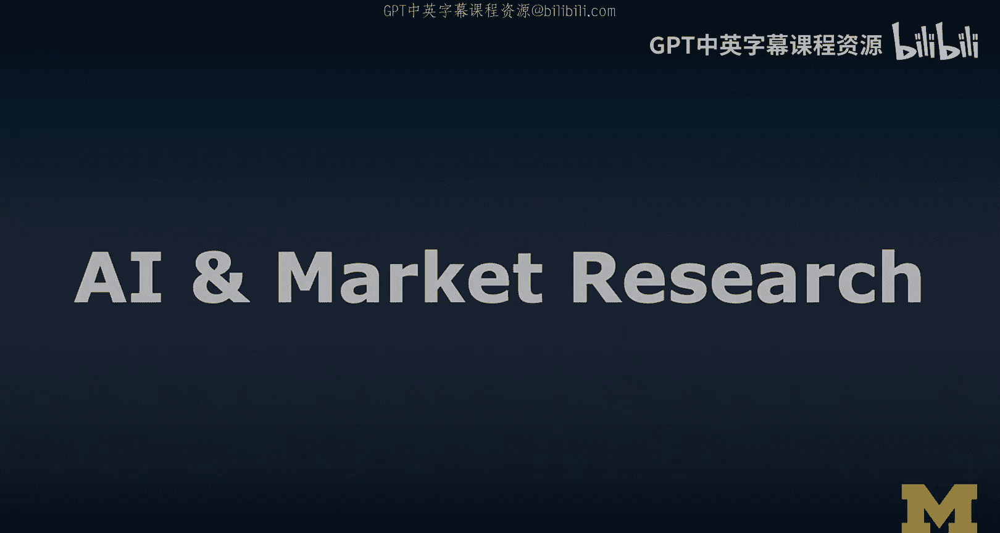
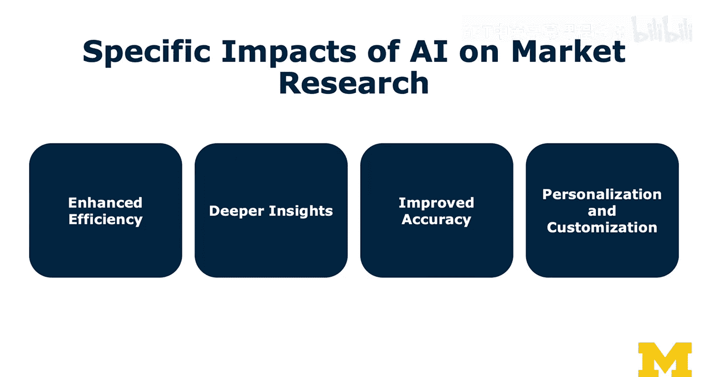
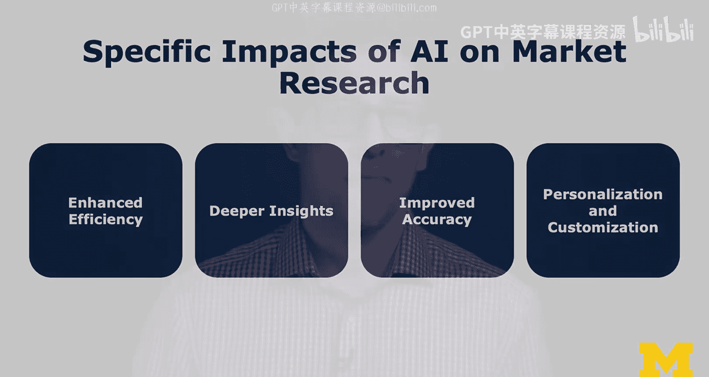
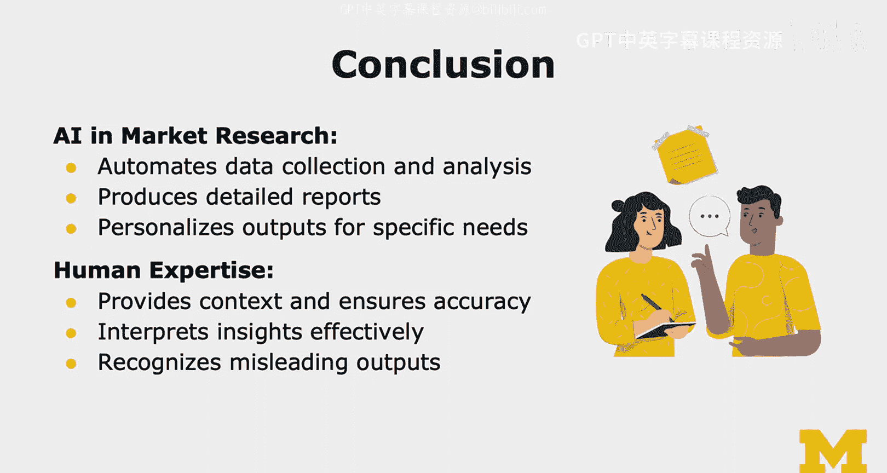
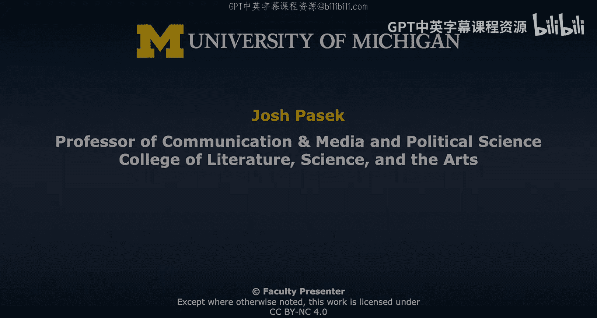

# 密歇根大学《应对颠覆：工作场所的生成式人工智能｜Navigating Disruption： Generative AI in the Workplace》 - P23：11_人工智能市场调研.zh_en - GPT中英字幕课程资源 - BV159uyztEfn

Market researchers play a critical role in the marketing process。

 they gather and analyze data to understand market conditions， consumer behavior and trends。

 helping businesses make informed decisions。Typically。

 market research involves a large amount of data collection。

 which includes designing and conducting surveys， interviews and focus groups。

 as well as pulling together data from various other sources like social media and consumer feedback once the data is collected researchers analyze it。

 typically through writing code to assess quantitative data and systematically evaluating qualitative data to identify patterns and trends they use statistical tools and software to interpret that data and to generate insights The results of those analyses are then used to generate reports and presentations that communicate the findings to their stakeholders in that process they need to visualize the data through charts。

 graphs and other visual aids， market researchers also need to predict future market trends in consumer behavior therefore they need to develop models that allow them。

 for instance， to forecast future sales， market shares and other key metrics they often assess what competitors are doing。

To analyze competitor strategies and weaknesses based on the products and their knowledge of market conditions and the competitive landscape。

So how exposed are these various tasks to artificial intelligence？Well。

 data collection tasks can be fairly high exposure AI can help to build consistent wording for survey questions and can automate a variety of approaches to data collection such as web scraping。

 social media monitoring or conducting sentiment analysis on survey data AI can also extract key concepts from interviews and focus groups I AI based tools can be used to generate responsive data collection approaches that alter which questions are asked to whom to maximize the value of the data。

Humans still need to be involved in making sure the methods match the goals of the study are ethical and that the posed questions are interpreted as relevant and unbiased。

 if there's considerable ability for AI to aid in data collection。

 there's an enormous ability for AI to assist in data analysis AI can replace large areas of human conducted data analysis。

 especially where market researchers are writing code to analyze data。

Computer programming is an area in which large language models have proven to be particularly effective。

 and coding for data analysis often involves a series of relatively straightforward coding tasks。

Further， when it comes to identifying patterns and generating insights from large data sets。

 machine learning can uncover trends more quickly than humans and natural language processing can analyze textual data from otherwise difficult to unpack reviews。

 comments， social media posts， and in-depth interviews to identify common narratives。

While AI can be effective in the heavy lifting of data analysis and even some interpretation。

 there's still a role for data analysis for humans which involves providing context and ensuring that the insights are actionable。

Nonetheless， this represents a significant shift in the human labor from conducting analyses to overseeing them。

When it comes to reporting and presenting results， there's at least a moderate exposure to AI。

AI tools can automate the creation of reports and presentations， generate visualizations。

 summarize and extract key insights， and even personalized reports for different stakeholders based on diverse interests and needs。

For a variety of reasons， at least in the near future。

 human evaluation of any automated reporting on the analysis remains critical to ensure the accuracy of the assessments and alignment with the goals for the intended audience。

Here again， we see considerable replacement of roles and a lot of shifting of the role of the market researcher to oversight。

 rather than production of much of the raw material。

 The same high level of exposure is present for market forecasting and potentially even competitor analysis。

 AI models are very good at making forecasts about future conditions using predictive analytics and machine learning algorithms。

 which are closely related to the tools market researchers already use。😊。

AI models can process large quantities of data to generate estimates of how things might look in the future in particular domains。

Human insights and oversight will remain necessary for recognizing novel components that may affect predictions。

 because AI's estimates are based solely on past data and may be unable to make effective predictions as circumstances change。

 but even despite this potential for error， AI can effectively capture many market fluctuations。

For competitor analysis， artificial intelligence has the capacity to do regular monitoring of activities to track market conditions。

 estimate and analyze competitor data， and provide real time updates on observed changes and strategies in the market。

While human involvement may still be necessary to make sense of the findings。

 the role of the market researcher may be fairly heavily exposed。

The impact of artificial intelligence on market research includes enhanced efficiency with AI's ability to speed up data collection and analysis tasks。

 this will allow market researchers to spend more of their time on high level strategic questions and interpretation。

The ability to automate analyses and reports reduces the time required for design analysis and routine reporting tasks。

 which currently comprise a significant portion of market researchers portfolios。

There's also the potential that AI is going to yield deeper insights and improved accuracy because artificial intelligence models will incorporate more data than many contemporary market research approaches。

The integration of AI and market research can be valuable in a variety of respects。

 but it can also introduce some risks， largely due to the black box problem。

 where artificial intelligence analysis fails to understand key parameters of the differences between what's being studied and the examples in its training dataset。

This is a phenomenon that's been observed in many fields in the past。

 where AI makes predictions of imperfect data and may lead to highly inaccurate outputs。

 despite confident forecasts。Therefore， assessing whether the model is appropriate to the data is going to be a very important question for market researchers。

 and a fully data driven AI driven approach may not be in the immediate offering。However。

 artificial intelligence is likely to have a sizable role here through personalization and customization of the outputs of market research and the ability to better tailor them toward different audiences。

 while AI is already playing a role in market research and will likely expand its influence as we move forward in the process of enhancing data analysis。

 human market researchers remain critical for interpreting results and maintaining the quality and relevance the insight provided。

 recognizing when they may be misleading or when the underlying factors may be poised to change in conclusion。

 AI can significantly enhance the efficiency and accuracy of market research by automating data collection and analysis。

 producing reports and personalizing outputs， however human expertise remain central to providing context。

 ensuring accuracy interpreting insights and recognizing imperfections。

 when the outputs may be misleading or when the factors may be poised to change。

