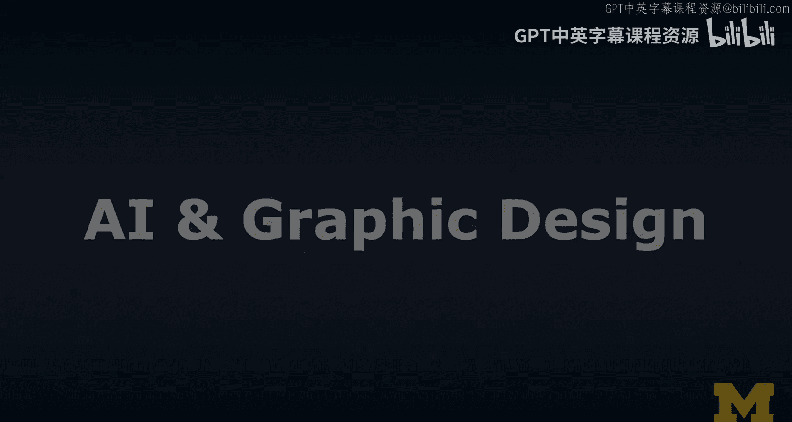
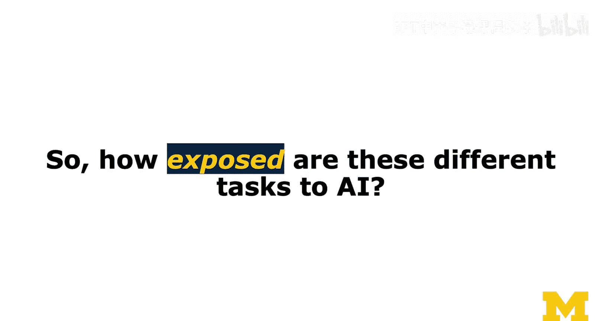
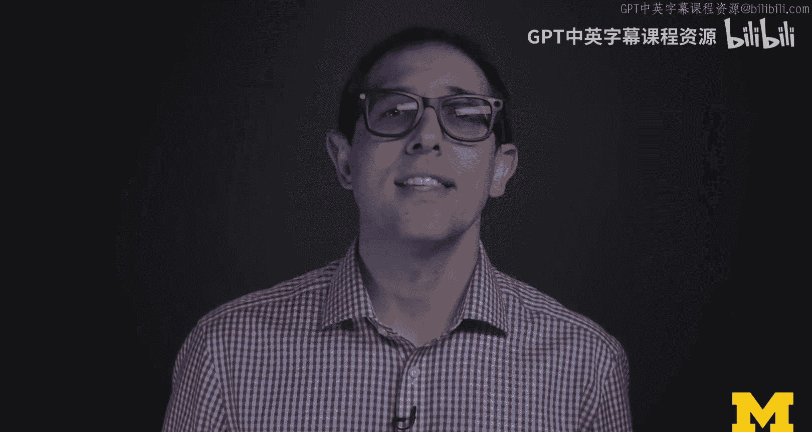
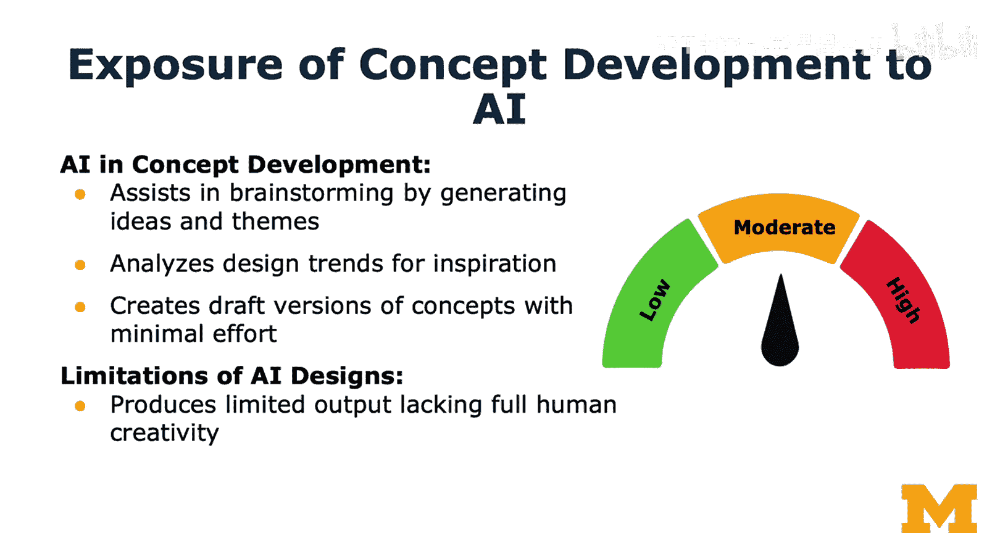
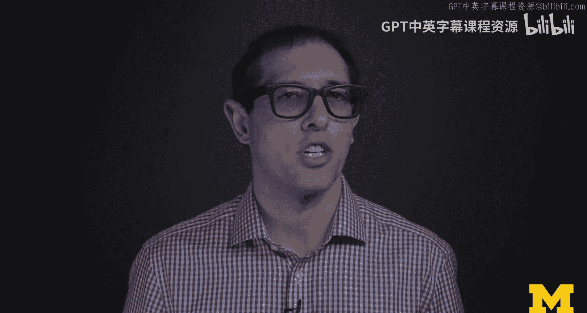
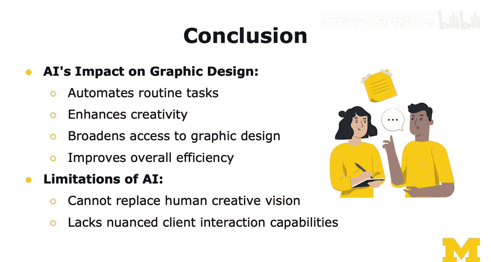
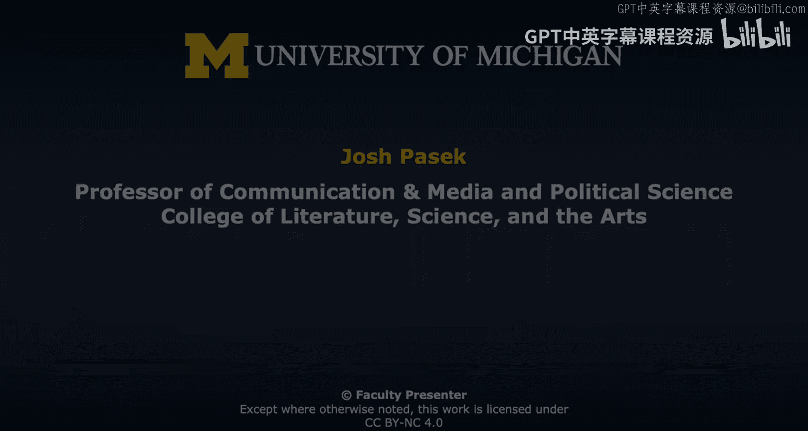
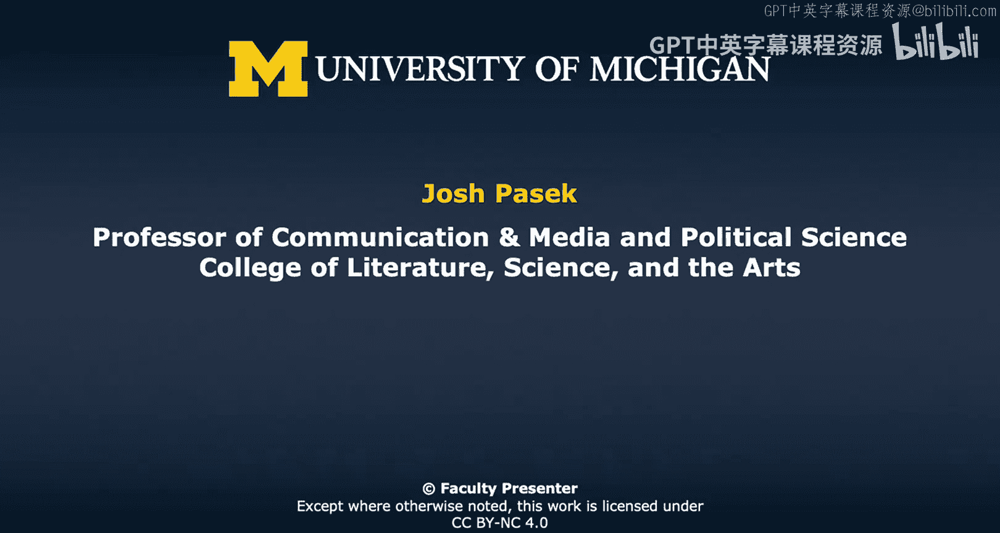

# 密歇根大学《应对颠覆：工作场所的生成式人工智能｜Navigating Disruption： Generative AI in the Workplace》 - P24：12_人工智能平面设计.zh_en - GPT中英字幕课程资源 - BV159uyztEfn

So how might AI affect graphic designers Well， graphic design involves creating visual content to communicate messages。

 combining art and technology to produce visually appealing and effective designs。

Graphic designers typically engage in concept development where they brainstorm and develop design concepts based on their requirements and an understanding of current trends。

 they also create mood boards and visual themes to conceptualize the layout of particular graphics once they move into the formal design creation phase。

 graphic designers work on logos， brochures， websites， advertisements and other visual content。

 using software tools to create and manipulate graphics。 From that point。

 they engage in a series of revisions and iterations based on client feedback。

 working to improve the visual elements and incorporate additional details。 Finally。

 graphic designers work more generally on creating and maintaining and understanding of the brand。

 ensuring adheres to brand guidelines and visual identities。

 and maintaining visual consistency across all materials throughout this process they consistently present design concepts and ideas to clients。

 In client feedback and preferences and update the designs accordingly。😊。

So how exposed are these different tasks to AI？

AI can assist in brainstorming by generating ideas and suggesting themes based on input parameters。

 AI tools can analyze design trends and provide inspiration making draft versions of concepts without requiring large amounts of effort。

When it comes to concept development， there's moderate exposure AI can assist in brainstorming by creating general ideas and suggesting themes based on input parameters AI tools can analyze design trends and provide inspiration。

 making draft versions of how a concept might look without taking large amounts of effort。However。

 AI driven designs produce limited output that lacks the full range of human creativity Overall。

 we would say this is a moderate exposure area and involves a large amount of AI augmentation。

 but there remains a collaborative effort between AI and humans。

While AI may fall behind in tasks requiring creative vision and a unique artistic touch。

 it can rapidly generate draft versions of images and ensure they match a client's goals。

 this shift in work dynamics can sometimes replace human tasks。

 especially for projects with limited budgets。

The design creation process has higher exposure AI powered design tools have the capacity to automate aspects of design creation such as layout generation。

 color palette selection and even photo enhancement platforms like Canva already use AI to provide templates and design suggestions again when it comes to larger tasks like create a vision and unique artistic touch。

 AI will fall behind what humans can potentially do。

But the ability to rapidly generate draft versions of images and ensure they match a broader design scheme may result in a shift of the tasks in design creation and even replace humans。

 particularly for firms that might not be willing to go the extra milein budgets and hiring for graphic design when it comes to revisions in iterations。

 there's moderate to high exposure， AI can streamline the revision process by quickly making suggested changes。

 offering alternative design options， and predicting the effectiveness of certain elements。

There still needs to be human oversight and touchups on this process。

 but again we're looking at a situation where we're shifting the work and sometimes allowing new opportunities that were difficult to achieve previously。

When it comes to brand identity development， AI is likely to play a more modest role AI can help maintain brand consistency by suggesting elements that align with established guidelines。

 generating variations of visual identities while preserving core elements。

But understanding brand identity in a general sense and recognizing how that resonates with a target audience remains a human task。

 so the integration of AI can have enormous augmentation but it's unlikely to fully replace human roles and finally。

 when it comes to client communication， we're talking about lower exposure。

 interactions where someone needs to understand and incorporate the ideas of a client and describe them effectively are going to require a human touch。

AI can assist in managing client communications by automating scheduling。

 providing project updates and even generating initial design presentations。Nonetheless。

 the human element is really key to nuanced and effective communication。 So overall。

 what are the effects of AI going to be on graphic design。 Well。

 AI will lead to a lot of additional efficiency and speed in the graphic design industry。

 It can create and revised designs much more quickly。 routine tasks can be automated。

 allowing designers to focus more on the complex creative and triangulation aspects of their work。😊。

AI enhances creativity by generating rapid prototypes and assessing different possibilities leading to more innovative and diverse designs。

 but still requires human involvement。AI will also be more cost effectiveff。

 potentially replacing human graphic designers for specific tasks where high-level creativity isn't required nonprofitfis or small businesses needing a simple logo may turn to AI for solutions instead of hiring graphic designers Finally AI can introduce additional consistency and precision across design elements。

 ensuring adherence to brand guidelines and design standards and eliminating human errors in technical aspects of design work。

So overall， AI is liable to have enormous impacts on the graphic design industry by automating routine tasks。

 enhancing creativity， allowing a broader group of people to do some graphic design and improving efficiency across the board。

However， AI is not yet capable of replacing the critical human role in providing creative vision and nuanced client interactions。

