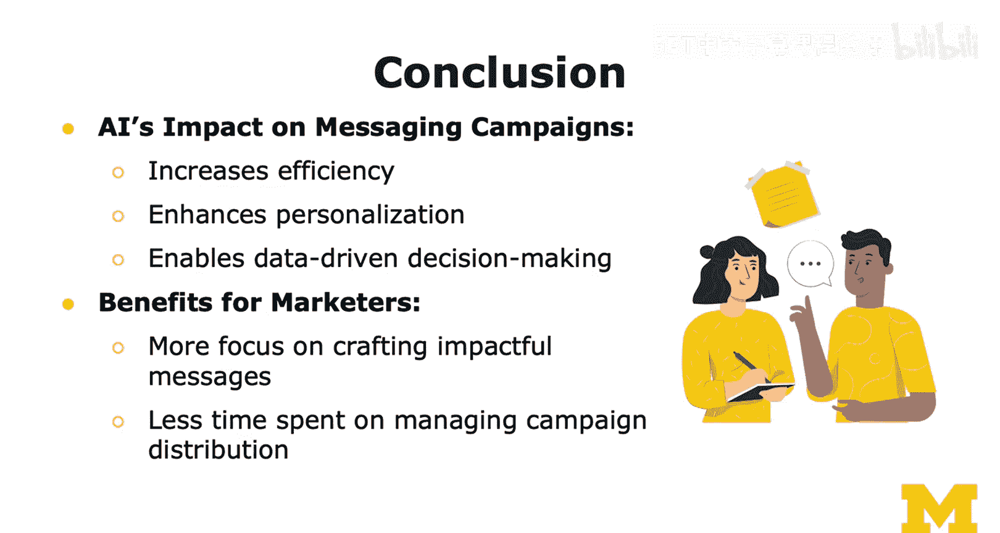
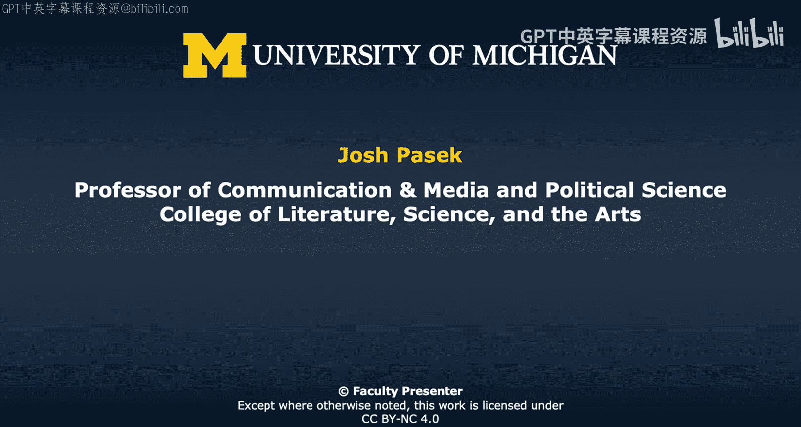

# 密歇根大学《应对颠覆：工作场所的生成式人工智能｜Navigating Disruption： Generative AI in the Workplace》 - P25：13_人工智能在传播活动中的应用.zh_en - GPT中英字幕课程资源 - BV159uyztEfn

Another critical aspect of marketing is messaging campaigns。

 Mesaging campaigns are crucial for brand communication。

 engaging audiences and conveying important content。

Messaging campaigns typically start with some overarching strategy development。

 where marketers will define campaign objectives， identify the target audience and key message。

 and plan out an overall strategy and timeline for the campaign after the initial design process。

 marketers draft compelling content for various platforms， including social media， emails。

 advertisements and other outlets。Marketers need to ensure consistency in tone and messaging across all channels。

As they do this， they'll need to engage in audience segmentation and personalization。

 parsing the audience based on demographics， behaviors and preferences。

 and then crafting targeted messages to resonate with different audience segments。

 marketers then need to conduct distribution and scheduling。

 deciding when and how to deliver their messages on what platforms。😡，They'll schedule， post。

 and manage other outreach to appear at optimal times。Finally。

 they'll evaluate the performance of the messaging campaign by looking at metrics like engagement。

 reach， and conversion rates。That data can be used to optimize the ongoing and future campaigns。

 so how exposed is running a messaging campaign to artificial intelligence。Well。

 when it comes to developing the strategy for a campaign。

 artificial intelligence can provide a moderate augmenting role。AI can help to analyze market trends。

 competitor activities， and audience insights to inform the campaign strategy。

 much as it does with marketing research。AI tools can also suggest optimal strategies based on historical data。

This will heavily shift the role of marketers。When it comes to content creation。

 this is a high exposure area， AI can generate engaging copy for various platforms using natural language processing and large language models。

AI can produce drafts， suggest improvements and tailor messages to specific audiences in ways that can be time consuming and laborious for individual marketers。

Of course， critical efforts are still needed to make sure that the content aligns with the brand voice。

 resonates emotionally and meets quality standards， but in many of these respects。

 AI can shift the work of human laborers and even replace certain tasks。

When it comes to audience segmentation and personalization， these are heavily data driven tasks。

 and like many data driven tasks， there's high exposure to artificial intelligence AI can use large amounts of data to segment audiences effectively and identify underlying trends that may not be obvious to humans。

Machine learning algorithms can predict audience preferences and behaviors in response to particular messages。

 enabling those messages to be highly personalized。

Yet someone still needs to interpret those AI insights to ensure that this personalization is done ethically and effectively。

Nonetheless， there may be a considerable shift in roles。

 where humans no longer need to be in charge of personalizing and segmenting the messages。

 and AI can take on some of that role， shifting the labor。

When it comes to distribution and scheduling， there's also high exposure AI tools can not only analyze the effectiveness of different distribution and scheduling strategies。

 but can also automate that distribution identifying the best times and platforms for delivery AI can also schedule posts and emails based on patterns of audience engagement throughout the campaign This both replaces some behavior that used to be human and allows for new potentials when it comes to performance analysis again。

 there's potentially quite high exposure to AI Art intelligence can track and analyze campaign performance in real time providing action insights and recommendations for optimization。

AI tools can identify patterns and not only suggest adjustments but even automatically adjust the campaign rollout to improve outcomes while broader strategic decisions need to be human led。

 AI can take on large portions of the task AI is likely to have a large impact on messaging campaigns by speeding up content creation。

 audience segmentation， performance analysis and enabling a more responsive campaign。

This will allow marketers to spend more of their energy focusing on strategy and creative direction。

AI will also enable increased hyperpersonalization by analyzing individual preferences and behaviors and generalizing personalized messages that can increase engagement and conversion rates。

 albeit it at some risk that those messages become so personalized that they're inconsistent or maybe misleading。

Therefore， it's critical to keep a check on what's being produced to ensure that things are not so hyper personalizedized that even the marketer doesn't realize what's being presented。

😡，AI is also likely to drive data driven insights by regularly assessing incoming data。

 helping marketers make more informed decisions and optimize their campaigns for better results。

Additionally， AI will enhance the scalability of messaging campaigns。

 making it possible to produce large volumes of communications across multiple platforms with less effort。

In conclusion， AI is poised to transform messaging campaigns through increased efficiency。

 personalization， and data driven decision making。As marketers leverage AI。

 they'll find that it's a powerful tool。Enabling them to spend more effort focusing on crafting impactful and resonant messages and less on managing the distribution of the campaign。

