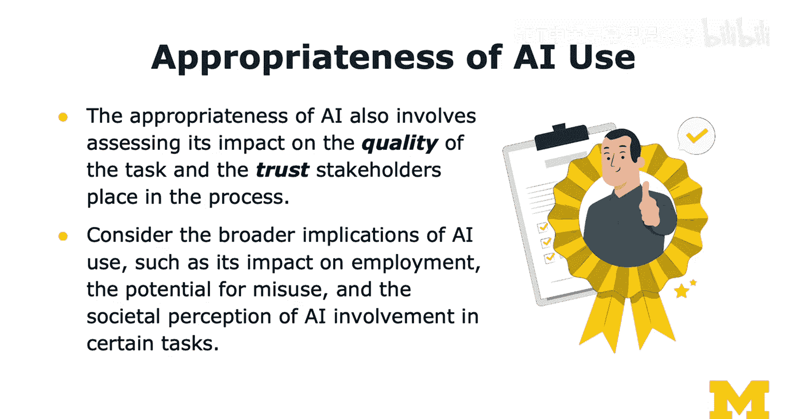
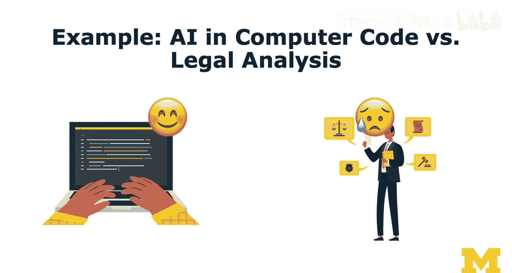
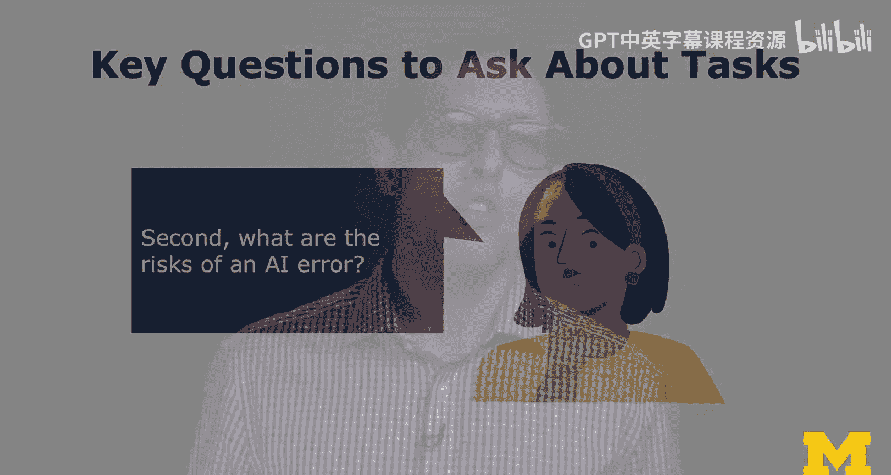
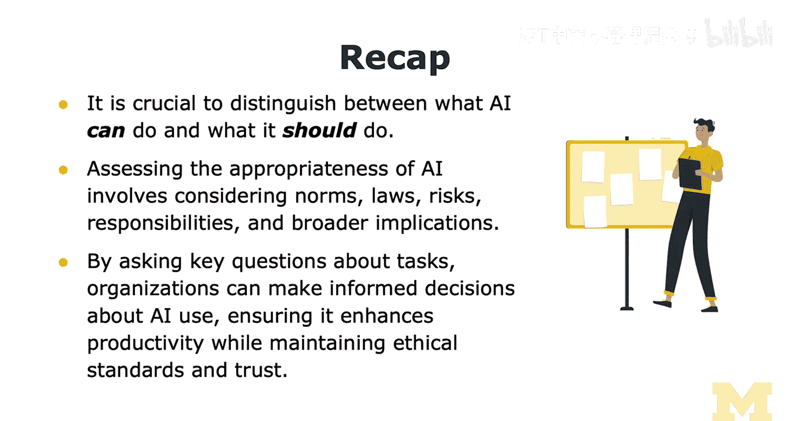
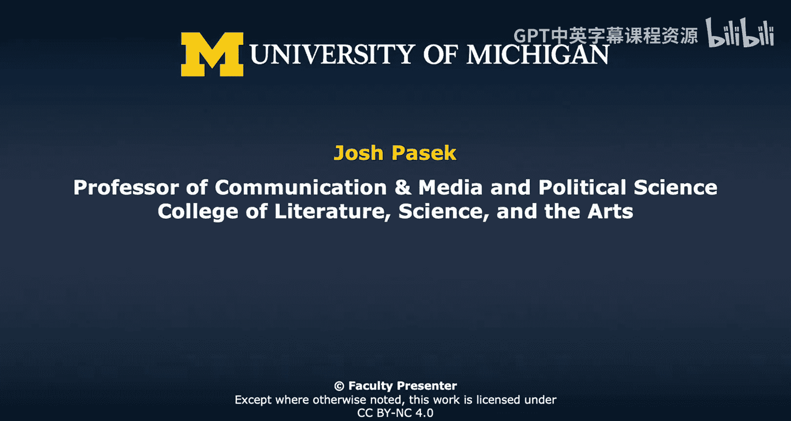

# 密歇根大学《应对颠覆：工作场所的生成式人工智能｜Navigating Disruption： Generative AI in the Workplace》 - P26：14_人工智能应用与场景适配.zh_en - GPT中英字幕课程资源 - BV159uyztEfn

So as we've seen across several job sectors and in the exercise where you evaluated AI's impact in your workplace。

 there are a broad array of applications for generative artificial intelligence tools in the contemporary workplace。

However， just because AI can perform a particular task doesn't mean it should in this lecture。

 we're going to discuss the distinction between what AI can do for a job and what AII should or shouldn't。

 We'll talk about when AI uses are appropriate and how that might vary depending on norms。

 laws and other considerations， Additionally， we will highlight some key considerations to think about when AI should or shouldn't be applied to particular tasks and roles。

😡，What is this distinction， broadly， what AI can do encompasses a wide range of tasks from automating repetitive processes。

 analyzing complex data sets， generating creative content。

 and editing creative content to producing initial drafts of various things。😡。

Whether we're talking about AI creating news articles， designing logos。

 diagnosing medical conditions， making investment decisions， or helping teachers in their classrooms。

 there are numerous potential AI applications。However。

 the decision to use AI is more than a question of capability。

It should be guided by ethical considerations， the potential impact on various stakeholders。

 and a broader understanding of what is socially and legally acceptable。

 simply put not all tasks that AI can perform are appropriate for AI to handle。

 and the suitability of AI for a particular task is going to depend on the risks， responsibilities。

 and social norms involved。So how do we understand when AI use is appropriate Well。

 the question is whether AI complies with existing legal frameworks and social norms。

 avoids harm and suits user goals。As an example， when dealing with data。

 AI needs to adhere to data protection regulations。

 there may be expectations from users that data are used in ways that will not identify them as part of the data。

😡，It's often important that elements of how AI is being used are transparent。

And AI's considerable costs and climate implications also merit consideration。

These requirements are shifting over time and will delve further into each in future courses。

Norms can vary by industry and region， as well as by what populations are implicated。

 requiring context specific approaches to AI implementation。In some fields。

 AI generated content may be acceptable and even expected， while in others。

 it may be considered a violation of professional duty。

Another important factor is quality and trust There are expectations around what a human must do to ensure that particular AI content is appropriate or reasonable Employs and employees need to think about how AI use in a particular arena is likely to impact both the products that AI enables as well as larger considerations such as the role of a particular job。

 what potential for misuse there is and how it might be perceived if people knew that AI was involved in the tasks。

The appropriateness of AI is also going to depend on an understanding of the quality of AI outputs within the context of a specific task。

 as well as the trust that stakeholders must make in the process。

Even high quality AI applications may not be suitable if a task requires precision that only humans can insure。

What are the key questions that we should be asking when thinking about whether AI might be suitable for particular tasks？

Well， first， we want to assess if AI can more effectively perform the task than the current approach。

 does AI have the capacity to do it effectively， how complex is the task。

 how high quality is the AI input and output， are there unique human skills required for the process。

 AI might be better at some tasks than others？For example。

 AI has shown efficacy in producing computer code， but struggles with complex legal analysis。

Second， what are the risks of an AI error， We need to assess the potential consequences of errors made by artificial intelligence and think about the stakes In high stakes tasks such as medical diagnosis or financial trading。

 AI errors may have enormous repercussions。 For example。

 if individuals receive an incorrect treatment， it will have serious health risks。

 AI has already proven that at least on one occasion。

 automated trading could crash the stock market due to AI algorithms that were improperly aligned。😡。

These kinds of cases。Our ones with the standards for AI reliability need to be very high before we should fully trust the algorithms。

Third。Is human accountability required some tasks require a human to take responsibility due to legal。

 ethical or professional standards。 For instance， legal judgments and medical decisions are going to require human accountability to ensure trust and responsibility。

😡，This area has proven challenging for autonomous vehicles， for instance。

 as it becomes unclear who bears liability for the inevitable crashes that will occur。

Another question to consider is whether it would be problematic if AI involvement was revealed。

 in contexts where AI use needs to be disclosed or may be accidentally revealed。

 the impact on trust and credibility must be weighed。

Circumstances where there would be negative repercussions if AI use was revealed are often cases where AI use is not appropriate。

 for example， AI written personal letters of recommendation or creative works might be perceived differently if the AI's role is known。

Finally， we want to know whether there are any ethical。

 bias related or legal implications of AI use in a particular context。

 can AI systems perpetuate a bias based on the training data。

 are there ethical rules that may require limitations on AI use in particular cases。

 or are there legal standards， as laws develop further on the subject？For example。

 when AI is incorporated into hiring practices， there's a critical need to ensure that AI use is carefully managed to avoid discrimination and to ensure fairness in the process。

 because bias can creep into the system in ways that may not be obvious。

 it's important to make sure that AI is being properly audited in these circumstances。

So as we think about the full range of applications of AI tools。

 we should consider the limitations of AI usage， not only due to the capabilities of artificial intelligence。

 but also based on what the integration of artificial intelligence in certain tasks may imply。

 and whether it's appropriate， acceptable， and legal in those contexts。😡。

And so we need to carefully distinguish between what AI can do and what AI should do。

 assessing the appropriateness of AI use will involve considering norms， laws， risks。

 responsibilities， and broader implications。😡，By asking key questions about each relevant task。

 organizations can make informed decisions about AI use。

 ensuring it enhances productivity and provides value while maintaining ethical standards and trust。

