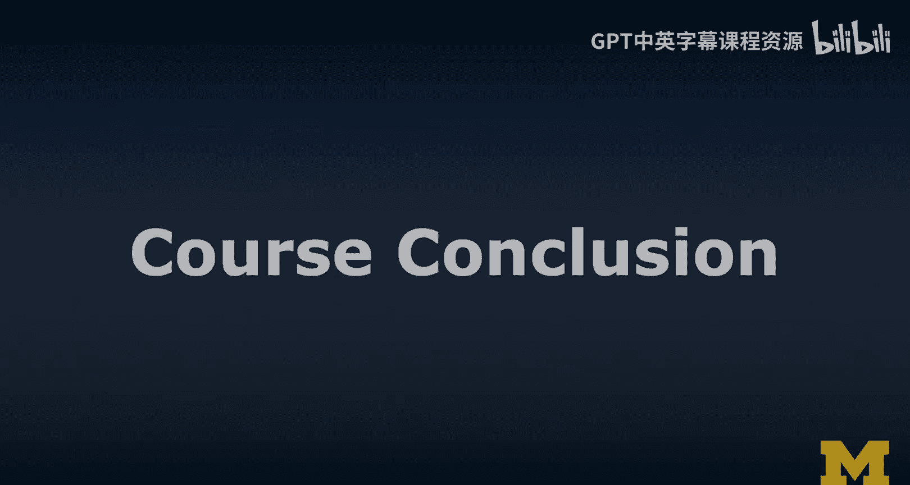
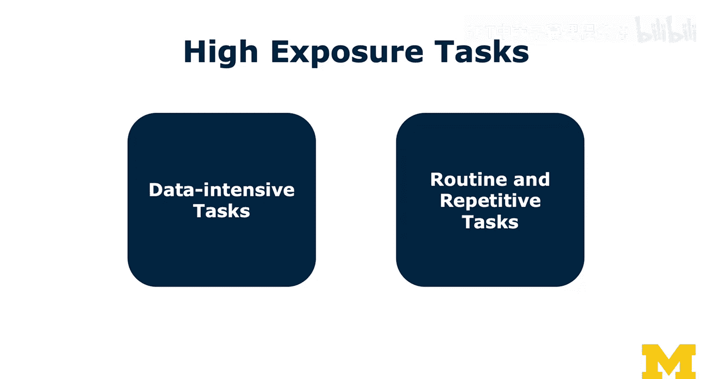
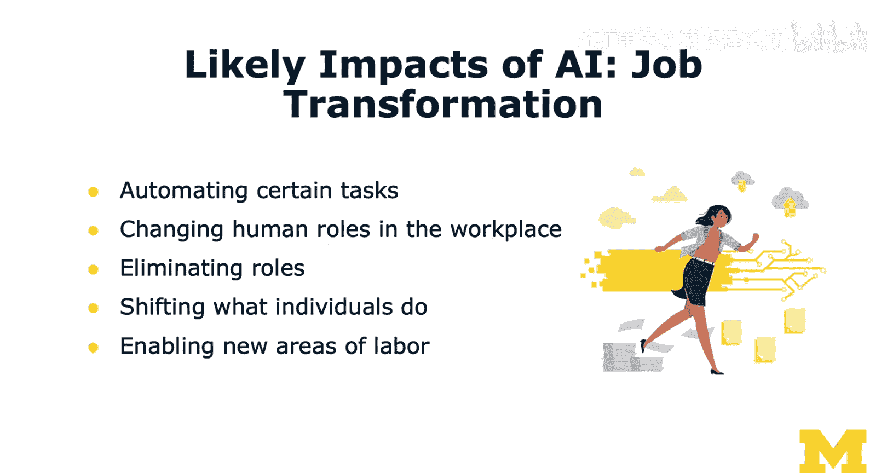
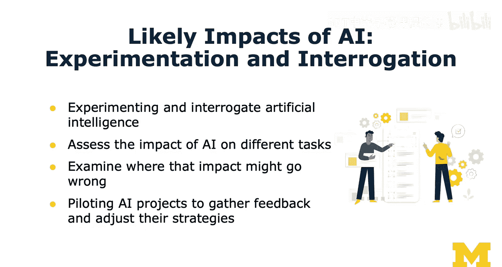
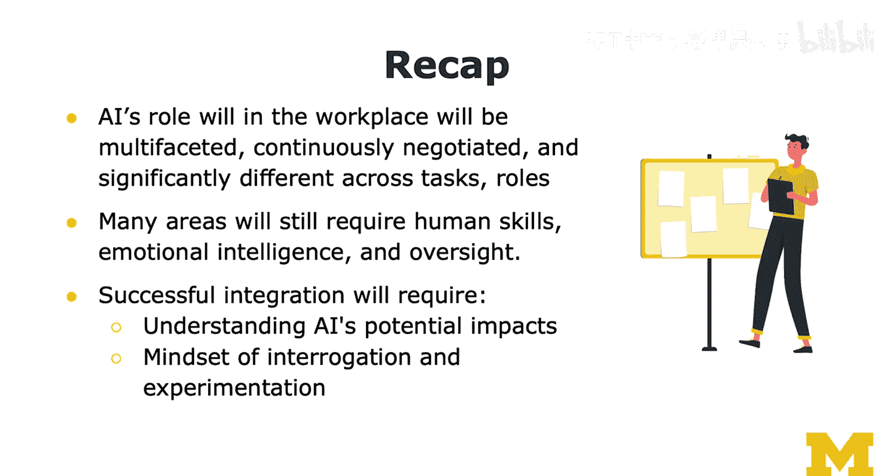
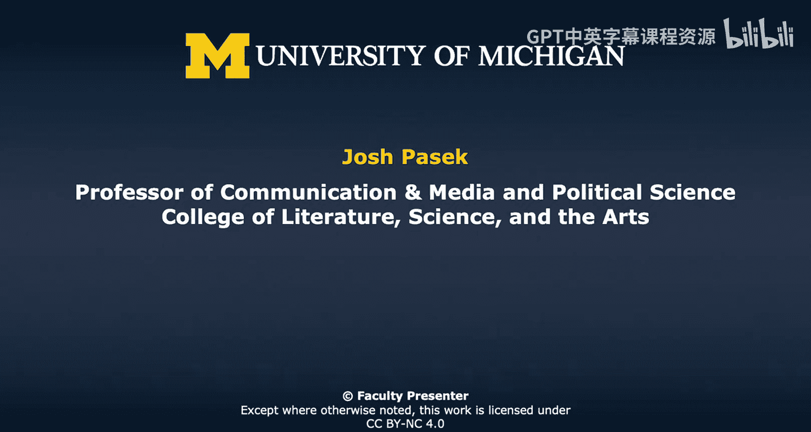

# 密歇根大学《应对颠覆：工作场所的生成式人工智能｜Navigating Disruption： Generative AI in the Workplace》 - P27：15_课程总结.zh_en - GPT中英字幕课程资源 - BV159uyztEfn

Across this course， we've seen a variety of potential impacts of artificial intelligence as it gets further integrated into workplaces。

 jobs， and the particular tasks that employees perform。

We can see that workplaces vary in the likely impacts。

 depending on the nature of the work that's conducted， the exposure of the tasks。

 and the implications of AI integration。

In certain cases， some tasks are very high exposure。

 jobs that involve data intensive work such as market research and data analysis are highly exposed to AI。

 which is good at analyzing and extracting insights from large data sets。

Routine repetitive tasks are also easily taken on by AI these sorts of processes highlight workplaces that are also likely to be high exposure。

Market research firms and financial institutions fall into that category。

 as do factories and assembly lines， which increasingly incorporate artificial intelligence powered robots and automation systems for repetitive tasks。

 tasks that involve creative and strategic thinking are likely to be moderately impacted by AI。

 which can assist in generating ideas and initial drafts。

 but for which higher level thinking and decision making remain predominantly human- driven AI will also have a moderate impact on support roles that aid core functions such as campaign management and client communication。

AI can automate scheduling， monitoring and initial interactions。

 but can't engage in nuanced relationship management。

 creative industries and healthcare settings like hospitals and clinics are also moderate exposure workplaces。

AI can assist in backend processing like diagnostics， patient monitoring and administrative tasks。

 but cannot replace the human elements essential to these fields。

 tasks requiring high levels of empathy such as counseling or client relationship management are less susceptible to AI and are fundamentally human centric。

These rules rely on emotional intelligence and are difficult to replace with an automated agent。

Similarly， broader strategic thinking and decision making require multiple perspectives and are likely to remain human driven。

 while AI can provide data and insights， it cannot replace human judgment。

So what are some lower exposure work tasks while parts of education are likely to be lower exposure AI can help with personalized learning and administrative tasks。

 but it can't serve as the teacher， the learning process requires human engagement and can't be supplemented or replaced with AI。

Social services like counseling centers or social work organizations also fall into this category。

 while AI can assist with administrative tasks and data management， empathy。

 counseling and human interaction are irreplaceable。Broadly construed。

 the impacts of artificial intelligence are going to yield large enhancements in efficiency and productivity across a variety of routine tasks and in the acceleration of data analysis。

In many ways， this is the potential to allow workers to focus on higher value activities that require more creativity。

 critical thinking， and strategic planning。AI tools that augment human capabilities will support idea generation data processing and personalized learning。

 shifting some human labor and creating new opportunities， in practice。

 AI will transform jobs by automating certain tasks， changing human roles in the workplace。

 sometimes eliminating roles， shifting what individuals do and in some cases enabling new areas of labor。

Workers are going to need to adapt to these changes by developing new skills and embracing continuous learning。

They need to consider their roles and think about how to utilize AI effectively or shift their labor accordingly。

Throughout all of this， there will be a need to consider the ethical use of AI， privacy issues。

 potential biases， and the risk of misuse。Establishing guidelines for responsible AI use is critical as the norms and legal framework surrounding AI are still evolving。

Governments and institutions worldwide are developing new and sometimes conflicting laws and regulations to ensure AI is valuable and not dangerous；

 this is going to require firms to experiment and interrogate artificial intelligence。

 assess the impact of AI on different tasks， and examine where that impact might go wrong。

The implications of AI will not be uniform and may change over time as AI tools evolve and regulations adapt。

Organizations should pilot AI projects to gather feedback and adjust their strategies based on the outcomes of AI use and an understanding of how that use is playing out in the workplace and the products of a given firm。

This approach will help businesses understand the strengths and limitations of AI in their domain。

 ensuring its integration enhances performance while being attentive to AI's broader implications for the labor market。

As we think about AI's role in workplace tasks， it's clear that it will be multifaceted and continuously negotiated。

 it's also going to vary significantly across different tasks and roles。

High exposure tasks will benefit from AI efficiency， but many areas will still require human skills。

 emotional intelligence， and oversight。The challenges posed by AI echo those of earlier technologies。

Successful integration will require understanding AI's potential impacts and approaching it with a mindset of interrogation and experimentation。

Firms that continued making horse and buggy whips after the invention of the automobile found themselves quickly becoming obsolete。

 but those who continuously evaluated and adjusted their business models in line with new technologies were able to adapt。

 moving forward， we can harness AI's potential while mitigating its risks by remaining adaptable。

 Embracing continuous learning and considering ethical and appropriate uses。

 This approach can create a future where AI and human capabilities。

 complement each other effectively。

