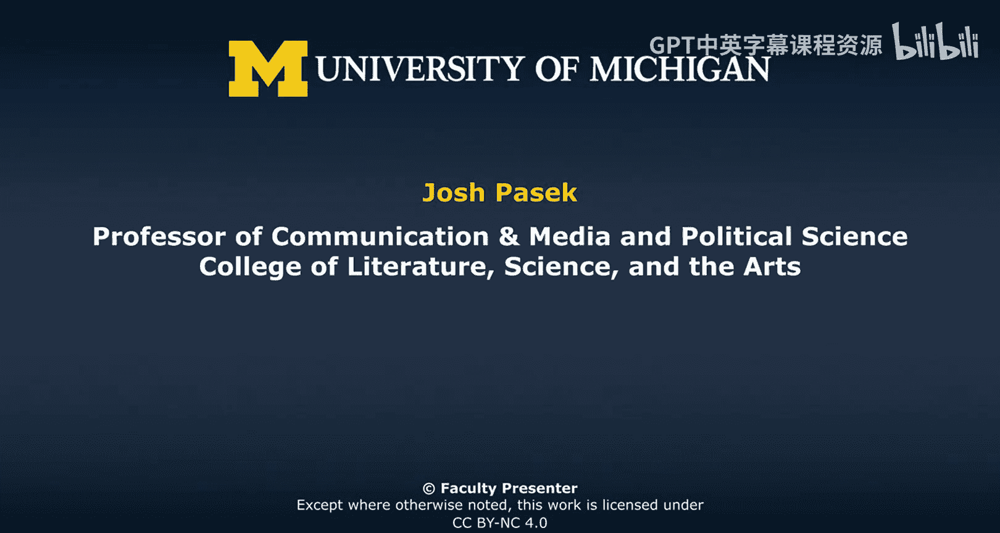

# 密歇根大学《应对颠覆：工作场所的生成式人工智能｜Navigating Disruption： Generative AI in the Workplace》 - P28：0_系列概述课程简介3.zh_en - GPT中英字幕课程资源 - BV159uyztEfn

Hi， my name is Josh Passock and I'm a professor of communication and media and political science at the University of Michigan。

Welcome to generative AI Ineg， Effects on labor and Workfor Cose3 in the four course series。

 navigating Dis， generative AI in the workplace。😡，In this course。

 we examine the implications of introducing generative artificial intelligence into the workplace。

 with effects not only on how workers do their jobs， but also on the relations linking firms。

 employees， and clients。Before we begin， let me tell you a little bit about myself。

My background is as a communication researcher， and my scholarship revolves around how people make sense of topics in the news。

I use a number of data science and machine learning techniques to understand the state of public opinion。

 as well as how people use information to make social and political decisions。

Some of the same data analysis approaches that I use in my research make up the core of modern artificial intelligence systems。

Understanding artificial intelligence， both from a technical perspective and its role as an information and communication technology。

 provides valuable insights into how the affordances or capabilities of AI are poised to interact with the social world。

Indeed， working at the intersection of social science and data science。

 as well as serving as the past Asiate Director of the Michigan Institute for Data and AI and Society has put me at the center of a conversation about the likely social impacts of artificial intelligence。

In this short course series， we explore how artificial intelligence is poised to influence the contemporary workplace。

Given the potential magnitude of the shifts introduced by AI。

 as well as uncertainty around both the future of artificial intelligence and how we will respond to it。

 I approach this course with an eye toward how past information and communication technologies shape the social and workplace environments of their eras。

Lessons from these historical examples provide the context for thinking about the impacts of artificial intelligence。

Making sense of what kinds of influence AI will have on workplaces and where AI may introduce unexpected hurdles requires an understanding of four key areas that serve as the FoOCI for this short course series。

First， assessing the impacts of AI requires that we understand what contemporary artificial intelligence actually is。

Focusing on generative artificial intelligence， the first course in the series is entitled generative AI Forecasting Disruption。

It puts AI in the context of earlier disruptive technologies， examines how AI works。

 and unpacks how different approaches to the use of AI can yield differing results。

The second pillar for understanding AI's implications stems from a focus on how AI is poised to alter the kinds of tasks that comprise contemporary workplaces。

The second course is titled Generative AI Shaping Work and Task。

 and highlights an array of jobs from various types of workplaces。

The course considers which worker tasks are more and less susceptible to AI replacement and augmentation and how the integration of AI may alter what people do。

Next， we zoom out to think about how shifting roles and responsibilities are going to alter knowledge work more generally and how interactions between firms。

 workers and clients are likely to change in the wake of AI integration。😡。

The third course in the series， generative AI integration， effectsect on labor and workforce。

 considers these issues and how firms can prepare。And finally。

 the series ends with a consideration of the many challenges that contemporary and near future artificial intelligence systems are likely to pose for workplace implementation。

In generative AI in the workplace， policies， ethics and risks。

 we examine questions about what kinds of AI use may be deemed appropriate or acceptable。

How public policy is handling AI and where the technology appears to be headed。

Although you can pick and choose among these courses。

 I think you'll find the most value taking these courses in this order。

Understanding how generative AI works is an important foundation for making sense of the implications it is likely to have on workers tasks。

 which is itself valuable for understanding the broader workplace implications of the disruption that's coming。

And identifying the changes that are likely to occur helps to prepare you for thinking about when and where things could go wrong。

If you've already finished earlier courses in this series， welcome back。

If you haven't， I recommend taking generative AI forecasting disruption and generative AI shaping work and tasks before this one to understand how AI works and how tasks for different jobs may be exposed to AI。

 as these provide a valuable foundation for this course。In generative AI integration。

 effects on labor and workforce， we take on the larger impacts of artificial intelligence on jobs。

 workplaces， and the relations between firms and clients。In this course。

 we identify the disruptions that are likely to occur on each of these levels and highlight the need for firms to simultaneously innovate while they work to ensure that their efforts build value and are well directed。

Working through these questions and developing strong policies is important for establishing a workplace culture that's likely to benefit。

From the changes to come。As you take this course， you should be able to recognize how AI may change the distribution of jobs in a workplace。

Identify ways AI might alter managerial work。Anticipate challenges that AI might pose for workers in management。

Forecast implications of AI for interactions between companies and customers。

Consider how choices about AI integration will influence both who takes responsibility for AI products and worker autonomy。

And recognize how AI is likely to influence the ways workers relate to corporations with respect to both organized and non organized labor。

I'm really excited that you'll be joining us for this course， and I hope that you find it valuable。

