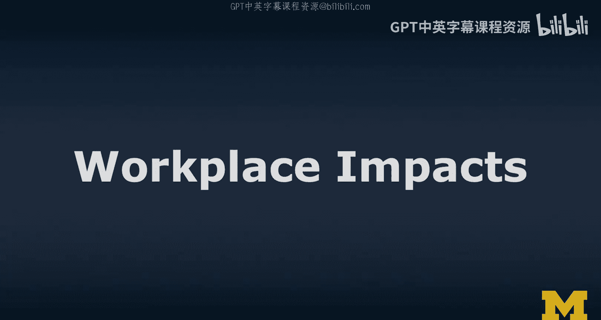
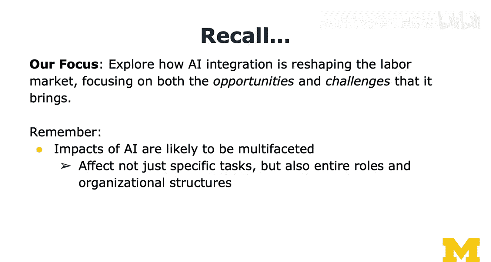
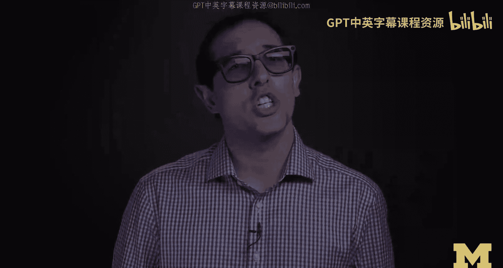
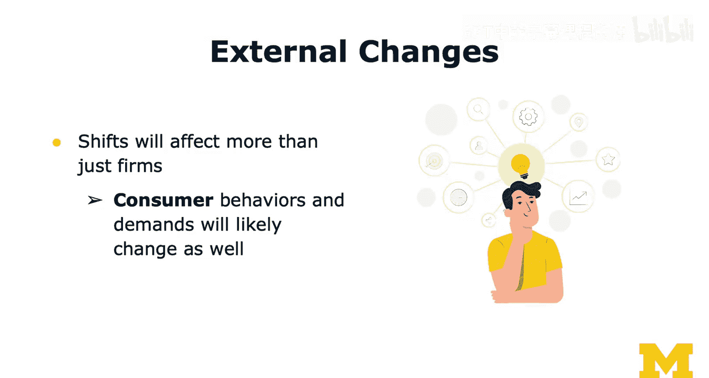
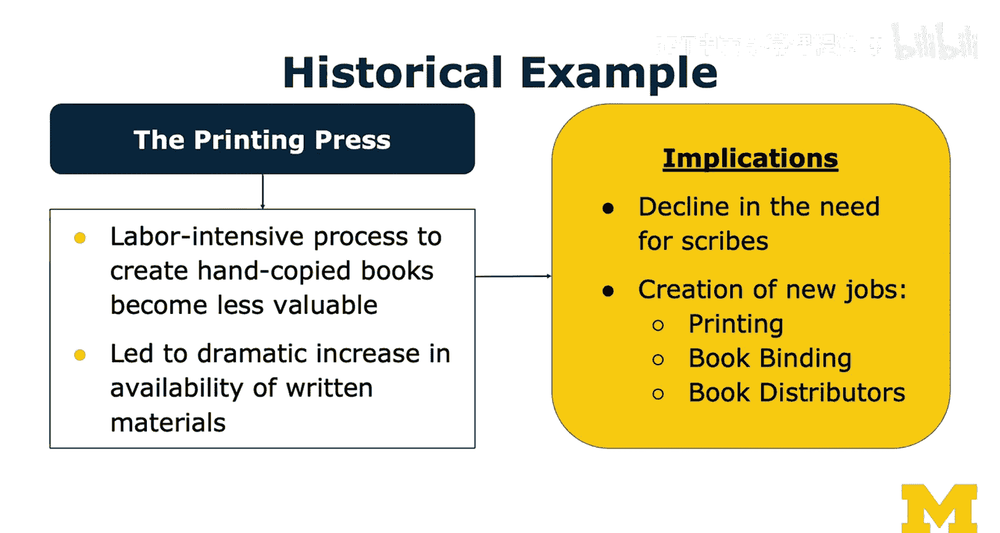
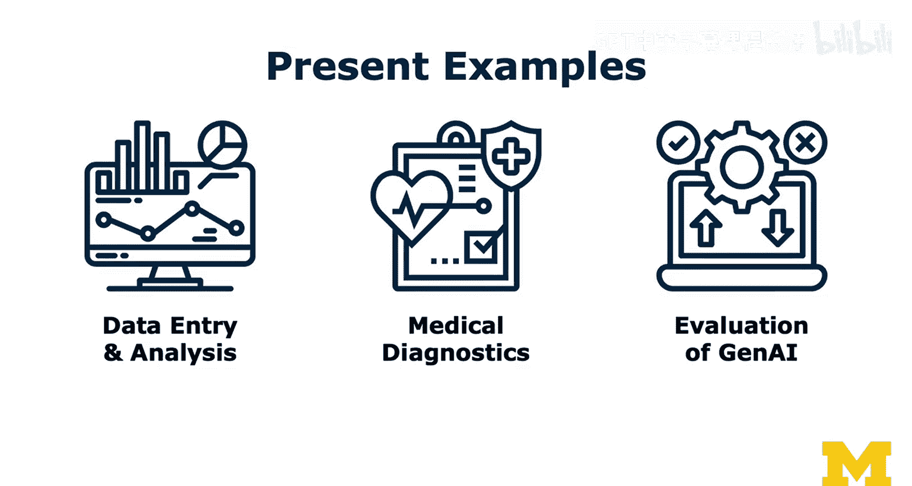
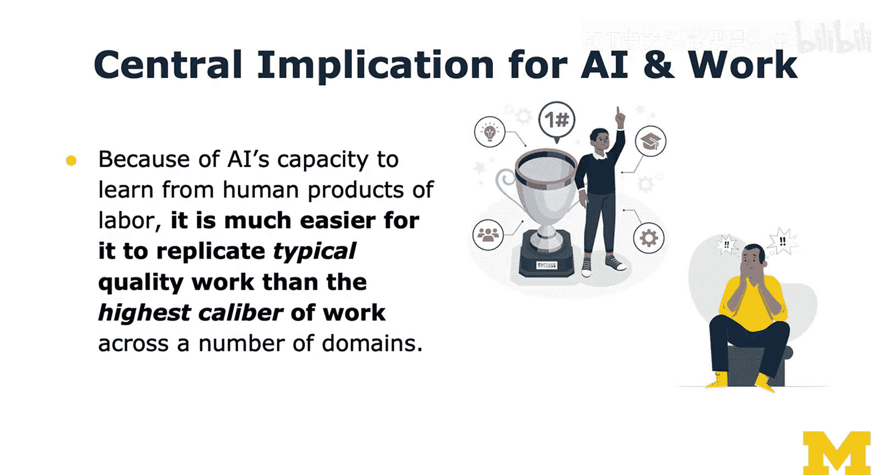
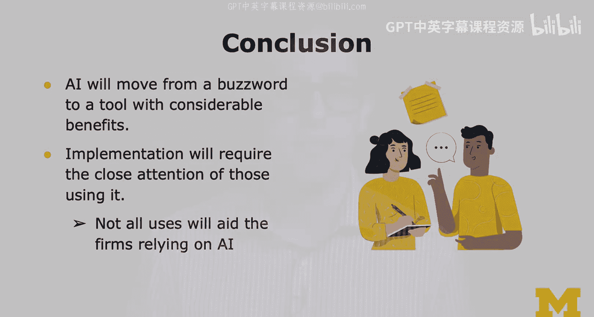
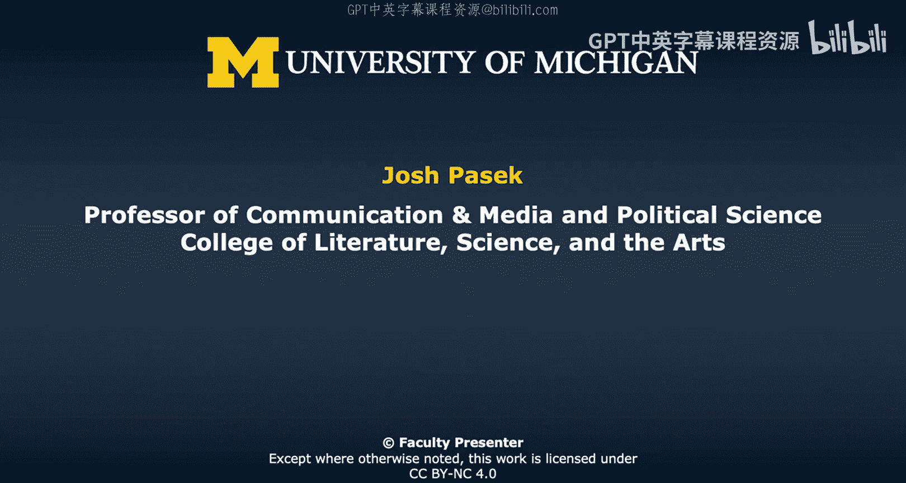

# 密歇根大学《应对颠覆：工作场所的生成式人工智能｜Navigating Disruption： Generative AI in the Workplace》 - P29：1_对工作场所的影响.zh_en - GPT中英字幕课程资源 - BV159uyztEfn

In this course， we shift from thinking about artificial intelligence's impact on the tasks that individual workers must complete to thinking about the larger impact of artificial intelligence in the workplace。

In many ways， AI has already begun to transform workplaces across various sectors from manufacturing to healthcare。

 and it will continue to do so。

Specifically， we're going to explore how AI integration is reshaping the labor market。

And focus on both the opportunities and challenges that it brings。Importantly， as we do this。

 it's worth remembering that the impacts of artificial intelligence are likely to be multifaceted。

They're going to affect not just specific tasks， but entire roles in organizational structures。

Things are going to change in many ways， this includes the ways that work is getting done and how that work is negotiated between workers。

 their workplaces and consumers。

Jobs within an organization are interconnected， and as artificial intelligence shifts what one person is doing。

 that will often lead to subsequent changes in how other people get their work done and in how work is distributed。

For example， when administrative tasks can be automated。

 the individuals who used to do those tasks now have additional time to focus on other activities。

It may be the case that in certain contexts， fewer positions are needed。

 because artificial intelligence has rendered the work manageable by a smaller number of people。

In other positions， there are new roles that will center around the oversight of artificial intelligence。

 instead of on the work previously done by humans that artificial intelligence can now replicate。

In practice， all these shifts necessitate a reevaluation of job descriptions and workflows to ensure that different parts of an organization adapt harmoniously and to ensure that effort is not wasted。

But the implications of all these shifts are that individuals will find that their roles change。

 even if their roles currently are not ones that are replaceable by artificial intelligence。Notably。

 these shifts occur not only for firms themselves， but also exist with respect to customer demand。

 that is what consumers want from firms is liable to change in the age of artificial intelligence。

 not just what firms are able to provide。😡。

If we look back to historical disruptive technologies。

 we see that technological advancements have radically altered job landscapes in the past。

When the printing press revolutionized the way information was disseminated。

 it rendered the labor intensive process， whereby scribes hand copied books far less valuable than it had been before。

 and created a dramatic increase in the availability of written materials。

 This shift resulted in a decline of the scribes roles。

 but created new jobs at the same time in printing， bookbining and distribution。

Similar to the printing press， artificial intelligence can be expected to disrupt a number of existing roles while creating new opportunities。

As we talked about in the previous course， artificial intelligence may replace routine or repetitive work that was previously done by humans。

Data entry jobs can increasingly be handled by artificial intelligence。

 eliminating the need for human involvement， and often improving the quality of the work。

In other cases， artificial intelligence can augment human capabilities。

 making workers more efficient and productive。Artificial intelligence powered tools and medical diagnostics can assist doctors by quickly analyzing medical images。

 flagging key things that doctors should pay attention to。

 and leading to faster and more accurate diagnoses。Additionally。

 artificial intelligence can shift the nature of a particular role。

 encouraging workers to develop new skills and focus on higher level tasks such as evaluating the quality of AI's work and fact checking to ensure that any hallucinations or biases in the products of artificial intelligence have been removed。

Of course， there are many contexts as well where artificial intelligence cannot meaningfully influence human labor。

Workers completing these tasks may see their roles as largely immune to artificial intelligence。

 but that would be a misconception。Even though the tasks they complete are not directly susceptible to AI augmentation or replacement。

As AI influences other roles， the repercussions of disruption may still influence these positions。

Collectively， when AI alters the role of labor， it will have implications across entire workplaces and collective goals。

In many circumstances， the integration of artificial intelligence can lead to a leaner workforce where fewer people are needed to perform tasks that AI can handle on its own or can efficiently augment。

But these effects will likely be felt unevenly across areas。

Demand for highly skilled workers who can manage and improve AI systems may increase those who have particular skill in prompting and shaping AI results may also benefit。

 hence while a factory that uses AI for quality control may require fewer line inspectors。

 it may simultaneously demand more AI technicians。One central implication of AI's capacity to learn from the products of human labor is that it will be much easier for AI to replicate typical quality work than the highest caliber work across a number of domains。

This leads to an expectation that an AI oriented workforce may see winner take all dynamics in particular。

 individuals who are top performers in their fields may find their positions solidified as AI augments their capabilities。

 but fails to encroach on the unique skill sets that make them the best at what they do。

These types of individuals may be viewed as even more productive and valuable。Conversely。

 midlevel and lower tier workers， as well as firms that rely on a large volume of AI replaceable output may face greater risks of displacement as the tasks they perform can more readily be automated and their roles deemed non-essential。

This dynamic highlights the importance of continuous learning and skill development for individuals and firms to remain competitive in an AI driven job market。

It also implies that contexts where marginal differences in skill are important are ones where the individuals exemplifying those skills are most likely to be protected from AI driven disruption。

Collectively， then， this has implications for workers， management and consumers。For workers。

 AI might displace certain jobs and change the roles of others。

 necessitating retraining and upskilling programs to help individuals transition into new roles。

Workers may also need to adapt to new collaborative dynamics。

 working alongside AI tools and learning to evaluate their output as a key part of their jobs。

Managers will face different challenges， they will need to find effective ways to integrate AI into existing workflows and to ensure that both AI and human workers are productive and engaged。

Effective AI management will require continuous learning and adaptation as AI technologies continue to evolve rapidly and concerns about their use subsequently adapt。

Managers will also need to build systems that will allow them to monitor the impacts of the AIVUs。

 as well as the impacts of artificial intelligence on demand for whatever products a firm produces。

For consumers， AI has the potential to enhance the quality and customization of products and services。

At the same time， artificial intelligence use raises concerns about data privacy and the loss of human touch in customer service。

Companies will need to balance efficiency gains from artificial intelligence services with maintaining trust and satisfaction among customers broadly speaking。

 AI will shift from being a bit of a marketing buzzword to something that can offer considerable benefits when it is part of a good or service that is being provided。

But it will require attention rather than simply broad application。😡，Indeed。

 not all uses of AI will aid the firms that implement them。

It is true that AI is likely to transform the workplace with huge implications for all the actors involved。

😡，Thinking through these implications proactively and imagining the downstream effects is key to productive implementation。

