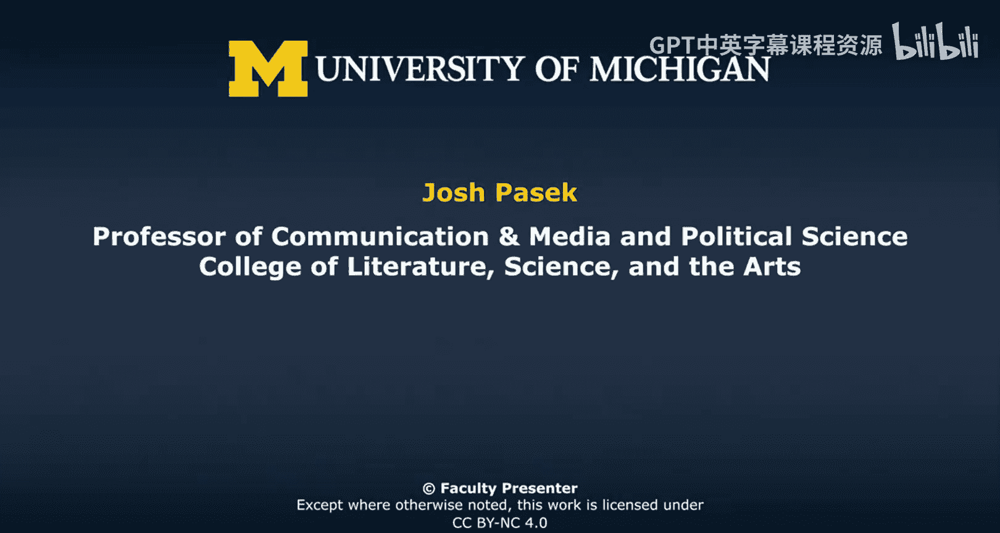

# 密歇根大学《应对颠覆：工作场所的生成式人工智能｜Navigating Disruption： Generative AI in the Workplace》 - P2：1_人工智能与印刷术.zh_en - GPT中英字幕课程资源 - BV159uyztEfn

Welcome to Mines Germany。This city。On the banks of the Rhine is the capital of the Rineland Poitinate region of Germany。

We begin our journey of disruptive technologies here because Mins was the home of perhaps the most disruptive technological invention of the last thousand years。

It was here behind me in the 1430s and 40s that Johannes Gutenberg assembled the first movable type printing press and set up his workshop。

This development allowed him to produce printed pages at a speed and with a consistency unheard of previously in human civilization。

Before the time of Gutenberg， if you wanted a book， you needed to hire a scribe。

 an expert whose job it was to carefully copy each letter from the prior version of the manuscript to the new version。

Sscribes could produce only one book at a time， and their works were highly prized。

The books they created were rare and expensive。The knowledge they contained was itself a precious commodity。

 and a rarefiified few would become literate and enter the small cabal of individuals who could access their wisdom。

What happened here in minds would alter the very trajectory of human civilization。

In a relatively short period， scribes were unnecessary， books became commonplace。

 and literacy began to permeate to the masses。But the revolution engendered by the printing press did not happen overnight。

Instead， a series of gradual changes shifted the role of information in society and the organization of societies themselves in ways that were not initially obvious and that only became clear in the decades and centuries that followed。

In fact， in early years， manuscripts produced by scribes were still seen as more valuable than those that were printed。

 and printers worked diligently to produce printed books that looked like they'd been copied by scribes。

Only later did they begin to lean in to the unique advantages of the printed page。

 such as standardized formatting。The full implications of the printing press would not crystallize until society was ready for them。

 Absent widespread literacy， books and pamphlets were only useful for a select few individuals。

Norms of information dissemination were necessary for the printing press to revolutionize science and literature。

 and new religious， political and social structures emerged only when it became clear how to publicize popular debates using the printed word。

The development of newspapers， the Protestant Reation， the broad recirculation of ancient texts。

 the enlightenment， and the beginnings of the scientific revolution were all logical outflows of Gutenberg's invention。

But the earliest of these were not apparent until the tail end of the 15th century。

The disruption of the printing press was far from the only technology that changed how information spreads and how human labor shapes that spread。

In the first half of the 19th century， the spread of telegraphs made it possible to send messages faster than humans could travel。

 In the 1890s， radio communication introduced the possibility that messages could be broadcast to a large audience。

In the first half of the 20th century， new media made it possible to convey not just text and sound。

 but also images。And in the second half of that century， the development of personal computers。

 again revolutionized methods for capturing and disseminating information。

Each of these had profound implications， introducing new ways of doing things and facilitating subsequent developments that change the ways people live their lives。

The shifts that these technologies have engendered also invited broad speculation about their cumulative impacts。

Some forecast that instantaneous telegraph connections between foreign governments would yield world peace。

Others posited that movies would negate the authority of parents and teachers。

These utopian and dystopian visions of the effects of technologies are often commonplace。

While each at their time may have seemed like a brave new world。

 the eventual effects were not quite so clear cut。Artificial intelligence clearly has the potential to introduce significant disruptions into the ways things will be done in the future。

The implications of this are indeed profound。But there's much to learn from these past disruptions。

Although some ways of doing things are likely to change。

 it's also likely that most jobs and workplaces will adapt to the vast majority of those changes。

The changes themselves are likely to take time。Indeed。

 even the scribes whose work was most obviously obsolete after Gutenberg's invention held on for a couple more decades。

And the biggest effects will probably only become clear to all of us once the technology has had time to mature。

 and we've figured out how to adapt to it socially。

As we explore how AI works and what kinds of implications it has for various domains。

 we need to simultaneously recognize both how revolutionary AI has the potential to be。

 as well as the long time span over which that revolution might take place。

This lesson is at its most salient here in the very spot where Johannes sctenberg was born。Of course。

 the more we think through both the technology and the implications of this next great revolution。

 the more prepared and proactive we can be。

