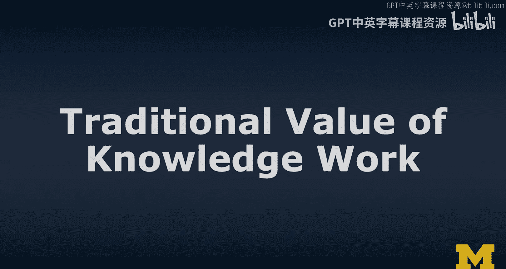
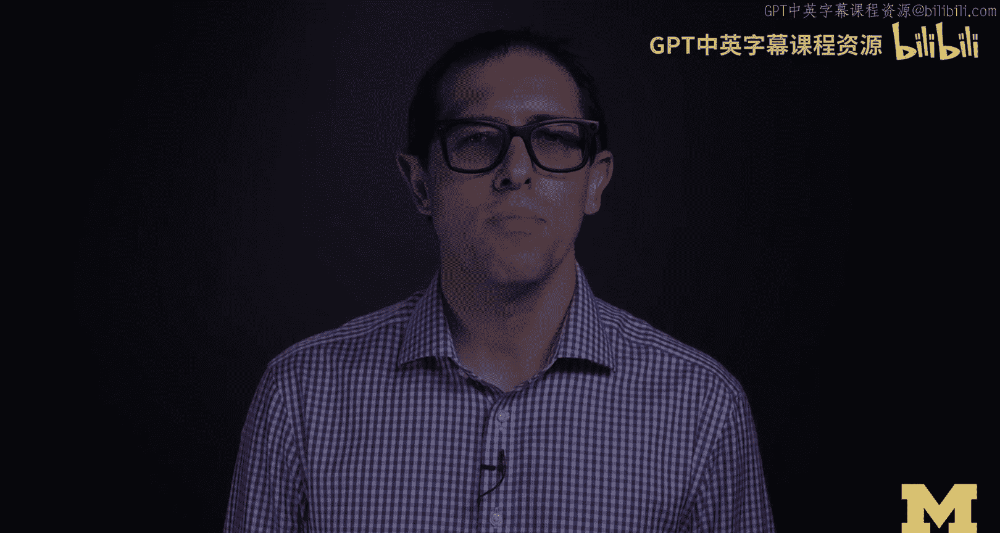
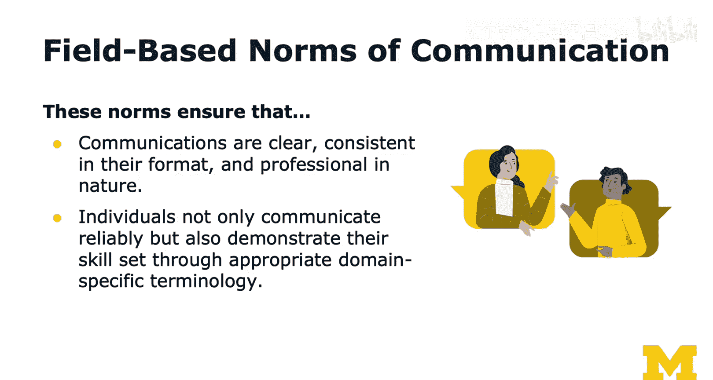
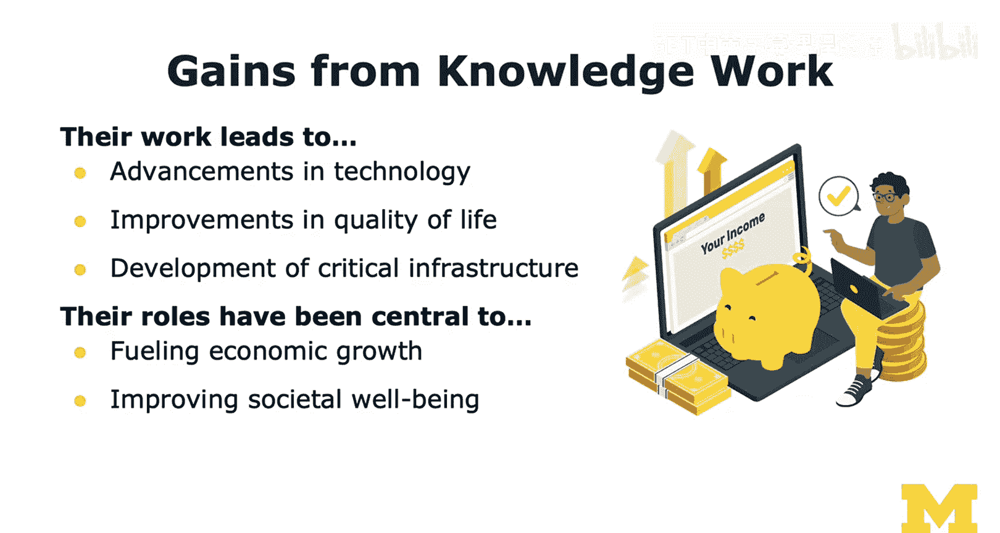
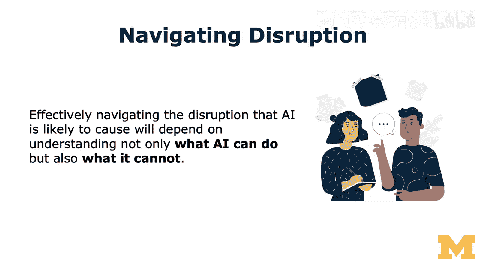
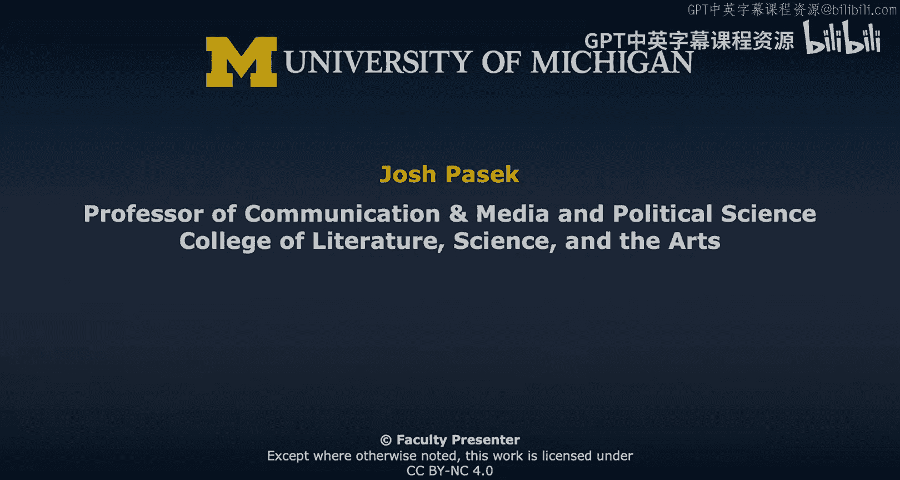

# 密歇根大学《应对颠覆：工作场所的生成式人工智能｜Navigating Disruption： Generative AI in the Workplace》 - P30：2_知识工作的传统价值.zh_en - GPT中英字幕课程资源 - BV159uyztEfn

Perhaps the greatest disruption will occur for knowledge workers。

 individuals whose jobs involve skills like writing， analysis， coding。

 and drafting materials that others read and see。These jobs have traditionally held immense value in key areas of the contemporary economy。

Knowledge work domains typically involve considerable training and credentialing。

 individuals with high levels of domain expertise。Standardized norms of communication and discourse。

 accountability for work products， and societal value。

Knowledge work often requires extensive education and professional credentials， accountants。

 lawyers and doctors go through rigorous training and certification processes。

 often spending years pursuing advanced educational degrees。

Their ability to complete specialized tasks is certified by university degrees and the courses they've taken。

This training ensures that knowledge workers have the necessary skills and knowledge to perform the complex tasks their domains require。

Individuals in knowledge work areas also often require considerable domain expertise this kind of expertise is necessary for solving complex domain specific problems and making informed choices。

For example， financial analysts must understand market trends and economic indicators to provide accurate advice。

This expertise is typically developed through a combination of formal education and practical experience。

Knowledge professionals frequently adhere to complex and specific norms and standards for communication。

Lawyers use precise language and follow strict documentation practices。

Academics have well established domain specific jargon that ensures identical understanding among peers。

These norms ensure that communications are clear， consistent in their format。

 and professional in nature。Individuals adept in these norms， not only communicate reliably。

 but also demonstrate their skill set through appropriate domain specific terminology knowledge workers are also typically accountable for their outputs。

 which must meet high standards of reliability and accuracy。

For example， a government worker must stand by the accuracy of an official statistic。

 or an engineer must ensure that their designs comply with safety standards and ethical guidelines。

To bolster accountability， professional bodies and regulatory frameworks limit who can participate in certain professions and outline the requirements workers need to meet。

Therefore， knowledge work requires expertise， awareness of norms， and accountability。

Its value is essential for the functioning of modern society。

 providing services and expertise that support various sectors。

 ensuring appropriate actions are taken， and that information about how and why those actions were taken is available。

This is true for healthcare professionals， for instance。

 improving public health and for educators shaping future generations。

The trust we place in knowledge professionals depends on a clear understanding of why they did what they did。

 which in turn relies on their training， expertise， and adherence to professional norms。

Knowledge workers tend to receive relatively high salaries。

 not only because of the training required， but also because their contributions are valuable to society。

Their work leads to advancements in technology， improvements in quality of life。

 and the development of critical infrastructure。These roles have been central to fueling economic growth and improving societal wellbeing。

Unlike many disruptive technologies the past few decades。

 artificial intelligence seems poised to have its greatest impact on the knowledge professions that tend to produce the most societal value。

This means that the disruptive impacts of AI are likely to be somewhat different from other recent disruptions。

 which largely affected manual laborers。AI， trained in a vast wealth of data。

 can effectively perform the tasks used to evaluate and credential knowledge workers。

AI can copy the communication standards and norms of various knowledge areas and replicate the outputs of critical thinking that have long differentiated the positions that were viewed as having the most societal value。

All this highlights the potential disruption generative artificial intelligence might cause。However。

 there are features that AI cannot replicate。Effectively navigating the disruption that AI is likely to cause will depend on understanding not only what AI can do。

 but also what it cannot。

