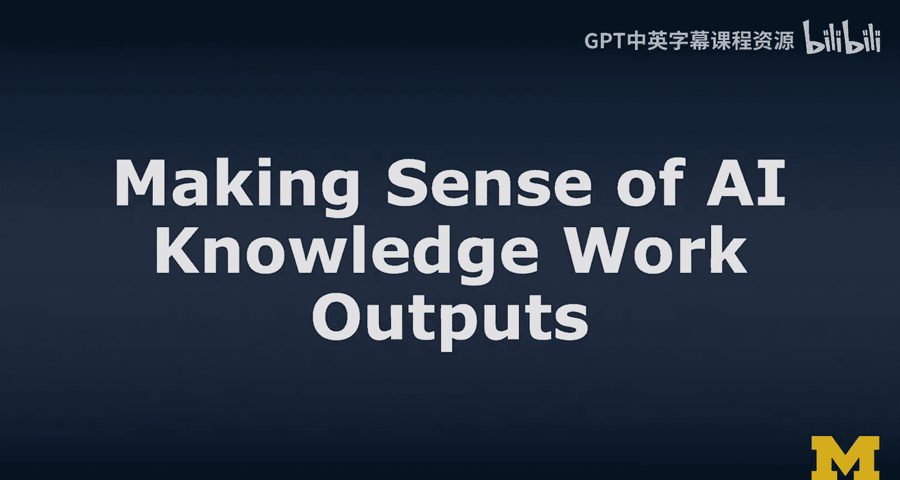
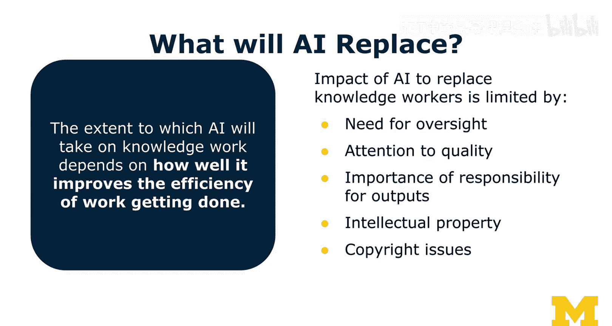
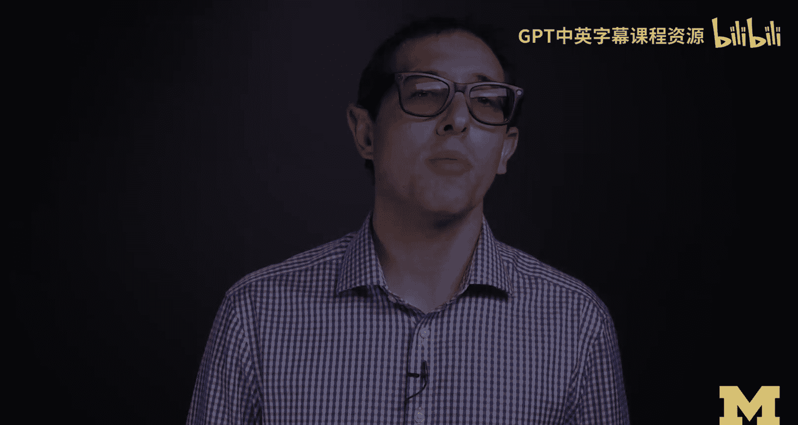
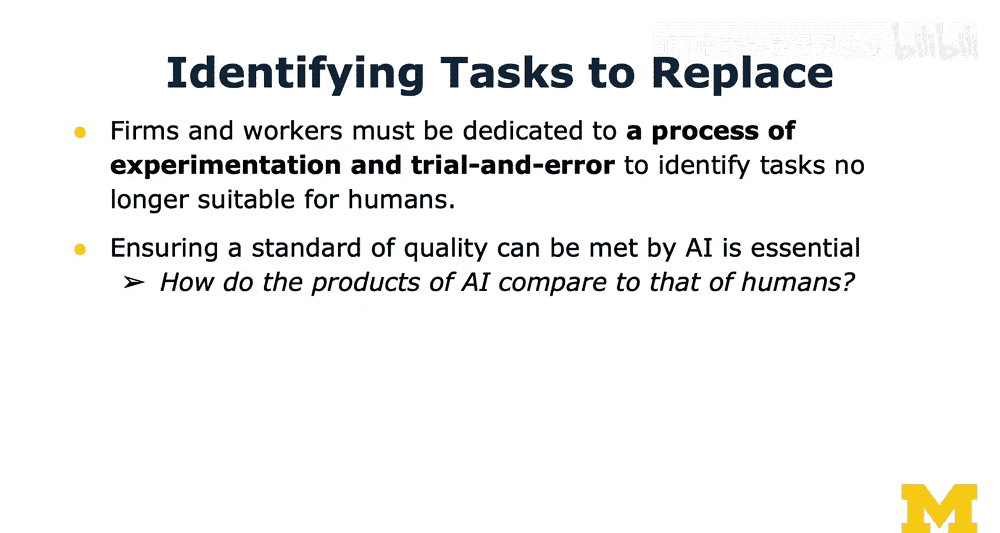
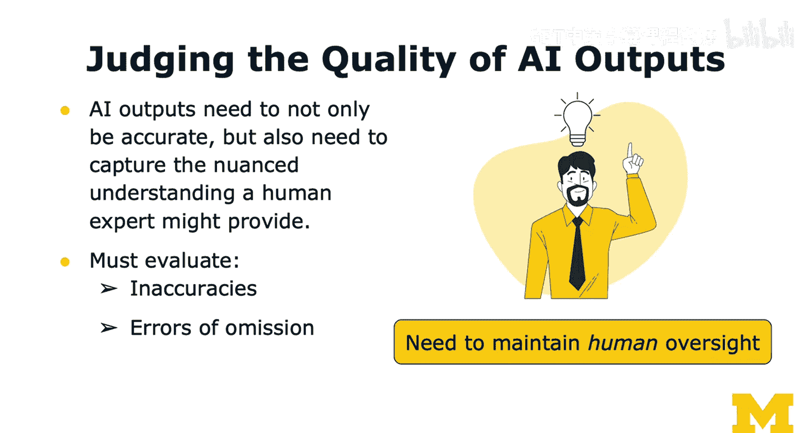
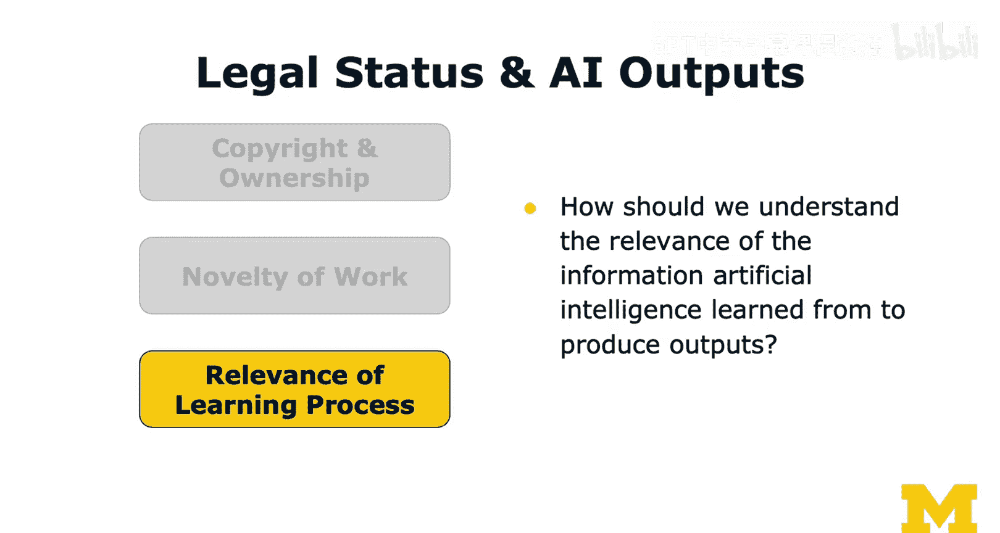
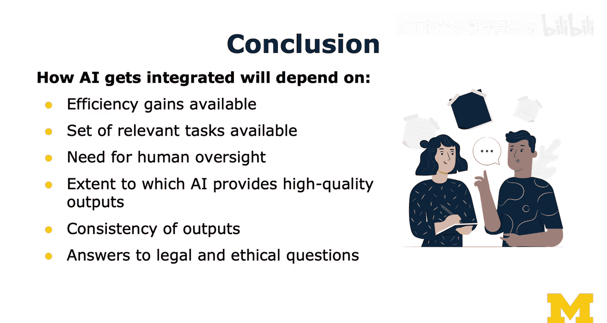
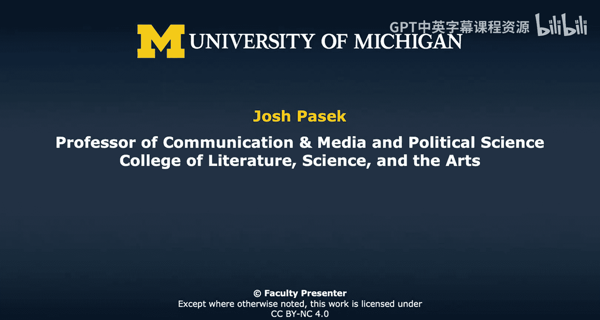

# 密歇根大学《应对颠覆：工作场所的生成式人工智能｜Navigating Disruption： Generative AI in the Workplace》 - P31：3_解析人工智能的知识工作输出.zh_en - GPT中英字幕课程资源 - BV159uyztEfn

In the last lecture， we discussed why knowledge work has been highly valued in society。

Another key feature of knowledge work， at least through the last several disruptive technologies。

 is that individuals in white color professions have been largely immune to the impacts of disruption。

In the artificial intelligence space， however， this is likely to change。

Using an assessment to the exposure of various tasks to artificial intelligence。

 scholars have evaluated which jobs are likely to experience the greatest disruption from AI。

In direct contrast to the lower skilled work that was upended by outsourcing or the manual labor replaced by assembly lines。

 the sort of work that AI disrupts tends to reflect the kinds of jobs that have been most immune to past disruptions and that require considerable investments in time in skill building and credentialing。

The extent to which AI will take on knowledge work depends fundamentally on how well it improves the efficiency of getting work done。

In many cases， due to the need for oversight， attention to quality。

 the importance of responsibility for outputs， and intellectual property and copyright issues。

 artificial intelligence is likely to be limited in its ability to completely eliminate the roles of human knowledge workers。

Reviewing both the efficiency gains that can be made， the likely shifts in labor that will occur。

 and the need for human oversight allows us to think more holistically about how task replacement。

 task augmentation， and shifting labor are likely to operate on the level of entire jobs。

 rather than mere tasks。

So where do AI gains in efficiency occur？Artificial intelligence can significantly increase efficiency by automating routine and repetitive tasks。

 drafting and outlining content that would otherwise need to be manually generated。

And collecting and evaluating data that may form the basis for various decisions。

The extent to which AI is likely to introduce efficiency gains depends in no small part on how well AI can be directed toward a task。

Hence， routine memos， standardized analytic procedures。

 and common forms of reporting are likely to be replaced or augmented by artificial intelligence more quickly than bespoke analyses。

This increased efficiency will initially place additional value on complex and creative tasks。

Identifying which tasks are no longer relevant for humans to do will require firms and workers to engage in experimentation and trial and error。

Assessing the reliability with which artificial intelligence can conduct basic data entry。

 initial legal document review or simple medical diagnostics will be critical for ensuring that a standard of quality is still met if individuals are not leading these efforts。

As firms engage in this sort of evaluation， they may wish not only to assess the quality of artificial intelligence work。

 but also to compare it directly to the quality of human work。

 and to examine how well human checking effectively catches AI errors。

Evaluating the quality of artificial intelligence work will be enormously important。

The accuracy and quality of AI generated outputs can vary significantly depending on the data and algorithms used。

 as well as the prompts provided to an algorithm。In some cases。

 it may be reasonable for firms to accept slightly lower quality AI outputs if gains and efficiency are sufficiently large。

In other cases， however， even small reductions in quality may undermine or eliminate the value of AI。

We need to ask whether AI generated reports are not only accurate。

 but also capture the nuanced understanding that a human expert might provide。

We need to consider not only potential inaccuracies， but also errors of omission。

 all this points to the need to maintain human oversight over the reliability and accuracy of AI outputs。

Firms also may need to engage in formal efforts to evaluate both the consistency and quality of AI work。

The use of artificial intelligence for work products also raises myriad questions about responsibility for the information that's produced。

Because artificial intelligence algorithms do not know things in the traditional sense。

 they're prone to various kinds of errors。The tendency to rely on automated tools can compound these errors。

 making them difficult to catch and adjudicate。When an artificial intelligence system recommends inappropriate content。

 cites a nonexistent court case in a legal brief， or simply mixes up its facts。

 who should be held responsible？

This question is especially pertinent when broad AI models are applied to specific use cases。

Developers presumably could never have foreseen the particular issues that might emerge and clearly should not be held accountable。

But depending on the circumstances， it may also make little sense to blame the user。

Such as when a chat bot provides inaccurate information in response to a customer service request。

Anticipating and evaluating these sorts of complications is a critical task。

The challenges of artificial intelligence products are only compounded when we consider the legal status of AI outputs。

There is an ongoing debate about whether and under what circumstances AI generated work can be copyrighted and who would hold the rights to such work。

If content is produced jointly between humans or firms and artificial intelligence。

 how should we evaluate the novelty of what's produced？

How should we understand the relevance of the information artificial intelligence learned from to produce outputs？

These questions undermine traditional notions of authorship and ownership and lead to legal and ethical dilemmas around AI generated art。

 music， and textual content。

It may be decades before we've established clear norms and laws for how to use attributee and credit AI generated and assisted content all this serves to highlight a series of challenges that firms face as they attempt to understand where artificial intelligence can and should fit into their workflows。

😡，The capacities of artificial intelligence are only part of that story。

How AI gets integrated will depend on the efficiency gains available， the set of relevant tasks。

 the need for humans to be part of various processes。

 the extent to which AI provides high quality outputs， the consistency of AI outputs。

 and questions of responsibility， ownership， and the legal status of artificial intelligence。

For these reasons， what AI can do？😡。

What AI will do and when AI should do it are importantly distinct questions。

