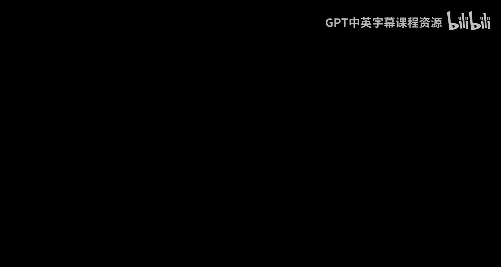
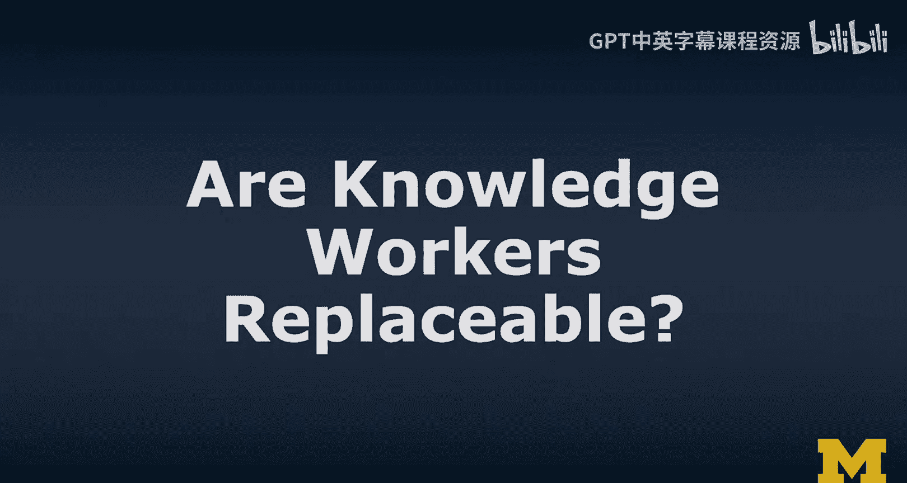
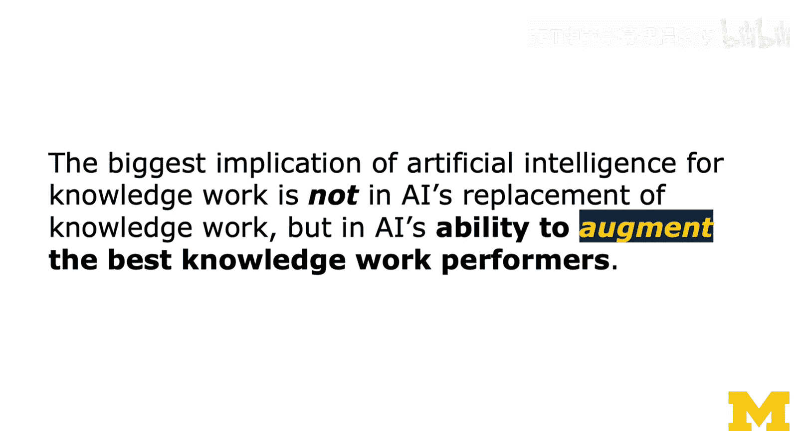
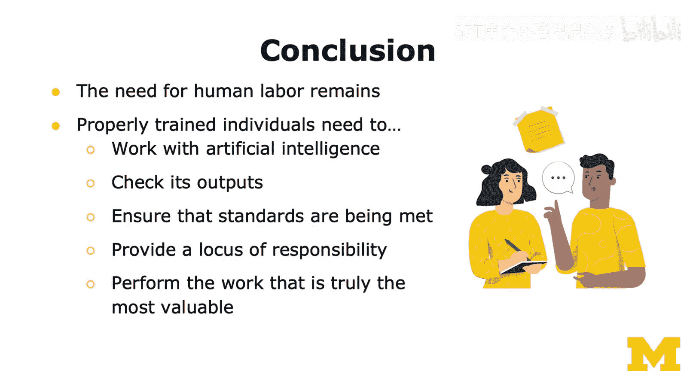
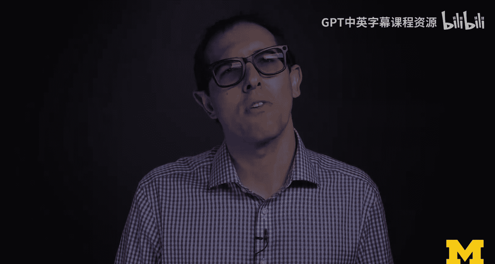
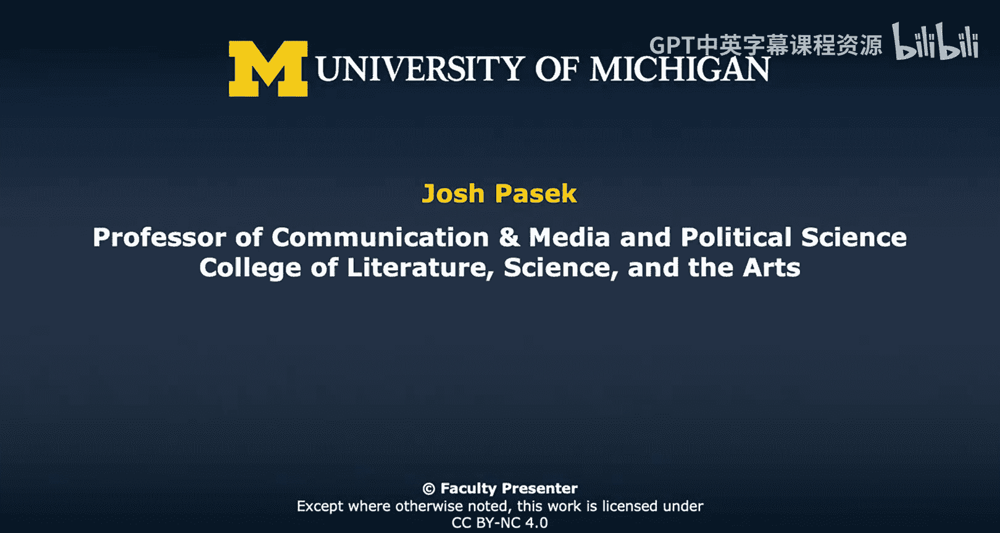
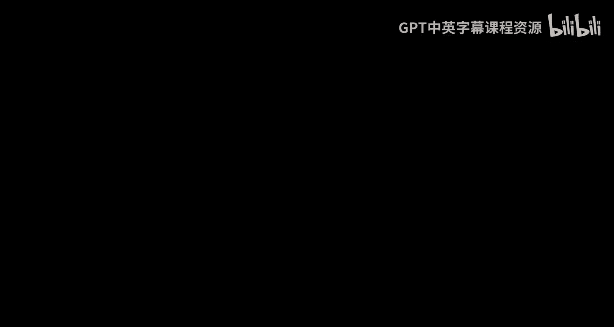

# 密歇根大学《应对颠覆：工作场所的生成式人工智能｜Navigating Disruption： Generative AI in the Workplace》 - P32：4_知识工作者是否可被替代.zh_en - GPT中英字幕课程资源 - BV159uyztEfn

Under what circumstances can artificial intelligence meaningfully replace knowledge work？

Although in various aspects， artificial intelligence can replicate what knowledge workers produce。

 the question is larger， it depends not only on the quality of what can potentially be replaced。

 but also on a series of economic considerations， the extent to which one can trust artificial intelligence。

 the need for oversight， and an understanding of the limitations。

 biases and other problems that accompany contemporary artificial intelligence。

As we've already covered， artificial intelligence has impressive capabilities to replicate many aspects of knowledge work。

AI systems can draft all sorts of documents， ranging from legal briefs to academic articles。

 diagnose and identify content and images， and generate automated reports on data about social。

 financial， and other matters。Artificial intelligence also continues to advance。

 and developments in natural language processing and machine learning are enabling new capabilities。

As a basic economic matter， the lower the barriers to entry for a particular area。

 the less valuable the skills and products of that area become。

To the extent that AI is able to complete tasks that previously required extensive training and expertise。

 their relative value of the skills and credentials that characterize that particular area is similarly likely to decline。

If a potential client for a graphic design firm is instead able to produce a sufficient design on their own。

 the value of the graphic designer's work is inherently diminished。

Clients seeking legal surfaces who are able to self generate a draft version of an agreement need less legal work than those who come empty handed。

In numerous areas， this can lead to a shift in job market dynamics。

 where specialized skills are no longer in similar demand or need to adapt to maintain their value。

That is， the barrier to entry is lower and the value accorded to a particular type of work is correspondingly decreased。

But the mere fact that artificial intelligence can complete a particular task is insufficient。

 either for firms to rely on it for that task or for them to trust the output that's produced。

The products of artificial intelligence， at least in the contemporary moment， are relatively opaque。

Unable to observe the methods used to generate content and other outputs。

 firms may find that lack of transparency prohibits reliance on AI。

AI may be using information that leads to biased results or may be using inappropriate information for making decisions。

Because the complexity of artificial intelligence models renders us unable to identify the specific reasons that a particular model yields a particular series of results。

 these sorts of errors may not be identifiable in nature。When AI makes mistakes。

 it may not do so in the circumstances where we would otherwise expect human mistakes to be the most common。

 meaning that our ability to even identify where to probe for potential problems could be misleading。

All this reinforces a theme for the integration of artificial intelligence into many workplaces。

It will involve considerable human oversight and regular evaluations of the quality and consistency of AI output。

That oversight will need to involve individuals who have the capacity and the expertise to identify errors on their own and to confirm the results of artificial intelligence。

Human oversight also offers the potential for meaningful accountability。

These limitations of AI largely surround the kinds of tasks that seem on their face to be solely replaceable with automated intelligence。

Yet it is important to remember that many tasks are only partially completable with contemporary AI。

In many cases， AI cannot produce sufficient output on its own， human judgment， creativity。

 evaluations of AI output， and considerations of how what's being produced relates to ethical， legal。

 and other standards require input beyond an artificial intelligence system itself。

Although perhaps more integrated with artificial intelligence than was the case previously。

 the human role here remains。Perhaps the biggest implication of artificial intelligence for knowledge work is not in AI's replacement of knowledge work。

 but in AI's ability to augment the best knowledge work performers。

Those who stand head and shoulders above others in their fields are likely to find themselves in even greater demand as AI further integrates into the workplace For one。

 the top performers will likely be able to accomplish more when augmented by artificial intelligence。

For another， the quality of work that can be achieved by AI is generally strong compared to the average outputs in a domain。

 but not at the level of the very best output。Firms and workers who perform demonstrably above average will be even more likely to stand out。

In contrast， mid level and lower tier workers may face greater risks of displacement as their tasks become automated and their roles less essential。

The implications of these challenges are manifold for one。

 workers and firms must focus on continuous learning and skill development to remain competitive in an AI augmented job market。

However， the value accorded to top performers relative to others in a particular domain will also raise important pipeline issues。

 because the kinds of mid-level work that allowed individuals to gain the expertise to become the very top performers will be more difficult to find。

 and may tend to pay less。Planning for these dynamics is critical for firms that wish to remain competitive into the future。

Collectively， these dynamics point to challenging times among the types of workers who've been relatively insulated from past technological disruptions。

But while the risks are many， the need for human labor remains。

Properly trained individuals will be needed to work with artificial intelligence to check its outputs to ensure that standards are being met。

To provide a locus of responsibility， and in some cases。

 to perform the work that is truly the most valuable。

So while there are implications for the value and nature of knowledge work。

 we are far from circumstances where we would expect a complete replacement for knowledge workers in the short or medium term。

