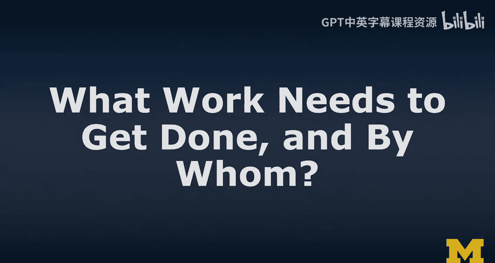
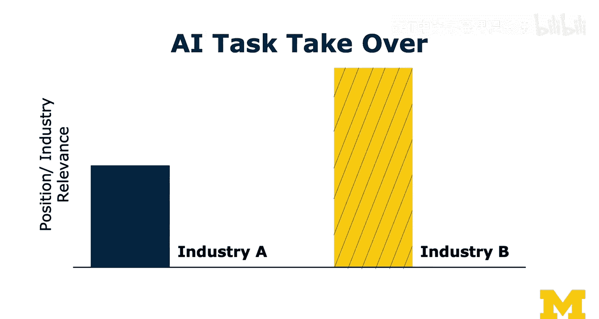
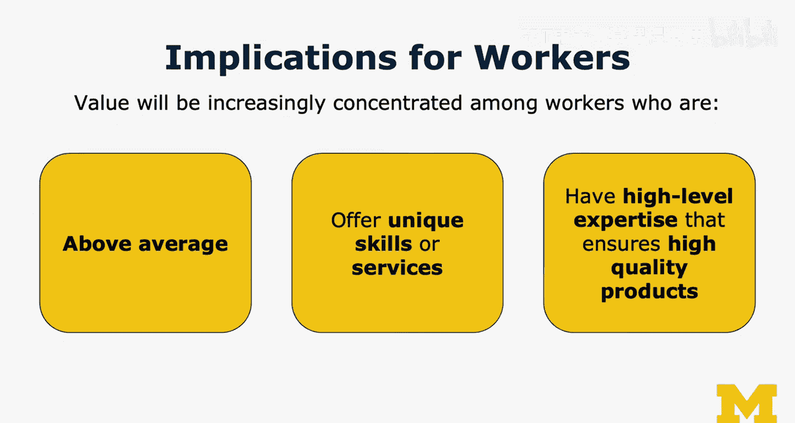
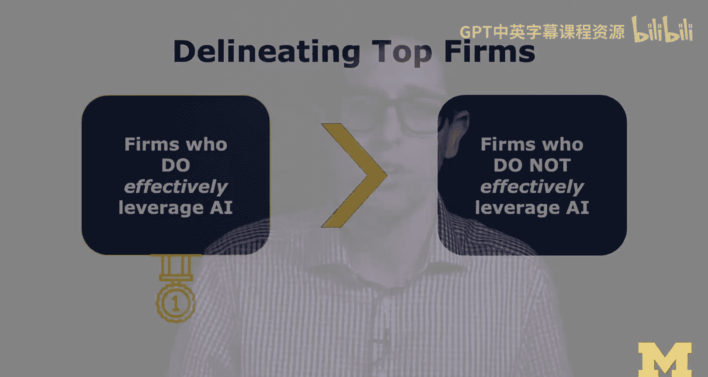
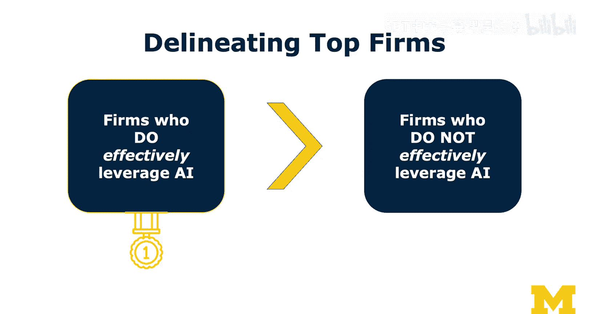
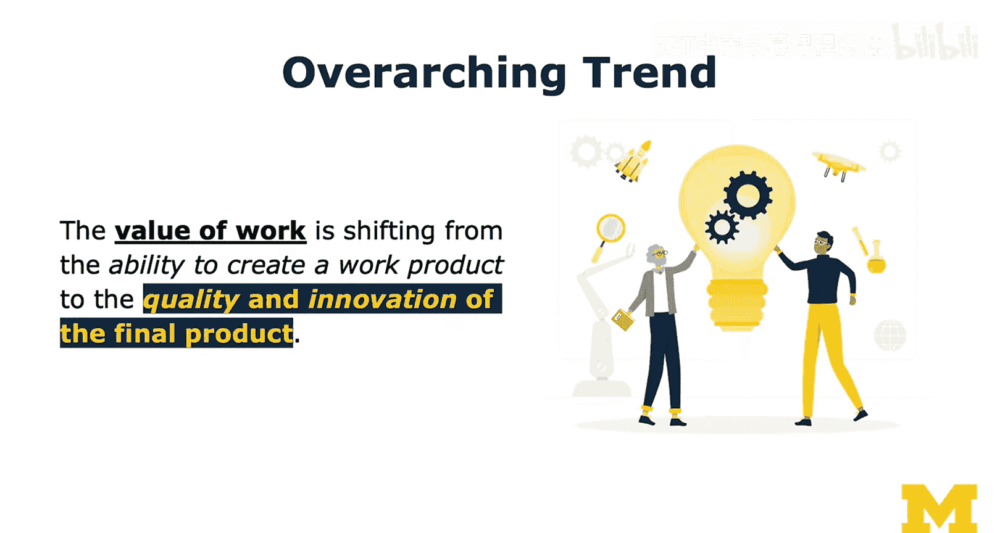
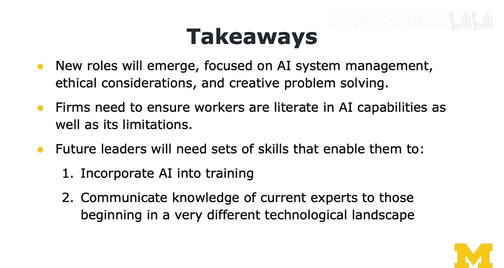
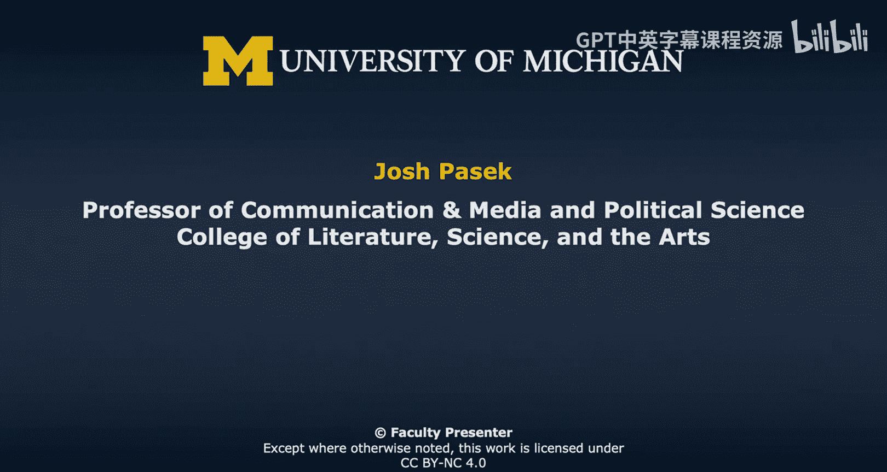

# 密歇根大学《应对颠覆：工作场所的生成式人工智能｜Navigating Disruption： Generative AI in the Workplace》 - P33：5_工作任务的分配与执行主体.zh_en - GPT中英字幕课程资源 - BV159uyztEfn

Artificial intelligence is poised to change not only the nature of individual jobs。

 but also the kinds of positions and industries and demand。

Some whole classes of industry will become less relevant as AI takes over tasks。

 while other domains will see their value propositions altered。

 with certain areas of labor becoming less relevant and other activities gaining greater importance。

The winner take all effect that is likely to influence higher versus lower performing knowledge workers is expected to have similar implications at an industry level。

New classes of work and firms will be necessary to handle the novel positions that characterize an AI augmented workforce。

To understand the implications of artificial intelligence。

 firms need to consider not only how it will affect their ability to supply what they currently supply。

 but also the demand for what they produce。

Entire industries may find that the products they sell become less relevant than before。For instance。

 companies that specialize in translating materials from one language to another will find that the need for professional translation services drops precipitously。

 as many translations can be effectively handled with artificial intelligence tools。

The same sorts of dynamics are poised to undermine many areas of graphic design。

 where small entities seeking logos may turn to Dolly or midjoney instead of a professional designer。

Firms will not only need to assess how their outputs compare to those of their competitors。

 but also how they fare in relation to AI generated alternatives。

Whether they're seeking a relatively quick illustration or a draft document from which to produce a will。

 clients may feel less of a need to seek out an expert if AI seems sufficient。

Firms will need to clearly reestablish their value in the emerging AI augmented landscape。

In an AI driven world， both firms and workers are likely to discover that average performance will no longer be sufficient for job security。

As AI allows non-experts to increasingly turn out typical level work。

 value will be increasingly concentrated among those who are above average。

 who offer unique skills or services and who have the kinds of high levelvel experience that ensure the quality of what's delivered is better than the typical AI offering。

It is not yet clear how consumers will come to learn which firms offer these higher quality outputs。

 but whether that processes by word of mouth or credentialing。

 being above average will prove increasingly important。

The winner take all effect is also likely to exist at the firm level。

 top performers who effectively leverage artificial intelligence are likely to come to dominate their industries。

 leaving less room for others。Companies that make better and more rapid use of the data available to them are likely to be the most effective first movers。

Here again， though， quality matters， we're likely to see many fly by night operations that use AI to quickly enter markets。

 but don't fully understand market circumstances。Firms that cannot respond to these developments will lose market share。

 while those that can clearly articulate their value added over and above artificial intelligence will play a continued role。

Many of these fly by night operations will fade when their lack of a deep understanding proves perilous。

Indeed， the value of work is shifting from the ability to create a work product to the quality and innovation of the final product in marketing。

 AI can generate campaign ideas， but the strategic insights and creative execution provided by humans add significant value。

😡，The competitive edge in this sort of environment will come from the unique contributions humans bring to AI generated outputs。

So what will emerge from these processes？

Although some tasks will be fully automated， many more are likely to require human oversight and regular intervention。

New job roles will emerge focusing on AI system management， ethical considerations。

 and creative problem solving。Positions like AI ethics officers， data scientists。

 and AI maintenance engineers will be critical in the future workplace。

Firms will need to ensure that their workers are sufficiently literate in the capabilities of artificial intelligence and its limitations to identify effective future uses of the technology and to articulate why the firm's approach is appropriate。

In addition， winner take all effects will result in the need for new pipelines for training future leaders across many fields。

Not only will there be a need to formally incorporate artificial intelligence into training。

But the specialized skills in the most expert individuals in each field will need to be effectively conveyed to a new generation that is doing things quite differently。

Adaptability and continuous learning are essential for workers and firms to thrive in the AI influenced business climate。

Collectively， these developments suggest we will see far broader AI human collaborations。

A democratization of the ability to perform what used to be specialized skills。

Increasing value for highly advanced training。

And a shift in value creation。

