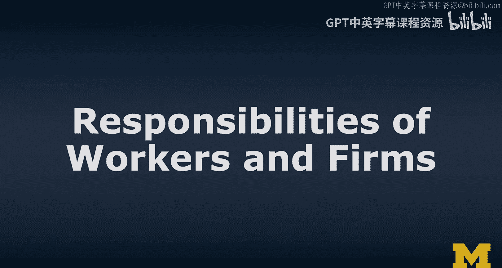
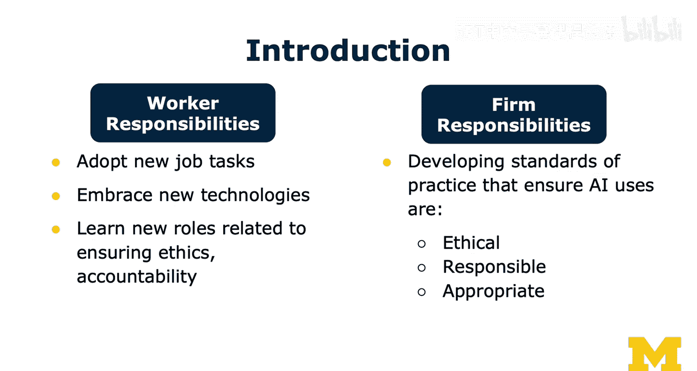
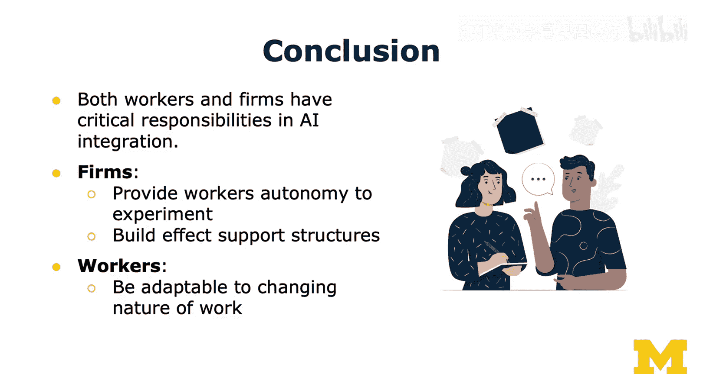

# 密歇根大学《应对颠覆：工作场所的生成式人工智能｜Navigating Disruption： Generative AI in the Workplace》 - P34：6_从业者与企业的责任.zh_en - GPT中英字幕课程资源 - BV159uyztEfn

Given the drastic changes that we may see in the roles of firms and in the competitive landscapes they face。

 it's important to consider and articulate the responsibilities of both workers and firms as AI further integrates into the labor market。

Workers will need to adopt new responsibilities and embrace new technologies。

 they will also need to learn to take on key roles in ensuring ethics and accountability。

Firms should prepare workers for AI by developing standards of practice that ensure AI uses are ethical。

 responsible， and appropriate。Workers and firms will need to find novel ways to work together to ensure that related disruptions don't undermine the corporate climate and that workers maintain their values and feel supported by their companies。

Perhaps the central responsibility of workers in response to the introduction of artificial intelligence into the workplace is the need to learn how to interact with AI and understand what it can and cannot do。

Courses that cover AI literacy， data analysis， and other relevant skills will provide workers with a solid footing for understanding both what artificial intelligence is doing。

And how it might be incorporated into their work。Workers will need to be adaptable as the technology gains additional abilities and becomes capable of taking on broader bodies of work。

Knowledge workers in particular will need to keep tabs on industry trends and stay aware of both the capabilities and potential risks of artificial intelligence use。

In most areas， workers will find value in embracing and experimenting with new technologies and tools to identify what can best enhance their productivity and gain a meaningful sense of the quality of the output that AI provides。

As companies identify trusted AI tools for various domains。

 employees will need not only to embrace these new technologies。

 but also to become proficient in these tools to stay competitive。In many cases。

 workers should also experiment by exploring additional tools that may be of value， however。

 the use of a broad array of AI tools by workers engender several risks。

Providing access to corporate data with AI tools might violate corporate standards and expose the company。

 workers and clients to risks， in many contexts， undisclosed uses of artificial intelligence will be considered a violation of reasonable practice。

Many contemporary AI systems use the data they're provided to further train their models。

AI models have the potential to perpetuate various forms of bias if they're not properly calibrated。

 and workers may need to proactively assess and address these potentialities。

 Workers will need to be responsible for evaluating whether it's appropriate to provide various types of data to AI systems and to proactively assess the risks of any novel technology uses。

 as workers increasingly collaborate with artificial intelligence to yield work products。

 They need to recognize how and when this collaboration will render them accountable and liable for the products of working with AI。

 They will also need to understand where AI use is viewed as appropriate and where it's not。

From a corporate perspective， a different set of responsibilities emerges。

 firms will need to provide training and development opportunities to help workers adapt to artificial intelligence。

Systems for sharing best practices among workers and for encouraging continuing education will help to provide a supportive learning environment。

Firms may also need to incentivize their employees to experiment with and evaluate various AI tools in their work。

To the extent that corporations encourage their employees to adopt novel approaches that may assist the firm。

 there must be clear policies to articulate what kind of employee behaviors are appropriate and acceptable with AI。

Firms need to provide employees with not only a basic understanding of the risks and benefits of AI use。

 but also with tools to directly assess how to evaluate things like data security risks and AI induceduc biases。

If there are AI errors under what circumstances will the company take responsibility。

 workers should know if experimentation is encouraged and under what circumstances。

 to prevent all sorts of issues， companies need to be clear about how they will evaluate the quality of AI outputs and the risks of inappropriate use of particular tools。

These questions differentiate firms that will effectively encourage their workers to use AI from those that may assert the value of experimentation。

 but fail to provide an appropriate framework to encourage employees to do so。

Firms need to decide AI policies at the highest levels to ensure that workers are not held accountable for gaps in corporate policy。

Firms also need to establish clear norms and policies around when and how AI can be used。

 and under what circumstances AI use must be disclosed， both to the company and to potential clients。

Because employees typically know better than upper management how to do their jobs。

 effective AI integration will require collaboration between workers and firms。

Firms that provide an effective framework for understanding appropriate and ethical uses of AI。

 as well as those that foster the sharing of best practices are likely to gain the greatest benefits from AI use。

Employees must understand， however， when they're liable for products that may be AI assisted and what responsibilities they have to check on the final products of their work。

They also need to understand the appropriate workflows for evaluating and approving AI tools and uses in the workplace。

Workplaces that fail to provide these frameworks will either discourage experimentation by employees or implicitly encourage employees to use AI tools in ways that may not be appropriate in the eyes of management。

Because companies can be liable for the products of AI。

 failing to provide this sort of framework would be a major mistake。

As employees experiment with artificial intelligence。

 corporate culture becomes particularly important。If workers do not trust that their jobs will be protected when and if they find more effective ways to use AI。

 they will not disclose their use of AI to their employers and will not highlight the way that AI might be capable of introducing new efficiencies。

In contrast， if firms provide opportunities for workers to upskill and foster a supportive environment。

 a culture of experimentation can yield enormous benefits。

Providing opportunities for continuous learning and advancement will likely aid in building this sort of workplace community。

In sum， workers and workplaces have critical responsibilities in AI integration。

Firms that can provide workers with the autonomy to experiment and that build effective support structures for that experimentation。

 as well as for workers whose jobs may change in the wake of artificial intelligence are likely to see the biggest benefits。

However， not all workplaces may see it this way， and many may view their workers as increasingly expendable to the extent that AI can replicate aspects of their jobs。

As workers and companies seek to negotiate this changing environment。

 the implications exist not only for individual firms， but for the labor market as a whole。

