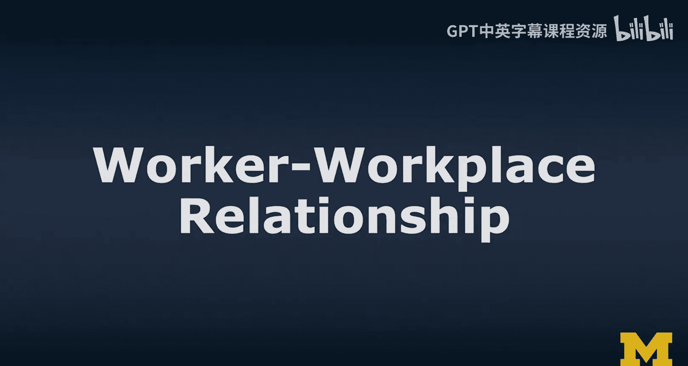
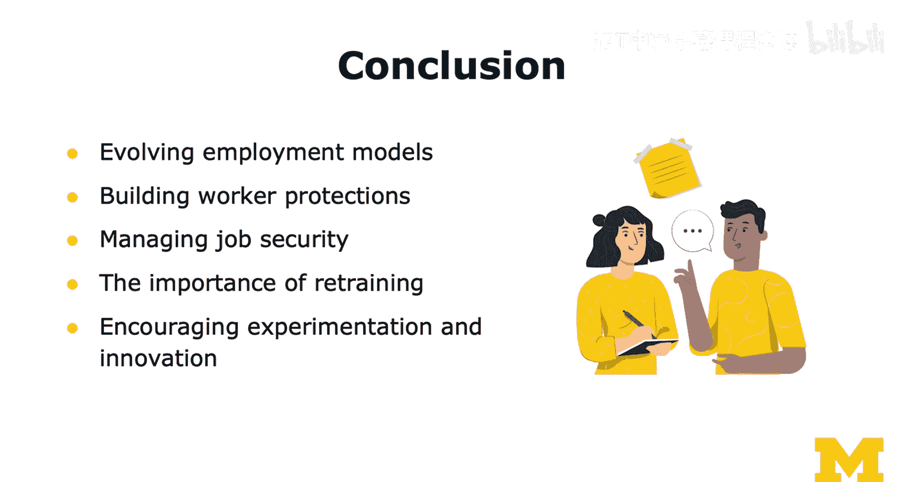
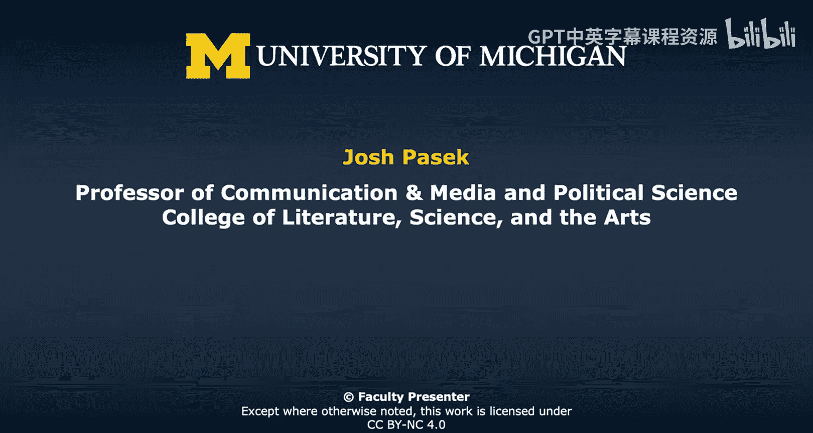

# 密歇根大学《应对颠覆：工作场所的生成式人工智能｜Navigating Disruption： Generative AI in the Workplace》 - P35：7_从业者与职场关系.zh_en - GPT中英字幕课程资源 - BV159uyztEfn

Artificial intelligence is entering an already dynamic labor market。 In recent decades。

 employment has evolved with unions comprising a shrinking share of many countries workforces。

Outsourcing and globalization， creating broad international supply chains and an increasing portion of the workforce engaged in freelance and contract roles facilitated by the gig economy。

 Work now tend to take many jobs over their lifetimes， rather than following a single career path。😊。

AI is poised to further reinforce this dynamism。Considering the role of AI in shaping worker workplace dynamics helps both firms and workers prepare for the future。

In recent years， a growing portion of many firms workforces have come through contracting and gig economy work rather than traditional employee employer relationships。

 employees in these roles often work on an as needed basis。

 lacking job security and establish relationships with companies that might encourage exploration into how AI could serve corporate interests。

They may also be less likely to disclose AIs to employers unless explicitly required。

Since these workers do not have long term relationships with the companies they work for。

 they cannot reasonably be held accountable for AI output issues that may arise。

While AI tools aid in facilitating the use of gig workers。

 the shift from long term employees to gig workers also engenders risks for companies。

Another growing trend in the workforce， explicitly enhanced by AI。

 is the tendency for workers no longer to be co located with the positions they work for。

Many AI tools are particularly effective in facilitating hybrid work and allowing workers to interface with others despite non matching working hours。

The continuation of this trend is likely， given the growth and capabilities。

 reducing the portion of workers who are co-present formal employees of a particular firm is likely to have various effects on how firms relate to workers and raise questions about how firms can best support their employees and what they can expect from them。

Notably， AI can create uncertainty about job security。

 making it important to manage worker expectations。

 and provide clear standards to both longstanding employees and those employed on a more temporary basis as AI replaces or augment particular jobs。

 workers will consider the effects of these transitions firms need to establish standards to help workers learn to use AI tools。

 navigate potential shifts in their work and identify prospects if their jobs are no longer needed。

Failing to address these issues or support workers as necessary is likely to undermine the quality of employees work as those who fear the future may proceed with one foot out the door。

In contrast， firms that anticipate these transitions， communicate effectively with employees。

 and provide opportunities for retraining and upskilling are likely to retain workers who can remain competitive in the contemporary job market and elicit loyalty through the disruptions that occur。

This approach is also likely to yield a direct competitive advantage。

 as individuals who feel supported and are encouraged to experiment with AI are likely to discover strategies that will make the firm more competitive and keep the firm's best interests in mind。

If employees and employers think they're in this together， everyone is more likely to thrive。

Strategies for encouraging experimentation may include pilot programs to test AI tools in the workplace。

 new approaches to building a culture of innovation coupled with safety nets for workers affected by experimentation。

 or innovation labs， where employees can test new tools in a controlled environment。

In an AI driven environment， companies need to think seriously about evolving worker models。

 workplace protections， job security， retraining， and how to encourage experimentation and innovation。

Companies that prioritize practices to support workers in an AI driven environment are best positioned to identify how AI can aid positions across the workforce and build a culture of innovation that will ensure future competitiveness。

