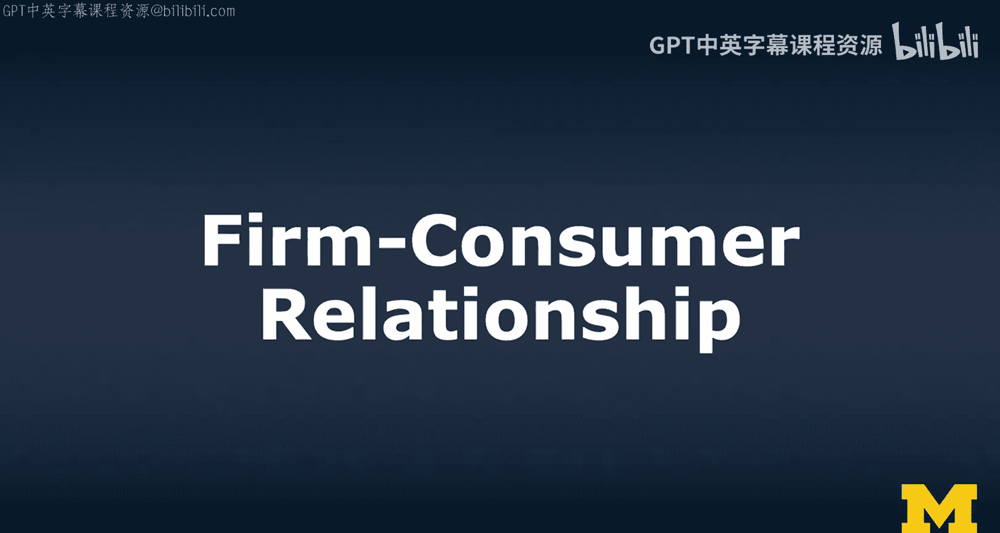
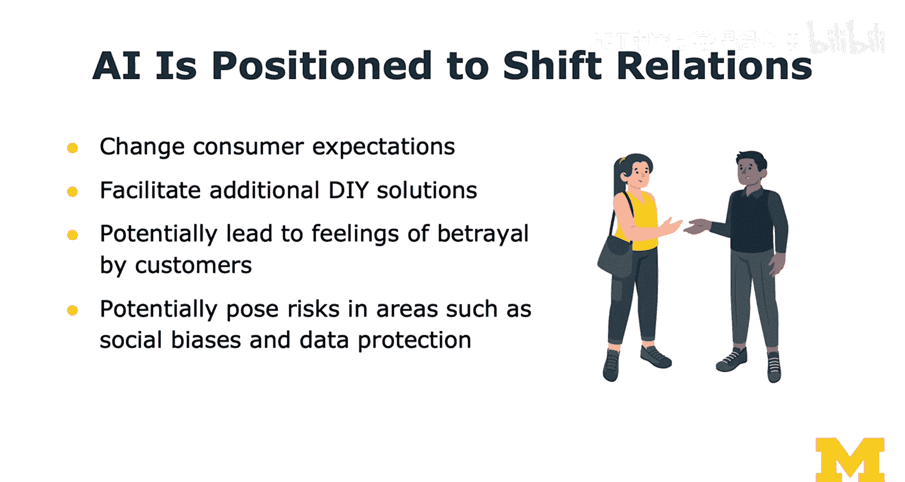
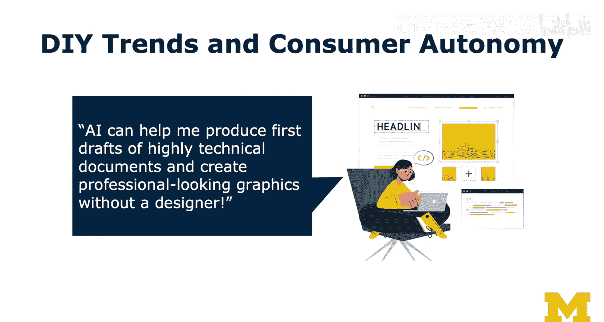
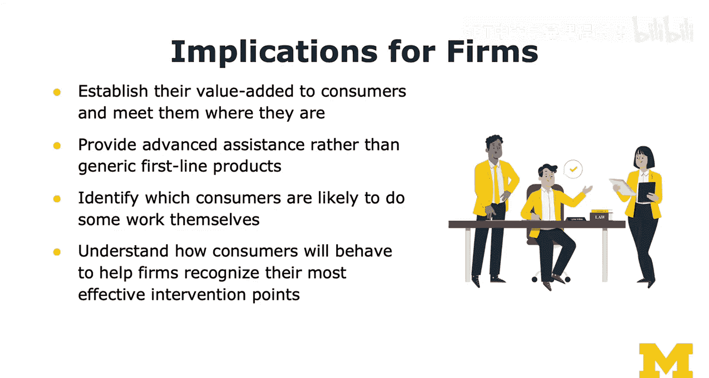
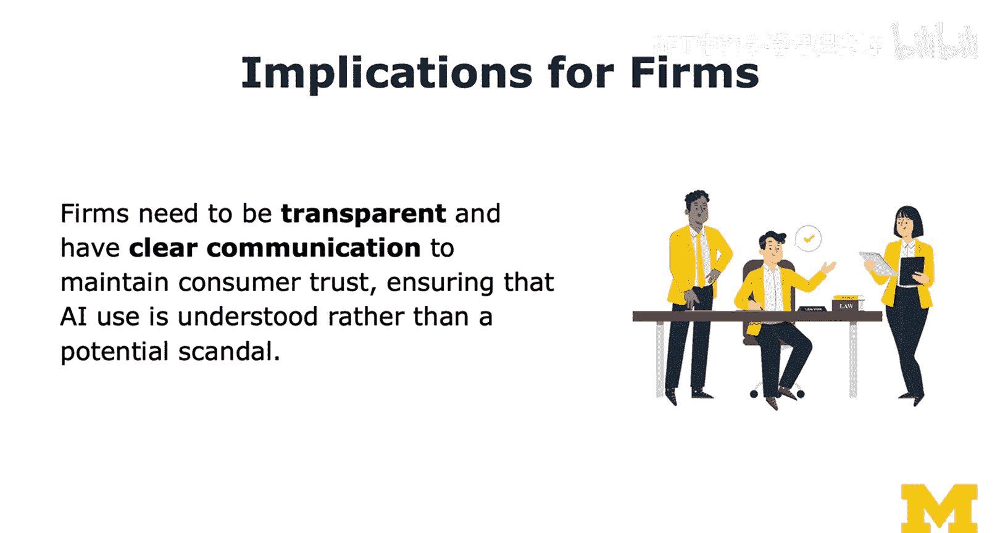
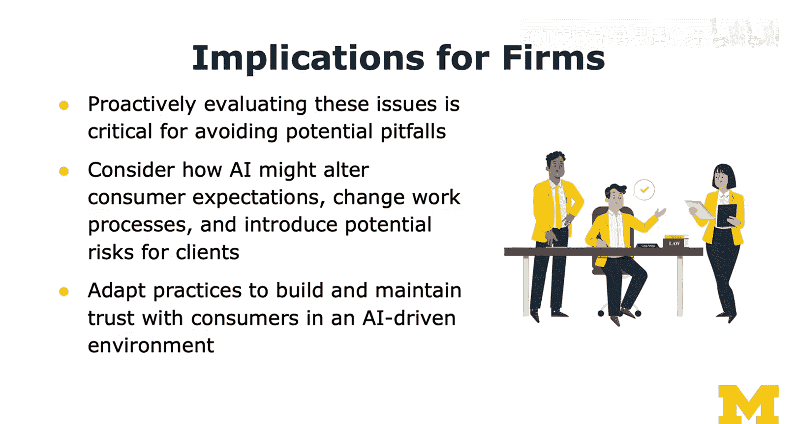

# 密歇根大学《应对颠覆：工作场所的生成式人工智能｜Navigating Disruption： Generative AI in the Workplace》 - P36：8_企业与消费者关系.zh_en - GPT中英字幕课程资源 - BV159uyztEfn

Artificial intelligence is positioned to shift relations between corporations and workers。

 as well as between firms and the consumers of their services or products。

AI is likely to change consumer expectations， facilitate additional do it yourself solutions。

 potentially lead to feelings of betrayal by customers。

 and pose risks in areas such as social biases and data protection。

Firms considering the future integration of AI need to account for its impact not only on their internal operations。

 but also on their relationships with external stakeholders。

Artificial intelligence makes it far easier than ever before to personalize services for clients and ensure minimal wasted effort。

As consumers experience AI powered recommendation systems on e-commerce platforms and personalized assistance from chatbots。

 they will expect responses to be closely tailored to their individual circumstances。

These expectations can lead customers to be disappointed with what was previously considered state of the art service。

Meeting these elevated expectations， while ensuring that AI systems do not pose unnecessary risks will be a challenge for firms。

Companies will need to manage the expectations and consider how changes in consumer demands could shape what they're providing。

Artificial intelligence tools also enable consumers to do work themselves that previously required hiring professionals。

For instance， AI can help ordinary individuals produce first drafts of highly technical documents or create professional looking graphics without a designer。

This potential for increased consumer autonomy poses risks for firms whose services can be easily replicated by AI tools。

Firms will need to clearly establish their value added to consumers and meet them where they are。

Providing advanced assistance rather than generic first line products。

 identifying which consumers are likely to do some work themselves and how they will behave will help firms recognize their most effective intervention points。

Artificial intelligence also poses several risks to the firm client relationship。

Understanding client expectations is crucial in this environment。

Some consumers may feel betrayed if they discover that a product they thought was human created was actually AI generated or heavily AI assisted。

If firms fail to be transparent about AI's role， this feeling of betrayal may lead to a reduction in consumer trust and push customers to seek services elsewhere。

This highlights the need for transparency and clear communication to maintain consumer trust。

 ensuring that AI use is understood rather than a potential scandal。

Artificial intelligence systems can inadvertently perpetuate bias because they learn from training data that may itself be biased。

This can lead to unfair or discriminatory outcomes。

 such as a offering loans based on AI generated data。

AI algorithms used in hiring processes can also produce biased results。

 potentially violating fair labor standards。These concerns underscore the need for rigorous testing。

 monitoring， and mitigation strategies to ensure fairness and equity in AI tools and applications。

In many cases， AI use involves collecting and analyzing large amounts of consumer data。

 raising significant privacy concerns， and potential misuse of that data。

When firms make personalized recommendations， the underlying data must be carefully managed。

Failure to implement robust data protection measures can lead to a loss of client trust or violations of legal and ethical norms。

A particular challenge is that firms may not know exactly what information underlies a particular model or how that information could be used。

 if not directly collected。AI models also often impute information， which can be a source of bias。

And there needs to be explicit communication between the client and the firm。

Proactively evaluating these issues is critical for avoiding potential pitfalls。

The integration of AI， both at a firm level and on a broader societal level。

 necessitates that companies consider how AI might alter consumer expectations。

 change work processes， and introduce potential risks for clients。

Companies need to adapt their practices to build and maintain trust with consumers in an AI driven environment。

