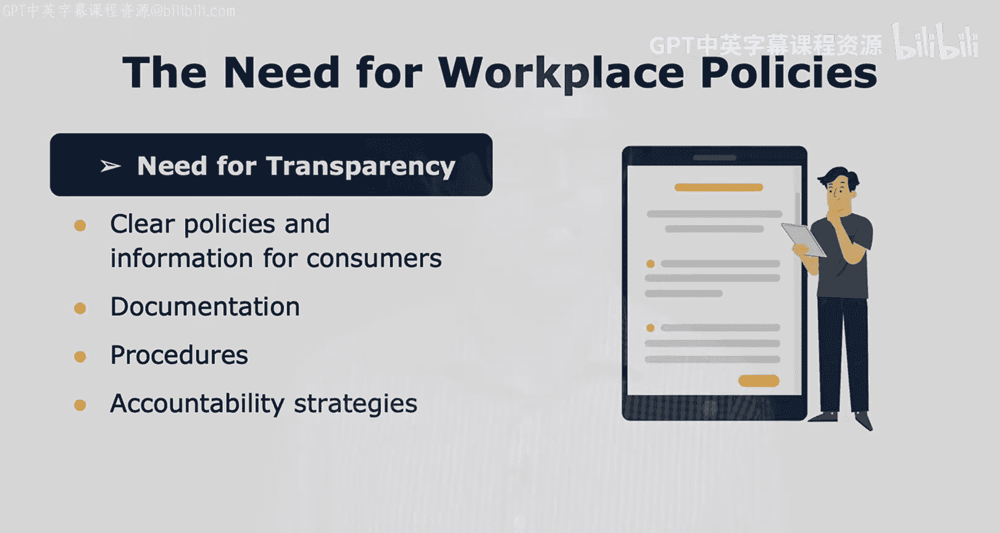
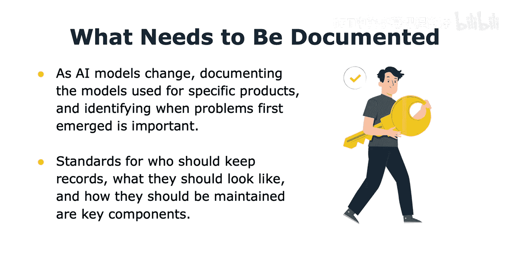
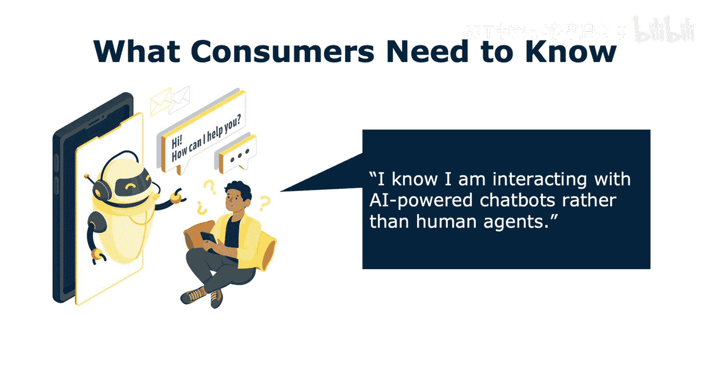
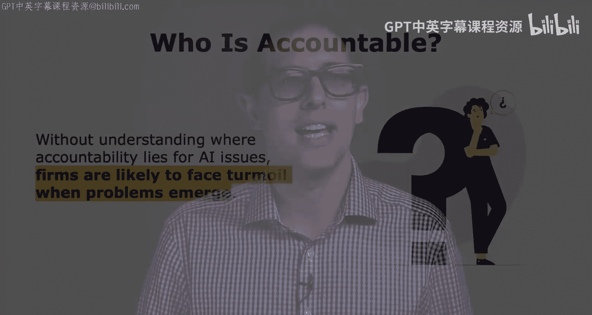
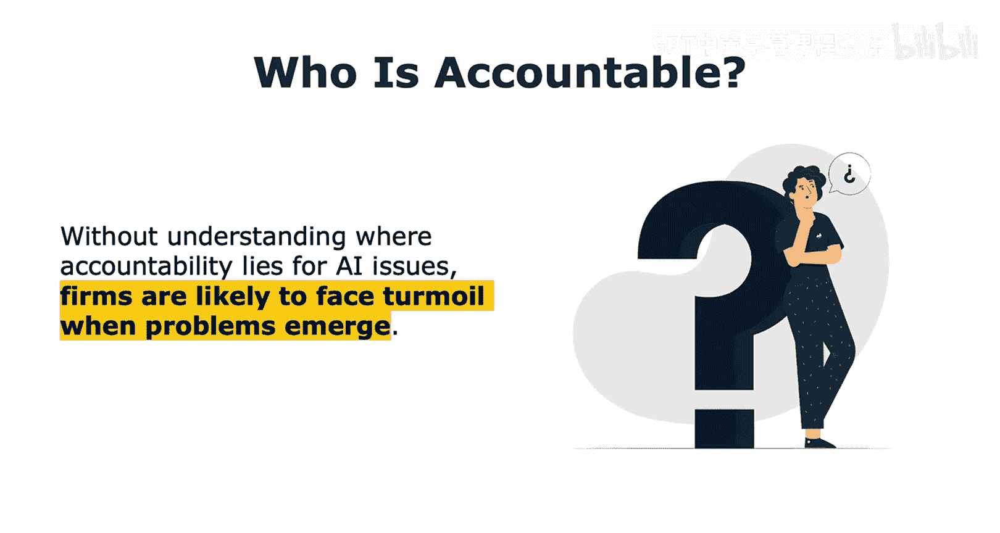
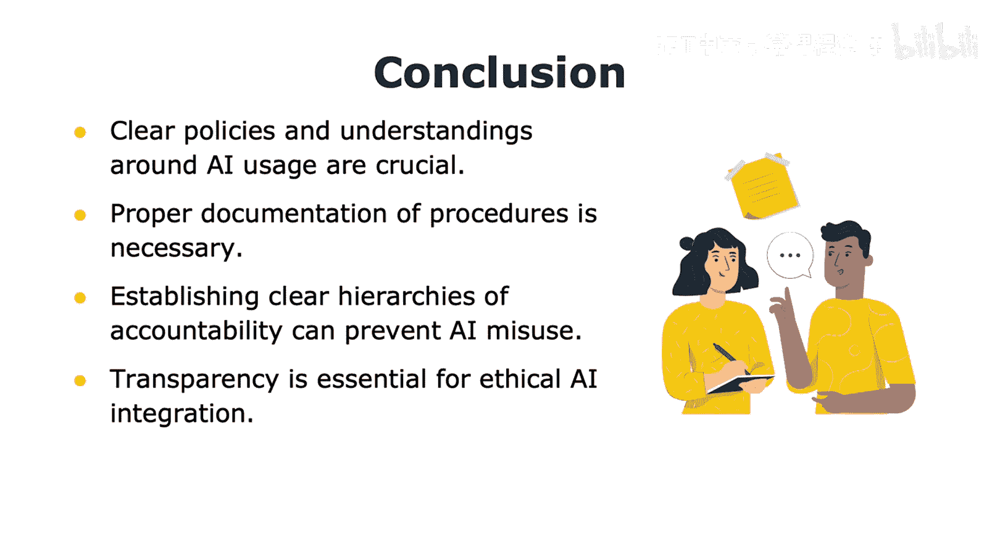
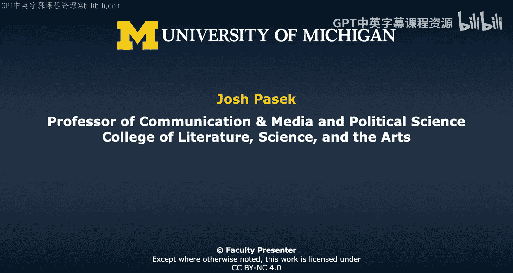

# 密歇根大学《应对颠覆：工作场所的生成式人工智能｜Navigating Disruption： Generative AI in the Workplace》 - P37：9_变革时期的透明度.zh_en - GPT中英字幕课程资源 - BV159uyztEfn

As artificial intelligence finds its way into the workplace and mediates the relationships between workers。

 workplaces， and consumers。One of the most important questions is how AI is integrated。

While the dynamism of AI and its impact negates any one size fits all solution。

 there are clear overarching policies that can help ease AI integration and ensure that it does not actively harm these relationships。

Most prominently among these is the need for transparency Works need clear policies。

 information for consumers， documentation， procedures and accountability strategies。

Effective artificial intelligence integration requires workplace policies for AI use workers need to know what they can and can't do with artificial intelligence。

And that the firm understands when and where AI will be incorporated。

These policies should cover how to use AI， when to use it。

 and the scope of AI in any decision making process。If AI is to be used in employee hiring。

 how should it be used， and in what ways should workers ensure that AI use is fair and compliant with both ethical and legal standards？

If AI is used to serve up information or content， what role should AI versus employees have？

When should employees evaluate the product of AI tools and how are potential problems handled？

Similar policies need to be put in place for the use of data within an organization。

Effective use of many AI tools involves collecting and storing large amounts of data。

 both on an organization and on those that the organization interacts with。

Yet when data is provided to AI tools， ensuring that AI does not learn inappropriate information about the organization or its clients is paramount。

It is crucial to store data safely and effectively so that newly acquired and available data within the firm is not at risk of theft or inappropriate use by external actors。

Indeed， one strategy is that many firms may decide to initiate contracts with AI providers that keep data in house。

Understanding which data can be shared with AI， what cannot and how novel uses of data compared to various data protection regulations such as the European GDPR rules。

 is critical for appropriate incorporation。Firms need to be careful about which tools are used by whom and under what circumstances to ensure transparency within and where needed outside the organization。

It is important to ensure that firms are aware of the tools being used so they can be appropriately vetted and that individuals within the firm using the tools are trained and educated on appropriate use。

Corporate policies need to clarify these questions。

 as failing to establish strong policies will lead to experimentation outside the firm's awareness and workers uncertain about what constitutes appropriate or inappropriate uses。

Surrounding these questions is a generalized need to establish documentation of AI processes。

 decisions， and outcomes， understanding what components of AI use and the products of artificial intelligence need to be documented as part of everyday workplace practice is crucial。

If AI models are refined or trained with workplace content。

 detailed records of how the AI model was trained， tested， and deployed are necessary。

This includes any efforts firms have made to assess whether there were errors in AI use。

As AI models change， documenting which models were used for specific products and identifying when problems first emerged in the training or updating process is important。

Standards for who should keep records， what they should look like and how they should be maintained are key components。

Artificial intelligence systems can be subject to various problems。

Ensuring that AI use is appropriately audited and reviewed constitutes another set of procedures firms need to standardize。

Evidence that artificial intelligence does not yield bias at one particular time is not sufficient to conclude that such bias will not emerge later。

Routine checks to verify whether AI outputs align with ethical guidelines。

 company values and industry standards are essential。

Procedures should also be in place for when AI failures or malfunctions become apparent。

These issues are an inherent risk in AI systems， so formal AI use must operate with the expectation that problems will emerge。

In many cases， it's important to be clear with clients and consumers about how AI is used in products and services。

This is not only critical for building trust， but may improve consumers's ability to gain useful insights from what a firm produces。

Clients may be disaffected if they discover they're interacting with AI powered chatbots rather than human agents。

But this is less likely to be an issue if the uses of artificial intelligence are transparent from the start。

Finally， the use of artificial intelligence requires someone to be accountable for AI products and decisions。

This needs to be a component of the roles and responsibilities surrounding artificial intelligence。

Is a problematic product attributable to a particular developer， an end user， or a manager？

Without understanding where accountability lies for AI issues。

 firms are likely to face turmoil when problems emerge。

Instead。Establishing clear accountability structures allows firms to address AI related issues and articulate who's responsible for AI products in the corporate pipeline。

All this highlights the critical importance of having clear policies and understandings around the uses of artificial intelligence。

And how it is established within a firm。Clear documentation of procedures。

Transparency both within and outside the organization。

And clear hierarchies of accountability can help firms avoid the riskiest errors due to artificial intelligence misuse。

They are far less likely to be cut off guard when AI issues emerge。Hence。

 transparency is critical for ethical AI integration and provides the foundation for maintaining trust with both employees and consumers。

