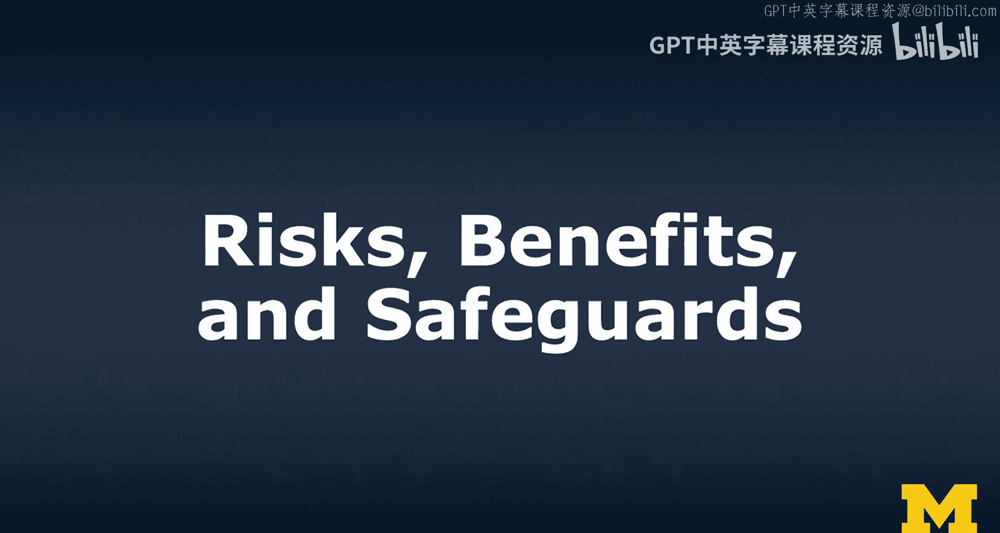
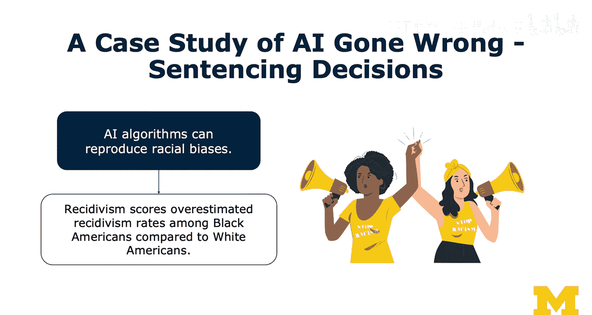
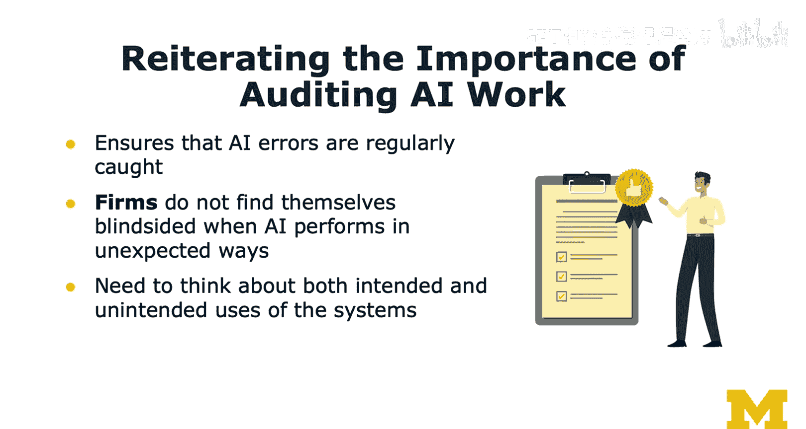
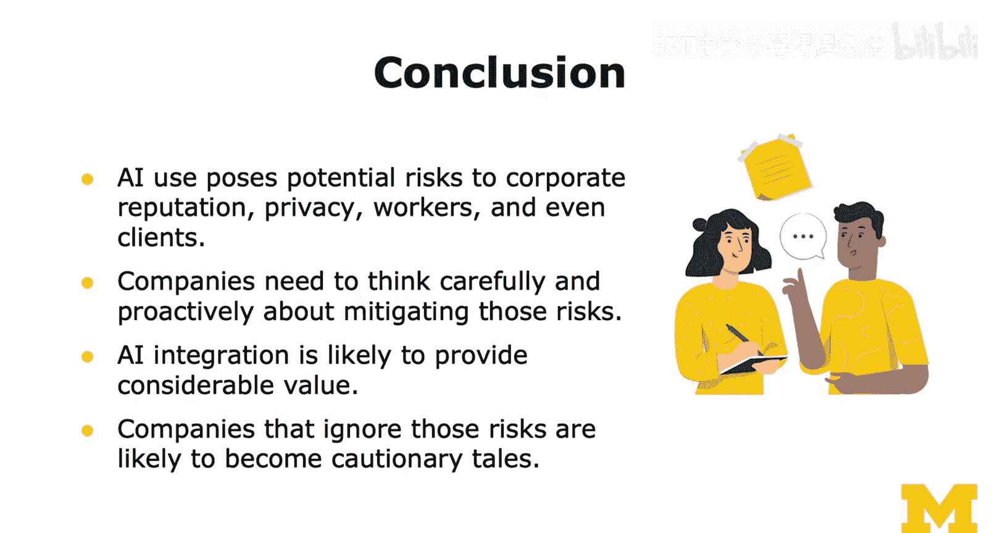
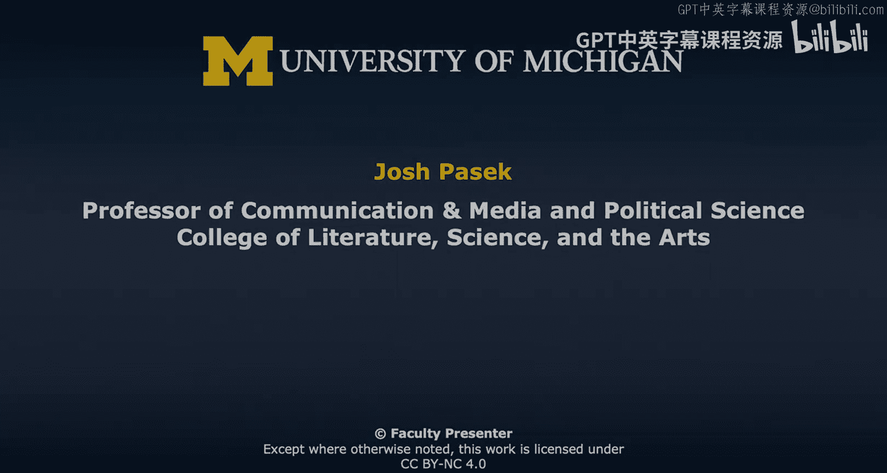

# 密歇根大学《应对颠覆：工作场所的生成式人工智能｜Navigating Disruption： Generative AI in the Workplace》 - P38：10_风险、收益与保障措施.zh_en - GPT中英字幕课程资源 - BV159uyztEfn

Incorporating AI into the workplace， workplace products。

 and decision making can be immensely effective for corporations。

But it can also have various negative externalities。

Recognizing the potential risks involved in AI use。

 being clear eyed about AI benefits and building appropriate safeguards can ensure that the use of AI is as appropriate and effective as possible。

By considering a series of real world cases where AI algorithms have yielded both substantive benefits and inadvertent problems。

 we can gain a sense of how problematic effects of AI use emerge and what might be done to avoid them。

We've long known that there are biases in how criminal justice is adjudicated in the United States。

In an attempt to avoid these biases， one strategy has been to use artificial intelligence to generate estimates of how likely individuals who commit crimes are to commit a future crime if they're given a punishment that does not involve jail time。

A number of companies created strategies for estimating the likelihood of recidivism among individuals who commit crimes。

And these approaches have been employed in numerous municipalities in an effort to reduce the extent to which judges rely solely on their own discretion when making estimates of recidivism and thus sentencing judgments。

Yet， an analysis of these algorithms revealed that even though they were not using race as a metric for estimating recidivism。

They nonetheless tended to reproduce racial biases。

Reidivism scores overestimated rates of recidivism among black Americans compared to white Americans。

These racial disparities only became apparent once researchers began to examine the actual data provided by the algorithm。

As the model itself yielded no clues that there would be a racial difference。

Evidence of these biases caused a PR problem for the company and real harm when the tool was used。

The risks of poorly implemented， improperly tested。

 and insufficiently transparent AI tools can be numerous。

And AI tools that are not well tested can do serious harm。

When Amazon debuted a new hiring tool without realizing that it gave lower scores to women。

 their reputation took a considerable hit。And when Microsoft released Tay。

 a new AI chatbot without sufficient safeguards， users interacting with the system were able to convince it to start espousing racist and hateful views。

But these risks do not undermine the potential for AI's enormous efficiency improvements。

AI's ability to enhance productivity by automating routine tasks， drafting processes。

 and facilitating group collaboration reduces the time it takes to complete a number of tasks and frees up human labor for more cognitive and creative oversight roles。

Instead， firms need to balance AI's risks with its benefits。Doing so requires three core principles。

First， AI use must be transparent， both within incorrations and between firms and their external stakeholders Second。

 it is critical to audit AI work and not to assume that what an AI system does is sufficient in itself。

And finally， the third key component is the need for policies。

Transparency and AI use and how AI should be used within a corporation are the bedrock for building trust and accountability。

Companies need to be clear about what AI systems are being used and how they're being used。

 what data they collect， and what they're doing to safeguard that data from potential inappropriate uses。

This has implications for corporate reputations and public trust。

Auditing the use of AI systems ensures that artificial intelligence errors are regularly caught and that firms don't find themselves blindsided when AI performs in unexpected ways。

Individuals auditing these systems need to think about both the intended purpose of the system。

 as well as any ways the system might behave unintentionally。

 They must commit themselves not only to the evaluation process。

But also to a series of ethical standards。Companies that have a code of ethics for AI deployment and implementation。

Are both less likely to introduce problematic AI content and far more likely to receive goodwill when and if AI algorithms air。

Policies and procedures constitute the backbone of appropriate artificial intelligence use when companies have well defined policies that guide when and how workers can use artificial intelligence。

 as well as how that artificial intelligence is deployed and presented to clients。

The risk potential is far lower。Companies that have thought through guidelines for data use。

AI system deployment and Ac will be ready to respond when AI systems behave unexpectedly。

Companies that lack these standards are liable to be cut flat footed。In some。

AIU poses potential risks to corporate reputation， privacy， workers， and even clients。

Companies that want to take full advantage of the artificial intelligence revolution need to think carefully and proactively about mitigating those risks。

To the extent that they can understand and mitigate those risks， while leveraging benefits。

 AI integration is likely to provide considerable value。In contrast。

 companies that ignore those risks are likely to become cautionary tales。

