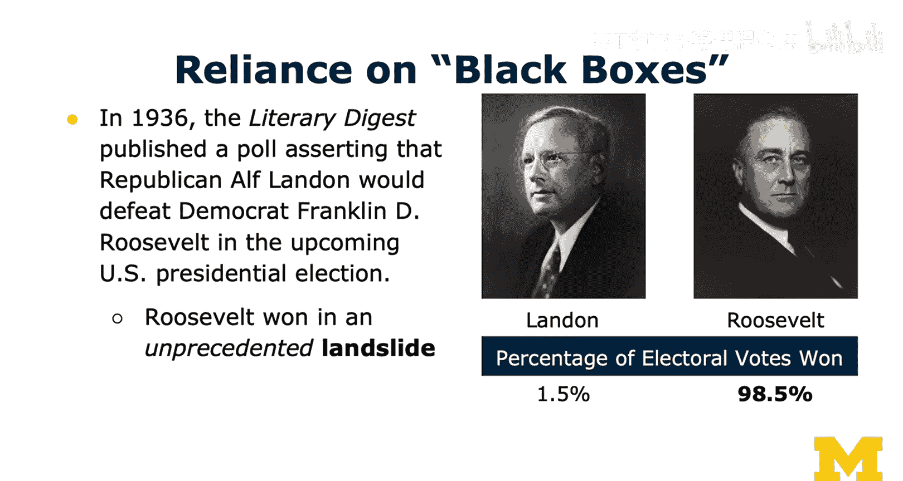
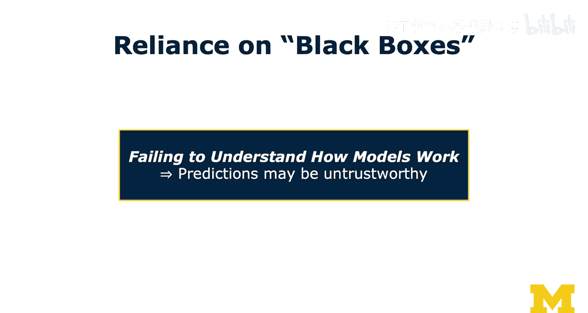
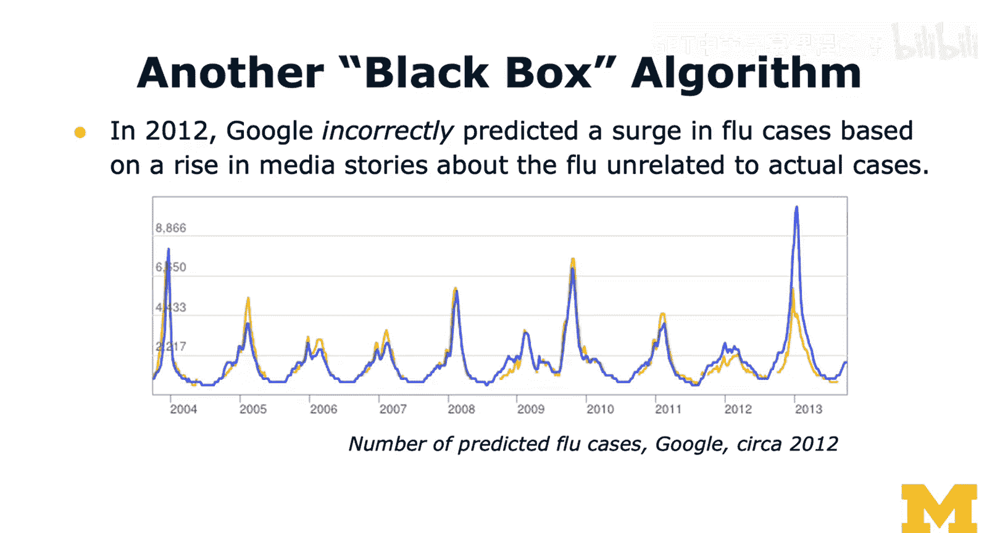
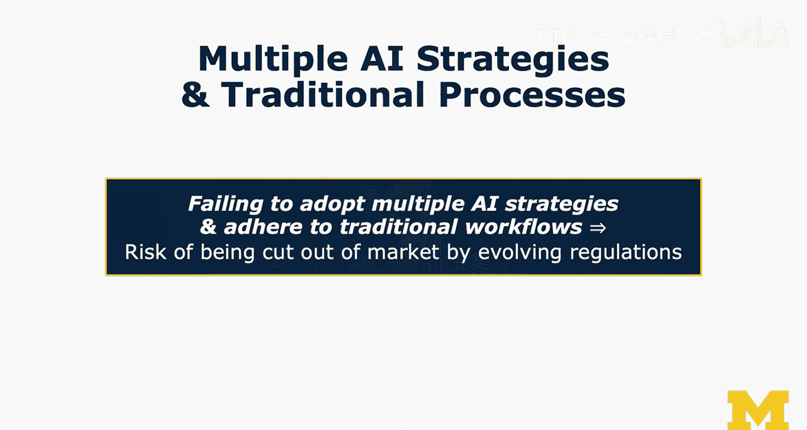
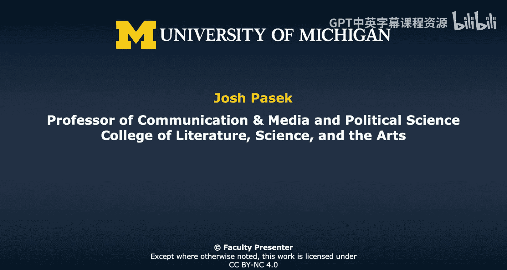

# 密歇根大学《应对颠覆：工作场所的生成式人工智能｜Navigating Disruption： Generative AI in the Workplace》 - P39：11_历史镜鉴.zh_en - GPT中英字幕课程资源 - BV159uyztEfn

Artificial intelligence use is still relatively new。

 but the challenges it poses and how those challenges are likely to play out can be understood in light of past technological advances。

Looking back into history helps to reveal the dangers of ignoring the conditions of labor。

 relying on black boxes， rather than fully understanding why something works。

 failing to deal transparently with customers， over relying on a single approach。

 and focusing too much on new technology， while forgetting traditional ways of doing things。

With a clear sense of how other disruptive technologies have sometimes gone awry。

 we may be able to avoid some of the same pitfalls。

The advent of mass manufacturing drastically changed the relations between workplaces and workers。

However， amid a series of corporate disasters such as the 1911 Triangle shirttwa Factory Fire。

 and the broad exploitation of child labor， companies that most lean into the system of mass manufacturing found themselves challenged by workers who began asserting their own rights。

The rise of unions was， in many respects， a product of the failure of mass production employers to consider their workers' welfare。

As AI transforms workplaces， firms have the potential to either embrace safe and fair labor practices and support their workers or ignore them at their own risk。

If companies do not ensure that their workers are treated well， employees will likely demand it。

We've already begun to see new labor organizing around artificial intelligence as workers attempt to establish their roles in a dynamic labor environment。

Another lesson from the past with particular relevance to artificial intelligence is the risk of relying on black boxes。

In 1936， the magazineine Literary Digest published a poll confidently asserting that Alf Landon would defeat Roosevelt in the upcoming election。

 Roosevelt won by a landslide。

The magazine's confidence stemmed not from an understanding of polling methodology。

 which in their case was highly flawed。But from the fact that their last few election polls had been incredibly accurate。

Without that understanding of why those polls had been accurate。

 they presumed the same mechanisms would continue to work into the future。

The conditions in 1936， however， were quite different， and their model。

 which they themselves did not truly understand， was therefore deeply flawed。

The lesson from this mistake is that predictions may not be trustworthy if we don't understand why they emerged in the first place。

AI poses enormous risks in this context， because of the complexity of AI algorithms。

 it's often unclear why AI comes to the predictions that it does。Without this understanding。

 we may not have a good sense of when the predictions are likely to be flawed and can rely on them in ways that are problematic。

This very sort of over reliance emerged when Google created a tool that used search results to predict flu prevalence。

 The tool massively overestimated flu rates in 2012 when media stories about the flu led to a flurry of searches that did not correspond with actual illnesses。

When new technologies alter the value of products in a market。

 there's a considerable potential for customers to feel betrayed if what they received is the new technological version of something rather than the product they thought they had received。

Gootenberg's early Bibles， printed with far less effort than traditional scribe copied versions。

 were initially sold for a hefty prophet。As customers began to discover that the Bibles they received required far less effort。

 their excitement over a newly affordable Bible turned to resentment。

Had the salespeople been more transparent about the process， this backlash may never have happened。

In a similar vein， there's considerable potential for backlash against AI generated products that clients are not informed about。

Here again， the lesson is that transparency is critical。

There are also considerable dangers from diving too quickly into a new technology。

 One potential concern stems from the over reliance on some approaches that may not work under particular circumstances。

Another problem can arise if the public or other stakeholders are not sufficiently ready for a new technology to be rolled out at scale。

When too many Irish farmers devoted their whole fields to potatoes in the mid 19th century。

 poor harvest caused a massive famine。Similarly， many companies suffered during the docom bubble of the early 2000s when they over investeded in a novel area and the public was not ready for many of their products。

Companies that diversify their approaches。Consider multiple AI strategies and maintain somewhat traditional workflows will be better able to respond flexibly to challenges that the AI revolution may pose。

In particular， as many countries begin to roll out meaningful regulations around artificial intelligence use。

Companies that have invested too heavily in approaches that are no longer regarded as acceptable or legal may find themselves cut out of a market。

 they once dominated。These cautionary tales encourage broad thinking on the part of firms planning to adopt artificial intelligence。

Firms that systematically work through the experiences and expectations of multiple stakeholders and then consider the potential pitfalls are far less likely to find that they put all their eggs in the wrong baskets。

