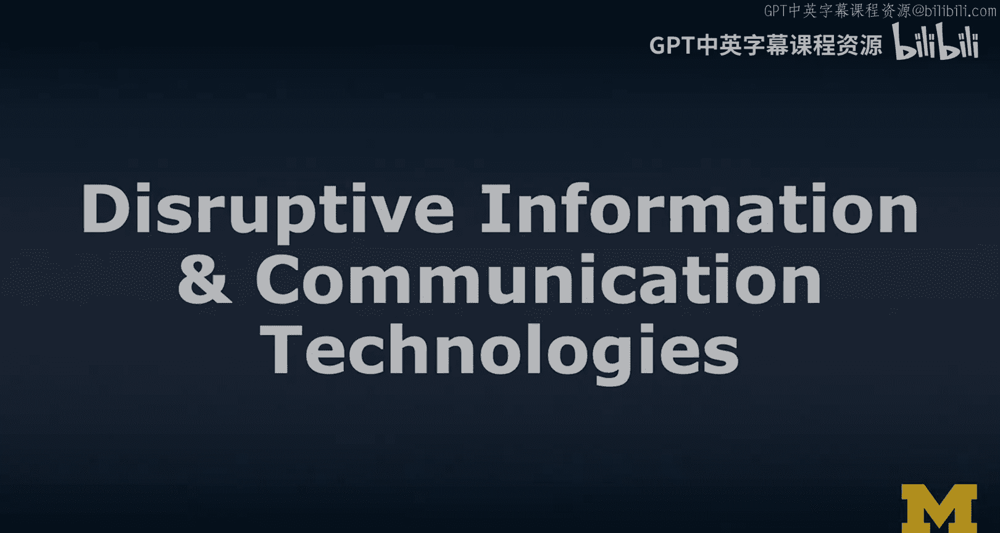
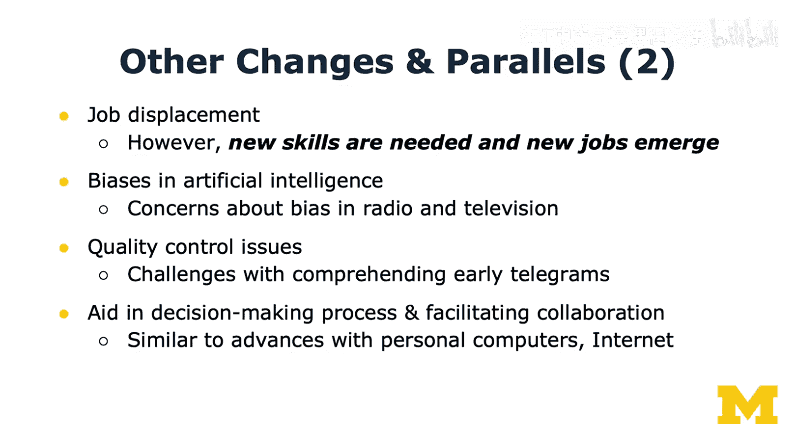
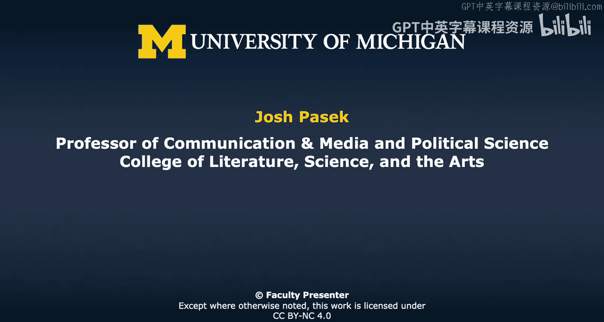

# 密歇根大学《应对颠覆：工作场所的生成式人工智能｜Navigating Disruption： Generative AI in the Workplace》 - P3：2_颠覆性信息与通信技术.zh_en - GPT中英字幕课程资源 - BV159uyztEfn

In many ways， the novelty of artificial intelligence makes it difficult for us to see the parallels between artificial intelligence and the disruptive technologies of the past。

As a disruptive technology， artificial intelligence is going to change the ways that people work and the way that societys working。

 it's going to change how information flows。Looking at the specific disruptions that AI can cause and how those relate to historical disruptions can help us understand the nature of those changes and what they may mean for society。

So what kinds of changes are liable to emerge as a function of artificial intelligence？

And can we find parallels between these changes and the disruptive technologies of yesteryear。

 artificialific intelligence enables people to accomplish a series of both routine tasks and even creative tasks。

 people who are not trained as artists can now generate art and those who knew little about composition can now create music。

This hearrkkenens back to the implications of the printing press。

 where individuals were able to essentially automate what had been a very laborious and routine process requiring considerable expertise。

AI tools also have the potential to streamline pieces of the content creation process。

This is similar in many ways to how assembly lines changed manufacturing efficiency and allowed the manufacture of many more products far more efficiently。

AI has the potential to generate personalized content。

Allowing people to be targeted more directly by messages。

This echoes the emergence of contemporary advertising。

 where advertisers have been increasingly able to market to niche segments of the public。

The way advertisements worked had to change， but advertising as a process remained。

 and the segment has even grown in size。AI is going to create new job roles。

When personal computers became commonplace， technical drawings were produced by graphic designers rather than manual drafting technicians。

And the provision of computerized databases meant that fewer data entry clerks were needed。

 while the market for data analysts expanded rapidly。Already。

 it's clear that AI will require new roles like AI trainers and prompt engineers。

AI is going to introduce a shift in the required skills for many positions。

Much like we needed to learn new literacy skills in the wake of the printing press。

 now digital literacy skills will become even more important。

As well as skills for how to engage with AI effectively。

 artificial intelligence will speed up information sharing。This is akin to the way the telegraph。

 radio and internet each rapidly increase the speed of communication。

Artificial intelligence is going to reduce the costs of producing novel content。

This echoes the plummeting costs of manuscripts after the invention of the printing press。

There will also be job displacement as roles that may have been highly prized in the past will be less prized now。

Demand for manual laborers and craftsmen decreased with the development of mass manufacturing as these skills were less necessary。

But at the same time， new skills were and are needed。

Biaassees in artificial intelligence reflect widespread worries that radio and television might spread propaganda。

Then as now， new institutional structures are required to address these concerns。

 we need norms for how to address inaccuracy in artificial intelligence and how to check it on a regular basis。

There are going to be quality control issues that need to be dealt with。

How do we ensure that what we get out of an AI system is high quality？

There was a similar need for new engineers to ensure that early telegraphs were comprehensible to the people who were receiving the messages。

There are novel abilities to use artificial intelligence to aid decision making through data analysis。

This is in some ways not altogether dissimilar from how computers themselves revolutionize the ways that we could process and analyze data。

Artificial intelligence is going to be very effective at facilitating collaboration of large social teams and organizations。

Which has echoes and the internet's ability to enable global connectivity。

 and there are likely to be many innovative applications that we will want to facilitate。

Artificial intelligence is helping to discover new drugs in healthcare。

It's coming up with strategies to maximize revenue in the financial industry。

And it's providing opportunities to incorporate real time information in education。

These have parallels in how electricity changed all sorts of new industry sectors。

We will need to understand how to respond to these technological developments， importantly， though。

 we've done this before。We did it not only for the printing press。

 but also for the personal computer and numerous other technologies。

The long term societal impact of AI's changes is something we may not know for a while。

 and it may be rocky。But recognizing what the changes are likely to be and planning for them is going to be very important。

The lesson from past revolutions in communication and production technologies is that we can and will adapt。

