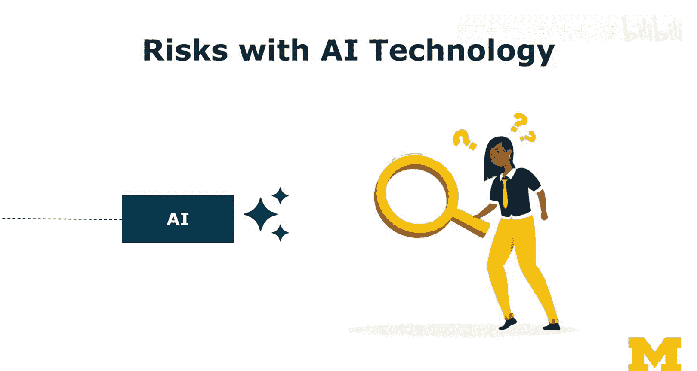
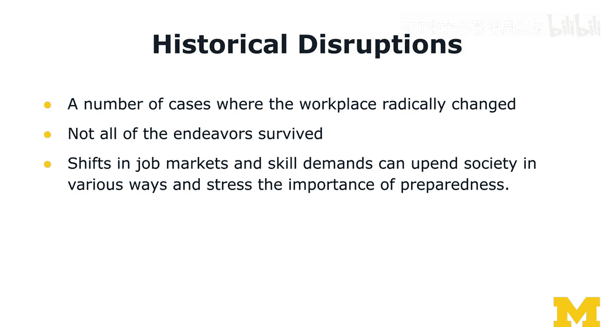
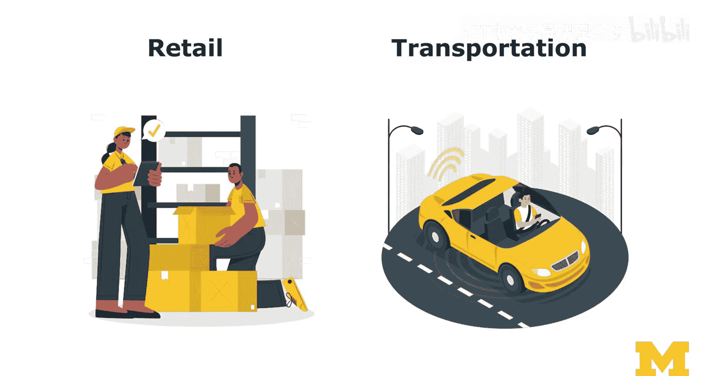
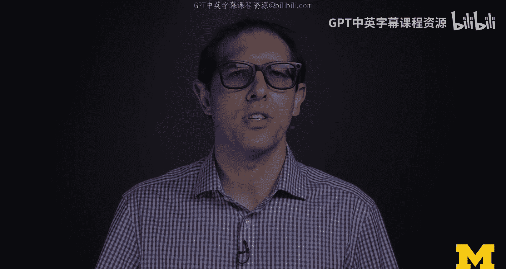
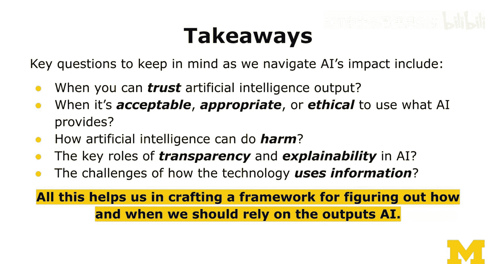
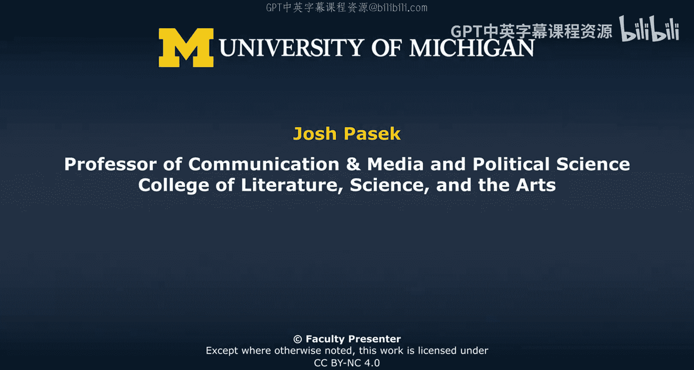

# 密歇根大学《应对颠覆：工作场所的生成式人工智能｜Navigating Disruption： Generative AI in the Workplace》 - P41：1_颠覆带来的风险.zh_en - GPT中英字幕课程资源 - BV159uyztEfn

Artificial intelligence is poised to radically reshape many areas of our lives for the way that people get work done in society。

 artificialific intelligence has the capacity to change tasks across all sorts of industries。

 leaving a wake of disruption and raising questions about how human labor will change。

 as well as what the future of work looks like。Coupled with the many opportunities offered by AI。

 this disruption also comes with inherent risks。 In particular。

 artificial intelligence includes a series of pitfalls that workers and their employers need to be aware of before jumping into the abyss。

One set of challenges and risks that emerges from artificial intelligence disruption is similar to those of technologies in the past。

 The industrial revolution， the advent of the Internet and various other shifts shaped the nature of labor and how humans communicate and had ramifications on labor and the relations between firms。

 workers and clients。

That took decades to settle。The other set of risks emerges from the technology itself and an understanding of what it can and cannot accomplish。

In this course， we broadly consider the set of ways whereby the introduction of artificial intelligence。

Has the potential to cause challenges for individual workers and for workplaces。

These challenges stem from both the structural shifts that artificial intelligence will induce。

 as well as questions about what it means to depend upon AI across various areas。

When we look back at historical disruptions， we can observe a number of cases where the workplace radically changed after the introduction of new technologies。

The industrial Revolution led to a widespread transition from agrarian societies to industrial ones。

 with major impacts on labor markets， urbanization and lifestyle。

The advent of the internet reshaped communication， commerce， and information access。

Companies emerged almost overnight amid these challenges to become among the biggest players in the global market。

And other once mighty firms faded to relative obscurity。

But not all of the endavs that emerged during the dot com boom of the 1990s survived。

 Many misstepped， either assuming that they would gain greater adoption for the technology than they did or because they misunderstood what the technology could do。

The lessons from these past disruptions tell us that shifts in job markets and skill demands can upend society in various ways and stress the importance of preparedness。

They highlight the need for things like retraining programs for workers that are displaced by new technologies。

They also tell us about potential impacts on social structures and norms。

Urban migration changed the nature of how people interact in society and altered family dynamics。

 the invention of the printing press induced a new wave of public literacy into society。

These disruptions have required new policies and regulations。

 approaches for managing the impacts of the technology。

 and broader understanding about what the technology could or could not do and how it should be managed。

The Industrial Revolution proded the development of new labor laws。

Manufacturing technology spurred environmental regulations。

These secondary and tertiary impacts of disruption are critical to forecast for firms that hope to navigate and make the most of a changing workplace。

Today's artificial intelligence disruption is already influencing many fields and is poised to shape far more。

In healthcare， we're seeing developments where AI is engaging in diagnostics。

 helping to reshape treatment approaches， and even yielding personalized medicine。In finance。

 artificial intelligence is deeply involved in fraud detection。

 algorithmic trading and customer service。In retail， it's assisting with inventory management。

 marketing， and consumer insights。And in transportation。

 we're seeing the development of autonomous vehicles and logistics optimization generative AI will bring these sorts of shifts to many more types of industry。

 generative AI enables individualized interactions with companies where customer service roles may be partially replaced with autonomous agents and opens new opportunities for automation in data analyses。

 textual composition， image generation and even computer code。

But just like the technologies of the past and the shifts they induced。

 artificial intelligence disruptions have all sorts of associated risks。

 Theres a potential for job displacement and skill mismatches as workplace needs and what workers provide diverges。

There's a potential for increased inequality and social ethics concerns。

 as the biases and artificial intelligence recruitment tools may affect hiring decisions。

And there's an evolving regulatory framework for making sense of what artificially generated content implies for questions ranging from copyright to international competition。

To understand these changes and their impacts， it's critical to make sense of the risks that are involved in artificial intelligence。

In this course， we ask a series of questions about when and how artificial intelligence can introduce risks and biases for workplaces and work。

To this end， we consider when you can trust artificial intelligence output when it's acceptable。

 appropriate or ethical to use what AI provides。How artificial intelligence can do harm。

The key roles of transparency and explainability in AI and the challenges of how the technology uses information。

All this helps us in making sense of artificial intelligence and provides a framework for figuring out how and when we should rely on it。

 with subsequent implications for how AI policies operate within workplaces。

 how individuals are treated， and the nature of the public policy landscape。

In this course， we focus on how and why things can go wrong and what kinds of strategies workers and workplaces can put in place to avoid those negative externalities。

