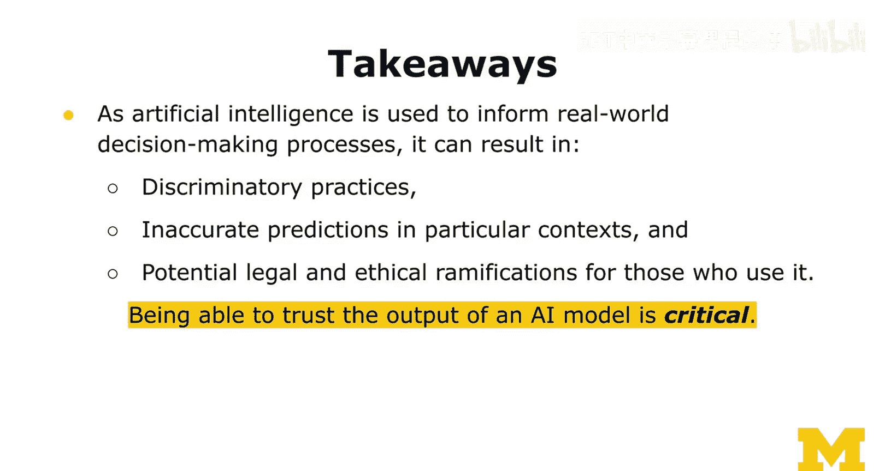
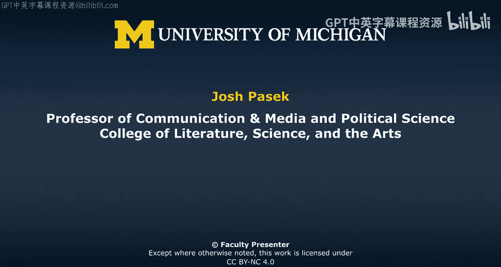

# 密歇根大学《应对颠覆：工作场所的生成式人工智能｜Navigating Disruption： Generative AI in the Workplace》 - P42：2_何时可以信任人工智能输出.zh_en - GPT中英字幕课程资源 - BV159uyztEfn

One of the critical questions for the use of artificial intelligence in any serious setting is when the output of artificial intelligence can be trusted。

If you can't trust what AI is generating， it's not really usable for many purposes。

And so in this lecture， we're going to discuss the importance of trust in AI systems and some of the key factors that influence how trustworthy AI outputs are。

 as well as ways to think about them。The first of these factors that we're going to discuss today is accuracy。

Artificial intelligence information needs to be sufficiently accurate for whatever purposes it's being put to。

If AI is gathering information about some particular occurrence or an individual。

 knowing that that information is correct and verifying it in some way is important。

If artificial intelligence gets factual information wrong， in a context where high accuracy matters。

 all sorts of risks can ensue。There are a number of reasons that artificial intelligence outputs can be inaccurate。

Understanding the nature of AI models helps to understand these sources of inaccuracy。

 One particular area of note is what are called hallucinations。

 These are cases where an artificially intelligent model may provide what seems like a factual answer to a query that is actually made up by the model。

 This can occur because artificial intelligence uses predictive relations to try to understand what it should be saying next。

Those predictive relations may not yield an accurate answer。

 either because there's not enough information in the model to do so or because the model's providing plausible sounding responses to a particular question without any real underlying memory that could allow it to fact check the information that it provides。

That is， AI is generating estimates of what seems likely rather than basing its responses on some underlying bedrock set of knowledge。

A body of recent evidence suggests that hallucinations may be an inherent feature of AI。

 and although much research is focused on reducing their frequency。

 there may be no such thing as truly hallucination free generative artificial intelligence。

A second major concern for trusting AI output is the potential for misinformation or disinformation。

AI can easily be used to generate credible sounding but inaccurate information in the form of news stories or other false claims。

A particularly pernicious form of this is what's known as Deep fakeakes。

 where audio or video content can be created that appears to show something that was not actually present。

😡，In some deep thick videos， public figures have been incorporated into scenes that did not actually occur。

And AI makes it relatively easy to create and disseminate these sorts of inaccuracies。

Deep fakes have potential implications not only for political information。

 but also for firm reputation， as false video， audio or textual information can lead to a major PR problem and can lead to reputational crises。

Recognizing the potential for inaccurate information， companies and workers need to be aware。

That there can be misinformation， disinformation， deep fakes。

 and other threats that may be used to undermine privacy and reputation， or even to blackmail。

Establishing clear information streams is critical for ensuring that people can identify accurate information amid a potential disinformation campaign。

Another area of concern for the trustworthiness of artificial intelligence output has to do with algorithmic biases。

As artificial intelligence learns from training data。

 it may come to learn from a subset of training data that does not reflect the full universe of context that may be relevant to a particular individual or term。

For example， if an artificially intelligent model is trained to identify which skin images are indicative of melanoma。

 the AI model may misestimate the prevalence of melanoma if too many of the pictures that it's trained on are cancerous compared to the proportions of cancerous skin abnormalities in the true population。

Here， the misleading rate of cancer in the training data results in a diagnostic misidentification。

AI models can also provide inaccurate information when they're estimating something outside the context of what they've been trained in。

Many AI models are heavily trained on data from a handful of relatively well known Western countries。

 when these models are used to make estimates about things in other cultures。

 they may prove inaccurate。For instance， the accuracy of facial recognition systems tends to vary across racial groups。

 in part because these systems were trained with more individuals from certain backgrounds than individuals from other backgrounds。

Training data may also be based on various historical cases that do not apply well to the current moment or that don't translate from one social and political context to another。

This means that as artificial intelligence is used to inform real world decision making processes。

 it can result in discriminatory practices， inaccurate predictions in particular contexts。

 and potential legal and ethical ramifications for those who use it。

Being able to trust the output of an AI model can， in many cases， be critical。

Recognizing that AI output is not inherently trustworthy is an important component of this。

Given AI's general tendency to sound quite authoritative across various domains。

 the fact that AI is not necessarily as trustworthy as it sounds is a key thing to attend to in evaluating the quality of AI models。

