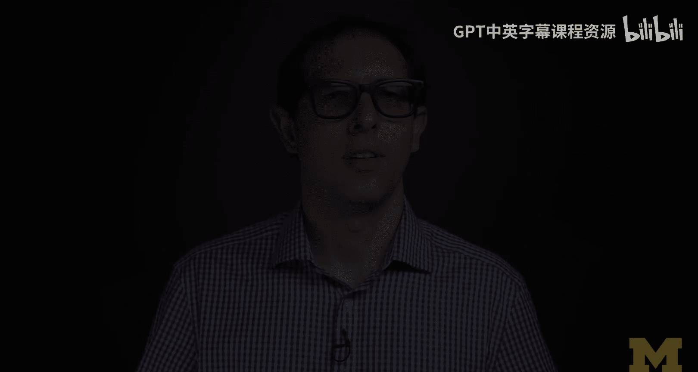
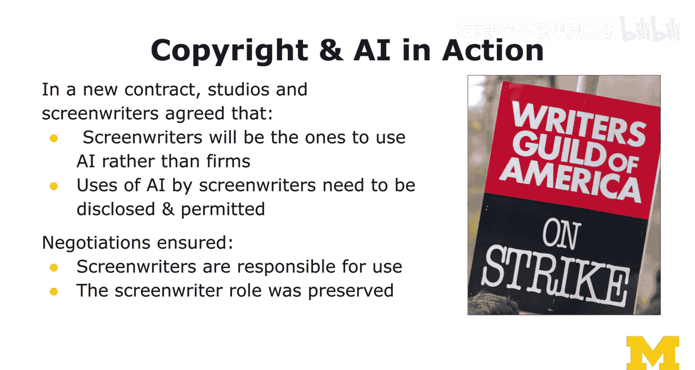
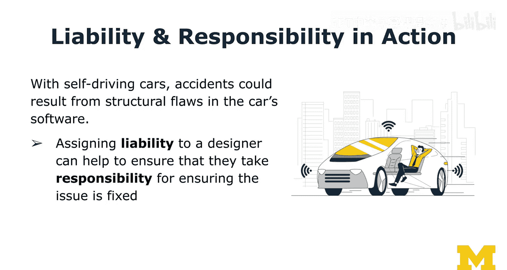
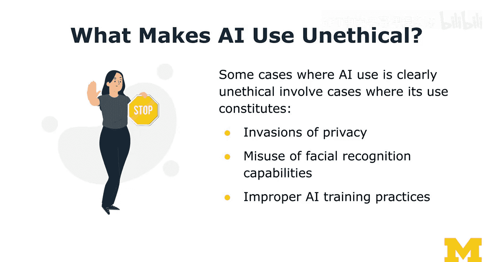
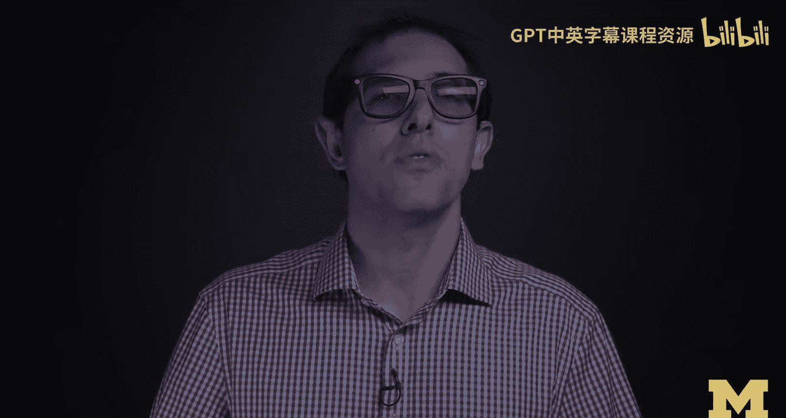
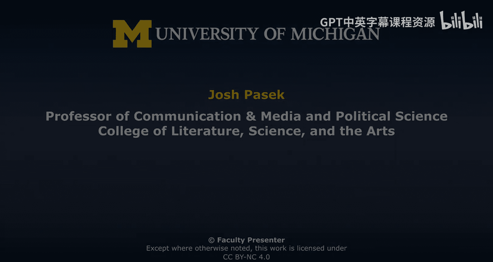

# 密歇根大学《应对颠覆：工作场所的生成式人工智能｜Navigating Disruption： Generative AI in the Workplace》 - P43：3_决定使用人工智能时的考量因素.zh_en - GPT中英字幕课程资源 - BV159uyztEfn

There are a variety of circumstances where requirements about who can do a particular task and what qualifications they need to have can pose significant challenges that undermine the value of artificial intelligence use。

There are also numerous circumstances where the use of artificial intelligence needs to be negotiated among various actors to ensure that what occurs is appropriate and reasonable。

In these kinds of cases， one of the central questions becomes one of who is going to be responsible for AI content。

This is perhaps nowhere better adjudicated than in the 2023 Writers's Guild of America Str。

When screenwriters went on strike， one of the provisions they wanted to establish was how artificial intelligence would and could be used in script and movie writing。

Underlying these negotiations were concerns about whether AI would be able to learn from the writer's work。

 whether AI could be used by studios to circumvent the role of scriptwriter。

 whether scriptwriter themselves could use AI， and who would be able to decide if and when AI could be used。

These concerns had implications not only for how AI would be used in the industry。

 but also for how that would affect workers jobs。These questions reflect core challenges that need to be negotiated for the use of AI across many workplaces。

One set of issues concerns the status of copyright with regard to AI。Specifically。

 who owns the copyright for AI output？😡，If an AI tool generates the output。

 is it the firm that requests the output， is it the particular individual who derives and enters the prompt。

 is it the group that generated the artificial intelligence tool。

 or is it none of these because artificial intelligence cannot be an author？

These kinds of questions raise inherent issues for treating AI product as an output。

In and of themselves， without some clear integration of humans into the process。For screenwriter。

 the answers to these questions were eventually written into their contract。

 Studios and screenwriters agreed that screenwriters themselves would need to be the ones to use AI rather than the firms who were hiring them。

And that uses of AI by the screenwriters would need to be clearly disclosed and permitted by those that were employing them。

The results of this negotiation solved issues for both parties。

 ensuring that screenwriters would be responsible for any use and that their role in the script generating process would be maintained。

The kinds of questions raised in these negotiations highlight broader challenges。

Not only understanding intellectual property rights， but figuring out whose work something is。

 and how we should make sense of the value of that work， especially once AI is involved。

For the studios and the writers， the results of these negotiations also solve challenges that resolved around AI learning。

Because the people permitted to use AI were the same individuals that AI had learned from in the first place。

 these negotiations skirted a series of additional attribution questions。

The question of liability and responsibility is a critical one。 when something goes wrong in society。

 we tend to assess who's liable for whatever problems there are。

 This is perhaps nowhere more evident in the artificial intelligence space than for the challenge of self- driving cars。

In the not too distant future， we may have the technology to create a fully self driven car。

 perhaps even ones that perform better than humans， on average。

The best evidence suggests that despite some automakers' claims we're not there yet。

But even if we had such a self-d car， we would still need to deal with some accidents because driving is an inherently dangerous activity。

 and there's no such thing as a completely accident free environment。Indeed。

 there are many different things that can happen out on the road that can yield an accident。

 whether they are mechanical issues， misidentifications of things that are occurring。

 or freak incidents that could not be avoided。When an issue like that occurs。

 we attempt to assign liability for the accident and try to understand who， if anyone is at fault。

Although it's possible to declare in certain cases that no one is at fault for a particular error。

 we don't want to do that all the time。If there's a structural flaw in the self driving software。

 assigning liability can help ensure that the designer takes responsibility and that the issue is fixed。

 If an individual is responsible for an accident， it should be their insurance that pays for what happened。

And if liability resides elsewhere， such as because a city failed to fill in a dangerous pothole。

 they too need to accept liability and make necessary reparations and fixes。

The challenge is that it's often difficult to perfectly attribute the causes of something。

An accident might be partially caused because of dangerous road conditions and partially because a driver was being reckless or careless。

 But just as drivers accept ethical and moral responsibilities for their performance on difficult choices when they get their licenses when we give over key tasks to autonomous agents。

 such as deciding how to react in the context of an accident。

 we must hand over large ethical and moral questions to the pieces of software driving the vehicle。

For instance， there may be a circumstance where a car loses traction on ice and where harms cannot be avoided。

When software ends up having to choose between two bad outcomes。

 decisions about ethics must be coded into the algorithm。

If the software ends up choosing one of these options。

 the software is responsible for that choice in some way and should not be fully absolved of it。

All this goes to highlight the challenges that exist in making sense of liability when part of a task is created by a machine。

Because there's no one that can observe the decision making process of an artificial intelligence tool in its full complexity。

 whether that tool is generating new textual content or trying to avoid an accident。

 these challenges remain。

When medical systems are diagnosing individuals， if there's a misdiagnosis， who's at fault？

How do we assign responsibility？If an algorithmic trading system leads to financial disruption。

 as occurred in the flash crash， which we'll talk about in a later lecture。

How should we deal with the ramifications of what happens？

Thinking about when AI use is appropriate requires then that we also consider the potential implications of what could go wrong。

Where issues might emerge？About the state of liability and the roles of algorithm users， creators。

 and other actors。Now， there may be a number of cases where we can say the use of artificial intelligence is clearly unethical。

 We may decide that certain kinds of artificial intelligence use constitute too much of a privacy invasion。

And that facial recognition， for instance， in certain contexts is not acceptable。

 or that providing certain kinds of data for automated tools to learn from compromises the privacy and status of individuals。

According to some news sources， a target predictive model may have outed a pregnant teenager to her father by sending baby supply mailings to her address before she'd informed her parents about the pregnancy。

Creating algorithms to figure out this sort of information and using it for marketing can cause direct harm。

Thinking through this series of unacceptable uses， as well as borderline cases can help us imagine potential risks and consequences around decisions where AI should be used and help us figure out what constitutes acceptable and appropriate use and what does not。

We need to think about human rights， about civil liberties， about expectations of privacy。

 and about how algorithmic tools might even play off one another to come to ends that we may not expect。

We also need to think about the social and economic implications of our choices。

 because those downstream consequences matter not only for people's lives， but for society at large。

And so， thinking about the ethics of AI application in a particular space is not such a simple task。

 these big questions of liability and responsibility and of potential risks and dangers consistently emerge。

