# 密歇根大学《应对颠覆：工作场所的生成式人工智能｜Navigating Disruption： Generative AI in the Workplace》 - P44：4_人工智能与法律.zh_en - GPT中英字幕课程资源 - BV159uyztEfn

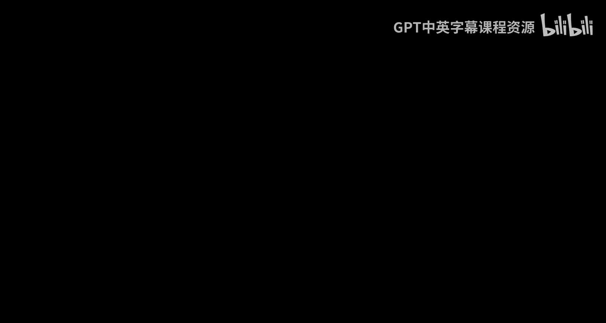

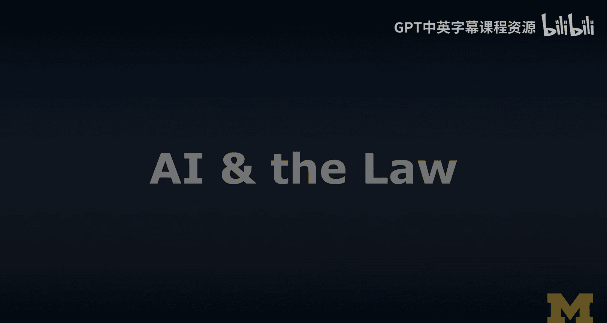

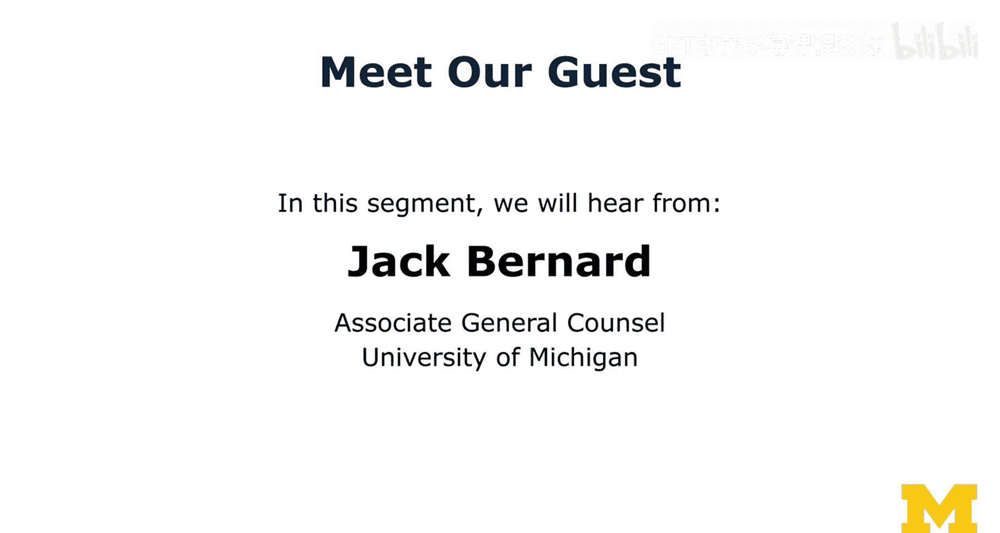

Hi， I'm Jack Bernard and I am an attorney in the General Co's office at the University of Michigan。

 where I also teach in the schools of Law， education， public policy， and information。

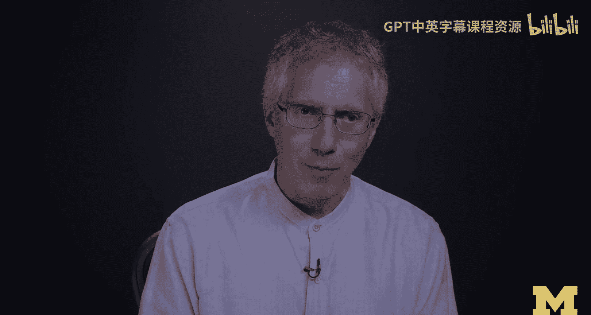

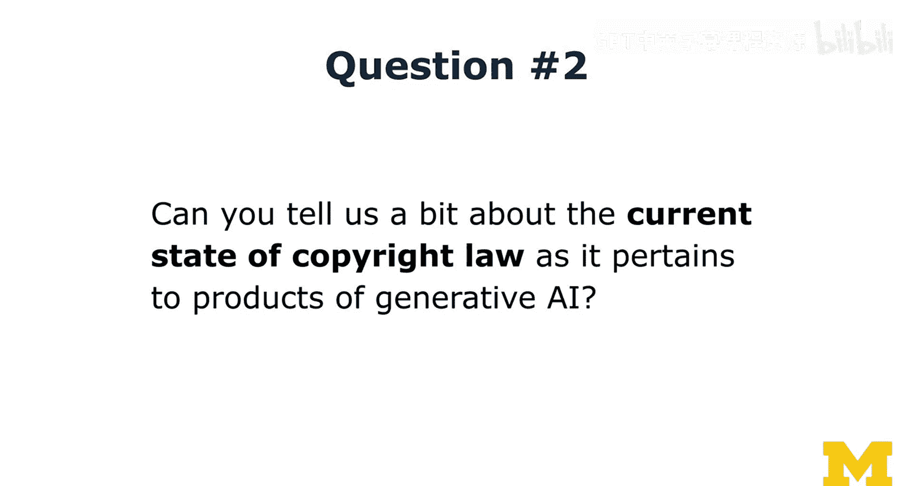

And today I'm going to talk with you about the intersection of AI and generative AI and copyright。

 and maybe some other laws as we continue this discussion。

So copyright is the part of law that protects authorship and in fact it protects fixed works of authorships that are expressed in a tangible medium。

 so things you've written down or photographs you've taken or films that someone else has taken。

 even little doodles and notes you might be writing right now。

 these things are the purview of copyright， and copyrightable works are emerging as an important aspect of how we think about AI in the modern era。

 as you think about copyrighted works in this context。

 realize that they are everywhere in the context of what AI is absorbing into into its programs in order to learn and what AI produces looks an awful lot like the kinds of things that copyright might protect。

 although as we'll see， copyright doesn't typically protect。

thhings that are created by AI today so when you think about the kinds of things that train generative AI like large language models that could include things like works of authorship such as books or computer code or images the human creations that we all experience every day and create ourselves so what happens is this content is ingested inside the language learning models or the AI system and it's incorporated into how the AI produces results when it gets queries and a lot similar to the way that you learn things so too does the AI and the big question is when AI absorbs all this information to。

to learn and to develop the capacity to see relationships between all sorts of human creations。

 whether it's creations of speech or image or sound， when that happens。

 what when they produce results do those results to the output that emerges does that create a copyright problem Well when you think about this it's useful to think about it in terms of inputs and outputs so the inputs are what's being put into the generative AI and what's training it right there's the input part and then there's the training part that I put on the input side of the equation on the output side there's what the AI produces and then how downstream users might make use of those two things when you think about what may or may not be lawful from a copyright perspective that is what may or may not be。

Infringing from a copyright perspective， I would encourage you to think about it in these two large buckets。

 inputs and outputs right now there are a whole variety of lawsuits over a dozen of them looking at this exact question that is whether the large language model companies or the generative AI companies have infringed someone's copyright by inputting thirdparty copyrightable works and then enabling users to produce content that comes out on the other end these cases are currently unresolved。

 so we don't know for certain how courts are going to address these questions。

 but we might have some idea about how distinguishing between inputs and outputs might be useful。

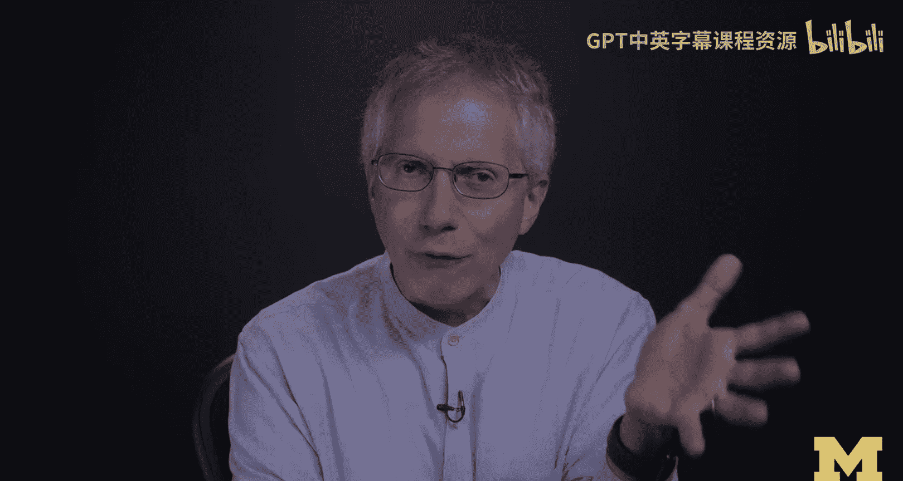

It's entirely possible， and I think probably likely the courts will say that the input part of things that is making copies in order for the model to learn and train on those copyrighted works。

 but that might be what copyright refers to as a fair use， that it's a use authorized by Congress。

 it's a use that's not harmful to the copyright holder。On the second side though。

 there's the outputs and I think for most generative AI models。

 the objective is that the output isn't a copy of what's been put in。

 but that it's something new for the same reasons that when you ask a generative AI system to answer a question。

 it will answer it differently every time kind of like a person answers questions differently。

 and in many ways it's useful to think of the experience that we're observing here it's quite similar to what happens with people for instance you've been exposed to lots of third-party intellectual property and then you produce your own outcomes from that that is you write something down or you express ideas this is from the amalgam of experiences that you've had beforehand well this is a little bit like what the generative AI models are emulating that is they're taking the old。

And breathing new and different life into it， so the big question from a legal perspective will be when AI has produced。

Something is is the output if it's substantially similar to something that existed beforehand。

 will that be a copyright infringement， and then if even that's not a copyright infringement。

 will the uses that you put to that output。 could that somehow be a copyright infringement。

 So we're trying to get to the bottom of this right now in society where there are lots of court cases。

 I'm thinking we'll see the court say that there's a distinction between the inputs and the outputs Now it's worth saying something about the outputs right now under US copyright law。

 nothing that is produced by a machine independent of a person。

 which is sort of what we're trying to get to with AI gets copyright protection。

 even if it looks similar to the kinds of things that humans might produce like artwork or coding music or text。

Images of all kinds， these sorts of things that are usually the purview of humanity。

 we don't protect those things。 you may remember reading in the paper about the famous monkey selfie where a photographer left a camera out in the wilderness and a monkey could see its own face and push the button in order to take a picture and that is what happened but the courts and the copyright office agree that that just doesn't get copyright protection even though it was a photograph and most photographs get copyright protection even though the camera ordinarily does all the work here the monkey pushed the button and therefore no protection。

 there are also these examples of cats with paint or elephants painting and what they create is beautiful from our perspective but it doesn't get copyright protection because it wasn't created by a human。

One of the interesting challenges for us is what does it mean if humans do lots of the work。

 say by asking lots of prompts in order to get a particular outcome from the AI。

 for instance you're trying to get a particular piece of art and you might speak a prompt the AI over and over and over again until you get what you want。

 is there some aspect of the prompter that gets some protection in the output。

 well we don't know the answer to this， but I think this is going to be a fundamental question going forward。

 how much human involvement is there and where will it have to be。

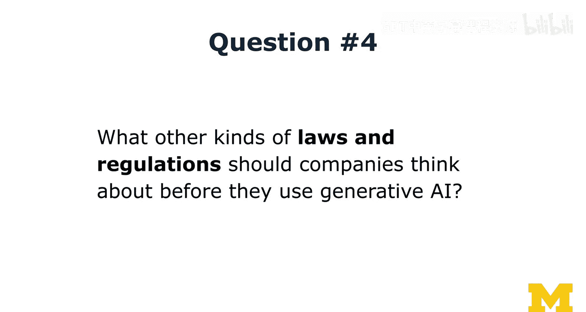

So because the works that are produced by AI， because they don't get protection as a copyrighted work。

 it might mean that if your organization is creating these works。

 either you beknownst to the management or not， those works don't get the same kind of protection that other kinds of copyrighted works might get。

 so for instance， if I write a letter， that will get copyright protection and my employer will hold the copyright to it。

 and that's a pretty normative standard in fact the copyright Act is organized in that way。

But if I prompt AI to produce a very similar letter by giving it a reasonable prompt and it produces a letter that's something similar to what I might have written myself well that will get no copyright protection now that doesn't mean that the company doesn't have some way of protecting that work。

 for instance if what's produced isn't shared with people or is only shared with people under a contract。

 well you could do something like that， but you won't be able to rely on the base copyright for that purpose。

 and I think this is going to change perhaps how companies are thinking about who is doing what。

 it might also mean that companies are changing contracts slightly when they're negotiating or that if your company produces content for third parties。

 you might say something in your contract with your customers that you want them to treat the materials in a particular way that is not to use them in a particular way。

 for instance you might say whatever。Produced here。

 we don't want you ingesting it into some thirdparty product or some third-part AI。

 or you might say that some of what was created as part of this product that we are selling to the world some of this was created by AI and you should be aware of that。

 In fact I suspect that this is where we'll start seeing some regulation about transparency in when what contact we interacted with or what contact a company might have produced was created by AI and not a person。

 I think that we see people heading in that direction although it's not necessarily clear to me that that's where we'll end up in the end。

 there's certainly plenty of places in society where we expect people to get credit for the work they do and maybe one day we'll expect that particular AI gets credit for the work that it's done because we want to be able to trace things back to their source。

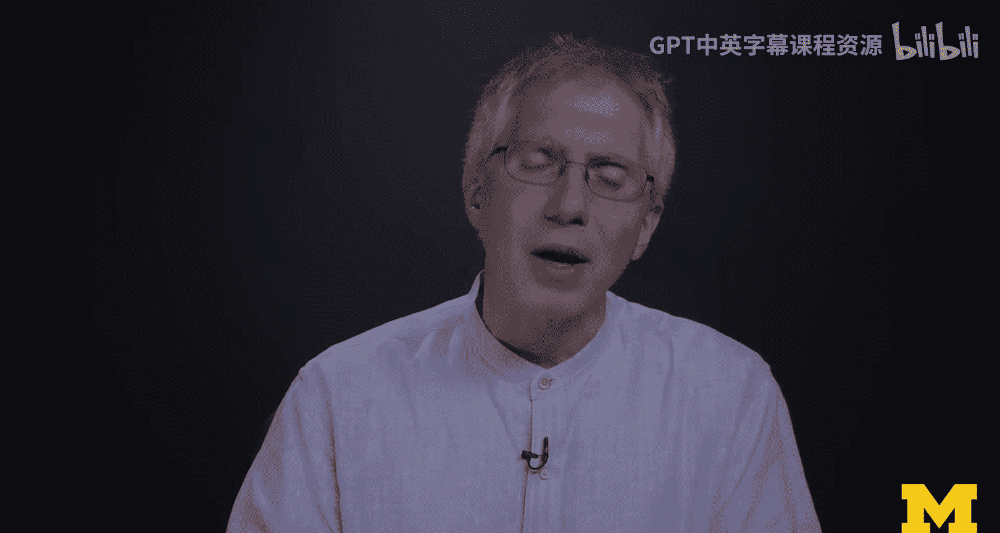

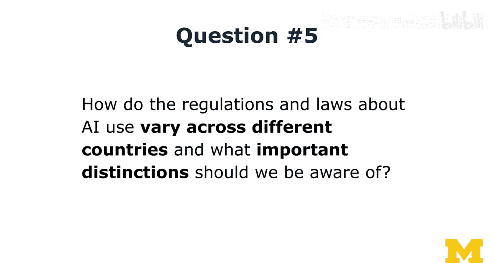

Another challenge as you're thinking about AI in this era is how do we treat things internationally。

 there are different rules around the country， Europe has already promulgated AIrelated law。

 and it's AI related law that would not graft on particularly well in the United States in Europe theres a real proclivity towards protecting the sanctity and dit morale。

 the kind of internal connections between the artist and the art。

 moral rights is what that's sometimes referred to and also there's a real commitment to protecting notions of privacy。

 it's not that we don't have protections for privacy in the United States but there're more robust in Europe whereas in the United States。

 there's a greater sense of protection for the First Amendment and an idea。

 more stronger idea undergirding our system of rugged individualism。

 and so these things don't necessarily align now there isn't robust law in the United States based around AI although。

President Biden did in October of 2023 produce an executive order that was sort of aspirational rather than really deeply substantive but talked about the existential concerns of AI making sure that things are protected and that people's identities are protected and that we're also remaining competitive in the field so there isn't a lot of substance in that I'm sure will be refined over time I should also mention that there were some concerns about what is influencing AI and are the petty bigotries that we have as humans is that getting folded into the what's produced by generative AI and most certainly it is and so there were concerns about that on the part of the executive order so right now there's not a lot of sturdy law that is geared specifically towards AI with this in mind it's also worth saying that copyright is only one aspect of the kinds。

thhings that we think about when we're thinking about regulating AI and copyright has boundaries and we shouldn't use copyright as a tool to constrain AI or to adjust it。

 nudge it one way or another in areas that go beyond the boundaries of what AI is to do privacy laws still apply。

 laws about what you can share internationally or the rights of individuals to have their own personality or to not have their image exploited in one way or another。

 there are a whole variety of laws that might interact with with AI and the general kinds of practices that you have in your community will still tend to apply in the AI context。

 I fully expect that in the future， we will start seeing a body of law growing up out。

 I guess to to be around the periphery and to keep AI and the places where it is unique serving us in the best。

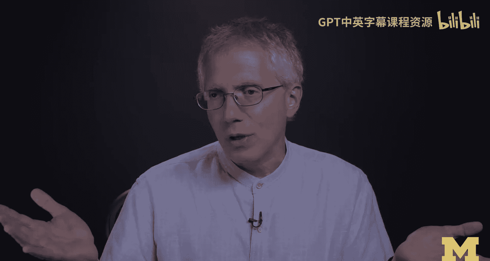

There are profound public policy issues and certainly many pragmatic issues for organizations as they think about how to go forward using AI。

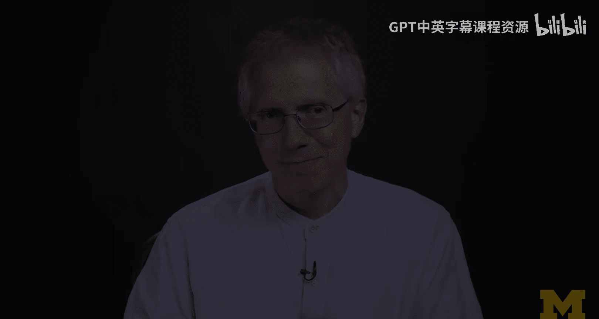

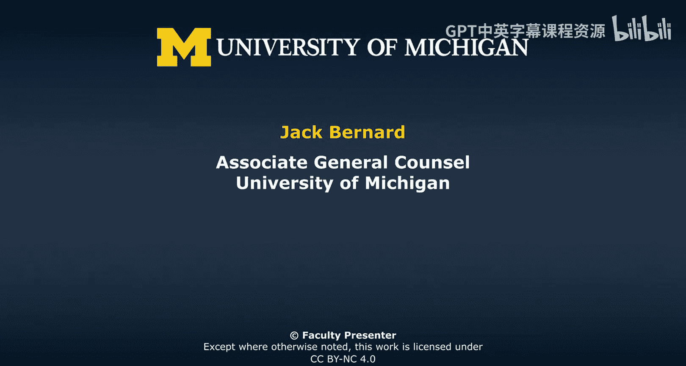