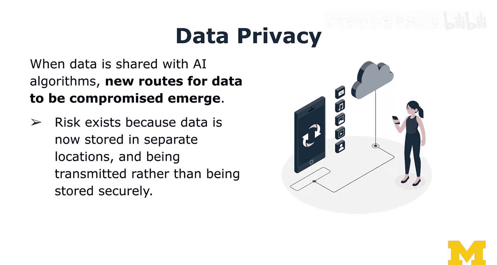
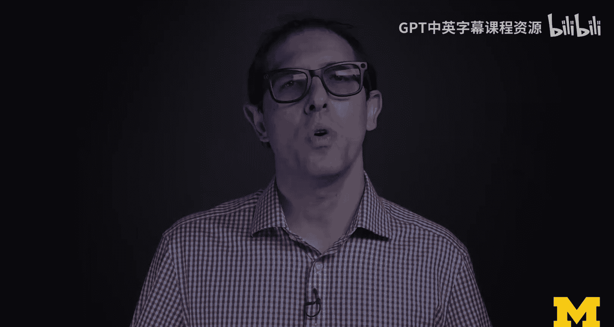
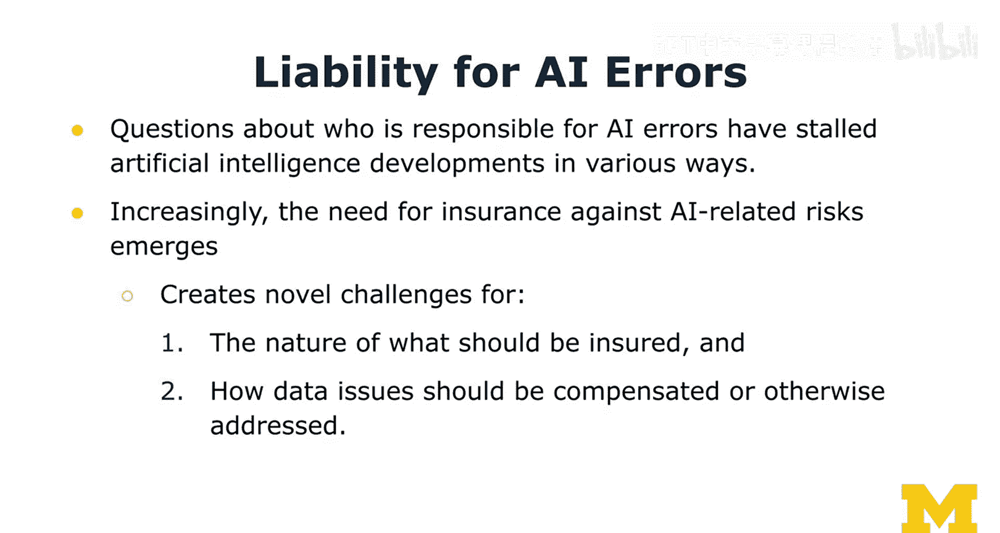
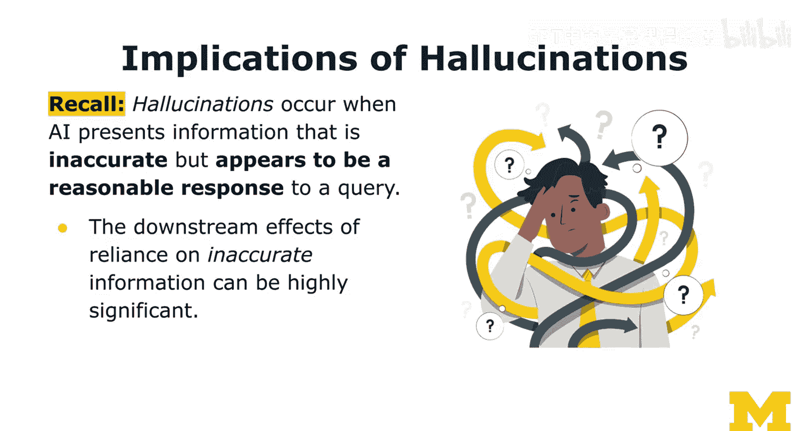
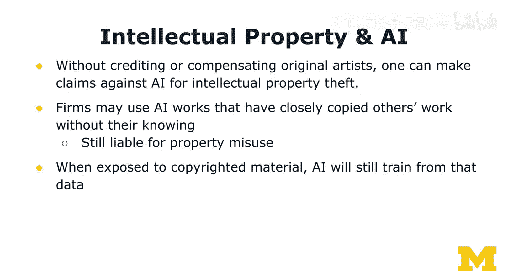
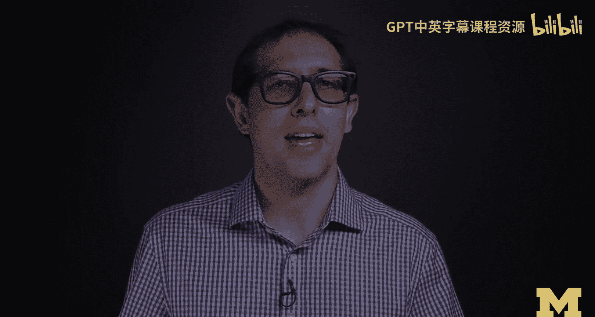
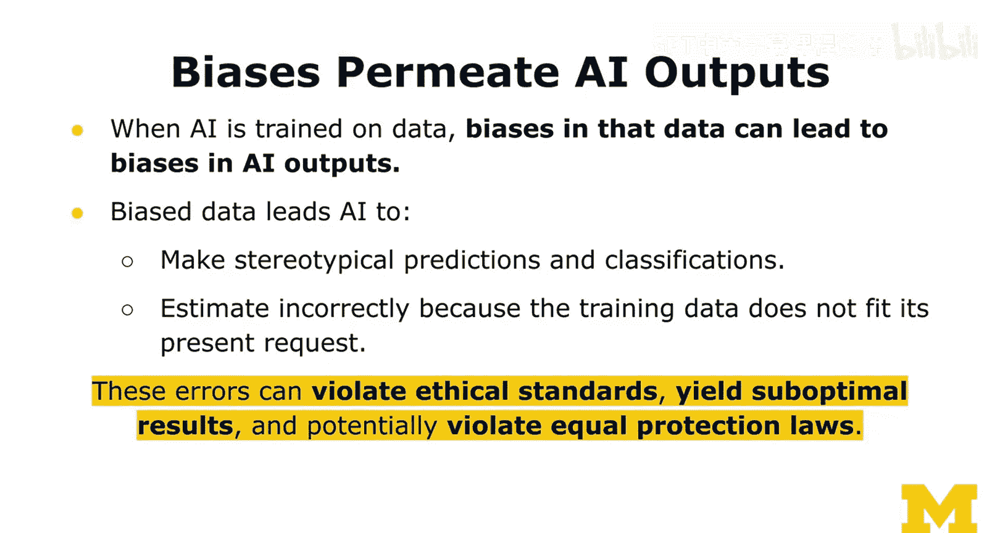
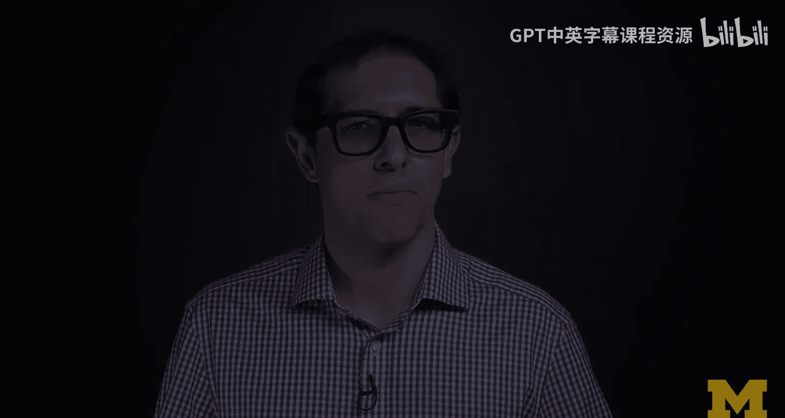
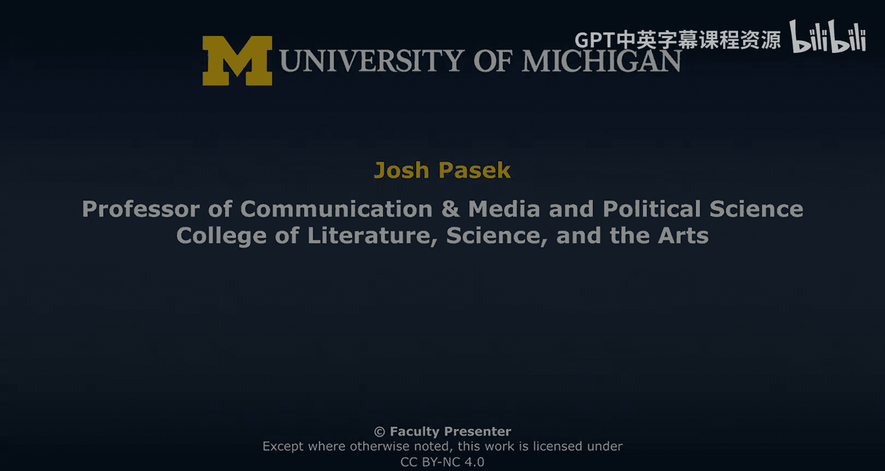

# 密歇根大学《应对颠覆：工作场所的生成式人工智能｜Navigating Disruption： Generative AI in the Workplace》 - P45：5_人工智能的潜在危害.zh_en - GPT中英字幕课程资源 - BV159uyztEfn

The implementation of artificial intelligence in workplace settings can cause serious harm to both companies and those they serve in a variety of respects。

One class of harm that's particularly likely is a series of risks to data privacy。

Both of a firm and for those the firm interacts with。

Another concern stems from what should be done when AI makes mistakes or presents inaccurate information。

There's also the potential that artificial intelligence is involved in intellectual property theft。

Because AI can end up reappropriating existing work as if it's novel or copying work from a firm that's using AI。

And finally， AI can recreate societal biases when learning from problematic training data。

Understanding these different risks is important because to the extent that companies are aware of the potential for risks to privacy。

 risks of liability， and risks around intellectual property。

 they can be largely mitigated through the use of appropriate AI policies and objectives。

So what do these risks look like？When it comes to data privacy。

 artificial intelligence systems are at their core data collection and analysis programs。

They gather information that's fed to them， either via automated processes or from those that directly interact with them and use that data to train their models。

Interaction with artificial intelligence， at least to the extent that data is being shared with AI algorithms。

 may also open up new routes for data to be compromised。

These novel risks exist because data is being stored in a separate place and transmitted in ways that may engender additional security risks。

Over the past several years， there have been a number of high profile data breaches involving artificial intelligence。

Some of these have resulted in data theft， others have resulted in privacy violations。

 and many have involved information that individuals who are clients of a firm would not want public。

 which ended up being disclosed。

These sorts of data leaks have a variety of implications。For one。

 direct harm can come to individuals whose medical records and credit card information are exposed。

For another， data breaches can cause financial and reputational damages for the companies whose data has been breached。

Thinking comprehensively through how to maintain data security when interacting with artificial intelligence products。

 and how to ensure that data which should not leave a firm or particular servers。

 is being appropriately safeguarded is a critical question。

 legal liability exists in a variety of ways for the products of artificial intelligence。😡。

Questions about who's accountable for AI errors have stalled artificial intelligence developments on various fronts。

Indeed， the development of electric cars that can autonomously drive themselves has been in some ways hindered by the need to clearly establish legal liability。

One effect of all of this。Is an increasing need to consider insurance against AI related risks。

 which creates novel challenges regarding both the nature of what should be insured and how data issues should be compensated or otherwise addressed。

Think about， for example， errors in AI medical diagnostic tools。

Reliance on these tools could lead to malpractice claims against the firms and doctors who use problematic algorithms as well as claims against the software companies themselves。

In cases like the flash crash， where an algorithmic trading system led to a rapid sell off of stocks and subsequently tanked the stock market on a particular day。

 there are legal and financial penalties for the kinds of issues that emerge。

Regulators have to determine how those penalties should be meted out。

 Hallucinations constitute another form of AI danger when artificial intelligence tools confidently present information that's inaccurate。

 They only providing information that seems reasonable in response to a particular query。

 But the downstream effects of reliance on that inaccurate information can be highly significant。

Intellectual property questions in the context of artificial intelligence raise additional challenges。

 When artificial intelligence is， for example， generating a new picture。

 that picture may have been trained on the work of existing artists。

On some level， thus training is not dissimilar from how human artists learn by copying great works。

 but on another， the ability to closely mirror an approach and style can infringe on the original creator's rights。

If the original artists are not being properly compensated by the artificial intelligence tool itself。

 which at least to date has not been the norm， then there's a reasonable intellectual property claim against the artificial intelligence creator。

 and those of are are producing the quasi copyrighted works。Further。

 there are concerns for firms that may end up using products of AI that are themselves closely copied from others' work。

 and may be liable for that use， even if they don't know the provenance of the original piece。

Another critical challenge regarding intellectual property and artificial intelligence is the fact that artificial intelligence services are learning from what they're exposed to。

As they're exposed to works that may be copyrighted by a firm。

 perhaps even by employees of that firm， they may learn from and use things to generate further output。

Figuring out how to protect the products of a firm from what artificial intelligence might learn from those products and how to identify when intellectual property has been appropriated through the use of an AI tool is an area that requires considerable fleshing out。

 both legally and practically。😡。

There are also messy questions here about what the standards even are for AI replication of work。

 If a painting were copied by an artist， that would have very different implications from that same painting being copied by an artificial intelligence agent。

 especially if minor changes were incorporated in the process。

 so many of these questions need to be resolved in ways that will require considerable future clarification。

 Lastly， when AI is trained on data。

Biaes in that data can lead to biases and AI outputs。This can cause AI in some cases。

 to make stereotypical predictions and classifications。

It can also lead to cases where AI estimates are wildly off because the data they were trained on differed systematically from the situation it's being applied to。

Errors such as these can violate ethical standards， yield suboptimal results。

 and even lead firms to violate equal protection laws。

From these examples， we can see a series of potential harms that can come through firm engagement with artificial intelligence。

 either because the firm exposed information to artificial intelligence in the first place or because artificial intelligence in some other way is providing something to affirm that it should not be。

These kinds of concerns raise important issues not just for the legal standards of what constitutes appropriate or inappropriate use。

 but also for how firms should proceed， given critical questions about where artificial intelligence information comes from and how artificial intelligence is being used。

