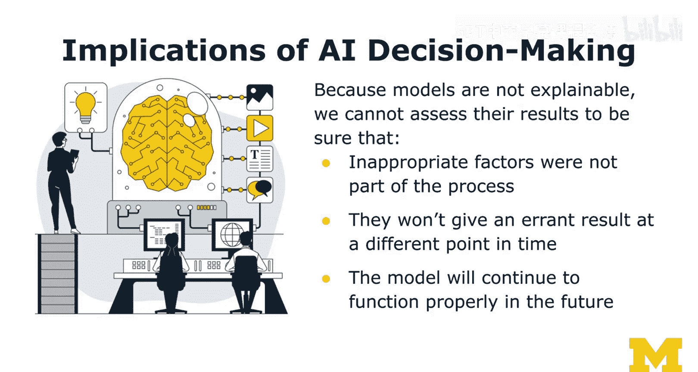
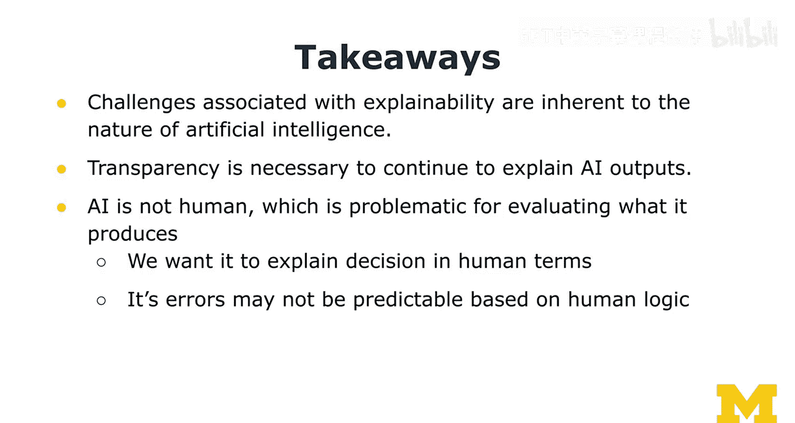

# 密歇根大学《应对颠覆：工作场所的生成式人工智能｜Navigating Disruption： Generative AI in the Workplace》 - P46：6_透明度与可解释性.zh_en - GPT中英字幕课程资源 - BV159uyztEfn

Artificial intelligence models operate by understanding the relations between words， images。

 and sounds， and generating contextual understandings of how these things relate to each other。

 and thus what responses users want when they prompt the models。

In the process of building models like this， computer scientists use neural networks。

 which successively link the words in a text stream or the pixels in an image to the eventual output of the model。

This happens through understanding the relationships between components of the model and generating multiple successive predictive results。

But because of the nature of the predictive results that are produced。

 and because of the enormity of the models involved。

 contemporary artificial intelligence models are opaque to direct human examination。

One cannot simply look at the model， examine its output。

 and trace the process by which a particular predictor or input resulted in what emerged。

Because of this limitation， contemporary artificial intelligence is not explainable in that we cannot trace the provenance of something that emerged to where it came from。

This lack of explainability and transparency may seem at first academic。

 but has real risks for the ways that individuals and corporations use and make sense of AI outputs。

It therefore has implications for the sorts of risks that the use of such models pose。

Explainable artificial intelligence is a major field in contemporary computer science。

 where scholars are increasingly borrowing techniques from psychology to understand what kinds of outputs models will produce。

Understanding why a model produced the result it did helps to diagnose when models may provide inaccurate results and can clarify whether a model is indeed doing what it was asked to do in an appropriate way。

Take， for example， healthcare diagnostics in healthcare diagnostics。

 we might want to train a model to， for instance， observe a picture of a particular skinnyregity and determine whether that is likely to be cancerous。

Absent explainability， All that we get is that we put a picture in and we get a result that says either cancerous or not cancerous。

Importantly， we don't know why it reached the conclusion it did。

 and we don't know what information was part of that process。

Although it's possible to ask an AI algorithm why it produced the information it did。

 the response may not be accurate because the models do not have any algorithmic self awareness。

In some ways， this is similar to humans who are often unable to explain why they make the actions they make。

But unlike humans， AI tends to be confident about these determinations。

 and there are too many potential input parameters for AI explanations to be at all reliable。That is。

 artificial intelligence algorithms do not know in a meaningful sense why they came to the conclusion that they did about whether that picture was or was not cancerous。

This matters because an AI model may depend on bases for judgment that may not be relevant under certain circumstances。

 or a model may have learned an inappropriate basis for a particular assessment that's being relied upon。

 but that is not otherwise apparent because these models are largely not explainable。

 We cannot assess the results of the model， and be sure that inappropriate factors did not constitute a piece of the process。

We cannot assess the results of the model and know that they won't give an errant result at an alternate point in time。

And we also cannot be confident that what works today will continue to work tomorrow。

The absence of explainability puts the onus on users of artificial intelligence models to make their behavior transparent。

Transparent use of artificial intelligence that makes it clear when and how it's being used。

 why it's being used in a particular way， and what we know about how effective that use has been is critical for building trust with users。

And establishing the reason of a particular application for AI use。For these reasons。

 transparency is critical to accountability， and it's necessary for ensuring that AI processes are fair。

Only when we're transparent about the processes by which AI is used and integrated。

 can we meaningfully audit those processes to examine whether AI use operated in the way we would hope it would。

Ideally， at some point in the future， we may be able to find ways to make the results of artificial intelligence algorithms more explainable。

😡，This may not come through fully understanding the process by which input becomes output。

 but by more seriously making sense of how the probabilities of various options in artificial intelligence operate under varying circumstances and as conditions change。

Recognizing that at least in the current moment， we're dealing with a black box necessitates a serious focus on the disclosure of the contents of a prompt。

 as well as the context within which that prompt was asked as a way of understanding what led to a particular result。

It also highlights a need for AI literacy。Only with AI literacy are users likely to understand what we do and don't know about why AI is giving us the results it is。

This is particularly critical because artificial intelligence has the potential to hallucinate or to copy things inappropriately。

Having a collective understanding of how often that may happen in particular circumstances is critical for being able to trust the outputs of artificial intelligence。

The challenges associated with explainability are inherent to the nature of contemporary AI。

And raise the need for uses to be transparent and for us to continue to seek to explain artificial intelligence outputs。

But we must be very cautious in this regard。Because artificial intelligence is not a human being。

 and it's very easy to inappropriately personify AI when evaluating what it produces。

When we want to explain why artificial intelligence makes the decisions it does in human terms。

 it may not make the same decisions that people would make。

 and the errors may not be predictable based on the typical patterns of human errors broadly construed。

 we need to regularly interrogate the outputs of AI。

And to remain attentive to the challenges posed by its lack of explainability。

By constantly evaluating what's working and what's not working with artificial intelligence。

 we can be ready to flag the circumstances where things are likely to go wrong。

And we can potentially prevent issues as they emerge。

