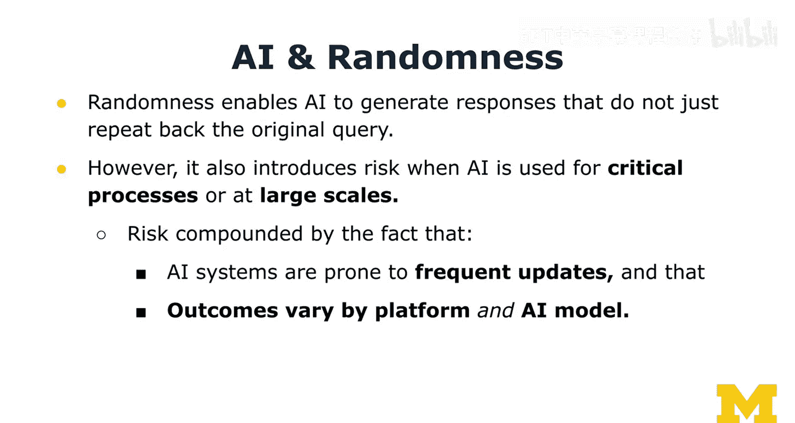
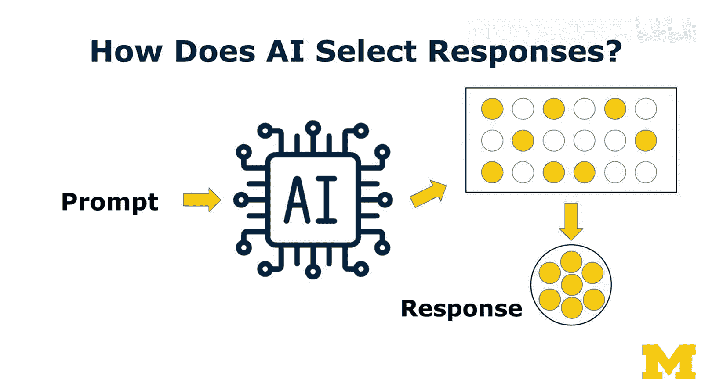
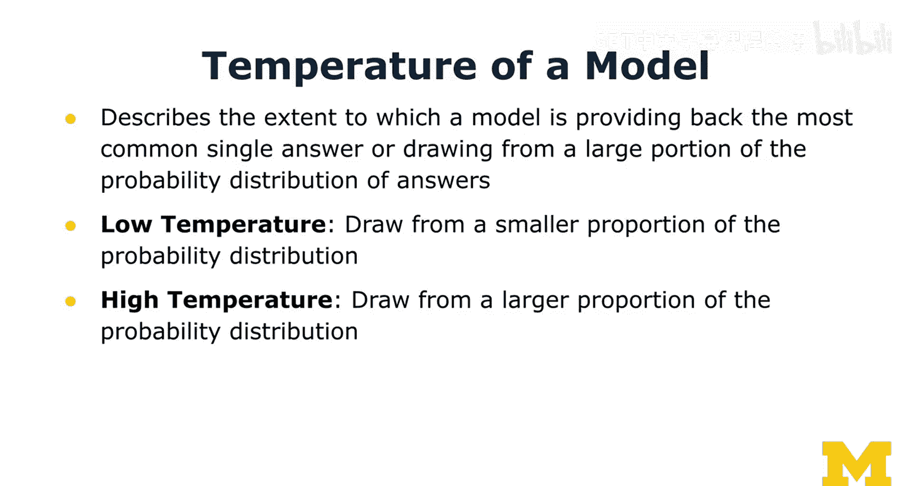
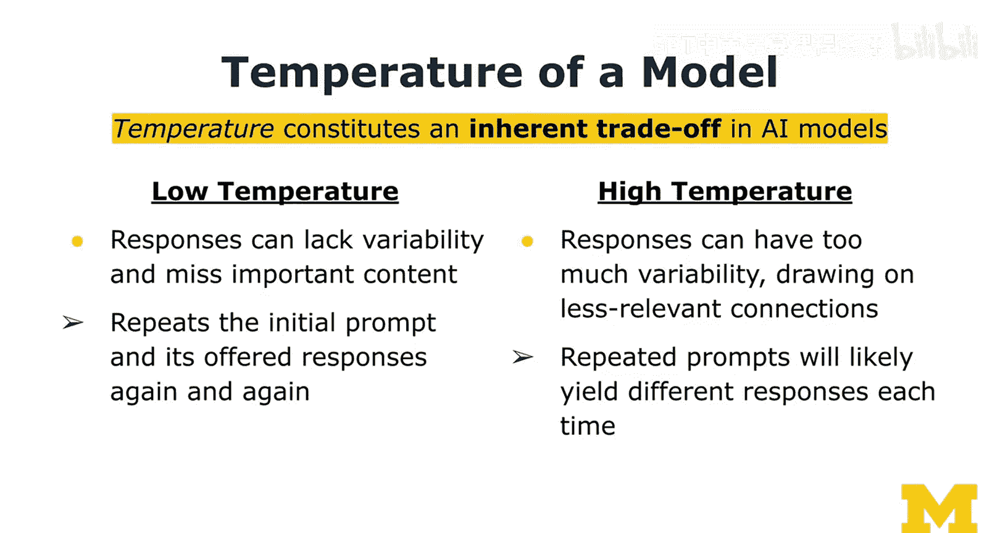
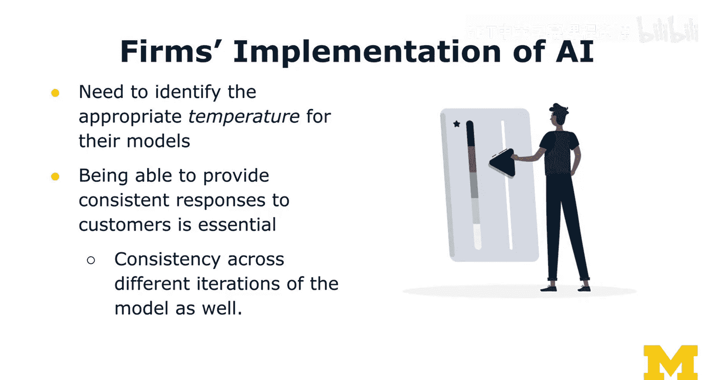
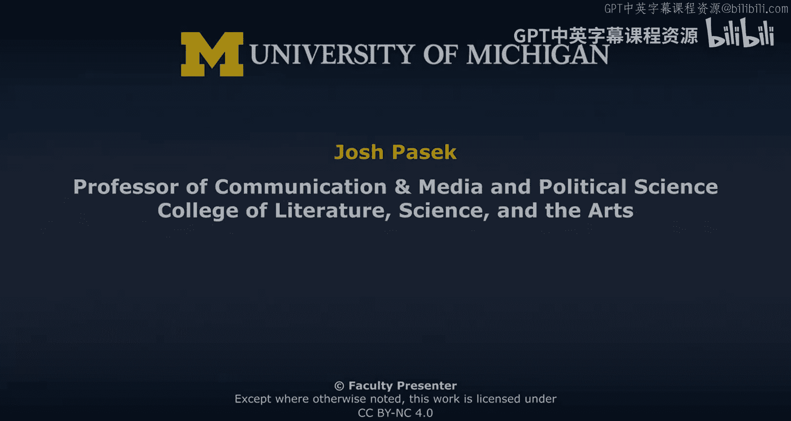

# 密歇根大学《应对颠覆：工作场所的生成式人工智能｜Navigating Disruption： Generative AI in the Workplace》 - P47：7_依赖随机性的技术演进平台.zh_en - GPT中英字幕课程资源 - BV159uyztEfn

Some of the central risks associated with artificial intelligence as well as many of its benefits stem from the fact that artificial intelligence is based on principles of randomization。

 it is in computer scientist termstochastic。

Because artificial intelligence is based on principles of randomness。

 it produces novelty and does not merely repeat exactly the particular words that it was given。

But this randomness in the process can introduce risks when artificial intelligence is being used for critical processes or at large scales。

Those risks can be compounded by the fact that artificial intelligence systems are prone to frequent updates。

 and the results of the platforms that are being used differ depending on which version of a particular AI model is employed。

Understanding the dynamic nature of artificial intelligence systems can help us understand the impact of both inherent randomness and those changes on the reliability of artificial intelligence outputs。

And being aware of these processes and planning for them is critical for mitigating that risk。

When artificial intelligence is queried with a prompt。

 the results that come back are sampled from what the algorithm determines are the most likely desired contents based on the pattern of words or other content in the prompt。

To understand where those responses come from， we need to look at the distribution of what the artificial intelligence system learns from in practice。

 artificial intelligence systems will learn from other content that shares key components of what's being prompted。

Upon receiving the prompt， the newly created response to that prompt would draw heavily from what exists in relative proportion to the frequency of different things that exist as related to that prompt。

As an example， if I were to talk about swimming， immediately an AI algorithm would recognize that swimming is likely to be associated with places where it would be reasonable to swim。

 such as a pool or a beach。

The AI algorithm will then use words in the contextual environment to figure out what kind of environment would be most likely for where I might be going swimming and to provide information in its response in line with that context。

AI algorithms tend to sample heavily from the parts of the distribution that show up the most frequently。

So if pool is used twice as frequently as beach when talking about swimming in text out in the world。

 it might be used even more disproportionately compared to beach in the AI model。

When an AI model is providing a response， this is a common choice of artificial intelligence system programmers because it enables them to provide high quality feedback based on the most common responses that emerge。

Put simply， AI programmers presume that users want a relatively common response and provide these sorts of responses even more frequently than they would appear in typical human text。

Assessing the extent to which different things that might be associated with the context of swimming will come up will depend inherently on the relative frequency of those different concepts。

But the specific choice of how much more likely the very top few concepts are than everything else will depend on something that's called the model's temperature。

The temperature of a model essentially corresponds to the extent to which a model is providing back deterministic feedback that is the most common single answer。

 or drawing from a large proportion of the probability distribution that underlies the potential responses to the queries。

Models with a lower temperature draw a smaller proportion of the probability distribution。

 whereas those with a higher temperature draw from a larger portion of the probability distribution。

Both choices have risks， and temperature constitutes an inherent tradeoff in AI models。

A lower temperature can yield text that fails to provide interest or enough variability to serve up new content。

Low temperature models can essentially repeat both the prompt and what they have already produced again and again。

High temperature models， in contrast are likely to draw things that are less relevant to a particular query。

 but that may also be possible。Repeating a prompt for a high quality model will often yield something new。

 whereas repeating a prompt for a low temperature model will tend to generate the same output again。

In certain cases， variability is highly valuable。For instance。

 when you go and you search for information on a service like Google。

 Google wants to provide high probability responses to your query。

 but they also want to present the range of things that you might be looking for。

 that is they don't want to provide only the same kind of responses to your query in case you were looking for something a little different from the top single answer。

While Google searches are not random in this way， they are designed to simultaneously provide the highest quality responses while covering the range of responses that a user might be looking for。

This is equivalent to responses with an increasingly high temperature as you go down the results of the search。

A model that provides more variability may help reveal other alternatives for what you may have meant or recognize other possibilities that might not be highlighted by a lower temperature model。

 These choices around the temperature of a model also have implications for whether a model is likely to deliver a wildly unexpected result。

And so the higher the risk of a wildly unexpected result。

 the lower the temperature of a model should be。The baseline temperature makes a lot of sense in certain circumstances。

 but not others。A certain amount of variability is really helpful to draw ining responses from a model。

But variability when looking for exact information can be equivalent to inviting inaccuracy。

As firms come to experiment with artificial intelligence outputs。

 it's critical to think about the appropriate temperature for models。

Temperature can be set in many ways when interacting with AI。

 though not frequently for users employing the most basic interaction platforms。Indeed。

 the quality of many of the automated ways of interacting with artificial intelligence relies on the right temperature being set。

Recognizing the risks of truly oddball responses is important for mitigating the dangers of the randomness inherent in AI。

The other key piece of thinking about the reliability of artificial intelligence use in corporate settings is the consistency of the results that may be observed across different iterations of the artificial intelligence models that are used as the models themselves change。

Since Cha GT first exploded onto the scene in 2022。

 new models have been rolled out on the order of every few weeks or months。

 and larger updates have come every year or so。These updates fundamentally change what should be expected as output from an AI model。

 often rendering that output more sophisticated， changing its form slightly。

 or merely altering its appearance。

While these kinds of changes are not problems per se。

 coupled with the randomness inherent in AI models。

 they pose inflection points where systems can break and where the results of artificial intelligence may radically diverge from what they had been previously。

This can lead to cases where things go wrong quite suddenly。

And because it's so difficult to pinpoint the errors underlying those issues within the neural networks themselves。

 firms need to be aware of this potential and to regularly engage in spot checking the results of the algorithm。

 as well as more systematically assessing。Its reliability and whether it is indeed fit for purpose。

In practice， then， understanding the dynamics of artificial intelligence。

 both the underlying randomness of the models and the tendency for new updates to cause large shifts in model results。

And help prepare firms to both systematically evaluate and record the results of the evaluations of the models that they're using。

As well as help to prevent over reliance on artificial intelligence in circumstances where events and other happenings may change。

That is being aware of the dynamics and the processes underlying artificial intelligence and having strong record keeping of how and where artificial intelligence can be used and why it's being done the way it is can help not only to mitigate risks。

 but also to recognize when things are liable to change。

