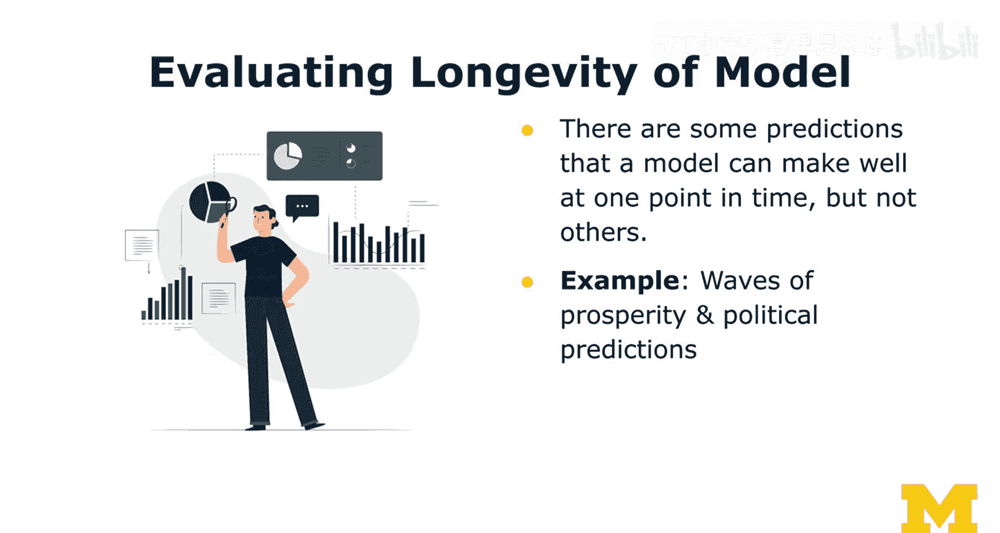
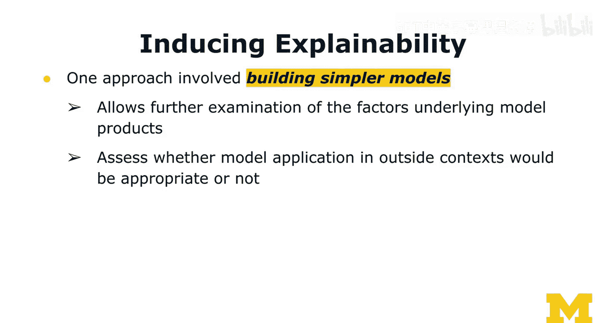

# 密歇根大学《应对颠覆：工作场所的生成式人工智能｜Navigating Disruption： Generative AI in the Workplace》 - P48：8_过度依赖的风险.zh_en - GPT中英字幕课程资源 - BV159uyztEfn

At its core， artificial intelligence is a pattern learning process。

 and the process of learning patterns and making predictions from those patterns can be simultaneously incredibly powerful。

 but can also lead to problems。

One of the central risks that can occur when we over rely on our ability to recognize patterns is that we may fail to understand when there are limits and challenges to the ability for those patterns to continue predicting into the future。

Models built too rigidly on a small set of patterns can operate in very odd ways。

 when patterns change or when novel dynamics are introduced。

Recognizing those risks of over reliance on existing patterns can help to avoid some of the more challenging problems that tend to occur when using artificial intelligence models。

In 2010， a series of stock market models were running to decide whether certain stock should be traded or not。

Because of a set of circumstances that had never occurred before。

 multiple of those models interacted in a way that very quickly led to a massive stock sell off in the United States。

 and the stock market experienced what they called a flash crash or a very rapid decline。

The high frequency trading algorithms were making decisions to sell stocks at lower prices on a rapid basis。

 and an enormous sum of money was lost。The incident revealed the circumstance where over reliance on algorithmic trading could actually lead to market instability。

 and indeed， things got so bad on the day of the flash crash that the stock market was paused and no new trading was allowed until the problem was fixed。

There are ways to address these sorts of issues， both through regulatory responses and through preventive approaches。

But recognizing the potential for algorithms to behave weirdly。

 especially when working with out of sample data， is critical for appropriately using artificial intelligence and for being aware of its limits。

Whenever humans are relying on patterns within data。

 they're taking a risk when they assume that those patterns will necessarily continue into the future。

For some patterns， this is a perfectly reasonable assumption。

 perhaps because the kinds of circumstances that lead to those patterns and the reason the pattern exists are well understood and consistent over long periods of time。

In contrast， when predictions are made without an underlying understanding of why those predictions exist and the way they do。

 if the circumstances turn out differently， things may quickly devolve。

Models tend to fail when they're presented with what we call out of sample data。

All models are trained on some sample of information。

But depending on the nature of the data that they're training on and the training。

 things can fall apart quickly when models encounter information that does not match the circumstances under which the model was trained。

Sometimes these cases result in inadvertent bias。such as when water taps at the airport were trained by exposing them to developers' hands。

 but not to hands that looked very different from those of the developers。

This meant that individuals whose skin tones were darker were unable to operate the sinks。

Speech recognition algorithms， often trained on American intonations and voices regularly fail when they encounter Scottish accents。

 or those who talk somewhat differently。These sorts of failures stem from models that are trained on one set of data。

 but then are applied to data outside of that scope。

This has implications in part for training artificial intelligence models and ensuring that the training of models is done as broadly as possible。

 but also for the applications of those models。Because recognizing when applications occur outside of the training data is critical for understanding when artificial intelligence models are likely to yield misleading results。

Take， for instance， a model designed to estimate sales of a particular product in the United States。

If a company used that model， suddenly to estimate sales of the same product in Thailand。

 it's quite likely that the model would fail。This is not because the model' is wrong for the case that it's been trained on。

 but because the context of the application is so different that the set of predictors may operate very differently。

The black box nature of artificial intelligence models makes it difficult to understand how a model may be relying on attributes that will not hold across contexts。

This means that end users the model will need to assess whether the model applies appropriately。

There are a number of approaches that can be used to address potential over reliance on training data for artificial intelligence models。

 one is to try to expand the scope of artificial intelligence training data in the first place。

To the extent that firms are using their own models to train AI。

 ensuring that the data that's being used for that training process covers the full gamut of potential applications and is being reassessed for the potential that it covers that full gamut is important。

Failure to fully cover the scope can result in model misspecificationations when applied outside of that scope。

Another question that users need to ask about the scope of an artificial intelligence model has to do with time。

 In some cases， models may work at certain points in time， but not at other points in time。 again。

 because the context is different。

For instance， Democrats tend to feel better about the Democratic presidential nominee's chances when the economy is doing well。

 if there's a democratic incumbent。And they feel worse about their nominee's chances if the economy is doing well。

 and there's a Republican incumbent。The opposite is true for Republican partisans。

At some points in time， the economy doing well makes Democrats feel better about their party's chances。

 where at other points in time， the economy doing well makes Republicans feel better about their nominee's' chances。

These are quite reasonable reactions， but if we built a model using data only from periods when Democrats were incumbents。

 we might fundamentally misunderstand the relationship and in fact， get things completely backwards。

Our predictions when Republicans were incumbents would be incorrect。

A key approach to addressing these kinds of issues is to attempt to induce explainability into the model。

This can be done in a few ways。One approach is to build a simpler model that examines the factors that may be underlying what a model produces and to use that model in an effort to think through whether the model application would occur outside of where the model has been trained。

The problems can sometimes be obvious when we can observe the factors that matter in a model。

But again， in the artificial intelligence environment， we're dealing with black boxes。

 we don't see this information。 So unless we're creating an alternate simplified model to corroborate our evidence against。

 we may be caught blindsided when a model stops working in a high stake situation because it was learning from exactly the wrong things。

To avoid these issues， we either need to really interrogate explainable models or we need to regularly reassess model accuracy。

😡，Both approaches require considerable resources beyond the direct costs of using AI。

