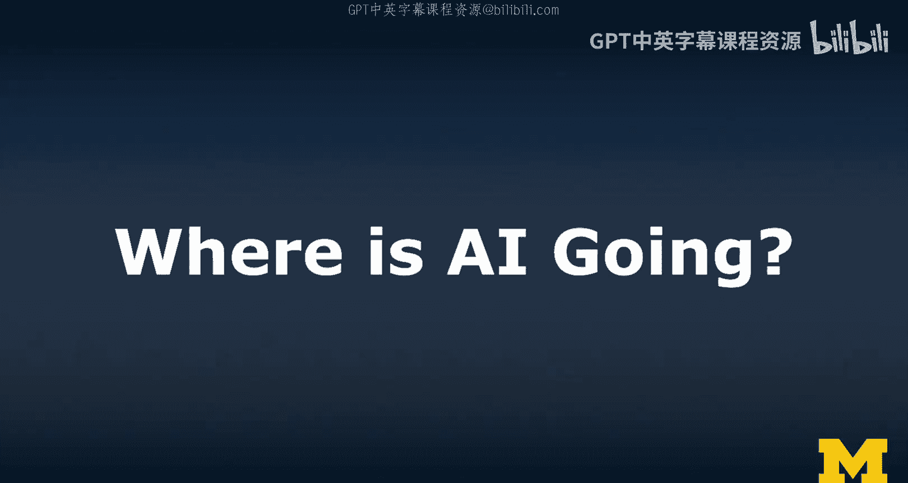
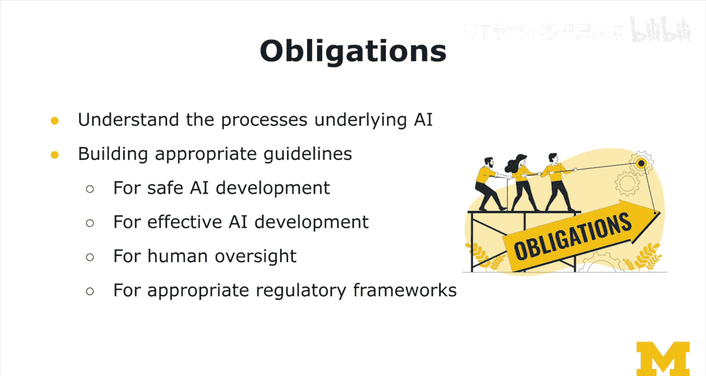
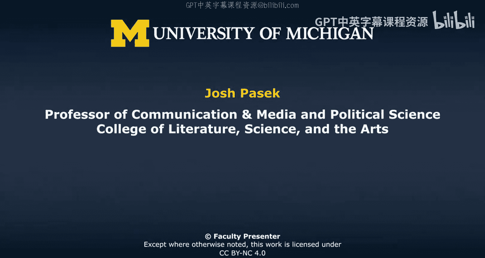

# 密歇根大学《应对颠覆：工作场所的生成式人工智能｜Navigating Disruption： Generative AI in the Workplace》 - P49：9_人工智能的发展方向.zh_en - GPT中英字幕课程资源 - BV159uyztEfn

One critical thing to understand about artificial intelligence at the current moment is that we are very much at the beginning of this transition。

Understanding what might happen with artificial intelligence in the future opens a broad range of possibilities and ones that we should think about as affecting the future of work。

 as well as the future of artificial intelligence's role in the workplace。 Now， of course。

 we don't know what the future of artificial intelligence will bring。

One possibility is that artificial intelligence continues to gain more and more capabilities。

Another is that we've largely reached the limit of what AI can learn based merely on the kinds of information that are publicly available。

And there are even risks that artificial intelligence may devolve in certain ways as we move forward。

In this lecture， I articulate some of the possibilities for where artificial intelligence might be going in the future。

And while， of course， we can't know for sure， it's useful to think about these possibilities because they have broad implications for how we design firms around the use of artificial intelligence and for a society。

 recognizing the changes that artificial intelligence has brought and will continue to facilitate。

1 merely needs to venture to the movie theater every couple of years to come away with the scariest and darkest of AI potentialities。

 The notion that artificial intelligence may become as smart as or smarter than humans and will decide in some fit of peak that humanity is。

 in fact， unnecessary has been a theme of science fiction for at least the last 40 years。

While the potential for great battles between AI and humans may be overwrought or at a minimum premature。

 one of the big questions that underlies these sorts of doomful dystopianism is the notion that artificial intelligence may reach what's called a singularity。

The idea of a singularity is that artificial intelligence may reach a point at which it's capable of thinking at least as well as a human does。

And may reach a point where it's likely to begin building better and better forms of artificial intelligence。

 such that it eventually surpasses humans。There are many futurists who expect such an outcome in the not too distant future。

Imagining what technology and humanity look like in the context where we've hit a singularity is virtually impossible。

At that point， we very quickly can imagine that artificial intelligence would continue to build on its own abilities and become something that may even be beyond our comprehension。

But it's also quite possible that such a point is never to be reached。

Artificial intelligence at its core， at least as currently constituted。

 is learning from the product of humans。 Some postulate that it may never be able to truly surpass them because humans are a limiting factor for AI's training data set。

 and thus， human capabilities may be a functional limit。

Their relevance to thinking through the singularity question。

In the context of the role of AI in the workplace is that should AI truly hit a singularity at some point。

 there will be a radical shift。Such a shift will necessitate large scale social reformulations。

And if it seems likely that we're approaching this point。

 we should prepare for the possibility that large classes of work may no longer be necessary for people to do。

 and we may need to design new ways of doing things and， in fact。

 an entirely new approach to managing society around that potential。

 Some futurists who've imagined this sort of prospect have suggested that it implies that we should implement policies like universal basic income。

To ensure that should nearly everyone become unemployed。

 people will still have some way of making money。But truly establishing what would happen in these circumstances is beyond comprehension。

Where we can use such speculation， however， is that if we imagine that AI is becoming more and more capable of human tasks。

 we may want to think through what the role of humans would look like when， in fact。

 our own ability to track the quality of AI results is no better than that of AI。

One critical question in understanding how the AI future will look is what happens when artificial intelligence begins to train more and more on AI generated products。

As more and more of the content available to train AI。

Is augmented by AI or fully generated by AI systems， what happens to the models themselves？

In contrast to the singularity possibility， some early evidence suggest that generative AI models trained on generative AI content actually lose capabilities。

AI can start corrupting its own training data， and recursive learning can yield odd behaviors。

For instance， AI may become increasingly deterministic as it samples from the highest likelihood responses of training data already sampled only from highly likely responses。

This could mean that the value of artificial intelligence。

Or what more it's able to learn is essentially hindered by itself。

 And this sort of recursive process is referred to as model collapse。

Some emerging evidence suggest that if artificial intelligence models are consistently trained on recursively generated data。

 they will in fact collapse and yield lower and lower quality responses。

 or at least responses that are of less utility to humans。

So while AI learning from AI may be a feature that could accelerate learning and innovation under some theoretical frameworks。

 there's a considerable possibility that artificial intelligence actually has little to improve beyond its current state。

Preparing for this sort of eventuality is very different。

 as it implies a need to watch carefully to assess the quality of AI outputs and to ensure that what AI is producing is not degrading in ways that we don't even notice。

Will AI accelerate learning innovation and yield a process of uncontrolled self improvement or one where it begins to cannibalize itself？

We don't know。But as we think about the future， where it may lead and what artificial intelligence can and may be able to do。

 we have some obligations to make sure that we understand the processes underlying artificial intelligence in order to make sure that we're balancing innovations and applications thereof with concerns about safety。

We should make sure that we're building appropriate guidelines for safe AI development。

 for effective AI development， for human oversight and for appropriate regulatory frameworks for whatever might emerge。

One thing that is clear about artificial intelligence is that as a disruptive technology。

 it's going to be one with a long shadow。Just as we observed。

 centuries between the development of the printing press and when its impact had stabilized。

 were likely to find the same with artificial intelligence。

This is a technology that will shape the future。Even if it doesn't progress as far as many forecast that it might。

