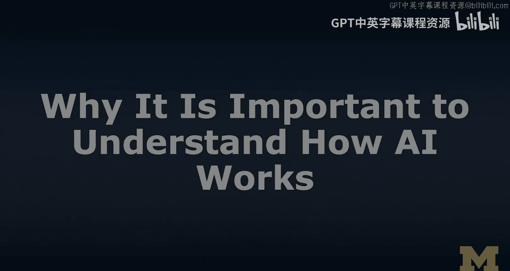
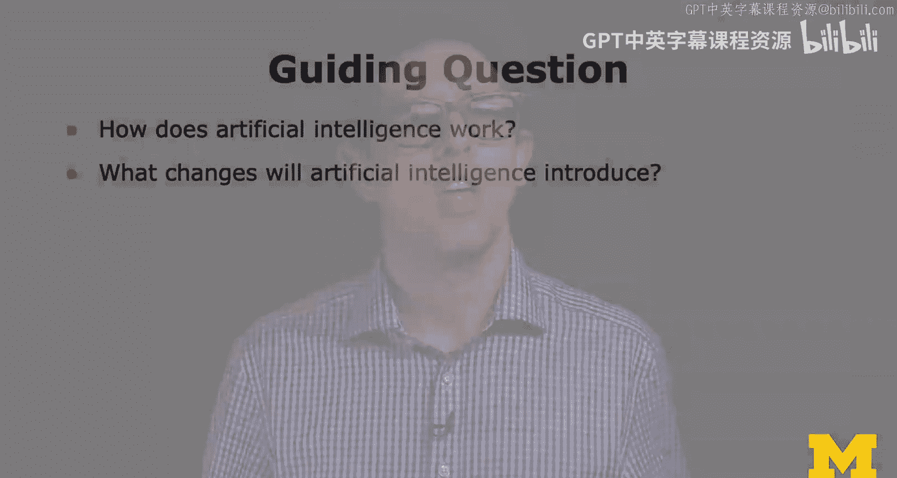
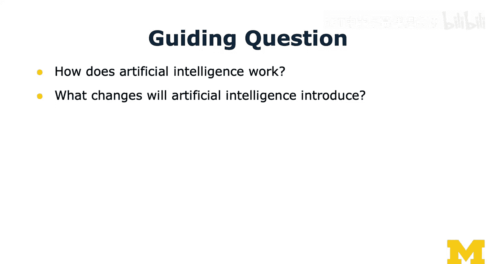
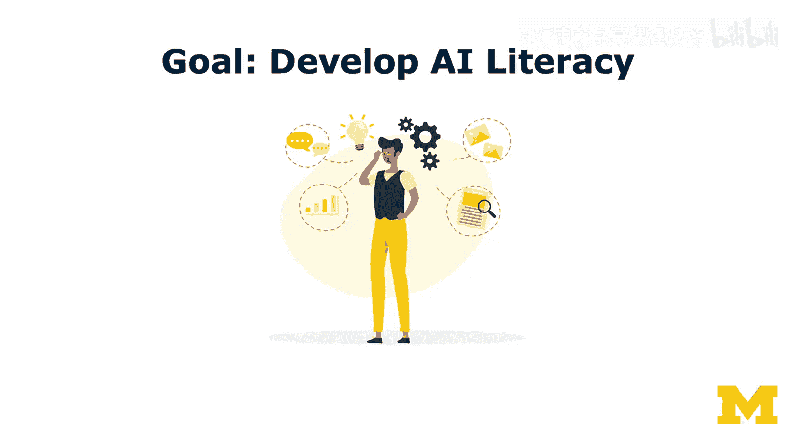
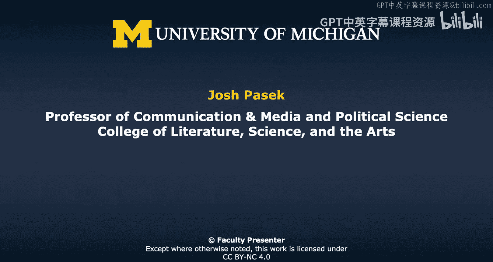

# 密歇根大学《应对颠覆：工作场所的生成式人工智能｜Navigating Disruption： Generative AI in the Workplace》 - P4：3_理解人工智能工作原理的重要性.zh_en - GPT中英字幕课程资源 - BV159uyztEfn

So far， we've discussed the nature of disruptive technologies and how artificial intelligence seems poised to become one of them。

But to understand the potential disruptions that artificial intelligence is likely to bring forth。

 we need to understand how artificial intelligence works and what kinds of changes it will introduce。

Artificial intelligence refers to any computerized system that replicates the kinds of processes that we consider distinctly human。

It's already pervasive in our daily lives， embedded in various aspects of social media algorithms。

 virtual assistance and manufacturing processes。Recognizing the role of AI in these different environments。

 as well as the emerging roles of generative artificial intelligence。

 a particularly important application that we'll discuss in a minute。

 helps us comprehend what those impacts are likely to be。Historically。

 the idea of artificial intelligence emerged during the mid 20th century。

There was a notion that as computers became more and more capable。

 they would approach the kinds of intelligence that we think of as distinctly human。

This idea led to the Tring test， originally named the imitation game。

Which proposed to test whether computers could exhibit behaviors in a particular domain that are indistinguishable from what humans would produce。

As we've developed new technologies， the definition and purposes of AI has changed。

 the first applications of artificial intelligence were for specific backend tasks in industries like finance and areas like handwriting detection。

 which was generally designed to perform particular tasks based on preset criteria。Over time。

 artificial intelligence has become a suite of tools that is accessible to everyone for all sorts of purposes。

 ranging from voice assistance。To various AI driven applications。

As this broad accessibility has democratized AI， it's become increasingly integral to personal and professional activities。

 Artific intelligence has gained widespread usage because it aids people in productivity。

 entertainment， and many other daily tasks， AI powered recommendation systems are the backbone of online video providers。

 smart home devices that interact with one another。

 and language translation tools that make international travel easier along with myriad other applications。

For organizations， AI is also increasingly used for decision making， streamlining processes。

 and driving various forms of innovation through services such as predictive analytics。

 automated customer service， and supply chain optimization。However。

 AI also brings a series of risks and drawbacks at both the individual and societal levels。

For individuals， AI poses privacy concerns as AI can collect and potentially misuse personal data。

It may also perpetuate societal biases， amplifying discrimination as AI learns from provided data that could be potentially biased。

 we'll discuss these sorts of challenges in depth in future lectures。There are also societal risks。

 including job losses due to automation。And there may be ethical dilemmas。

 as AI decision making can be opaque and raise moral questions。

Working with artificial intelligence requires us to become literate in AI。

 and AI literacy involves understanding how artificial intelligence functions， empowers individuals。

 and how individuals can use these tools responsibly and effectively。

AI literacy helps us to identify and mitigate potential risks and for these reasons。

A goal of this course is to provide a fundamental understanding of AI to enable better decision making in personal and professional contexts。

 informed by literacy in AI's capabilities and limitations。

As we continue to work through this course， we'll emphasize the importance of understanding AI to harness its benefits and to mitigate its risks。

It is going to be important in the future to stay updated on new developments in AI。

And understanding the mechanisms that undergird AI systems is crucial for engaging responsibly in conversation about appropriate and inappropriate uses of AI。

As well as how AI can truly provide benefits to humanity。

