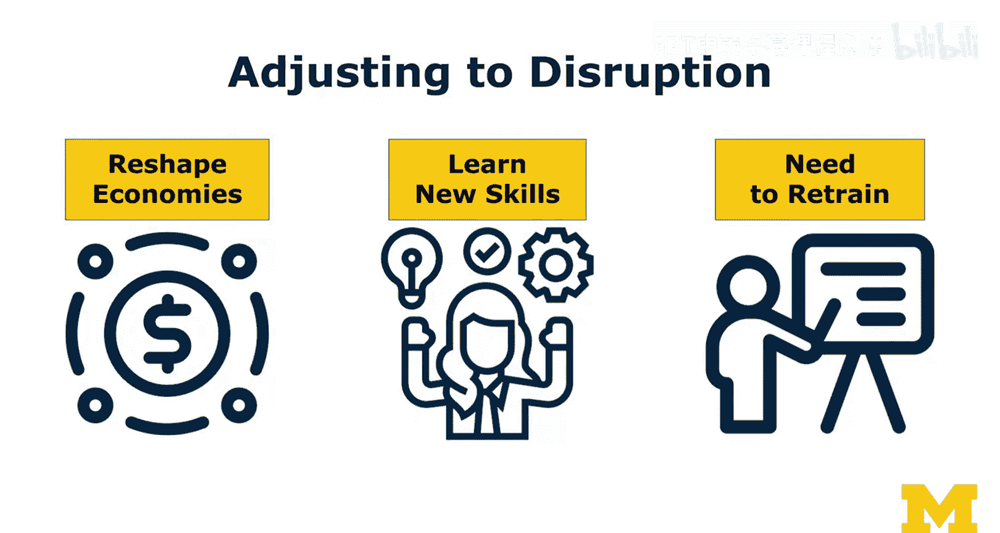
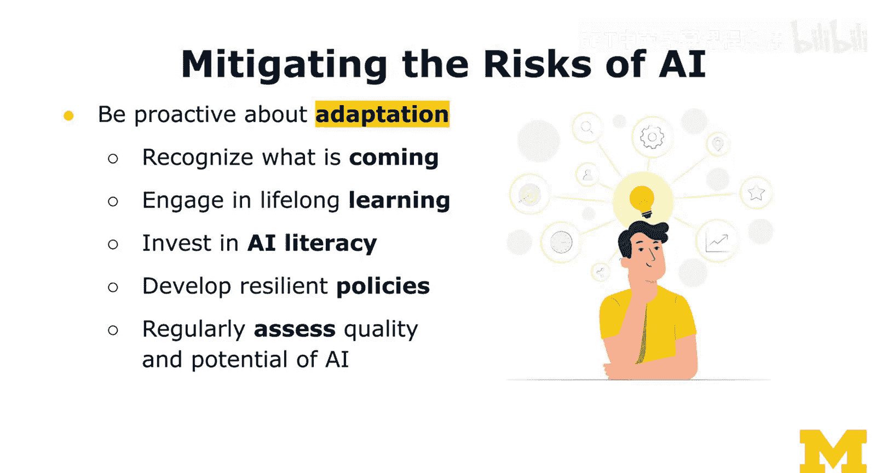
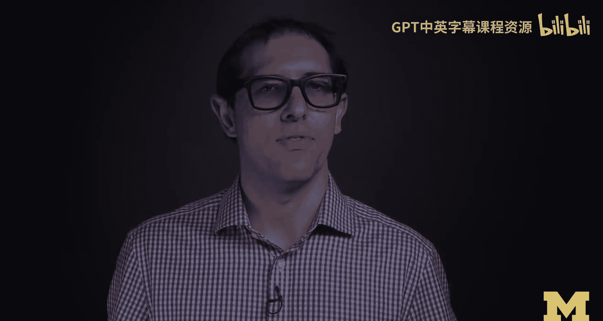
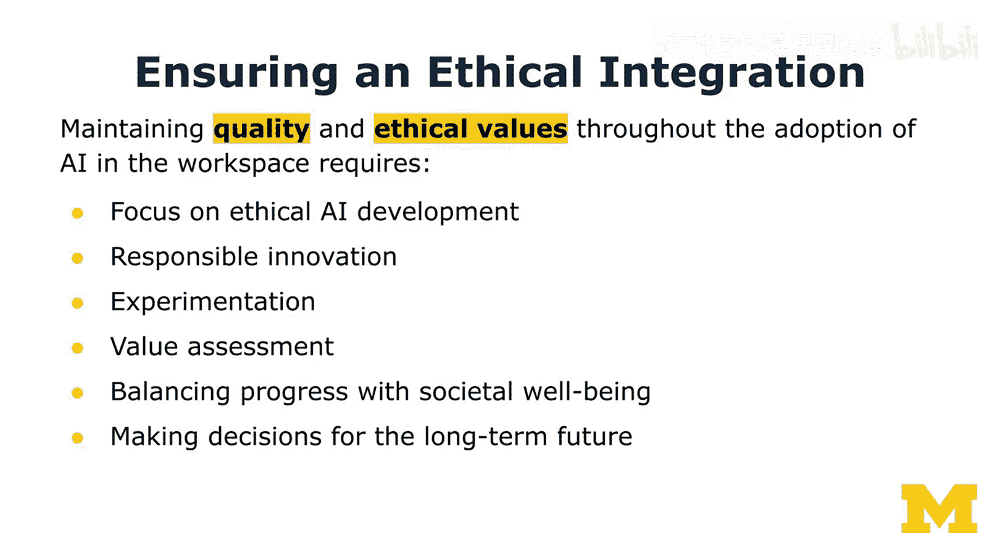
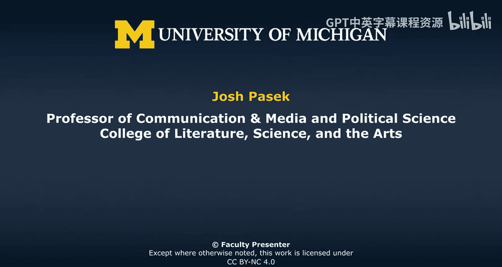

# 密歇根大学《应对颠覆：工作场所的生成式人工智能｜Navigating Disruption： Generative AI in the Workplace》 - P50：10_回溯经典颠覆性技术.zh_en - GPT中英字幕课程资源 - BV159uyztEfn

Throughout this course， we've discussed a number of the risks inherent in the use of artificial intelligence。

 and have placed those risks in the context of how many firms may use and incorporate AI into their work。

Throughout the larger series， we considered the role of artificial intelligence as a disruptive technology that was liable to influence a number of workplace tasks and to shape how workplaces operate。

In this last lecture， we put artificial intelligence back in comparison with other disruptive technologies of the past。

Because many of the lessons of artificial intelligence are lessons that humanity has already learned。

 and we just need to remember。In the Industrial Revolution。

With the advent of the Internet and through the printing press。

 the telegraph and other innovations that shaped how people communicate and how they produce things。

 We've seen historical disruptions that required human adjustment。

This adjustment often involved reshaping economies。

 the need for individuals to learn new skills as jobs changed。

 and the development of retraining programs to address new technologies and build novel skill sets such as literacy or assembly line experience。

In time， disruptive technologies yield societal impacts。

 whole societies adapt to the ways they change what people do and how they do it。

Broad populations came of age in a new era where things were done differently。

Policies need to be established to appropriately interface between the effects of the new technology and the way society operates。

New technological changes induce regulatory responses as well as new norms for how people operate and understand things。

Artificial intelligence as a disruptive technology is poised to bring about these sorts of changes。

For the first time in decades， a new technology is entering the scene that is poised to challenge the positions of individuals who've typically been highly regarded and well prized in the work they do。

The job preparing individuals for knowledge work positions will need to shift as knowledge work itself evolves。

Those in employment areas susceptible to AI disruption will need to develop skills to maintain their value。

 or well have to adapt to novel areas。Recognizing this coming disruption。

 individuals and firms will spend considerable effort experimenting with artificial intelligence。

 identifying where it's effective， where it's not， where it's reliable and where it's risky。

New workflows will emerge that engage both artificial intelligence and human labor in different ways than things were done previously。

There are ways to mitigate the risks being proactive about adaptation。

 recognizing what's coming instead of burying one's head in the sand， engaging in lifelong learning。

 investing in AI literacy， developing resilient policies and thinking through frameworks and approaches that regularly assess quality and potential are critical。

Artificial intelligence will have implications not just for workplaces。

 but also for international competitiveness。

Thinking seriously about how to integrate AI ethically and work through changing regulatory dynamics will be paramount。

Our challenge moving forward is to think through how to ethically maintain key priorities such as quality and values as AI integrates into the workforce。

This will require a focus on ethical AI development， responsible innovation， experimentation。

 value assessment， balancing progress with societal wellbeing and making decisions for the long term future。

😡，They're all going to matter。And these efforts are going to matter not just for individual firms。

 but for society at large。

We also must continuously forecast the risks and reassess the benefits of our uses。

These obligations exist at every level。Working together across individuals， firms， governments。

 and social structures toward the goals of integrating AI for both competitiveness and the greater good is essential。

As we think through the effects of artificial intelligence。

 the changes occurring in workplaces will ripple out to every aspect of society。

Myethodtically working through how those changes are likely to occur。

 understanding their benefits and risks and appropriately preparing individuals and workplaces for those changes is our central priority。

I hope the series of considerations I've laid out for you can be helpful in terms to think seriously about how to prepare for AI in the workplace and how to prepare for the development of policies。

 frameworks and assessments that will lead you to AI success。

 Thank you for joining me in this course。 and I hope you enjoyed。😊。

