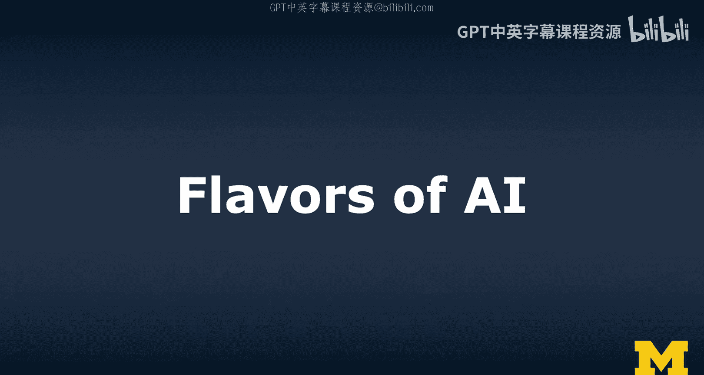
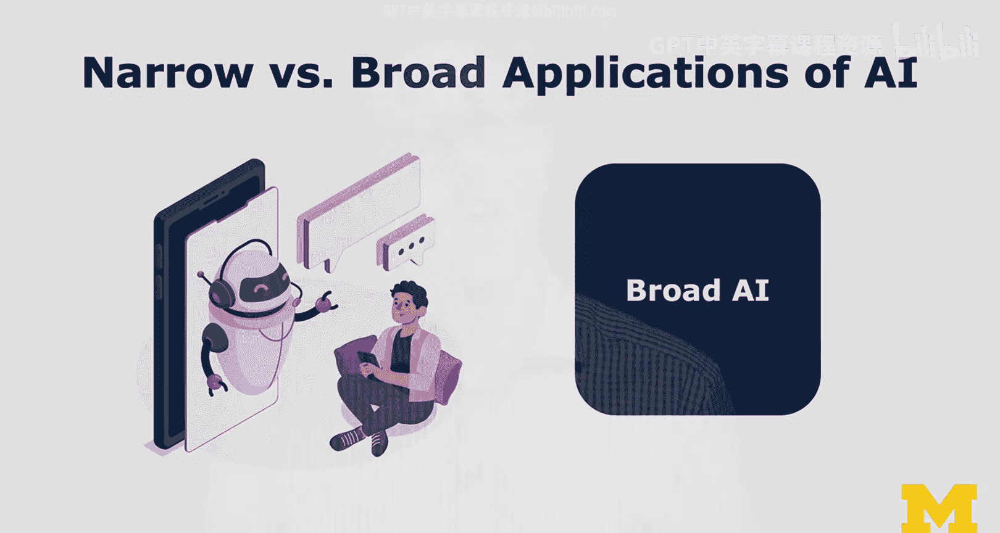
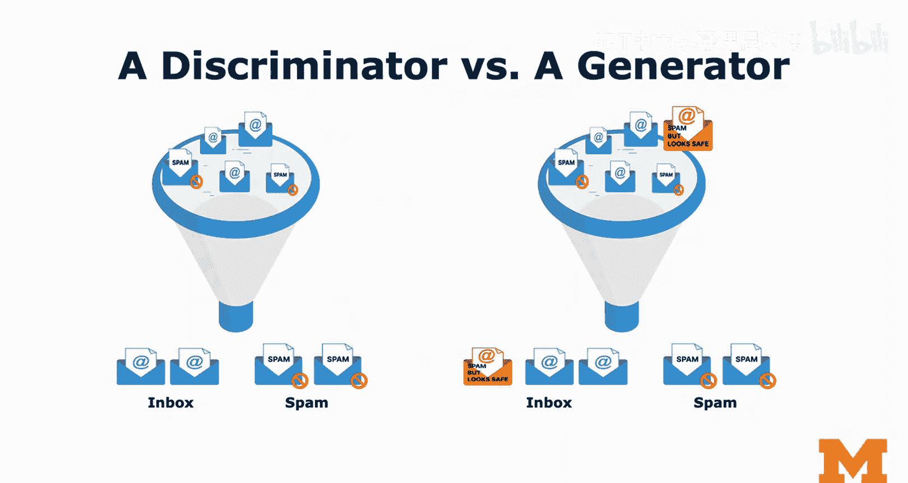
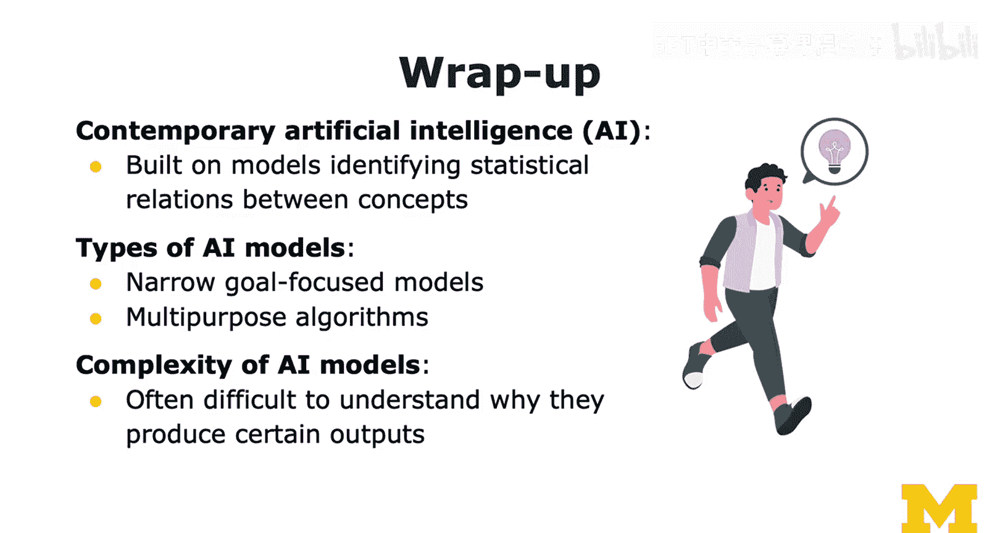
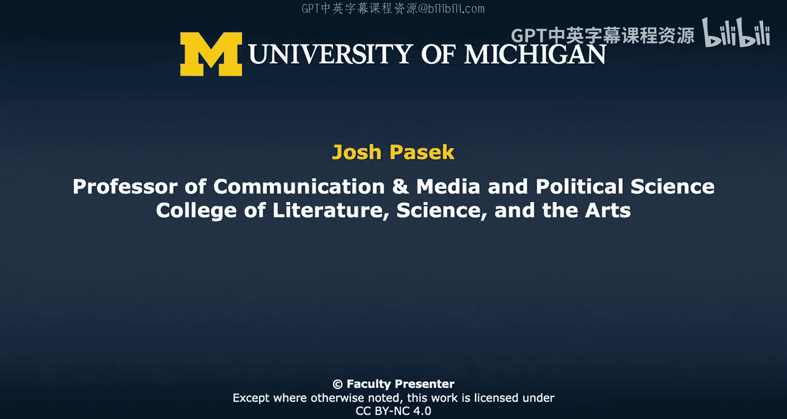
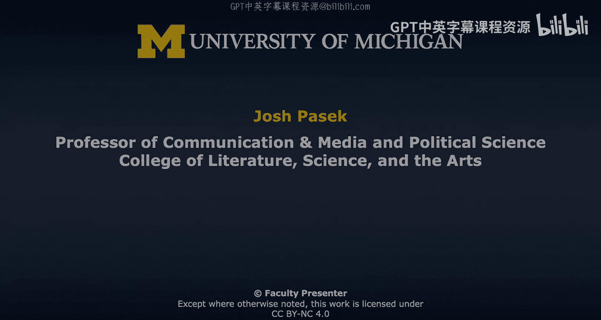

# 密歇根大学《应对颠覆：工作场所的生成式人工智能｜Navigating Disruption： Generative AI in the Workplace》 - P5：4_人工智能的不同类型.zh_en - GPT中英字幕课程资源 - BV159uyztEfn

Artificial intelligence can mean different things and has evolved over time。

It includes a variety of techniques， ranging from simple classifying strategies to complex generative models。

The biggest distinction across applications of artificial intelligence is whether it's being narrowly or broadly construed。

Narrow artificial intelligence is designed to accomplish specific tasks within a limited domain。

For example， an email filter designed to determine if a particular email is spam is an example of narrow AI。

 it only does that specific task。In contrast， broad AI involves systems capable of performing multiple tasks across various domains。

 such as virtual assistants that can handle diverse queries and tasks or generative algorithms that produce novel text in response to human input。

Over time， artificial intelligence applications have become increasingly sophisticated。

 while early applications of what we now consider AI were virtually indistinguishable from other statistical models。

Today， artificial intelligence uses a toolbox that looks somewhat different from many other statistical applications。

Some of the earlier approaches that evolved into what we today think of as artificial intelligence。

Are classifying systems。That is systems that sort input into predefined categories。For example。

 a credit risk assessment can use relatively basic statistical procedures to predict how likely someone is to default an a loan based on aspects of that individual's financial risk。

As these models have become more sophisticated， credit risk assessments now use AI tools to analyze patterns in the data and learn from real life loan defaults to estimate financial risk both more accurately and in a more granular basis。

Artificial intelligence models learn using statistical learning techniques。

They start with relatively simple basic models and use them to identify patterns and make predictions。

To give an example of how this might look。Imagine that you were in the business of selling ice cream。

It doesn't take long to notice that the hotter the temperature。

 the more ice cream you'd be likely to sell on a particular day。

A statistical regression is a tool that can help you predict how much ice cream to make based on the temperature。

But many problems are more complex than a direct relationship between temperature and ice cream sales。

For instance， predicting the weather requires numerous pieces of information。

And the presence of the same factor may yield different predictions in different circumstances。

As the relations between inputs and outputs get increasingly complex， two things begin to happen。

First， more and more data is needed to figure out how the parts of a model relate to one another。

And second， it becomes less and less clear how those predictions are made。

This process results in a model that can generate excellent predictions。

But it's functionally a black box。Where we may not know why the model predicted what it did。

To figure out the predictors and outcomes of complex models。

 computer scientists have derived a series of approaches that are collectively referred to as deep learning。

As an example， one common strategy is called generative adversarial networks these gs train artificial intelligence by involving two models。

 a generator， and a discriminator。The discriminator tries to classify things。

 while the generator tries to create new content to trick the discriminator。For example。

 a discriminator tries to decide if an email should be classified as spam or if it should get into your inbox。

Each time the discriminator improves at determining which emails should be sorted out。

The generator model produces new content with the goal of fooling the discriminator model as the discriminator improves at predicting certain categories。

 the generator simultaneously improves at figuring out what might trick the discriminator。

Over time， this competition improves both models until the discriminator can classify as well or better than humans without regular human input。

As this process moves forward， the models get better and better at their purposes。

 but they also get increasingly complex and the multitude of factors involved make them relatively opaque。

Applications like chatGT， or its Google， meta， and Anthic counterparts fall into a group of AI products referred to as foundation models。

These are general purpose algorithms that work with a broad series of natural language。

 visual under or auditory inputs， and outputs on a large variety of different problems。

Foundation models can then be honed to accomplish a specific goal。

One of the major developments in AI was the realization that foundation models that were later tailored to a particular purpose tended to perform better than models that were trained only on data from other similar problems。

For this reason， many contemporary applications of AI involve applications of foundation models to specific problems rather than the development of new AI models。

In sum， contemporary artificial intelligence is built on models that attempt to identify statistical relations between concepts。

The models themselves sometimes are designed and built to accomplish a narrow goal and sometimes involve multipurpose algorithms that can either be used as general assistance or may be honed towards specific use cases。

And the way that many of these models are constructed can be quite complex。

To the point that it is often difficult to understand why they produce the outputs they do。

