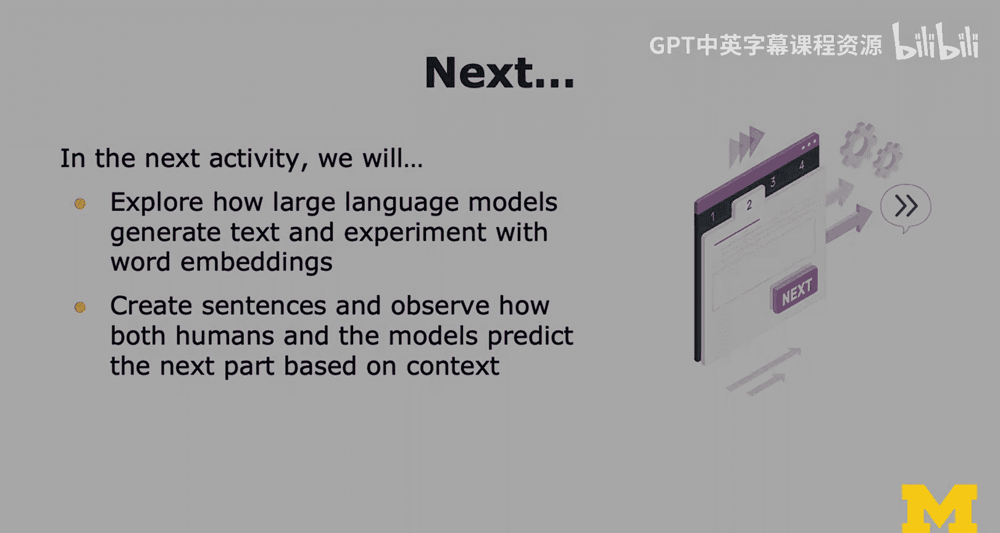
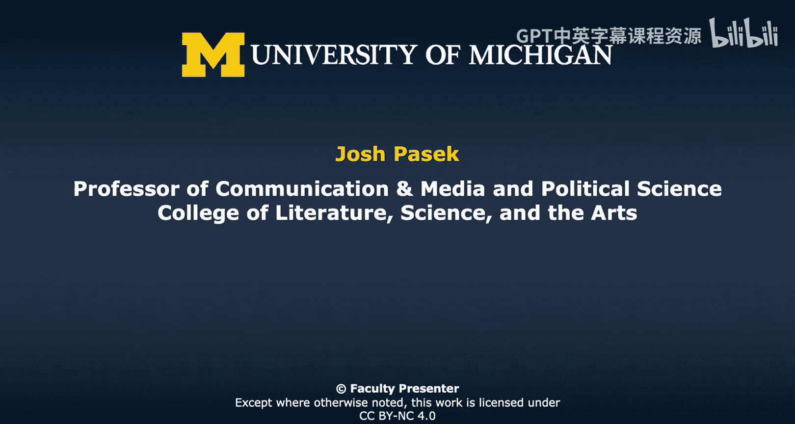

# 密歇根大学《应对颠覆：工作场所的生成式人工智能｜Navigating Disruption： Generative AI in the Workplace》 - P6：5_理解大型语言模型.zh_en - GPT中英字幕课程资源 - BV159uyztEfn

Many of the most sophisticated artificial intelligence models that we work with today。

Began their lives as what we call large language models or LLMs。

Large language models are models that incorporate a large corpus of human language。

 mainly sourced from the internet。And other sources and aim to perform a relatively simple task。

Predicting the next word in a sequence。The idea behind a large language model is that if you predict the next word in a sequence repeatedly。

 you can get to a point where the outcome becomes sentences， paragraphs。

 and eventually an entire document based on continuing the text that's being produced in response to a given prompt。

To accomplish this。Large language models need to ingest a vast amount of data to learn language patterns and understand how each word relates to other words。

This process enables the model to generate output text that resembles natural language and can accomplish tasks such as answering questions or telling a story。

Because these tasks involve identifying and placing words that can complete a narrative。

 large language models are based on a notion called word embeddings。In word embeddings。

 words are represented as vectors in a high dimensional mathematical space。

These vectors capture various pieces of meaning and the relationships between words。For instance。

If given a sentence like， John went to thee。We could predict that the next word might be office or store。

 but not cup， as John went to the cup doesn't make sense。

Much of our understanding of how words relate stems from our human intuition based on contexts。

Similarly， if I give the start of a sentence， like Jane went swimming at the blank。

You might think of a series of responses that would complete the sentence such as pool， beach。

 or lake。There are also many words。That you would say would be improbable after a sentence like that。

For example， Jane when swimming at the telephone doesn't make sense because of the set of words in the context of the words。

 has a series of rules， traditions and other aspects that constrain what could reasonably come next。

The things that you can't go swimming in wouldn't follow the start of this sentence。But。

I can add or change context that would alter what we might expect。To come next， for instance。

 the sentence Jane went swimming in the teacup would seem unreasonable unless I had previously told you that Jane was a mouse。

Human languages also follow formulas with additional rules about what kinds of words are likely to appear when。

Those rules， in fact， can vary across languages and across contexts。For example， in English。

 adjectives typically come before nouns， like a red apple。In fact。

 there's a rule for what kinds of adjectives come before。

 what other kinds of adjectives we can refer to an apple as the big red apple。

 but it sounds weird to a native English speaker to say the red big apple。In Spanish。

 adjectives usually come after the corresponding noun， we would talk about Laman Sanar Roha。

 the equivalent to the Apple Red。In German， some verbs come at the end of a sentence。

 yielding formulations that in English would be likeJohn is with his friends at the store shopping。

These linguistic patterns help us understand where certain words are likely to exist in a sentence。

Other cues from the word and the context also help us think about what kinds of things are likely to appear next。

 Can you surprise someone by inserting a word in a sentence that they don't expect absolutely。

 but typically the next word is somewhat predictable。

 What this means is that a computer program can come to understand word embeddings by making sense the network of words that exist and how they might relate to each other in both placement and context。

😡，For instance， in the earlier example， swimming would be closer in vector space to pool than to mountain。

We can use that to determine the likelihood of different word possibilities。

Even though sentences can have an infinite number of possible word combinations。

 and many of those combinations may be novel and have never been seen before。

 practical constraints around sentence construction lead to reliable estimates of both content and form。

In practice， this means that as we better understand the probabilities of particular words appearing next in a sequence。

 we can continue that sequence in a reasonable way。This is exactly what LLMs do。

Large language models use estimates of these probabilities to predict plausible words that could come next。

For example， given Jane went swimming at V， the model is likely to provide an answer like pool or beach。

 and it will fill in one of those that seems reasonable and high probability based on the context。

To generate these estimates， large language models and other generative AI models utilize a system called neural networks。

These are basically a series of predictions that allow all words to have relations to all other words in a couple different ways。

They're kind of opaque and you don't need to understand them too well to make sense of what's going on。

 but what happens in practice is you have a series of predictive models for the likelihood of every single word based on the words that you just observed。

Then you repeat that series of predictions a couple of times to predict things between the word set that you observe and the words that you come out with。

While we can't ascribe a particular meaning to what the different pieces in that network are。

 we end up coming out with a pretty good approximation of how humans would think about what words are liable to come next。

Okay， so what does this mean？Importantly。This means that when you're dealing with large language models and other sorts of generative AI models。

 they're not based on memory。In the way that we think of computers as having a recorded cache of information。

Instead。They're based on a generalizable theory of how different words。Concepts。

 and even in contemporary cases， images and sounds relate to one another。

Understanding those basic relationships allows a computerized model to generate coherent sentences that may include novel word combinations that have never existed before。

The computer is encoding a series of likely relationships and trying to select out of those to come up with something plausible that makes sense。

In that process， it's predicting a reasonable approximation of what the next word could or could not be。

In the next activity， we're going to present to you you'll get a sense of how large language models generate text and experiment with word embeddings yourself by producing actual sentences and seeing how the context of those sentences leads both humans and large language models to similar understandings of what text might come next。

😡。

