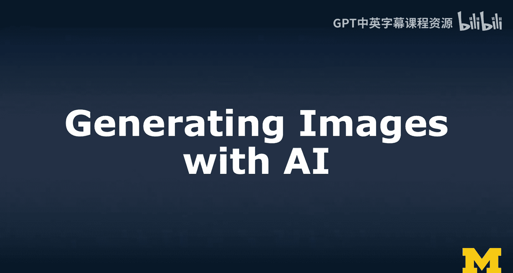
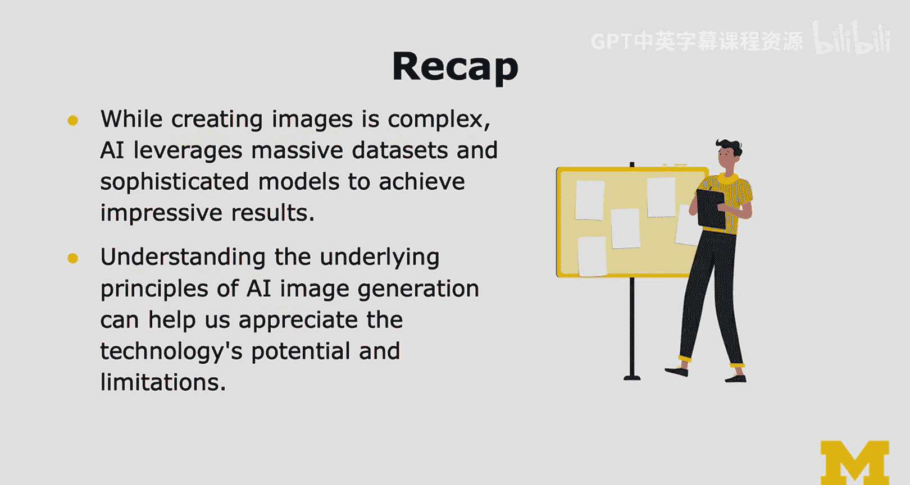
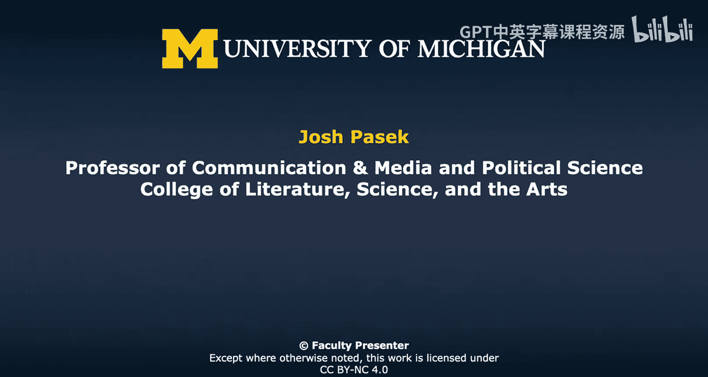

# 密歇根大学《应对颠覆：工作场所的生成式人工智能｜Navigating Disruption： Generative AI in the Workplace》 - P7：6_使用人工智能生成图像.zh_en - GPT中英字幕课程资源 - BV159uyztEfn

Now that we understand how artificial intelligence can predict words in the large language model context。

 let's explore how it can generate and make sense of images。In many ways。

 the challenge for artificial intelligence is far greater with images than it is for words。

This is due to the complexity of the problem and the lack of clear cues to understand distinct objects such as movement or distance。

To understand how a computer can start to make sense of images。

 it is again helpful to look at how humans do it。So。How do we figure out that a dog is a dog？

Well'll imagine for a moment that you're a baby who just encountered the word dog for the first time。

What should you associate that word with？The word dog could refer to all animals。

 this particular animal， the color of this animal or something that the dog is doing。

If we only have heard the word dog once， we simply don't know。As humans。

 we figure out what words go with what concepts by hearing the same word a number of times and identifying what's common about the things we see when those words are used。

That is we begin to see enough examples to categorize them together into the concept of a dog。

And then we learn to recognize it。Identifying patterns of similarity helps us to figure out whether what we see is or isn't a dog。

And when the word does or does not apply。By associating particular features like shapes。

 colors and behaviors with the word dog， we gradually develop a better visual sense of what that word describes。

When artificial intelligence tries to make sense of an image。

 it has to do this somewhat differently from humans。For one thing。

 artificial intelligence has access to different information。

Most of what's used to train computers consists of static images。

Some of which have labels and some of which do not。

The relevant information it has is simply the color of various pixels across the image。

This differs from human experience where distinct objects are identifiable in part through our depth perception and also because both we and the objects we observe are able to move。

Because we may subsequently see a dog's head and tail from different perspectives。

 we have additional tools that let us recognize that these come from the same object。

 rather than two completely different creatures。Human experience confers some direct advantages。

So how can AI come to figure out what is and is not a dog in an image？Again。

 computer scientists have developed a series of clever approaches。

But the basic answer is that computers can just be given far more examples to complete their learning。

If a computer is exposed to enough pictures of dogs， common patterns start to emerge。

 and as data sets get large enough， the patterns of features that tend to cluster together for computers become similar to those patterns humans observe。

There are also a series of computer algorithms that allow generative AI to make sense of what's going on in an image。

One strategy is called convolutional neural networks。

It uses a series of relationships between different pixels to identify how things relate to each other in an image and compare those pixels with other data sets。

This practice allows artificial intelligence to recognize edges， shapes。

 and textures within an image。Further， by filtering images in different ways。

 different sets of patterns can become even more pronounced。

This makes it relatively straightforward for AI to identify things like edges， textures， and shapes。

By examining how pixels relate to each other using these various filters。

 neural networks can then understand the relationships that exist between those pixels within images。

And through this process， pieces of images can be regarded as distinct objects and clustered into groups that appear across multiple images。

Computers can then use labeled data sets to understand relationships between words and objects by observing that the word dog is associated with certain groups of objects and not others。

 AI can correctly classify which objects are dogs and which ones are not。In this manner。

 the values that are assigned to different relations between pixels can eventually provide substantive meanings to a particular image。

As we come to understand more and more about an image。

 we can begin to predict information about things that we cannot directly observe， for instance。

This is a photo of an obscured beach。Given what we know as humans and what algorithms can also infer。

 we can imagine that if the beach weren't obscured。

 it would consist of light colored sand at the bottom and water at the top。

If we instructed an AI algorithm to fill in the space behind the object。

 it would do so in much the same way。This process allows artificial intelligence to， for instance。

 fill in an error in a photograph or remove a person from an image。These processes。

 when combined with external data， allow for the creation of novel visual content。

Using the contextual information provided in a prompt。

 AI can fill in pixel relationships and in turn entire objects to match an existing scene。

It's not a huge leap from this to generating completely novel images by placing a few pixels。

 making predictions about other pixels， and refining them。In this manner。

 AI is able to generate new images that resemble real scenes or mimic an artist's style。

These are the tools used in various image generating algorithms。

 what you should understand out of all of this is that while creating images is a complex task that requires enough data and enough processing power。

 computers are able to start understanding the series of relationships underlying those images。

 and generate novel images that match the prompts that users give them。😡。

