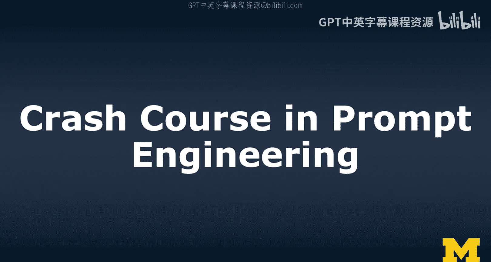
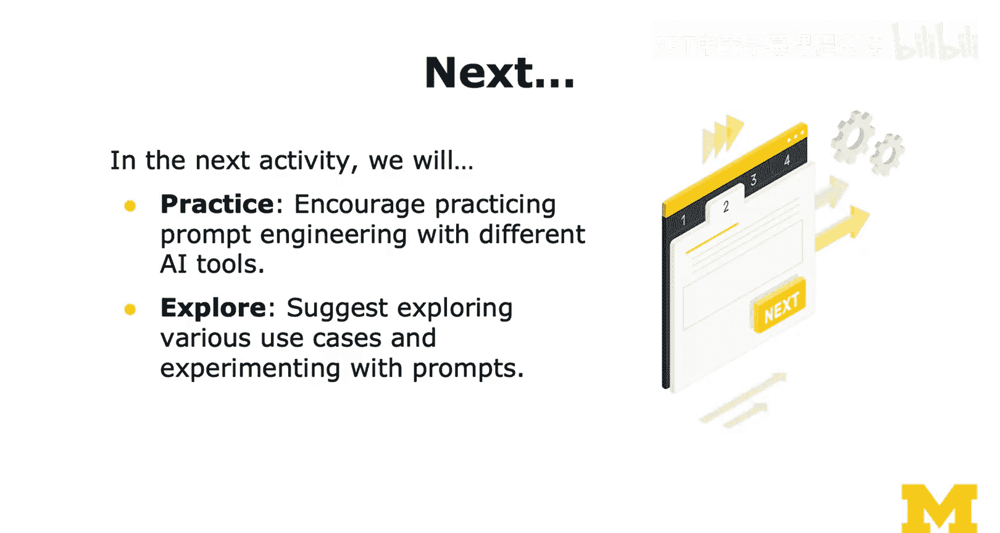

# 密歇根大学《应对颠覆：工作场所的生成式人工智能｜Navigating Disruption： Generative AI in the Workplace》 - P8：7_提示词工程学速成.zh_en - GPT中英字幕课程资源 - BV159uyztEfn

As artificial intelligence algorithms gain the capabilities of producing novel text。

 generating images， and other outputs， a question begins to emerge。

 how can we get these algorithms to produce the best possible outcome in response to a query？

Part of this process involves refining the algorithms that are used to answer user queries through the design and training of the artificial intelligence models themselves。

Another part of this comes from improving our ability to request what we want from artificial intelligence systems。

😡，The emerging art of asking good questions to artificial intelligence so that you can receive the outputs you would hope to receive is an area that has come to be known as prompt engineering。

And is emerging as an important skill for all sorts of workers。When we talk about prompt engineering。

 we're referring to the practice of designing and refining prompts to effectively interact with artificial intelligence models。

 particularly generative artificial intelligence models。

Prompt engineering matters because high quality prompts will typically yield more accurate artificial intelligence outputs。

Making artificial intelligence more useful and more efficient。

There are a few key points we need to understand to make sense of how to create ideal input prompts for an AI system。

As we've already discussed， AI models are trained on large data sets understanding how they interpret and respond to language is key to improving the prompts we give and thus the outputs we receive。

The structure of a query influences what AI gives back。

And components like the terms used can result in slightly different results。

It's also worth noting that because AI is based on a probabilistic model rather than some precoded answer to a query。

 every time you ask the same question to an artificial intelligence system。

 you will get a slightly different response。So how can you craft a prompt that will yield the output you want？

Well， there are a few key elements。First， you want each prompt to be as clear as possible。

 unclear prompts are likely to receive outputs that don't make much sense and are relatively general。

Second， context is very important if you can explain to an AI model why and for what purpose you're asking for a particular thing。

 that model will be better able to provide a version of its response that is tailored to what you may be looking for。

For instance， if you only want 100 words on a particular topic， stating that can be helpful。Third。

 specificity aids prompts for AI models， the more detailed a prompt is。

 the more the response will adhere to those details。Finally。

 if you have examples of the types of responses you would like to receive for a particular query。

 you can provide those examples to the model as a form of refinement training。

 so when the models are run for a particular purpose， it will achieve the desired outcome。

It's important to note that there's no such thing as a perfect prompt。

Finding a way to request what you would like out of an artificial intelligence model involves some element of trial and error。

However， understanding general principles can help starting with a broad prompt if you're not entirely sure what you're looking for。

 then narrowing it down and making it more specific in response to the output AI generates can be effective。

Essentially， this involves reasking the algorithm to generate something novel based on a now clearer prompt。

You can also use AI responses in a feedback loop for example。

 you can ask AI programs to suggest relevant questions that might help refine your prompt and receive a better answer。

A prompt for this purpose might be， I want to design a job ad for a new programmer。

 what do you need to know about the position to create the best possible ad？😡。

Other effective techniques in certain circumstances involve assigning a particular role to an artificial intelligence agent。

 for instance， if you ask AI to act like a historian and explain something it will provide something different from a question than simply asking what is that？

You could also ask AI to generate an explanation of something for children if you need a simpler version at a particular reading level。

If you have particular constraints for the desired outputs from the model。

 being clear about those constraints and conditions can be helpful。

Clarifying the number of words for a document， the time of a speech。

 or the number of colors used for an image might shape the model's output to something more useful furthermore。

😡，Breaking down complex requests into a series of smaller。

 more manageable parts can yield higher quality results。For example。

 rather than asking artificial intelligence to write a 10 page paper。

 asking it for assistance on small sections while providing context for the entire project can often lead to better outcomes that may avoid repetitiveness and other potential problems you can end up with from AI。

 many of which we'll discuss later。But the best approach to learning to craft good prompts is probably just experience if you haven't yet had a chance to work with AI models。

 start with relatively simple questions to understand the kinds of things that artificial intelligence will give back。

As you get responses back， try modifying your query， adding specificity and providing context。

 this trial and error process will help make it clear what you do and do not need to specify。😡。

As you become more familiar with AI， you can move to increasingly complex prompts。

 even by including large texts and appended documents as context。

Advances in artificial intelligence algorithms in the last few years have made it possible to massively increase the amount of contextual information models can use when generating new outputs。

What that means is that if you want to get something specific。

Providing more and more details can be helpful。And will give the model a clearer sense of exactly what you'd like to be outputted。

😡，This can include information about the style， form。

 or function of the output as well as possible examples。As you do this。

 be careful not to over relyly on the output of an AI model。For a number of reasons。

 the models can produce content that misses the mark。

This can occur either because of poor prompting or because of limitations in the models themselves。

While AI can help generate rough copy and refine existing text。

 the product tends to be far better when humans look over AI output and refine what AI generates。

In addition， there are some particular challenges that can make prompts yield less than optimal outcomes。

But there are also ways to get around these challenges。If prompts are relatively vague。

 they're likely to lead to unclear outputs， so providing specific and detailed language will help achieve better results。

As we'll discuss later。Artificial intelligence models have considerable ability to exhibit biases based on issues with their training data。

If an artificial intelligence model only encountered certain kinds of data。

 that's all it's likely to give back。Therefore， when you're crafting a prompt。

 you may want to think about what kinds of bias that model might have learned and how you can ensure that it's not reflected in the final product。

😡，In summary。Prompt engineering requires clarity of desired output。

 and it's helpful to provide as much context as is feasible。

Spificicity of the output that you would like and to iteratively examine and refine the outputs from artificial intelligence。

Again， there's no such thing as a perfect AI prompt AI prompts change the outputs that we get。

Every time artificial intelligence models are updated by their software teams。

And they're also going to continue to respond to changes according to the ways that individuals interact with them。

 as well as what you've told them over the course of a particular interaction。

This means that refining， experimenting， and doing that little bit of trial and error can go a long way toward improving how intelligent AI output seems。

It also means that what you get back from artificial intelligence is not something that can be used as is。

 but is something that needs to be checked。You need to make sure that what it provided is correct and reasonable and that it doesn't have common errors that can appear with AI results。

😡，Put simply AI can accomplish a lot of work， but it can't replace humans entirely。

 at least not at this point。In the next activity， we're going to give you a few example prompts to try out with artificial intelligence。

 and we're going to ask you to play with how to modify those prompts with different artificial intelligence tools and upload your feedback on what you learned in the iterative process to the discussion prompt。

😡。

