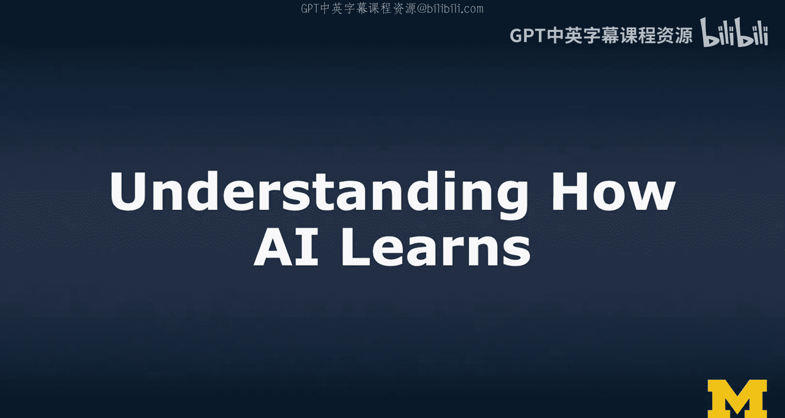
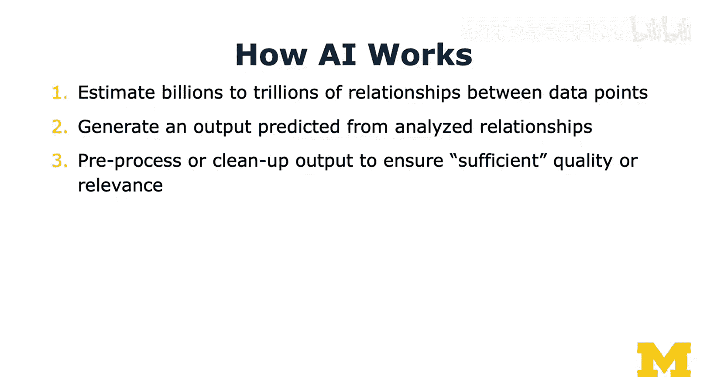
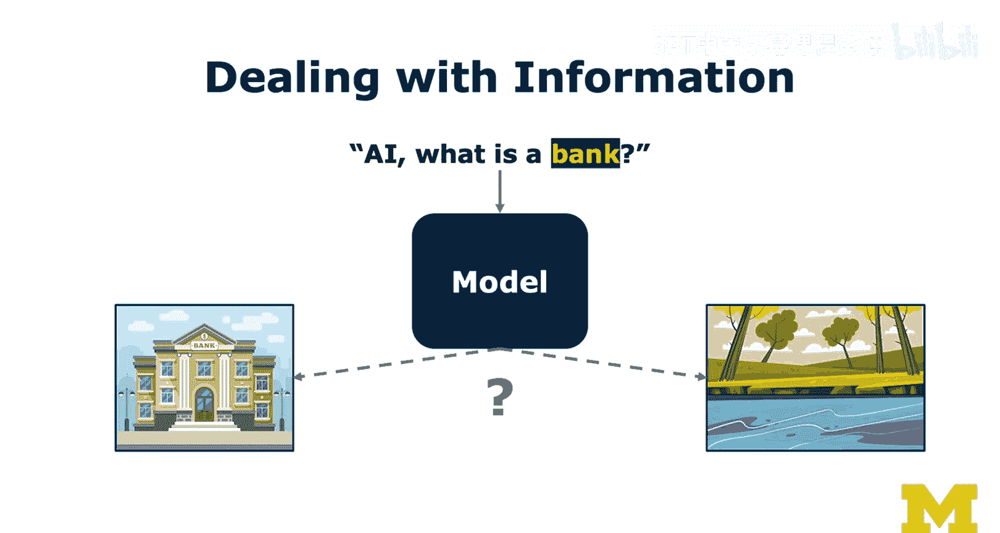
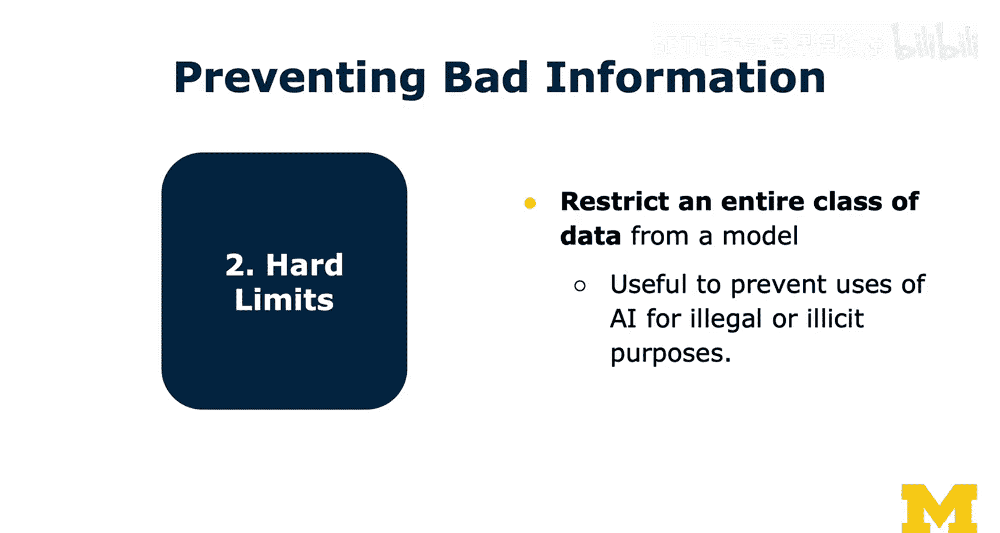
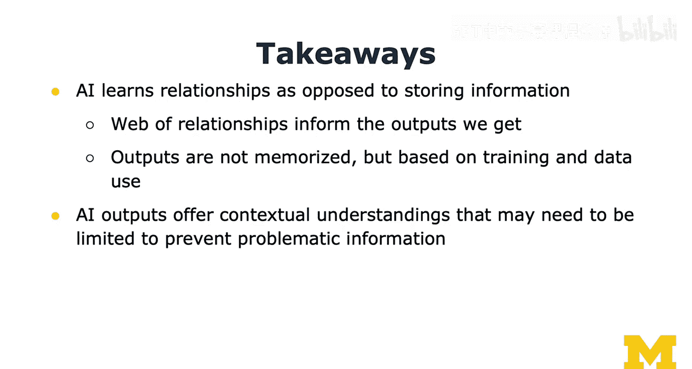
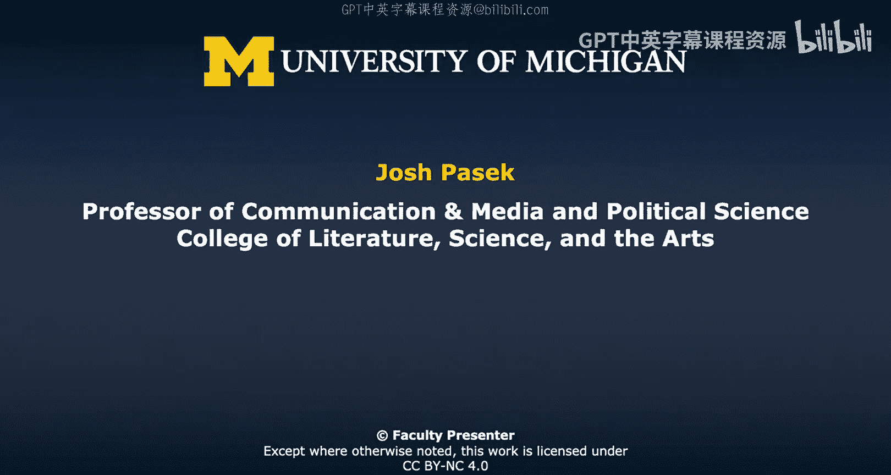

# 密歇根大学《应对颠覆：工作场所的生成式人工智能｜Navigating Disruption： Generative AI in the Workplace》 - P9：8_解析人工智能的学习机制.zh_en - GPT中英字幕课程资源 - BV159uyztEfn

As we discussed previously， artificial intelligence learns by ingesting data and understanding relations between different pieces of information in a data stream。

 in a large language model， it predicts the next word based on all the previous words and the presumed relations between them。

 in an image based model， AI estimates how different pixels relate to each other using a similar structure。

However， AI doesn't think in the way humans do。 Instead。

 it finds likely predictions and in many ways， mimics the patterns found in its training data。

Understanding the way artificial intelligence learns from its training data and operates is critical for understanding both the capacities and limitations of artificial intelligence。

The goal of this lecture is to discuss how AI processes information and generates its outputs。

 It is important to understand what AI is doing， how that differs from human thinking and what we might consider true intelligence versus just parroting back observed data。

Contemporary AI systems estimate billions and even trillions of relationships between data points。

 a model like chat GT processes relationships between words and context to generate coherent text。

 The text is generated from understanding relations that the model gets from training data。

 which is preprocessed or cleaned to ensure the data is of sufficient quality and relevance。

Now， I'm using vague terms like sufficient here for a reason。

 because the actual observation of that training data is something that many of these companies consider to be their secret sauce in practice。

 when companies train data sets for artificial intelligence models。

 they're doing a series of processing tasks that involve things like filtering out noise or irrelevant information in the dataset set。

 ensuring the consistency of different pieces of the dataset set。

 and assigning value to the different pieces of data。

This involves considering what should be accurate and reliable and sometimes actively finding ways to exclude information that may be inaccurate。

 offensive or unhelpful for the model。 In practice。

 we can think of this by imagining reliable sources like academic papers might receive relatively high weights。

 where random posts on Reddit might not be heavily weighted for the model。Yes， it's true。

 many contemporary AI systems will take all of that in and use it as part of their training。

 but what the model is really learning from is the data that gets higher weights in this process。

  importantlyly， we're doing a weighting process that assigns higher weights to some information and lower weights to others。

😡，What that means is that we're going to see at the end of the day that AI produces content that resembles the higher weighted data sources。

And so if we say， for instance， that newspapers and academic articles and professional books are the things that should receive the highest weights。

 the writing of AI is going to look a lot like the content of newspapers and academic papers and professional books。

 importantly， when an AI system is built， much of what we think of as the AI system is not actually storing information。

Traditionally， when we think about computers， one of the key parts is the memory that takes the data file you might have and stores it in a particular place which you can access later。

😡，When you reopen a Word document or whatever you're using at some later point in time。

 it reproduces exactly what you would put into it。This is not how artificial intelligence systems work。

Instead， artificial intelligence systems don't record the state of something；

 they record how different things relate to one another。

This is important because what they produce is a novel generation based on its understandings of how those states relate。

 The model doesn't have a specific internal definition of words。

But comes to understand that a word can have multiple sets of relations depending on context。

In this manner， if you ask an artificial intelligence system what is a bank。

 it won't know whether you're talking about a financial institution or the side of a river until it sees the context around the word。

Artificial intelligence systems also have the potential to generate biased output because training data from the real world not only provides high quality and accurate information。

 but also low quality and inaccurate information。 Ba information or problematic links can creep into the model leading to biased or inaccurate outputs。

Preventing this involves setting soft limits or down weighting stereotypical content and hard limits。

 such as excluding certain classes of data。 We know that this can happen with all sorts of systems。

 For instance， financial models about who's likely to succeed or fail at repaying a alone can sometimes end up recreating racial biases when they train on data that was produced in the era of redlining。

 Preventing bad information in artificial intelligence systems can be done in two basic manners。

There can be soft limits on the kind of information that are produced。 For example。

 we may say that relations that tend towards something highly stereotypical about a group might be something that we want to give less weight to and have considered as less reliable。

 That provides a soft limit where we can tell the system。

 we just don't want to see the relations activated as often。

There are also hard limits where you might say an entire class of data won't be provided in response with a particular model。

 So if you were to ask an artificial intelligence system to produce things that many people would find problematic。

 the system will sometimes not do that。If you were to say ask it how you could hotwire a car or do something else illegal。

 many of the systems have been trained not to answer that kind of question。

All of this means that there are various strategies that help set the outputs of an artificial intelligence model。

 And ideally， those strategies are set up to make the model more reliable and less biased。

 though there are a whole bunch of ways in which that doesn't always happen。

There's a considerable concern and we'll talk about this in future lectures。

The potential of models to continue to generate harmful or inaccurate information or to highlight potential links between ideas that might not be obviously and inherently problematic。

One longstand question is whether AI is just a stochastic parrot。

 merely combining and rephrasing information without true novelty。

 or is in fact generating new things。This raises questions about creativity and whether human creativity is fundamentally different from combining the novel pieces like AI does。

There's clearly evidence that what artificial intelligence is doing goes beyond what we would describe as mere parentting behavior。

Early AI systems often provided snippets that were very similar to pre existingisting content。

But as models have grown， computer scientists have shown that they can learn complex patterns and can actually generate contextually relevant responses that are quite unique from what might have been produced。

 Otherwise， This is why you can do something like ask an artificial intelligence model to create a new word。

 and it's able to do so。😊，So what should we make of the process of how artificial intelligence learns information？

 Well， AI learns relations between things rather than storing information traditionally。

 This creates a web of relations that generates the novel content we get back。

 So what you get back isn't memorized， and the outputs depend on training and data use。

 producingcing contextual understandings that in certain cases need to be limited to prevent problematic information。

In conclusion， there's an extent to which AI is learning in these models。

 not necessarily in the way that we might have traditionally thought about it。

But as these models continue to be trained with more data。

 they're going to understand the set of potential relations that could exist in that data and be able to generate novel things that cover large portions of that scope。

