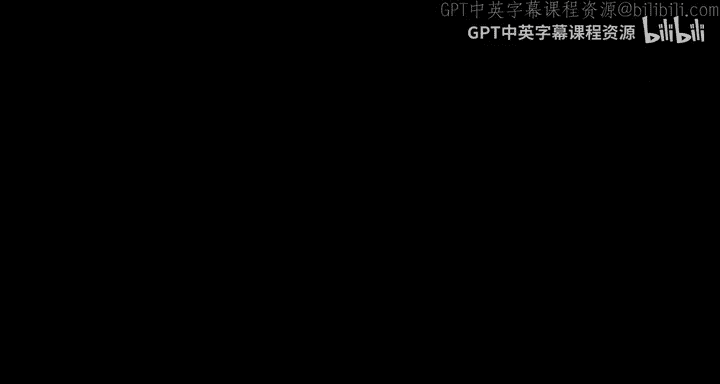
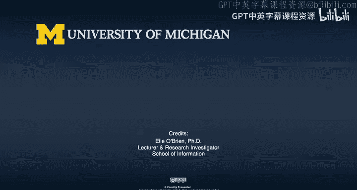

# 密歇根大学《理解数据：导航统计、科学和AI-Understanding Data Navigating Statistics, Science, and AI》 - P11：10_开展民意调查.zh_en - GPT中英字幕课程资源 - BV1pU4NzuEvt

In this demonstration， I'm going to give you a look into how we conduct a survey or poll。

Did you know that rubber ducks are participating in the workforce？ Yes。

 they are clowns and chefs and construction workers。And they're also pirates。

 And I want to find out how many of them have chosen to become pirates。 Now， as you can see。

 there are a lot of ducks， and it would be hugely time consuming to get in touch with every duck and ask them about their job。

 Melvin cannot be left alone for that long。 So what we can do instead is randomly select a bunch of them。

 And then we study that random selection。 So to do that， I'm going to use my big scooper here。

 And this scoop will get about 10 ducks。 And I'm going to lay them out for inspection。

 So let's do that now。Okay， now in this selection of 10 ducks， it looks like I have。Two pirates。

 we could count that two of the 10 ducks are pirates。

 2 and10 could also be stated as 30% of the ducks are pirates。 Okay， did we solve the problem。

 Do we know how many pirate ducks there are。Not exactly。

 let's see what would have happened if I did this exercise again。For good measure。

 I'm going to shake this up。Doing this because I want every duck to have an equal chance to get in the scoop。

 okay， and now I'm going to scoop。Let's get one more。Okay， now I have one pirate duck。

 one in 10 is a pirate。Does that mean that the rate of duck piracy is decreasing， Of course not。

 We know that the bucket of ducks hasn't changed， There are exactly as many pirate ducks as before。

 but what changed does that we sampled or grabbed a different 10 ducks。

 and I'm going to do this once more for good measure， so I'm going to put my ducks back， shake it up。

Now I have three pirate ducks out of 10。 Is that surprising， Are you surprised？

Three is a little different than we'd seen before， it's a little bit。

 you know it's the biggest number we've seen yet。But it's not that far off from what we've seen either。

 right， we've seen one duck in 10。 we've seen two ducks in 10。

 if we had something like eight ducks and 10 were pirates now that would be surprising threes。

It's a little bit unusual， but it's not out of the range of possibility based on what we've seen before。

So what I'm showing you here is that each time we sample or randomly select some ducks to study。

 we get a slightly different set of ducks in our scoop。

 and that can lead to some differences in the proportion of pirates that we measure。

 even though overall in this whole big bin of ducks， nothing is changing。So I bet you're curious now。

 what is the real proportion of pirate ducks。 I lied earlier。 I'm so sorry。

 I do know the count in this bucket。 There are 235 ducks in the total。

 and there are 37 that are pirates。 And that's roughly 15% of them。

 So our estimates from the three draws warrant't too far off。

 It's between 1 in 10 ducks and 2 in 10 ducks。So what are you supposed to take away from this demonstration。

 well there are a few things that I want you to know。First。

 it's often impractical to measure every individual that we'd want to study。

 so statisticians will often conduct a survey， ideally where they randomly select a subset of individuals to study。

 just like I asked only 10 ducks what career they've chosen， a polling company might ask 1。

000 people what candidate they like for president。We try our best to make this selection random。

 for example， I shook up the bucket to try to give every duck a fair chance。

 although that can also be very hard to do in the real world。Second， when we use a sample。

 the answer can depend on exactly who gets included。

 so two samples might give us different measurements， even if nothing else have changed。

 and we just have to acknowledge this somehow。It's a bit like the scale in our last video when we were measuring Melbvinne's food。

Even though the amount of grain wasn't changing， the scale would sometimes give us a different answer。

 it just wasn't completely reliable。In fact， just like the scale is the kind of instrument that we use to measure mass。

 we can also think of our survey as an instrument， it's an instrument that measures how many pirate ducks might be in my town。

And like the scale， the survey results can vary a bit from measurement to measurement。

Now that doesn't mean our measurements are useless just because they're a little noisy。

 We were not that far off from the correct proportion of pirate ducts， for example。

 even when we were only sampling 10。But we have to be honest that the measurements from our samples are inexact。

 they can change a bit from sample to sample， so they're not perfect measures。Of the whole thing。

When we talk about them， we should emphasize that there's some uncertainty。And finally。

 we need to get used to expecting variability that we won't always get the exact same answer from survey。

 from Duckco to survey， and that's normal。😡，Could you imagine that if I were to put on a red hat and I measured the pirate ducks。

 and I got that there were three in 10 pirate ducks， right。

 And then I put the ducks back and I changed my hat for a green one， and I sampled again。

 And now I got two pirate ducks。 So what has has the red hat， you know。

 increase duck piracy or did the green hat decrease duck piracy， Of course not。

 I would be fooling myself。 This change between measurements is actually quite typical。

 It has nothing to do with what hat color I'm wearing。

So what we did here with Ds is very similar to other kinds of surveys you might read about。

 For example， when we want to understand public opinions about someone running for president。

 we usually have to study samples of voters。 There are too many people to ask all of them and because there are so many possible combinations of who could wind up in our sample。

 we have to live with some noise， some inexactness in our measurements。 This is not a bad thing。

 We just have to know that theres some fuzziness in our numbers。

