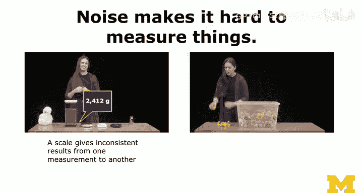
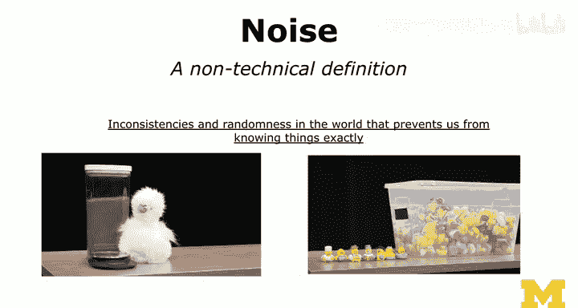
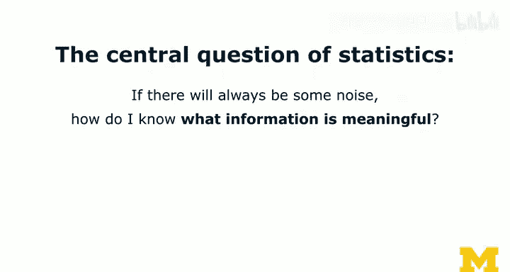

# 密歇根大学《理解数据：导航统计、科学和AI-Understanding Data Navigating Statistics, Science, and AI》 - P12：11_充满噪声的现实世界.zh_en - GPT中英字幕课程资源 - BV1pU4NzuEvt

In our demos， we saw examples of how noise can make it hard to measure things。 First。

 we were interested in trying to measure the mass of some grain。

 and we had a scale that was a bit noisy。 It gave us inconsistent results from one measurement to the next。

 And that made it hard to know what was the real mass。😊，In our duck demo。

 we looked at trying to understand the rates of piracy in rubber ducks。

 but we found that our answer could depend on which ducks we chose to measure and because we were conducting a survey where we tried to randomly pick a different set of ducks every time。

There was always some randomness， some noise in which Ds ended up getting studied。

These are examples of noise now I've used that word a bit and I want to give it a definition。

 unfortunately from area of science to area of science noise can take on slightly different meanings and there isn't a precise definition that can be universally used but I'd like to give us a non-technical intuitive definition that we can keep in our minds whenever we're talking about noise noise is inconsistencies and randomness in the world that prevents us from knowing things exactly and that was like our scale because it was sometimes inconsistent。

 it was hard to be sure which measurement exactly was closest to the real one and in our duck survey because of the ducks in our survey varied from scoop to scoop that made it hard to know well what is really the truth there。

But there's an even deeper point here about noise that I want to make and it's that noise is not only about our instruments。

 instruments like the scale or our survey noise is also a part of the world that we probably can never get rid of so let's take an example with Melvin again and let's say that I want to study Melvin's math skills and so I put together the world's greatest scientists and I have them come up with a math test that is a perfect instrument for measuring Melvin's math knowledge you know it's just so exquisitely designed that it is a perfect index of what math concepts Melvin knows and how many questions he can answer。

So let's say I put Melvin to the test and he gets 84% of the questions。 correct， Well。

 what would happen if we tested him every day for a week？

 And let's just say that we don't have to worry about Melvin remembering his answers from one day to the next because he is a chicken and he just has a short memory。

 So every night when he sleeps， it's like he gets a clean slate to take the test again。

So if we tested him every day for a week we saw on our first day that he got about 84% correct。

 then he did a little better on Tuesday， Wednesday got a little worse Thursday， oh。

 that's a high score and Friday not so hot So what's going on here do you think that Melvin got better then worse then better and then way worse？

Probably not， Melvin's math skills aren't changing over the week。

 but Melvin's ability to take this test is。So on the first day， let's just say that， you know。

 Melvin came in and he did all right， but there was a bug nearby and it was distracting him。

 and that made it kind of hard to answer all of the questions。 On the next day。

 Melvin got a compliment and he was feeling really confident。

 so he you know he just he had a little bit of extra self- eseeem and that gave him a little boost。😊。

The next day it rained and Melvin doesn't like rain。

 and that was kind of affecting his interest in taking the test。

On Thursday he was feeling bold and he took a few guesses， and some of those guesses were just lucky。

And then on Friday， Melvin was just grumpy。 He doesn't know why。 that's okay。

 but he sure was not in the mood to be taking that test。

So here's an example where our tool was perfect。 And yet， Melvin himself was not the same every day。

 right， So we see these fluctuations， and these are more or less random。

 These were unpredictable events like a fly being in the room or getting a compliment on the way to take the test or that it range one day or just feeling grumpy for no reason that you can particular identify。

 These things happen all the time， and we don't have any control over them。😊。

And because of so many things affect one another in the world。

 like the fly affecting Melvin's ability to focus， we ourselves can be a little bit noisy。

But that doesn't mean that our data is useless， right， we can still learn something。So。

Do you think it's likely that Melvin's true math ability as you know measured by this test could be 30%。

 do you think it's likely that he only knows how to answer 30% of the questions？Probably not， right。

 our data is nowhere close to 30% we're seeing scores well above that。

But what about 100% do you think that's likely。I don't think that's likely。

 Melvin's scores are not particularly close to 100% either。

 so I would think it's pretty implausible if somebody were to say that his true ability on this test was actually 100%。

Instead what I could do is maybe draw a line through all of these data points。

 this here represents the mean the average of his scores over these days and that's about an 86% and so we could say that his true ability in terms of his ability to answer questions on that particular test is about 86% he can get about 86% of them right。

 of course it might be a little too confident for me to say it's exactly 86% so maybe I could put a range around it and so this is a range that encompasses most of the data here and so maybe I could say that Melvin's true ability is likely in the range of 84 to 87% of getting the questions right。

Now noise is not just part of our environment， it wasn't just about the fly or you know a rainy day。

 noise is also a part of many biological processes and by biological processes。

 I mean our brains and the parts of our body that help us you know， think and perceive and act。

Here's an example from neuroscience so neurons in your body are cells that help us perceive and sense the world this here is a picture of neurons in your ear and so the red and the yellow fibers here they look like strings these are actually neurons in your ear now neurons respond to the world with spikes we say that they fire or they spike and the way that an auditory neuron encodes sound that happens in the world and translates it into something that your brain can use is that it fires or spikes when a sound occurs so we hear a sound and then the neuron responds with this pattern and so the dots are seconds where the neuron might be quiet and then these exclamation points indicate that all of a sudden it spikes and it won't spike just once it will often spike several times now if I。

The same sound， so we'll say this this horn here and I have the same neuron and I'm able to perfectly record from that neuron。

 what will we see if I play the same sound again and again to the same neuron with a perfect recording unit what we're going to see is that we'll get。

😊，Slightly different patterns of excitation every time。 right now。

 that's actually kind of a deep idea。 The same neuron， the same sound。

 Imagine we have no noise in our recording instruments， the neurons response varies。

 even though it's responding to the same stimulus。 and yet。

 even though as far as this neuron is concerned， it never heard the horn the same way twice。

 somehow our brains are able to understand， that we are hearing the same thing。 right。

 even though every time I speak to you as far as your neurons are concerned。

 It's different every time。 the same pattern of excitation never happens twice in your body。

 yet you still know it's consistently me。😊，And so our bodies are already doing something that you know is really a deep and interesting computation。

 it's trying to identify in a world where there's always noise picking out what information is meaningful and constructing patterns out of that and that is in fact the central question of statistics。

 that's what we're learning how to do very explicitly in the lectures that we're having here is we're trying to build some intuition for you know how do we think about a world where there's always noise。

 choosing information that we think is meaningful。😊。

And so we'll keep developing this a little bit more explicitly in some of the following slides。

