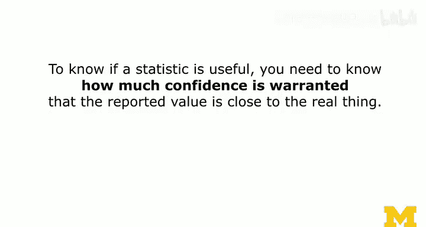

# 密歇根大学《理解数据：导航统计、科学和AI-Understanding Data Navigating Statistics, Science, and AI》 - P13：12_如何与噪声共存.zh_en - GPT中英字幕课程资源 - BV1pU4NzuEvt

We've learned that practically there is always going to be noise。

 we will never be in a situation where there isn't noise to deal with in the world。

But that doesn't mean that we have to assume the whole world is random and nothing can ever be known。

 We can still form some expectations， and we do this all the time。 So， for example。

 weather we can't know precisely if and where lightning will strike。

 but we can still get forecasts that tell us it's likely enough that lightning will occur that we ought to take precautions and go inside。

Another example is in language， if I tell you I'm going to go for a swim at the。

 there are you know many possibilities of what I'm going to say next now we can see some of them here。

 some of these are more likely than others right it's more likely that this is going to be something like pool or beach or lake than library or grocery store or carrot。

😊，Now remember， earlier we had looked at you know how do we deal with having a range of possible outcomes and we were looking at when do children learn how to walk and we found that while you could use the average and you could say you should expect your kid to walk when they are 12 months old。

 this would actually leave a lot of parents high and dry because of a lot of kids are going to walk before 12 months and a lot are going to walk after 12 months。

 so what we did was we said you should expect your kid to walk between eight and 18 months and we gave a range。

And this turns out to also be a good way to deal with noisy measurements。

Now instruments themselves have a built in margin of error。

 margin of error helps us identify what is that range。

 what is the range of possible outcomes that we should expect。

 so this often comes with scales when you buy them that the manufacturing instructions or the instruction booklet will give you a margin of error and it might sound something like this scale is accurate within one gram。

So another way to say that is the scale has a margin of error of1 gram。

And that would mean that if I measured 300 grams on this scale。

 then I know that the real mass of whatever I measured is probably between 299 and 301 grams。

If the margin of error was 10 grams， so that's a bit bigger。

 then the mass of an object that measured at 300 grams is probably between 290 and 310 grams。

 so the range of possibilities has gotten a little bit bigger。

And what if the scale had a margin of error of 100 grams now I can only say that the real mass of my object that I measured at 300 grams is probably between 200 and 400 grams。

 so that's even bigger。And in general， the bigger the margin of error。

 the less helpful the instrument is， we'd really rather have a scale that has a margin of error of 1 gram than 10 grams or 100 grams。

Another example comes from polling。And you may have been， you know。

 inundated with these examples if you've recently gone through an election in your town or state or country。

Now remember， a poll is an instrument too， it's an instrument for understanding something about the sentiment or beliefs or you activities of people in the world。

And you probably already know that some polls are better than others。

 you probably have an instinct for， you know， just knowing that there are some ways to conduct a poll that are superior to others and they're not all equally good。

So let's look here at at least one way that a poll could be considered useful or less effective。

Which poll would you rather have and these indicate， you know。

 let's think about this for our rubber duck piracy survey or poll， let's say in poll A。

 we're only going to sample four ducks and in poll B we're going to sample many more Which one would you rather have？

Now you probably thought that you would rather have poll B， but let's think about why， so in poll A。

 you got only a few responses， so it's very possible that the poll could miss trends in the whole population。

Poll B has many more responses， and so it's more likely to represent the whole population。So poll A。

 where we were surveying very few people or ducks here， had a pretty big margin of error。

Whereas pole B has a smaller margin of error， we're more confident that it's closer to the truth。

Now every poll actually has a margin of error but it can be hard to find。

 so for example I was recently reading a news article about a poll that had to do with presidential approval and then there was a footnote in the bottom of the story and this was where the margin of error was reported for the poll including some details about how many people were participating and how they were reached so you really had to look in the article for this I think it's very possible a lot of people would not have read all the way through the article to see this。

But what does that really mean so let's just put a visual on that so let's say that we measured 45% approval in a poll and we'll use 3% margin of error the slide before it was a 3。

1 but let's simplify it and call it a 3% margin of error so what does that mean let's depict it graphically we could think about extending some lines around our estimate of 45% so kind of giving it a neighborhood around it and this looks like saying that given what we measured and given the poll that we have and it's built- in margin of error。

 it's plausible that the true support for the president could be as low as 42% or as high as 48%。

So in other words， I'm not certain what the true approval rate of the president is in the country。

 but if we think that this poll is reasonably representative and well done。

I can be reasonably confident that the true approval rate is between 42 and 48%。

So what would happen if we conducted another poll， which I've marked here in blue？

This time we measured a 46% approval in that poll and again we have a 3% margin of error。

 so let's say that we just you know the blue poll here is we repeated same the same exact method as before。

 but we did it a week later and because of we're doing a random sample。

 we have different people participating in the study。Okay， so if you saw this data。

 if the blue poll is one week later with different people。

 do we think that approval of the president has gone up， did it go up from 45 to 46%？

You should be a bit skeptical here， in fact that 1% point difference that we saw going up from 45 to 46% is in fact。

 within the 3% margin of error of our original poll。

 so that means that if you know if we had just continued to measure you know same the same exact thing in week one。

 but we just grabbed slightly different people to participate in the study。

 even though nothing had changed，Our approval rate could vary within those up or down three percentage points and our new poll is in that range of what we would expect just by varying up who's in the survey。

 so it really has not particularly strong evidence that we've increased you know the approval rate of the president nationally。

That would be you know if we were to say oh that percentage point increase。

 you know is very meaningful， that would be a bit like if we had a newscaster watching Melvin going oh oh Melvin just got better at math and now he's getting worse and he's better again and oh oh he's getting worse at math right we know that didn't happen these were just random draws essentially of you know circumstances that led Melvin to vary a little bit but all within a pretty similar neighborhood because we know that Melvin's true ability to answer these questions is not really changing over the course of this week。

So to bring this all back together， when we're talking about statistics。

 another element of deciding if a statistic is useful is that we have to consider how much confidence we should have in the particular number that is being reported right。

 if we have a poll， it's not just about knowing well what is you know the measurement of the poll。

 the 45% approval rate， we also need to know how big is the margin of error around that。

 and that tells us how confident we should be that the reported value is actually close to the real thing。

