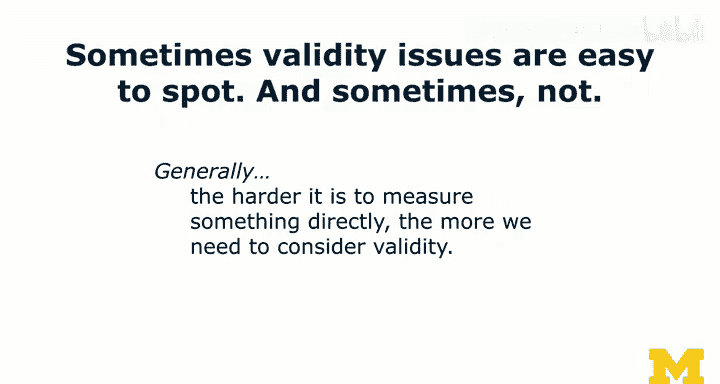
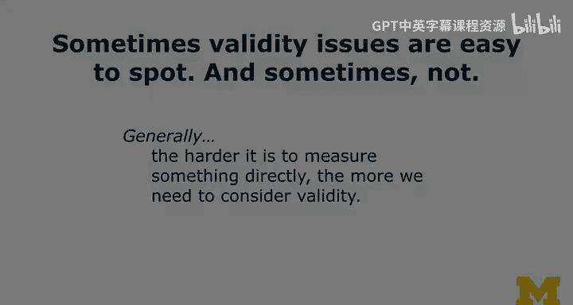

# 密歇根大学《理解数据：导航统计、科学和AI-Understanding Data Navigating Statistics, Science, and AI》 - P14：13_效度：我们究竟在测量什么.zh_en - GPT中英字幕课程资源 - BV1pU4NzuEvt

I have some breaking science news for you Did you know that I can determine what breakfast cereal most resembles you based on how you would pick a day of outfits。

 and if you're willing to tell me about your dream birthday party。

 I can precisely determine which 90s heartthrob is your soulmate。Do you believe this？

Maybe you should be a little bit skeptical， in fact， these examples remind me of a mood ring。

 so a mood ring was a fad toy from the 1970s and what it was was a rock that people would wear on their fingers or on their wrists and supposedly it would change colors that tell you how you feel and you could look at the color and get a determination for if you're angry or happy or peaceful。

Now， all of these examples I've shown you so far， they might be giving you a little bit of a feeling that something's not right。

What you're likely feeling is that there's something funky about what is scientifically called validity validity。

 this is a non technicalchnical definition， more of an intuitive definition。

 but validity is about how well the thing that we're measuring matches the thing that we want to understand。

So let's look at some examples of high validity。If I wanted to understand how heavy a chicken is。

I might want to look at its weight， weight is a valid measure of heavy。

 and a scale is a valid instrument to measure weight。And of course。

 I've got to be measuring the correct animal， so if I were to put Melvin on the scale and I know that my scale is a valid measure of weight。

 then I'm doing a pretty good job of getting a valid measure of how heavy a chicken is。

Another example， if I want to understand how cold it is outside。

 then temperature is a valid measure of cold。And the thermometer is a valid instrument to measure temperature。

And of course I've got to be outside， I have to take my measurement outdoors。

 so I can't take it indoors to understand how cold it is outside。What about low validity？

What if I were to use a tape measure to understand how heavy a chicken is。

 I could be using an extremely precise tape measure。

 but it still doesn't really tell me how heavy the chicken is that's not quite valid。

 I could use the ruler to understand how cold it is outside， again， could be an excellent ruler。

 not a valid measure of how cold it is outdoors。And this is because measuring length doesn't lead to understanding of weight or temperature。

Another example might be weighing a penguin to understand how heavy a chicken is。

 We could have an excellent， excellent high quality measurement of the penguin still not related to how heavy the chicken is。

And that's because measuring something other than chickens doesn't lead to understanding chickens。

So let's consider our presidential poll again。What was it that we were trying to understand？

In that example， we were looking at approval of the current president among citizens of our country。

What could affect the validity of the poll？Though there are several things。

 Perhaps the poll is confusingly worded。 If it was confusingly worded。

 people may not have known exactly what question they were being asked。

 or they might have just guessed。What if the poll asked a related but different question。

 For example， the poll might ask， do you plan to vote again for the president in the next election that is probably related to approval。

 but it's not exactly the same， there might be people who disapprove。

 but are still planning to vote because of they think that this president is better than the alternative。

It could also be that the poll over representspresent some groups of people。

 so if the poll is accessing most of its participants by phone， lots of people don't pick up phones。

 in fact， I don't like to pick up the phones， so people like me who are maybe a little bit more introverted and don't want to be picking up a phone call from a random number are perhaps over underrepresented or people who don't own phones or landlines are also going to be underrepresented。

 whereas people who do reliably pick up the phone might represent a fairly not random proportion of our population。

So if any of these things were true。Then it's possible that we could have an extremely certain estimate。

 right， so we could have a very small margin of error， which might correspond to having， you know。

 a huge， huge， huge number of people participating。

But we still might not have good correspondence between what we measured and what our question was。

And if the poll is not a valid measure， then it doesn't matter how many people you ask because no amount of data。

 if it's the wrong sort of data will answer that question。

How do validity issues happen There's a couple of broad patterns about how these concur there's many。

 many ways， but here's just a couple things to think about。😊，One example is in defining categories。

 so we often want to categorize things so we can measure things that are similar。

 but creating categories from real data can be surprisingly hard， so here's one example。

 we often want to understand what were the causes of death in a country。However。

 there can be huge regional variations in how deaths are recorded examples might be that you know in some locations。

 you know， from state to state， there could be differences in。😊。

What sort of official actually records death is it a medical examiner。

 is it a technician with very little training， is it you know a physician who that is would depend by the region and so all of those people could potentially have you know different ways of reporting there might be pressures in some parts of the state or country to attribute deaths to certain causes than in others。

 there can be huge variances about how deaths are recorded and who does the recording。

Another issue is challenges in reporting， it can be hard to get accurate selfre about sensitive topics。

 so imagine asking people how often do you exercise how many fruits do you eat a day or how often do you tell a lie？

In all of these examples， there might be some pressure to inflate or deflate your answer so that you look like a good and socially acceptable person。

Another issue is in generalizing the results， a research question that's of active interest is can we use social media to understand feelings。

 beliefs and values in our broader society， but here there's an important question about should we generalize those results？

If we study social media users， can we actually learn about people offline or are we just studying social media users。

 social media users may differ from people who are offline in a lot of important ways that know are sometimes obvious and sometimes not。

Now experts can legitimately disagree about validity， for example。

 in this you know example of social media research。

 there is legitimate disagreement and it's still an area of active discovery about in what ways can we reasonably generalize from social media users to the rest of the population and in what ways are social media users behaviors just restricted to them so that's kind of you know an ongoing area of discovery and discussion but there are also times where there really is not legitimate disagreement like in the mood ring it turns out what the mood ring measures is body temperature so it's a fairly valid measure of body temperature but when people interpret that as being a measure of your mood that's where we lose validity and there's not a lot of expert disagreement about that so sometimes validity issues can be easy to spot like in the mood ring but sometimes they're not。

And generally， the harder it is to measure something directly。

 the more that we need to be thinking about the validity of our measurements。

