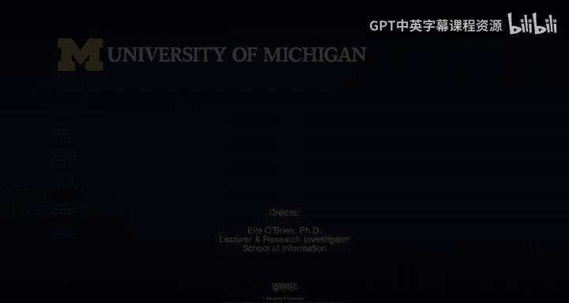
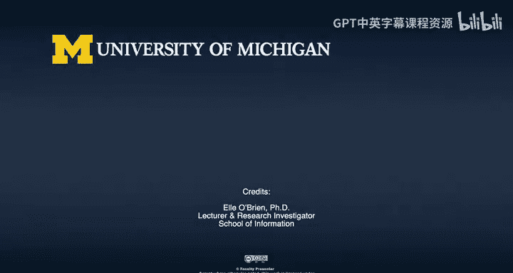

# 密歇根大学《理解数据：导航统计、科学和AI-Understanding Data Navigating Statistics, Science, and AI》 - P15：14_模块3导论：数字叙事中的统计学.zh_en - GPT中英字幕课程资源 - BV1pU4NzuEvt

Last week， we developed our intuitions about uncertainty。

 We learned that randomness and noise is unavoidable。

 which can be frustrating for people who want to know everything。

But even though we can never be completely certain。

 we don't have to despair that nothing will ever make sense。 either。

 Statistic thinking gives us a middle path， but statistical thinking can be unfamiliar。

Even though our brains are extraordinarily good at spotting patterns amongst noise。

 talking about statistics and numbers takes a lot of practice for most of us。

 it doesn't come naturally。Next we're going to look at some real examples of how statistical communication can go right or wrong remember we don't do statistics just because we love spending time with numbers statistics help us create knowledge or at least describe complicated things in simpler terms。

So when we encounter statistics in the world， we need to remember that they often serve a rhetorical purpose。

 they're put in front of you by a human storyteller。

 storytellers might be trying to enlighten you about something they find interesting or important。

They might hope to persuade you of theirre position。

 or they might be inviting you to join in the act of sense making。

We'll start with the greatest hits collection of tensions in statistical storytelling。

 these are helpful considerations to keep in mind as you develop a critical eye about statistics。

