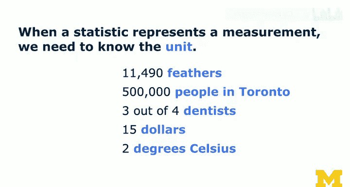
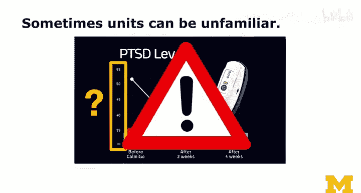
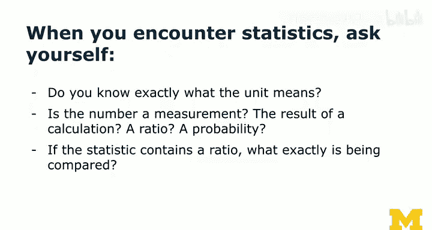

# 密歇根大学《理解数据：导航统计、科学和AI-Understanding Data Navigating Statistics, Science, and AI》 - P16：15_单位、量纲与估算.zh_en - GPT中英字幕课程资源 - BV1pU4NzuEvt

Let's recall what a statistic means。A statistic is a calculation about data。

 and data is a value plus context。So remember when we were counting Melvin's feathers back in week one。

We counted that he had 11，490 which is a value， but everything else is context right there's these feathers and what were they counted on。

 it was Melvin and who verified it， that was to University of Michigan Chi scientists and what day did we do this on all of this context gives the number meaning so one important aspect of context is what was the measurement unit？

When a statistic represents a measurement， we have to know the unit。So we know that Melvin had 11。

490 feathers， the feathers are the unit。A unit could be how many people in Toronto did something interesting。

You might hear three out of four dentists recommended toothpaste， dentists is the unit。

 dollars or whatever the unit of currency is where you live is another popular unit。

Or we might be talking about a temperature in which case it's especially important to know well what scale are we using。

 and so here I have two degrees Celsius。

Sometimes a unit can be quite unfamiliar though Here's an example of an advertisement I saw online。

 It was a targeted advertisement on social media for a device that seems to be marketed to treat posttraumatic stress disorder or PTSD and on the Y axis here they have these numbers which I guess are the PTSD level Now I am not somebody who specializes in posttraumatic stress disorder I don't know how PTSD is measured and so I don't know what these numbers are at all。

 I have absolutely no idea where they're from and does changing by five units on this scale what does that mean like how many of these do you need to change before somebody start saying wellow my PTSD symptoms feel like they're getting better I just don't know so for me this is a big warning sign I immediately start thinking I really can't interpret this chart because I do not know what those units are Now another thing to。

Keep in mind is that some statistics are not exactly measurements they're derived from other statistics so one example is smart scale smart scales are a kind of you know their body weight scales that you can buy for your home and a lot of them claim that they measure body fat percentage now I looked into this a little bit deeper and it turns out that it's actually extremely hard to directly measure body fat percentage and your bathroom scale is not doing a direct measurement of that it really is not equipped to do that so what this actually does is it measures other things that it can from when you stand on it and then it plugs those numbers about I think it was about bioelectric impedance so something about how electricity travels through your body and it uses that number puts it into a formula that's built into the scales computer。

And spits out an estimate of what it thinks your body fat percentage must be。

Now derived estimates like this are crucial for a lot of kinds of science， so in fact。

 in neuroimaging or brain imaging， we really can't directly measure what sort of brain activity is going on in a person who's you know behaving we really don't have a nice and easy way to stick something to measure your neural activity inside your brain while you're up and moving about and doing all sorts of things that we might like to study so we have lots of measurement techniques that use things like blood flow or electrical activity at a very co level to try to estimate what regions of the brain are active during certain kinds of behavioral tasks like listening to something or viewing a movie and so this is how a lot of neuroscience is done we often can't get the direct measurement that we want so a derived estimate is basically the best。

We can get so I'm saying derived estimates are imperfect right and it's important to know that whenever we're talking about them。

 we're not talking about a direct measurement， we're talking about a measurement that then is transformed via some formulas into an estimate for something else and they can be a vary in quality in fact it turns out that the bathroom scale example a lot of these are regarded by people who study body composition as not particularly useful enough for anybody to gain information from at home。

 but in neuroscience we are sometimes able to put together you experiments that still tell us something because of we can invest in very high quality equipment and hopefully use statistical analyses that you appropriately handle the fact that we have some uncertainty that we're not measuring brain activity directly。

Now， another part of context is that numbers can have some flavors， kind of like ice cream。

 and here's what I mean。Some numbers are ratios， so three out of four dentists。

 half of all Australians， four times as many visitors as last year。

All of these are secretly a ratioio。And ratios are comparisons。

 they tell you the relationship between two quantities。Three of the four dentists that we asked。

 half of all Australians visitors this year compared to visitors last year， right。

 all of these are making a comparison。A number can also be a percent。

Sometimes you'll see on the label of a package at the supermarket now with 60% more juice。

Now this is also secretly a ratio， 60% is the same as 60 in 100。

And percents can also represent probabilities， so if you hear that there is a 70% chance of rain。

This isn't really a measurement right we can't have you know we can't measure exactly like I'm not sure how you would measure that directly。

 but this is a statement about things that could happen。

 it's saying that there is a probability of rain and we estimate it around 70% chance。

Another way of thinking about this is if we could simulate， you know， today。

 100 times 70 times we would end up with rain。Per sense and ratios can be trickier than they look。

For example， here's one that I hear all the time， I'm not even sure where it comes from because I hear it so much。

 50% of marriages end in divorce， so let's try to unpack this percent。Now。

 as best as I could tell from looking into this number and I've put a good reference here for it。

 it seems like this statistic probably comes from a rough count that at least， you know。

 based on some data in the United States where I live。

 there was a time that for every 100 marriages occurring in a year， there were 50 divorces。

 so there were twice as many marriages happening as there were divorces。

But what does marriage mean exactly though？There's a really subtle distinction here that can be made。

One way that we could think about marriages is just any marriage ending in divorce。

 the unit is a marriage。But one person could have several marriages throughout their life。

 On the other hand， we could be measuring people experiencing divorce in their lifetime。

The unit is a person， not a marriage。And so that means that， you know。

 actually you either do or you don't experience divorce in your lifetime。

 you will either have experienced it or not， no matter how many marriages or nonmarriages you've had。

Now by necessity， the percent of people who have experienced a divorce is lower than the percent of marriages that end in divorce and just take a second to think about why that must be true right that people can have multiple marriages and some people do have many marriages so the percent of people who have experienced divorce in their lifetime is going to be lower than the percent of marriages that end in divorce in this example it turned out what was being reported or the closest that I could find to a citation for that 50% of marriages end in divorce is more about marriages。

 it's not actually about the chance that I will experience a divorce in my lifetime or anyone else will we're talking about marriages ending in divorce in that statistic we're not talking about people experiencing a divorce and those are actually different units so to sum all this up when you encounter statistics。

Consider asking yourself。Do you know exactly what the unit means？

Is the number of measurement or is it the result of the calculation from some other measurements。

 is it a ratio， a comparison， or is it a probability？And if the statistic contains a ratio。

 what exactly is being compared， make sure you know exactly what the two numbers that are being compared are。

