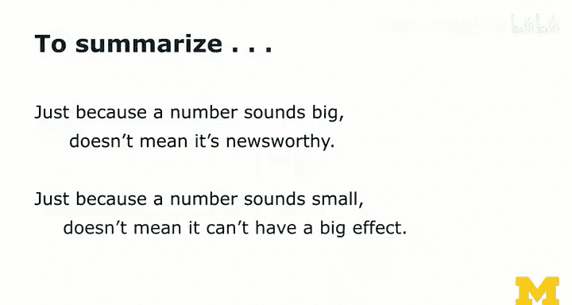

# 密歇根大学《理解数据：导航统计、科学和AI-Understanding Data Navigating Statistics, Science, and AI》 - P17：16_理解大数与小数的意义.zh_en - GPT中英字幕课程资源 - BV1pU4NzuEvt

When we're dealing with topics that are unfamiliar to us。

 it can be extra hard to contextualize numbers， especially when those numbers are really big。

So here's an example， the number of people without a family doctor in the province。

 British Columbia has grown from about 340，000 in 2003 to 908。

000 in 2017 and is expected to be higher this year。

Now I don't know about you but I have a lot of trouble picturing what 908000 people is like that's very tricky for me I don't have a good grounding for that it's not as easy as picturing 10 people or 10 and I also don't know how extraordinary this is how many people in British Columbia normally are without a family doctor is this really a departure from what's typical I don't know because I don't know what those numbers are ordinarily and I also don't know what percent this is of the whole population so for me to understand this I might like to know well how many people are actually in the province so I could understand about what proportion of them are affected。

Here's another example， a record volume of 354，500 tons of agricultural products was carried on vessels leaving Ukrainian ports on Monday as part of the agreement。

Now I really do not know how many tons of agricultural products are normally leaving ports。

 I don't know what a big number is like， I know the 354，500 sounds like a big number。

 it's certainly bigger than numbers I normally think about。

 but how much bigger than normal is that for agricultural trade， I really don't know here。

So what we've come up against is that it can be challenging to think about really big numbers。

 especially when they occur in contexts that are just unfamiliar to us and you know I don't want to just look at news and go wow。

 that's a big number so it must be important， of course that's not always true。

 sometimes the number could be big but maybe it's not very newsworthy， you know what if 354。

500 tons was actually quite normal， I wouldn't really be able to know。

So it's important to distinguish that big isn't the same as newsworthy。

 newsworthy means that something is you know out of the ordinary or if it is ordinary。

 that we're looking at it through new eyes somehow。

And so we really do need to use context like benchmarks for comparison to understand what's being reported。

 particularly when numbers are on a scale that we're just not used to thinking about and about topics that occur on scales that are unfamiliar to us。

At the other end of the spectrum we have really small numbers now rare occurrences can happen a lot in a big world and I'm going to talk a little bit more about this here's an example each year in the United States about one in100 pregnancies result in severe maternal health complications and this comes from CDC annual reporting and so the real number is actually a little bit higher it's between one in 100 and1 in 200 but I'm rounding it to one in 100 for simplicity and a severe maternal health complications is defined as an event that was recorded at a hospital where you know the person giving birth needed to needed major intervention in order to you avoid impairment or injury or death and just to note that this statistic you know we have maternal health complications is being measured here and so the statistic might not be adequately。

Cpturing data about transgender parents in the United States。

So if we unpack this a little bit further， that we have we start with one in 100 pregnancies in the US poses a serious maternal health risk。

And there were more than 3。6 million births in 2021 in the United States。

 this actually comes out to there being more than 50。

000 women with severe pregnancy complications in a year。And these numbers。

 you know this calculation it is from， I think like 2014 or 2015。

 but as far as I can tell it is you know pretty consistent。

 there's no reason to think it's gone down so we have an estimate that actually we're seeing you know this considerable number of people who have a severe complication during pregnancy so it's both true that there's one in100 pregnancies which sounds kind of rare that have a serious risk to the mother。

 but that's also about 50，000 Americans so two ways of looking at it。

 you know something that's somewhat rare but with a lot of people having a lot of births that can actually be a substantial number of events。

 so to summarize just because a number sounds big， it doesn't mean it's newsworthy。

 we need context and the bigger the number the more likely we are to just not have an internal benchmark about it and to need some extra cues that help us put it in context。

On the other hand， just because a number sounds small。

 that doesn't mean it can't have a big effect if something is relatively rare。

 but it can happen to a lot of people if there's a lot of events in a big world with a lot of time that can still add up to a lot of occurrences that can affect a lot of people。

